<p align="center"></p>

<p align="center">
  <a href="https://kairos-76a0d.web.app/"><b>Live app</b></a> ·
  <a href="docs/01_PRODUCT.md">Product</a> ·
  <a href="docs/02_ARCHITECTURE.md">Architecture</a> ·
  <a href="docs/05_ALGORITHMS.md">Algorithms</a> ·
  <a href="docs/06_ROADMAP.md">Roadmap</a>
</p>

<p align="center">
  
  
  
  
  
  
</p>

**Kairos** (Greek for *the right moment*) is a free practice platform for JEE Main, NEET UG, IAT and GATE DA, plus DSA and system-design interview prep. You give it your exam date and it works backwards, so it decides **what you solve today** instead of leaving you to guess. It re-sizes the plan every morning, so you never cram at the end.

<p align="center"></p>

## Why it's different

| | |
|---|---|
| **Date-first planning** | Days left, weak topics, what you're forgetting and what you skipped all set today's load. It shows the reason, not just a list. |
| **A real exam screen** | An exam-style CBT interface with a question palette, section timer and mark-for-review. Practice and mocks share one flow. |
| **Honest pace** | A pace ratio (ρ) compares work left with time left. When you fall behind, you choose: add minutes or drop low-weight chapters. |
| **Animated DSA traces** | 117 problems with step-by-step traces, beginner and optimised variants, and highlighted costly lines. |
| **Analysis that points somewhere** | Mastery, mocks, mistakes, saved answers and your own questions in one place. |
| **Private by default** | Guest mode keeps everything on your device. Signing in is optional, and your progress migrates when you do. |

## Planned backwards

<p align="center"></p>

Buffer days are built in, with one for every seven work days. The last 15 days run a daily full mock at real exam time, and the last two taper to light revision.

## Architecture

```
app/        React 19 PWA: CBT, practice, planner, analytics, upload, onboarding
core/       pure TypeScript domain logic: scoring, Elo, FSRS, planner, paper generator, pace
pipeline/   Python: acquire → extract → validate → dedupe → tag → calibrate → publish
content/    blueprints (exam patterns as config), taxonomy, exam calendar
firestore-tests/  security-rule tests
docs/       product, algorithms, data model, roadmap
```

- **Exam patterns are config.** Counts and marks come from `content/blueprints/*.json`, never from code.
- **`core` is pure TS.** It has no Firebase or React imports and is fully unit-tested.
- **The question bank is static.** It ships as versioned JSON shards, and Firestore holds per-user state only.
- **One batched write per session.** Events buffer in IndexedDB, so the free tier stays free.
- **Mock answer keys never reach the client.**

## Run it locally

```bash
pnpm install
pnpm dev          # app on localhost
pnpm test         # core + app unit tests
pnpm e2e          # playwright
pnpm build        # typecheck + production build
```

Requires Node 20+ and pnpm. See [CLAUDE.md](CLAUDE.md) and [docs/](docs/) for the full working agreements.

## Content and privacy

Questions come from official papers and answer keys, open datasets, user uploads and original solutions. Nothing is scraped from competitors. Many users are minors, so attempt data is used only for the student's own learning (DPDP-aware, with a parental-consent flow under 18).

<p align="center"><sub>Built with care for students who'd rather practise well than practise more.</sub></p>
