# GATE DA 2027 Question Bank (Days 1-32)

1206 questions with options, answers and worked solutions. Math is LaTeX. Figures are PNGs in `figures/` with TikZ source alongside. Shared context blocks (datasets, graphs, conventions) are printed once, where they start applying; each question lists the context ids it uses.


# Part: Days 1-4: Probability and Statistics


## Day 1: Day 1 — Counting, Axioms, Conditional Probability, Bayes, Independence


### Q1.01
*NAT · 2 marks · Counting*

The number of non-negative integer solutions of $x_1+x_2+x_3+x_4=12$ with $x_1\ge 2$ and $x_2\le 3$ is ____.

**Answer:** 202

**Solution:**

Idea: shift lower bounds, then subtract violations of the upper bound.
Work: $y_1=x_1-2$: $y_1+x_2+x_3+x_4=10$ gives $\binom{13}{3}=286$. Violations $x_2\ge4$ (set $z=x_2-4$): sum 6 gives $\binom93=84$. Answer $286-84=202$.


### Q1.02
*NAT · 2 marks · Counting*

Ten identical balls are put into 4 distinct boxes so that \emph{no box holds more than 4 balls}. The number of ways is ____.

**Answer:** 68

**Solution:**

Idea: inclusion--exclusion on the ``bad'' events $x_i\ge5$.
Work: $\binom{13}{3}-\binom41\binom{8}{3}+\binom42\binom{3}{3}=286-224+6=68$. (Three boxes $\ge5$ would need 15 balls --- impossible.)
Note: general form: $\sum_k(-1)^k\binom{m}{k}\binom{n-k(c+1)+m-1}{m-1}$ for $m$ boxes, cap $c$.


### Q1.03
*NAT · 1 mark · Counting*

The number of onto functions from a 5-element set to a 3-element set is ____.

**Answer:** 150

**Solution:**

$3^5-\binom31 2^5+\binom32 1^5=243-96+3=150$ $\;(=3!\,S(5,3)=6\times25)$.


### Q1.04
*NAT · 1 mark · Counting*

The number of ways 5 boys and 5 girls can sit around a round table so that boys and girls alternate is ____.

**Answer:** 2880

**Solution:**

Seat the boys round the table: $(5-1)!=24$. Girls fill the 5 gaps: $5!=120$. Total $2880$.


### Q1.05
*NAT · 2 marks · Counting*

The letters of BANANAS are arranged at random. The probability that no two A's are adjacent is ____\ (round to 3 decimals).

**Answer:** 0.286  (solution header: $2/7\approx0.286$)

**Solution:**

Idea: gap method --- place the others first, then drop the A's into gaps.
Work: Total arrangements $\frac{7!}{3!\,2!}=420$. Arrange B, N, N, S: $\frac{4!}{2!}=12$; choose 3 of the 5 gaps for the A's: $\binom53=10$. Favourable $120$, so $P=\frac{120}{420}=\frac27$.


### Q1.06
*NAT · 1 mark · Counting*

The letters of STATISTICS are arranged at random. The probability that the three S's are together is ____\ (round to 4 decimals).

**Answer:** 0.0667  (solution header: $1/15\approx0.0667$)

**Solution:**

Idea: only the \emph{positions} of the S's matter; they form a uniformly random 3-subset of the 10 positions.
Work: Consecutive triples: 8; all triples $\binom{10}{3}=120$, so $P=\frac{8}{120}=\frac1{15}$.
Note: Long way: $\frac{8!/(3!\,2!)}{10!/(3!\,3!\,2!)}=\frac{3360}{50400}$ --- same answer.


### Q1.07
*MCQ · 1 mark · Counting*

The number of binary strings of length 10 with no two consecutive 1s is

- **(A)** 89
- **(B)** 144
- **(C)** 233
- **(D)** 512

**Answer:** B  (solution header: (B) 144)

**Solution:**

Idea: condition on the last bit: ending in 0 → any valid string of length $n-1$; ending in 1 → must be ``01'' after a valid string of length $n-2$. So $a_n=a_{n-1}+a_{n-2}$, $a_1=2$, $a_2=3$.
Work: $2,3,5,8,13,21,34,55,89,144$ ⇒ $a_{10}=144=F_{12}$.


### Q1.08
*NAT · 2 marks · Counting*

A 5-member committee is chosen from 6 men and 4 women with at least 2 women. A particular man $M$ and a particular woman $W$ refuse to serve together. The number of possible committees is ____.

**Answer:** 140

**Solution:**

All committees with $\ge2$ women: $\binom42\binom63+\binom43\binom62+\binom44\binom61=120+60+6=186$.
Subtract those containing both $M$ and $W$: choose 3 more from 5 men + 3 women with at least 1 more woman: $\binom83-\binom53=46$. Answer $186-46=140$.


### Q1.09
*NAT · 1 mark · Counting*

The number of integers in $\{1,2,\dots,1000\}$ divisible by 2, 3 or 5 is ____.

**Answer:** 734

**Solution:**

$500+333+200-166-100-66+33=734$ (floors of $1000/d$ for $d=2,3,5,6,10,15,30$).


### Q1.10
*NAT · 1 mark · Counting*

Five letters are placed at random into five addressed envelopes, one per envelope. The probability that \emph{exactly two} letters reach the correct envelope is ____\ (round to 3 decimals).

**Answer:** 0.167  (solution header: $1/6\approx0.167$)

**Solution:**

Choose the 2 correct letters $\binom52=10$; derange the other 3: $D_3=2$. $P=\frac{20}{120}=\frac16$.
Note: $P(\text{exactly }k\text{ fixed})=\binom nk D_{n-k}/n!\approx e^{-1}/k!$.


### Q1.11
*NAT · 1 mark · Counting*

Four people throw their hats in a pile and each picks one at random. The probability that \emph{at least one} person gets their own hat is ____\ (round to 3 decimals).

**Answer:** 0.625

**Solution:**

$P(\text{at least one})=1-\frac{D_4}{4!}=1-\frac{9}{24}=0.625$. Equivalently $1-\frac1{2!}+\frac1{3!}-\frac1{4!}$. As $n\to\infty$ this tends to $1-e^{-1}\approx0.632$.


### Q1.12
*MCQ · 2 marks · Classical and Geometric Probability*

A subset $M$ is chosen uniformly at random from all \emph{non-empty} subsets of $S=\{1,2,\dots,20\}$. The probability that the sum of the elements of $M$ is odd is

- **(A)** $\dfrac12$
- **(B)** $\dfrac{2^{19}}{2^{20}-1}$
- **(C)** $\dfrac{2^{19}-1}{2^{20}-1}$
- **(D)** $\dfrac{2^{10}}{2^{20}-1}$

**Answer:** B  (solution header: (B))

**Solution:**

Idea: toggle element 1: $T\mapsto T\triangle\{1\}$ flips the parity of the sum, so exactly half of all $2^{20}$ subsets have odd sum, i.e.\ $2^{19}$.
Work: The empty set has even sum, so all $2^{19}$ odd-sum subsets are non-empty. Sample space $2^{20}-1$. $P=\frac{2^{19}}{2^{20}-1}$.
Trap: (A) forgets ``non-empty''; (C) wrongly removes the empty set from the odd count.
Note: PYQ 2026 variant: \emph{product} even. Product odd iff $M\subseteq$ odds, so $P(\text{even})=1-\frac{2^{1013}-1}{2^{2026}-1}$.


### Q1.13
*NAT · 2 marks · Classical and Geometric Probability*

A program outputs a non-negative integer solution of $n_1+n_2+n_3+n_4=20$, every solution being equally likely. The probability that all four are positive is ____\ (round to 3 decimals).

**Answer:** 0.547

**Solution:**

All solutions $\binom{23}{3}=1771$; positive solutions $\binom{19}{3}=969$; ratio $0.547$.
Trap: stars-and-bars counts are equally likely here \emph{because the question says solutions are equally likely}. If instead 20 distinct balls were thrown into 4 boxes, solutions would not be equally likely.


### Q1.14
*NAT · 1 mark · Classical and Geometric Probability*

Four cards are drawn without replacement from a standard 52-card deck. The probability that all four are of different suits is ____\ (round to 3 decimals).

**Answer:** 0.105–0.106  (solution header: 0.105)

**Solution:**

Sequentially $1\cdot\frac{39}{51}\cdot\frac{26}{50}\cdot\frac{13}{49}=0.1055$, or $\frac{13^4}{\binom{52}{4}}=\frac{28561}{270725}$.


### Q1.15
*NAT · 2 marks · Classical and Geometric Probability*

A 5-card hand is dealt from a standard deck. The probability that it is exactly ``two pair'' (two cards of one rank, two of another rank, one card of a third rank) is ____\ (round to 4 decimals).

**Answer:** 0.0475

**Solution:**

Idea: choose the \emph{set} of two pair ranks, not an ordered pair.
Work: $\binom{13}{2}\binom42^2\cdot44=78\cdot36\cdot44=123552$; $\binom{52}{5}=2598960$; $P=0.0475$.
Trap: $13\cdot12$ for the pair ranks double-counts (gives 0.0951). The fifth card: $52-8=44$ (not of either pair rank).


### Q1.16
*NAT · 1 mark · Classical and Geometric Probability*

Three fair dice are rolled. The probability that the sum is 10 is ____\ (round to 3 decimals).

**Answer:** 0.125

**Solution:**

Solutions of $a+b+c=10$, $1\le a,b,c\le6$: with $y_i=a_i-1$, $\sum y=7$, $y_i\le5$: $\binom92-3\binom32=36-9=27$. $P=\frac{27}{216}=0.125$.
Note: sums 10 and 11 are the most likely totals (27 ways each).


### Q1.17
*NAT · 1 mark · Classical and Geometric Probability*

A three-digit number (100 to 999) is chosen at random. The probability that its digits are strictly increasing from left to right is ____\ (round to 4 decimals).

**Answer:** 0.0933

**Solution:**

Idea: a strictly increasing digit string is just a 3-subset written in order --- and 0 can never appear (it cannot lead and nothing smaller can precede it).
Work: $\binom93=84$; $P=\frac{84}{900}=0.0933$.


### Q1.18
*NAT · 1 mark · Classical and Geometric Probability*

A fair die is rolled 6 times. The probability that every face appears exactly once is ____\ (round to 4 decimals).

**Answer:** 0.0154

**Solution:**

$\frac{6!}{6^6}=\frac{720}{46656}=0.0154$.


### Q1.19
*NAT · 1 mark · Classical and Geometric Probability*

Five people's birth-months are independent and uniform over the 12 months. The probability that at least two share a birth-month is ____\ (round to 3 decimals).

**Answer:** 0.618

**Solution:**

$1-\frac{12\cdot11\cdot10\cdot9\cdot8}{12^5}=1-\frac{95040}{248832}=0.618$.


### Q1.20
*NAT · 2 marks · Classical and Geometric Probability*

Two friends arrive independently and uniformly at random between 12:00 and 13:00. Each waits 15 minutes for the other and then leaves. The probability that they meet is ____\ (round to 4 decimals).

**Answer:** 0.4375

**Solution:**

Meet iff $|X-Y|\le15$ on the $60\times60$ square; the two non-meeting corner triangles have legs 45.\\

[FIGURE 1: figures/Q1_20_s_f1_aab91558.png]

$P=1-\dfrac{2\cdot\frac12\cdot45^2}{60^2}=1-\left(\tfrac34\right)^2=0.4375.$\\
General: waiting time $w$ in a window $T$ gives $P=1-(1-w/T)^2$.

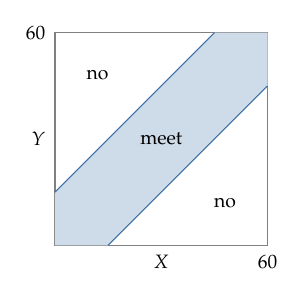

<details><summary>TikZ source</summary>

```latex
\begin{tikzpicture}[scale=0.045]
\draw[gray] (0,0) rectangle (60,60);
\fill[accent!25] (0,0)--(15,0)--(60,45)--(60,60)--(45,60)--(0,15)--cycle;
\draw[accent] (15,0)--(60,45) (0,15)--(45,60);
\node[font=\scriptsize] at (30,30) {meet};
\node[font=\scriptsize] at (12,48) {no};\node[font=\scriptsize] at (48,12) {no};
\node[font=\scriptsize,below] at (60,0) {60};\node[font=\scriptsize,left] at (0,60) {60};
\node[font=\scriptsize,below] at (30,0) {$X$};\node[font=\scriptsize,left] at (0,30) {$Y$};
\end{tikzpicture}
```
</details>


### Q1.21
*MCQ · 2 marks · Classical and Geometric Probability*

A stick of unit length is broken at two points chosen independently and uniformly along its length. The probability that the three pieces can form a triangle is

- **(A)** $\tfrac18$
- **(B)** $\tfrac14$
- **(C)** $\tfrac13$
- **(D)** $\tfrac12$

**Answer:** B  (solution header: (B) $\tfrac14$)

**Solution:**

Idea: triangle inequality $\iff$ every piece $<\tfrac12$.\\

[FIGURE 1: figures/Q1_21_s_f1_8ef05d10.png]

For $U<V$ the pieces are $U$, $V-U$, $1-V$. All $<\frac12$ ⇒ $U<\frac12$, $V>\frac12$, $V-U<\frac12$: a triangle of area $\frac18$. By symmetry the same for $V<U$. Total $\frac14$.

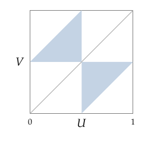

<details><summary>TikZ source</summary>

```latex
\begin{tikzpicture}[scale=2.2]
\draw[gray] (0,0) rectangle (1,1);
\fill[accent!30] (0,0.5)--(0.5,0.5)--(0.5,1)--cycle;
\fill[accent!30] (0.5,0)--(1,0.5)--(0.5,0.5)--cycle;
\draw[gray!60] (0,0)--(1,1);
\node[font=\scriptsize,below] at (0.5,0) {$U$};\node[font=\scriptsize,left] at (0,0.5) {$V$};
\node[font=\tiny,below] at (0,0) {0};\node[font=\tiny,below] at (1,0) {1};
\end{tikzpicture}
```
</details>


### Q1.22
*MSQ · 1 mark · Axioms, Events and Independence*

For arbitrary events $A,B,C$, which of the following are always true?

- **(A)** $P(A\setminus B)=P(A)-P(A\cap B)$
- **(B)** If $P(A)=P(B)=1$ then $P(A\cap B)=1$
- **(C)** $P(A\cup B\cup C)\le P(A)+P(B)+P(C)$
- **(D)** If $P(A)=0$ then $A=\varnothing$

**Answer:** A, B, C  (solution header: (A), (B), (C))

**Solution:**

(A) $P(A)=P(A\cap B)+P(A\cap B^c)$. (B) $P(A\cap B)\ge P(A)+P(B)-1=1$. (C) Boole's (union) bound. (D) ✗ events of probability 0 need not be empty: $\{X=0.5\}$ for continuous $X$.


### Q1.23
*MSQ · 2 marks · Axioms, Events and Independence*

$P(A)=0.4$, $P(B)=0.5$, $P(A\cup B)=0.7$. Which are correct?

- **(A)** $A$ and $B$ are mutually exclusive
- **(B)** $A^c$ and $B$ are independent
- **(C)** $P(A\mid B)=0.4$
- **(D)** $P(\text{exactly one of }A,B)=0.3$

**Answer:** B, C  (solution header: (B), (C))

**Solution:**

$P(A\cap B)=0.4+0.5-0.7=0.2=P(A)P(B)$ ⇒ independent. (A) ✗. (B) ✓ complements inherit independence. (C) ✓ $0.2/0.5$. (D) ✗ $P(A\triangle B)=0.7-0.2=0.5$.


### Q1.24
*MCQ · 1 mark · Axioms, Events and Independence*

Two fair coins are tossed. $A$ = first toss is H, $B$ = second toss is H, $C$ = exactly one H. Then $A,B,C$ are

- **(A)** mutually independent
- **(B)** pairwise but not mutually independent
- **(C)** not pairwise independent
- **(D)** mutually exclusive

**Answer:** B  (solution header: (B))

**Solution:**

Each pairwise intersection ($HH$, $HT$, $TH$) has probability $\frac14=\frac12\cdot\frac12$. But $A\cap B\cap C=\varnothing$, so $0\ne\frac18$.


### Q1.25
*MSQ · 1 mark · Axioms, Events and Independence*

A fair die is rolled. $A=\{2,4,6\}$, $B=\{1,2,3,4\}$, $C=\{1,2,3\}$. Which are correct?

- **(A)** $A$ and $B$ are independent
- **(B)** $A$ and $C$ are independent
- **(C)** $B$ and $C$ are independent
- **(D)** $A$ and $B^c$ are independent

**Answer:** A, D  (solution header: (A), (D))

**Solution:**

$A\cap B=\{2,4\}$: $\frac13=\frac12\cdot\frac23$ ✓. $A\cap C=\{2\}$: $\frac16\ne\frac14$ ✗. $B\cap C=C$: $\frac12\ne\frac13$ ✗. (D) follows from (A).
Trap: independence is a numerical coincidence of probabilities, not a property you can ``see'' from the sets.


### Q1.26
*MSQ · 2 marks · Axioms, Events and Independence*

For events with $0<P(A),P(B)<1$, which are always true?

- **(A)** If $P(A\mid B)>P(A)$ then $P(B\mid A)>P(B)$
- **(B)** If $A\subset B$ then $A$ and $B$ are independent
- **(C)** An event $E$ is independent of itself if and only if $P(E)\in\{0,1\}$
- **(D)** $P(A\mid B)+P(A\mid B^c)=1$

**Answer:** A, C  (solution header: (A), (C))

**Solution:**

(A) both sides say $P(A\cap B)>P(A)P(B)$. (B) ✗ $P(A\cap B)=P(A)\ne P(A)P(B)$ since $P(B)<1$. (C) $P(E)=P(E)^2$. (D) ✗ the identity is $P(A\mid B)+P(A^c\mid B)=1$.


### Q1.27
*NAT · 1 mark · Axioms, Events and Independence*

If $P(A)=0.7$ and $P(B)=0.6$, the minimum possible value of $P(A\cap B)$ is ____.

**Answer:** 0.3

**Solution:**

$\max(0,P(A)+P(B)-1)\le P(A\cap B)\le\min(P(A),P(B))$, so $[0.3,\,0.6]$.


### Q1.28
*NAT · 1 mark · Conditional Probability, Total Probability and Bayes*

Two fair dice are rolled. Given that the sum is 8, the probability that at least one die shows 6 is ____.

**Answer:** 0.4

**Solution:**

Reduced space $\{(2,6),(3,5),(4,4),(5,3),(6,2)\}$; two contain a 6.


### Q1.29
*MSQ · 2 marks · Conditional Probability, Total Probability and Bayes*

A family has two children; each is independently a boy or girl with probability $\tfrac12$ and born on any day of the week with probability $\tfrac17$. Which are correct?

- **(A)** $P(\text{both boys}\mid\text{at least one boy})=\tfrac13$
- **(B)** $P(\text{both boys}\mid\text{elder is a boy})=\tfrac12$
- **(C)** $P(\text{both boys}\mid\text{at least one boy born on a Tuesday})=\tfrac{13}{27}$
- **(D)** ``at least one boy'' and ``at least one girl'' are independent

**Answer:** A, B, C  (solution header: (A), (B), (C))

**Solution:**

(A) $\{BB\}$ out of $\{BB,BG,GB\}$. (B) the younger is independent of the elder.
(C) 14 equally likely (sex, day) types per child. $P(\ge1\text{ Tuesday-boy})=1-\left(\frac{13}{14}\right)^2=\frac{27}{196}$; $P(BB\text{ and }\ge1\text{ Tuesday-boy})=\frac14\left(1-\left(\frac67\right)^2\right)=\frac{13}{196}$. Ratio $\frac{13}{27}$.
(D) ✗ $P(\text{both})=\frac12\ne\frac34\cdot\frac34$.
Note: the more specific the information about ``a'' boy, the closer the answer moves to $\frac12$.


### Q1.30
*NAT · 2 marks · Conditional Probability, Total Probability and Bayes*

A disease affects 1\% of a population. A test detects it with probability 0.95 when present and gives a false positive with probability 0.10 when absent. Given a positive result, the probability the person has the disease is ____\ (round to 3 decimals).

**Answer:** 0.087–0.088  (solution header: 0.088)

**Solution:**

[FIGURE 1: figures/Q1_30_s_f1_96a013ee.png]

$P(D\mid+)=\dfrac{95}{95+990}=0.0876.$\\
Shortcut: odds form: prior odds $\frac1{99}$ × likelihood ratio $\frac{0.95}{0.10}=9.5$ gives $\frac{9.5}{99}$, so $P=\frac{9.5}{108.5}$.\\
Low prevalence means most positives are false (base-rate fallacy).

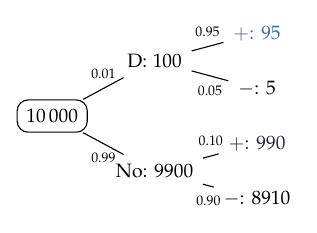

<details><summary>TikZ source</summary>

```latex
\begin{tikzpicture}[level distance=13mm,sibling distance=15mm,font=\scriptsize,grow=right,
  level 1/.style={sibling distance=14mm},level 2/.style={sibling distance=7mm}]
\node[draw,rounded corners] {10\,000}
  child {node {No: 9900}
     child {node {$-$: 8910} edge from parent node[below,font=\tiny] {0.90}}
     child {node[text=trap] {$+$: 990} edge from parent node[above,font=\tiny] {0.10}}
     edge from parent node[below,font=\tiny] {0.99}}
  child {node {D: 100}
     child {node {$-$: 5} edge from parent node[below,font=\tiny] {0.05}}
     child {node[text=nat] {$+$: 95} edge from parent node[above,font=\tiny] {0.95}}
     edge from parent node[above,font=\tiny] {0.01}};
\end{tikzpicture}
```
</details>


### Q1.31
*NAT · 2 marks · Conditional Probability, Total Probability and Bayes*

In Q1.30, a person is tested twice (tests conditionally independent given disease status) and both results are positive. $P(\text{disease}\mid ++)$ is ____\ (round to 3 decimals).

**Answer:** 0.477

**Solution:**

Each positive multiplies the odds by 9.5: $\frac{1}{99}\cdot9.5^2=0.9116$ ⇒ $P=\frac{0.9116}{1.9116}=0.477$. Equivalently, use Q1.30's posterior as the new prior.


### Q1.32
*NAT · 1 mark · Conditional Probability, Total Probability and Bayes*

Machines $A,B,C$ make 50\%, 30\%, 20\% of the output with defect rates 1\%, 2\%, 3\%. A randomly chosen item is defective. The probability it was made by $C$ is ____\ (round to 3 decimals).

**Answer:** 0.353

**Solution:**

$P(D)=0.005+0.006+0.006=0.017$; $P(C\mid D)=\frac{0.006}{0.017}=0.353$. Note $C$ makes only 20\% of output yet ties with $B$ for share of defects.


### Q1.33
*NAT · 2 marks · Conditional Probability, Total Probability and Bayes*

Urn I has 3 white and 2 black balls; urn II has 2 white and 4 black. One ball is moved at random from urn I to urn II, then one ball is drawn from urn II and it is white. The probability that the moved ball was white is ____\ (round to 3 decimals).

**Answer:** 0.692  (solution header: $9/13\approx0.692$)

**Solution:**

$P(W_2)=\frac35\cdot\frac37+\frac25\cdot\frac27=\frac{13}{35}$; $P(W\text{ moved}\mid W_2)=\frac{9/35}{13/35}=\frac9{13}$.


### Q1.34
*NAT · 2 marks · Conditional Probability, Total Probability and Bayes*

A box has three coins: a fair coin, a two-headed coin, and a coin with $P(H)=0.75$. A coin is picked at random and tossed twice, giving two heads. The probability that a third toss of the same coin gives a head is ____\ (round to 3 decimals).

**Answer:** 0.853

**Solution:**

Idea: posterior first, then average the head probability over the posterior.
Work: Likelihoods of $HH$: $\frac14,\,1,\,\frac9{16}$ ⇒ posterior $\propto(4,16,9)/29$.
$P(H_3\mid HH)=\frac{4}{29}\cdot\frac12+\frac{16}{29}\cdot1+\frac9{29}\cdot\frac34=\frac{24.75}{29}=0.853$.
Trap: $P(\text{two-headed}\mid HH)=\frac{16}{29}=0.552$ answers a different question. Also $P(H_3\mid HH)\ne P(H)=\frac{3}{4}$: tosses are \emph{not} independent marginally.


### Q1.35
*MSQ · 2 marks · Conditional Probability, Total Probability and Bayes*

One of two coins --- fair, or two-headed --- is picked with probability $\tfrac12$ each and tossed twice. $H_1,H_2$ = head on toss 1, toss 2. Which are correct?

- **(A)** $H_1$ and $H_2$ are independent
- **(B)** $P(H_2\mid H_1)=\tfrac56$
- **(C)** $H_1,H_2$ are independent given the coin
- **(D)** $P(H_1)=\tfrac34$

**Answer:** B, C, D  (solution header: (B), (C), (D))

**Solution:**

$P(H_1)=\frac12\cdot\frac12+\frac12\cdot1=\frac34$. $P(H_1H_2)=\frac12\cdot\frac14+\frac12\cdot1=\frac58\ne\frac9{16}$ ⇒ dependent. $P(H_2\mid H_1)=\frac{5/8}{3/4}=\frac56$. Given the coin, tosses are independent.
Note: conditional independence does \emph{not} imply independence (a hidden common cause links them).


### Q1.36
*MCQ · 1 mark · Conditional Probability, Total Probability and Bayes*

An urn has 5 red and 3 blue balls. Three balls are drawn one by one without replacement. The probability that the third ball is red is

- **(A)** $\tfrac{5}{8}$
- **(B)** $\tfrac{4}{7}$
- **(C)** $\tfrac{3}{6}$
- **(D)** $\tfrac{5}{6}$

**Answer:** A  (solution header: (A) $\tfrac58$)

**Solution:**

Idea: exchangeability: every position in a random order is equally likely to hold any ball.
Trap: computing $\frac{4}{7}$ or $\frac36$ assumes earlier draws were red.


### Q1.37
*MCQ · 1 mark · Conditional Probability, Total Probability and Bayes*

An urn has 1 red and 1 blue ball. A ball is drawn and returned together with another ball of the same colour. A second ball is then drawn. The probability it is red is

- **(A)** $\tfrac13$
- **(B)** $\tfrac12$
- **(C)** $\tfrac23$
- **(D)** $\tfrac34$

**Answer:** B  (solution header: (B) $\tfrac12$)

**Solution:**

$\frac12\cdot\frac23+\frac12\cdot\frac13=\frac12$. Pólya draws are exchangeable, so every draw has the first draw's marginal.


### Q1.38
*MCQ · 1 mark · Conditional Probability, Total Probability and Bayes*

Monty Hall with 4 doors and 1 car. You pick a door; the host, who knows where the car is, opens one of the other doors showing a goat. You then switch to one of the two remaining unopened doors at random. The probability you win is

- **(A)** $\tfrac14$
- **(B)** $\tfrac13$
- **(C)** $\tfrac38$
- **(D)** $\tfrac12$

**Answer:** C  (solution header: (C) $\tfrac38$)

**Solution:**

Initial pick right ($\frac14$) ⇒ switching loses. Wrong ($\frac34$) ⇒ the car is behind one of the 2 closed doors; pick it with probability $\frac12$. Total $\frac38>\frac14$ (staying).


### Q1.39
*NAT · 2 marks · Conditional Probability, Total Probability and Bayes*

$A$ and $B$ alternately roll a fair die, $A$ first. $A$ wins if he rolls a 6; $B$ wins if he rolls a 5 or 6. The game ends at the first win. $P(A\text{ wins})$ is ____\ (round to 3 decimals).

**Answer:** 0.375  (solution header: $3/8=0.375$)

**Solution:**

Idea: first-step recursion: if both miss, the game restarts.
Work: $p=\frac16+\frac56\cdot\frac46\,p$ ⇒ $p=\frac{1/6}{16/36}=\frac38$.
Note: in general $P(\text{first player wins})=\frac{a}{a+b-ab}$.


### Q1.40
*NAT · 2 marks · Conditional Probability, Total Probability and Bayes*

A gambler with \texttt{Rs}~3 bets \texttt{Rs}~1 per round, winning each round with probability 0.6. She stops on reaching \texttt{Rs}~10 or \texttt{Rs}~0. The probability she reaches \texttt{Rs}~10 is ____\ (round to 3 decimals).

**Answer:** 0.716

**Solution:**

With $r=q/p=\frac23$: $P=\frac{1-r^i}{1-r^N}=\frac{1-(2/3)^3}{1-(2/3)^{10}}=\frac{0.7037}{0.9827}=0.716$. (For a fair game, $i/N=0.3$.)


## Day 2: Day 2 — Discrete Random Variables, Expectation, Covariance, Descriptive Statistics


### Q2.01
*NAT · 2 marks · PMFs, Expectation and Variance*

$P(X=x)=\dfrac{x^2}{30}$ for $x=1,2,3,4$. Then $\operatorname{Var}(X)$ is ____\ (round to 3 decimals).

**Answer:** 0.689

**Solution:**

$\sum x^2=30$ ✓. $\mathbb{E}[X]=\frac{\sum x^3}{30}=\frac{100}{30}$, $\mathbb{E}[X^2]=\frac{\sum x^4}{30}=\frac{354}{30}=11.8$. $\operatorname{Var}=11.8-\frac{100}{9}=0.689$.
Note: $\sum k=\frac{n(n+1)}2$, $\sum k^2=\frac{n(n+1)(2n+1)}6$, $\sum k^3=\big(\frac{n(n+1)}2\big)^2$.


### Q2.02
*NAT · 1 mark · PMFs, Expectation and Variance*

$X$ is uniform on $\{1,2,\dots,10\}$. $\operatorname{Var}(X)$ is ____.

**Answer:** 8.25

**Solution:**

Uniform on $\{1,\dots,n\}$: $\operatorname{Var}=\frac{n^2-1}{12}=\frac{99}{12}$. (Uniform on $\{a,\dots,b\}$: use $n=b-a+1$; shifting does not change variance.)


### Q2.03
*NAT · 1 mark · PMFs, Expectation and Variance*

$P(X=k)\propto k$ for $k=1,2,\dots,10$. Then $\mathbb{E}[X]$ is ____.

**Answer:** 7

**Solution:**

$P(X=k)=\frac{k}{55}$; $\mathbb{E}[X]=\frac{\sum k^2}{55}=\frac{385}{55}=7$. In general $\frac{2n+1}{3}$.


### Q2.04
*NAT · 1 mark · PMFs, Expectation and Variance*

The MGF of $X$ is $M(t)=(0.3+0.7e^t)^5$. $P(X=5)$ is ____\ (round to 3 decimals).

**Answer:** 0.168

**Solution:**

$(q+pe^t)^n$ is the Bin$(n,p)$ MGF ⇒ Bin$(5,0.7)$; $P(X=5)=0.7^5=0.168$.


### Q2.05
*NAT · 2 marks · PMFs, Expectation and Variance*

A fair coin is tossed until the first head; $X$ is the number of tosses. $\mathbb{E}\big[(1.5)^X\big]$ is ____.

**Answer:** 3

**Solution:**

Idea: this is the probability generating function $G(s)=\mathbb{E}[s^X]$ of a geometric, at $s=1.5$.
Work: $\mathbb{E}[s^X]=\sum_{k\ge1}s^k q^{k-1}p=\frac{ps}{1-qs}=\frac{0.75}{0.25}=3$ (needs $qs<1$).
Note: at $s=2$ the series diverges: $\mathbb{E}[2^X]=\infty$ (St Petersburg paradox).


### Q2.06
*MSQ · 1 mark · PMFs, Expectation and Variance*

For random variables with finite moments, which are always correct?

- **(A)** $\mathbb{E}[X^2]\ge(\mathbb{E}[X])^2$
- **(B)** If $\operatorname{Var}(X)=0$ then $P(X=c)=1$ for some constant $c$
- **(C)** If $X>0$ then $\mathbb{E}[1/X]\ge 1/\mathbb{E}[X]$
- **(D)** If $\mathbb{E}[XY]=\mathbb{E}[X]\mathbb{E}[Y]$ then $X$ and $Y$ are independent

**Answer:** A, B, C  (solution header: (A), (B), (C))

**Solution:**

(A) $\operatorname{Var}\ge0$. (B) zero variance ⇒ degenerate. (C) Jensen: $1/x$ is convex on $(0,\infty)$. (D) ✗ uncorrelated does not imply independent.


### Q2.07
*NAT · 2 marks · PMFs, Expectation and Variance*

You roll a fair die and may either keep the score or roll once more and keep the second score. Under the strategy that maximises your expected score, the expected score is ____.

**Answer:** 4.25

**Solution:**

Idea: keep the first roll exactly when it beats the expected value of continuing (3.5).
Work: Keep 4, 5, 6 (mean 5, probability $\frac12$); reroll 1, 2, 3 (then expect 3.5). $\mathbb{E}=\frac12\cdot5+\frac12\cdot3.5=4.25$.
Note: with two rerolls allowed: keep $\ge5$ on the first roll, giving $\frac13\cdot5.5+\frac23\cdot4.25=4.67$.


### Q2.08
*MCQ · 1 mark · Named Discrete Distributions*

Match List-I with List-II.\\
\begin{tabular}{@{}l l@{}}
P. \# defectives in 5 items drawn without replacement from a lot of 50 & 1. Binomial\\
Q. \# e-mails arriving in one hour & 2. Poisson\\
R. \# tosses until the first head & 3. Geometric\\
S. \# heads in 10 tosses & 4. Hypergeometric\\
\end{tabular}

- **(A)** P-4, Q-2, R-3, S-1
- **(B)** P-1, Q-2, R-3, S-4
- **(C)** P-4, Q-3, R-2, S-1
- **(D)** P-1, Q-3, R-2, S-4

**Answer:** A  (solution header: (A))

**Solution:**

Without replacement from a finite lot → hypergeometric; counts per time → Poisson; trials until first success → geometric; successes in fixed $n$ trials → binomial.


### Q2.09
*MCQ · 1 mark · Named Discrete Distributions*

$X\sim\text{Bin}(n,p)$ with $\mathbb{E}[X]=4$ and $\operatorname{Var}(X)=2.4$. The mode of $X$ is

- **(A)** 3
- **(B)** 4
- **(C)** 5
- **(D)** 3 and 4

**Answer:** B  (solution header: (B) 4)

**Solution:**

$q=\frac{\operatorname{Var}}{\mathbb{E}}=0.6$ ⇒ $p=0.4$, $n=10$. $(n+1)p=4.4$ ⇒ mode $\lfloor4.4\rfloor=4$. (If $(n+1)p=m$ is an integer, both $m-1$ and $m$ are modes.)


### Q2.10
*NAT · 1 mark · Named Discrete Distributions*

A fair coin is tossed repeatedly. The probability that the 3rd head occurs on the 5th toss is ____\ (round to 4 decimals).

**Answer:** 0.1875

**Solution:**

Exactly 2 heads in the first 4 tosses, then a head: $\binom42(0.5)^4\cdot0.5=\frac{6}{32}$.


### Q2.11
*NAT · 1 mark · Named Discrete Distributions*

$X$ is the number of trials until the first success with $p=0.2$. $P(X>8\mid X>5)$ is ____\ (round to 3 decimals).

**Answer:** 0.512

**Solution:**

$P(X>k)=q^k$ ⇒ $P(X>8\mid X>5)=q^3=0.8^3$. The geometric is the only memoryless discrete distribution.


### Q2.12
*NAT · 1 mark · Named Discrete Distributions*

A lot of 20 items contains 5 defectives. 4 are drawn without replacement. $P(\text{at least one defective})$ is ____\ (round to 3 decimals).

**Answer:** 0.718

**Solution:**

$1-\frac{\binom{15}{4}}{\binom{20}{4}}=1-\frac{1365}{4845}=0.718$.


### Q2.13
*NAT · 1 mark · Named Discrete Distributions*

$X\sim\text{Poisson}(\lambda)$ with $P(X=2)=P(X=3)$. $\mathbb{E}[X^2]$ is ____.

**Answer:** 12

**Solution:**

$\frac{e^{-\lambda}\lambda^2}{2}=\frac{e^{-\lambda}\lambda^3}{6}$ ⇒ $\lambda=3$. $\mathbb{E}[X^2]=\operatorname{Var}+\mathbb{E}^2=3+9=12$.
Note: in general $P(X=k-1)=P(X=k)\iff\lambda=k$.


### Q2.14
*MCQ · 1 mark · Named Discrete Distributions*

The mode(s) of a Poisson distribution with $\lambda=4$ is/are

- **(A)** 4 only
- **(B)** 3 only
- **(C)** 3 and 4
- **(D)** 4 and 5

**Answer:** C  (solution header: (C))

**Solution:**

$\frac{P(k)}{P(k-1)}=\frac{\lambda}{k}$ equals 1 at $k=\lambda=4$ ⇒ $P(3)=P(4)$ are both maximal.


### Q2.15
*NAT · 1 mark · Named Discrete Distributions*

$X\sim\text{Bin}(1000,0.002)$. Using the Poisson approximation, $P(X\le2)$ is ____\ (round to 3 decimals).

**Answer:** 0.677

**Solution:**

$\lambda=np=2$: $e^{-2}(1+2+2)=5e^{-2}=0.677$.


### Q2.16
*NAT · 2 marks · Named Discrete Distributions*

Calls arrive as a Poisson process with rate 3 per hour. Given that exactly 4 calls arrived in a 2-hour window, the probability that exactly 2 arrived in the first hour is ____\ (round to 3 decimals).

**Answer:** 0.375

**Solution:**

Idea: given $N(0,T)=n$, the $n$ arrival times are \text{i.i.d.}\ uniform on $(0,T)$ ⇒ the count in the first hour is Bin$(4,\tfrac12)$.
Work: $\binom42/2^4=\frac{6}{16}=0.375$. The rate 3 is irrelevant.


### Q2.17
*NAT · 2 marks · Named Discrete Distributions*

$N\sim\text{Poisson}(4)$; given $N$, $S=\sum_{i=1}^{N}X_i$ with $X_i$ \text{i.i.d.}\ Bernoulli(0.25), independent of $N$. $\operatorname{Var}(S)$ is ____.

**Answer:** 1

**Solution:**

$\operatorname{Var}(S)=\mathbb{E}[N]\operatorname{Var}(X)+\operatorname{Var}(N)(\mathbb{E} X)^2=4(0.1875)+4(0.0625)=1$.
Shortcut: thinning: $S\sim\text{Poisson}(4\cdot0.25)=\text{Poisson}(1)$.


### Q2.18
*NAT · 2 marks · Indicators, Tail Sums and Waiting Times*

A fair die is rolled 10 times. The expected number of distinct faces seen is ____\ (round to 3 decimals).

**Answer:** 5.031

**Solution:**

Indicator $I_k$ = face $k$ seen; $P(I_k=1)=1-(5/6)^{10}$. $\mathbb{E}=6(1-0.1615)=5.031$.


### Q2.19
*NAT · 2 marks · Indicators, Tail Sums and Waiting Times*

Five H's and five T's are arranged in a uniformly random order. The expected number of runs (maximal blocks of identical letters) is ____.

**Answer:** 6

**Solution:**

Idea: runs $=1+$ (number of adjacent positions whose letters differ).
Work: $P(\text{positions }i,i+1\text{ differ})=2\cdot\frac{5}{10}\cdot\frac59=\frac59$; 9 adjacent pairs ⇒ $\mathbb{E}=1+9\cdot\frac59=6$.
Note: in general $\mathbb{E}[\text{runs}]=1+\frac{2mn}{m+n}$.


### Q2.20
*NAT · 1 mark · Indicators, Tail Sums and Waiting Times*

In a group of 30 people with independent birthdays uniform over 365 days, the expected number of pairs sharing a birthday is ____\ (round to 3 decimals).

**Answer:** 1.192

**Solution:**

One indicator per pair: $\binom{30}{2}\cdot\frac1{365}=\frac{435}{365}$. (Compare $P(\text{some shared birthday})\approx0.706$.)


### Q2.21
*MCQ · 1 mark · Indicators, Tail Sums and Waiting Times*

A random permutation of $\{1,\dots,n\}$, $n\ge2$; $F$ = number of fixed points. $(\mathbb{E}[F],\operatorname{Var}(F))$ is

- **(A)** $(1,1)$
- **(B)** $(1,1-\tfrac1n)$
- **(C)** $(\tfrac1n,1)$
- **(D)** $(1,n)$

**Answer:** A  (solution header: (A))

**Solution:**

$\mathbb{E}=n\cdot\frac1n=1$. $\operatorname{Var}=n\cdot\frac1n(1-\frac1n)+n(n-1)\big[\frac1{n(n-1)}-\frac1{n^2}\big]=1$.


### Q2.22
*NAT · 1 mark · Indicators, Tail Sums and Waiting Times*

The expected number of rolls of a fair die until every face has appeared at least once is ____\ (round to 1 decimal).

**Answer:** 14.7

**Solution:**

After $j$ faces are seen, the wait for a new one is geometric with $p=\frac{6-j}{6}$: $\mathbb{E}=6\left(1+\frac12+\dots+\frac16\right)=14.7$.


### Q2.23
*NAT · 2 marks · Indicators, Tail Sums and Waiting Times*

A standard deck is shuffled and cards are turned up one at a time. The expected position of the first ace is ____\ (round to 1 decimal).

**Answer:** 10.6

**Solution:**

Idea: each of the 48 non-aces lies before all 4 aces with probability $\frac15$ (it is equally likely to be in any of the 5 gaps the aces create).
Work: $\mathbb{E}[\text{position}]=1+\frac{48}{5}=10.6$. In general $\frac{N+1}{k+1}$.


### Q2.24
*NAT · 2 marks · Indicators, Tail Sums and Waiting Times*

Two fair dice are rolled. $\mathbb{E}[\max(\text{faces})]$ is ____\ (round to 3 decimals).

**Answer:** 4.472

**Solution:**

$P(\max\le k)=\frac{k^2}{36}$ ⇒ $P(\max=k)=\frac{2k-1}{36}$; $\mathbb{E}=\sum k\frac{2k-1}{36}=\frac{161}{36}$.
Shortcut: tail sum $\sum_{k=1}^6 P(\max\ge k)=\sum\big(1-\frac{(k-1)^2}{36}\big)=6-\frac{55}{36}$.


### Q2.25
*MCQ · 2 marks · Indicators, Tail Sums and Waiting Times*

A fair die is thrown repeatedly. The expected number of throws until two consecutive throws each show a number $\le2$ is

- **(A)** 6
- **(B)** 9
- **(C)** 12
- **(D)** 18

**Answer:** C  (solution header: (C) 12)

**Solution:**

Idea: Markov states: $S_0$ (no streak), $S_1$ (last throw a success), $p=\frac13$.
Work: $E_0=1+pE_1+qE_0$, $E_1=1+qE_0$ ⇒ $E_0=\frac{1+p}{p^2}=12$.
Note: $k$ consecutive successes: $\sum_{j=1}^k p^{-j}$. Fair coin: HH 6, HHH 14, HT 4. PYQ 2024 (two consecutive evens, $p=\frac12$) ⇒ 6.


### Q2.26
*NAT · 2 marks · Indicators, Tail Sums and Waiting Times*

Each entry of a $4\times4$ matrix is independently Bernoulli(0.5). $P(\text{row-1 sum}=2\text{ and column-1 sum}=2)$ is ____\ (round to 2 decimals).

**Answer:** 0.14

**Solution:**

Idea: condition on the shared corner $a_{11}$; the remaining 3 row cells and 3 column cells are disjoint.
Work: $a_{11}=1$: $\frac12\cdot\frac38\cdot\frac38$; $a_{11}=0$: $\frac12\cdot\frac38\cdot\frac38$. Total $(\frac38)^2=0.1406$.
Trap: row and column sums are \emph{dependent}. The product $(\frac38)^2$ matches here only because $P(\text{Bin}(3)=1)=P(\text{Bin}(3)=2)$; for sums $=1$ the exact value is $0.078\ne(\frac14)^2$.


### Q2.27
*MSQ · 2 marks · Covariance and Correlation*

The joint PMF of $(X,Y)$ is

\begin{tabular}{c|ccc}
 & $Y=0$ & $Y=1$ & $Y=2$\\\hline
$X=0$ & 0.1 & 0.2 & 0.1\\
$X=1$ & 0.2 & 0.1 & 0.3
\end{tabular}

Which are correct?

- **(A)** $\operatorname{Cov}(X,Y)=0.04$
- **(B)** $X$ and $Y$ are independent
- **(C)** $\mathbb{E}[Y\mid X=1]=\tfrac76$
- **(D)** $P(X=1\mid Y=2)=0.75$

**Answer:** A, C, D  (solution header: (A), (C), (D))

**Solution:**

$\mathbb{E} X=0.6$; $P(Y=0,1,2)=0.3,0.3,0.4$ ⇒ $\mathbb{E} Y=1.1$; $\mathbb{E}[XY]=0.1+0.6=0.7$ ⇒ $\operatorname{Cov}=0.04$ ✓. (B) ✗ $P(0,0)=0.1\ne0.4\cdot0.3$. (C) $\frac{0.1+0.6}{0.6}=\frac76$ ✓. (D) $\frac{0.3}{0.4}$ ✓.


### Q2.28
*MSQ · 2 marks · Covariance and Correlation*

$X$ is uniform on $\{-1,0,1\}$ and $Y=X^2$. Which are correct?

- **(A)** $\operatorname{Cov}(X,Y)=0$
- **(B)** $X$ and $Y$ are independent
- **(C)** $\mathbb{E}[X\mid Y=1]=0$
- **(D)** $\operatorname{Var}(X+Y)=\tfrac89$

**Answer:** A, C, D  (solution header: (A), (C), (D))

**Solution:**

$\mathbb{E}[XY]=\mathbb{E}[X^3]=0=\mathbb{E} X\,\mathbb{E} Y$ ⇒ $\operatorname{Cov}=0$. Not independent: $P(X=0,Y=1)=0$. $\mathbb{E}[X\mid Y=1]=0$ by symmetry. $\operatorname{Var} X=\frac23$, $\operatorname{Var} Y=\frac23-\frac49=\frac29$, sum $\frac89$.


### Q2.29
*NAT · 1 mark · Covariance and Correlation*

$\operatorname{Var}(X)=4$, $\operatorname{Var}(Y)=9$, $\rho(X,Y)=-0.5$. $\operatorname{Var}(2X-3Y+4)$ is ____.

**Answer:** 133

**Solution:**

$\operatorname{Cov}=\rho\sigma_X\sigma_Y=-3$. $\operatorname{Var}=4\cdot4+9\cdot9+2(2)(-3)(-3)=16+81+36=133$.
Trap: the sign of the cross term: $2ab\operatorname{Cov}$ with $a=2$, $b=-3$.


### Q2.30
*MSQ · 2 marks · Covariance and Correlation*

$\rho(X,Y)=0.6$. Which are always correct?

- **(A)** $\rho(-2X+3,\;4Y-1)=-0.6$
- **(B)** If $\operatorname{Var} X=\operatorname{Var} Y$ then $\operatorname{Cov}(X+Y,\,X-Y)=0$
- **(C)** $\operatorname{Cov}(2X,3Y)=6\operatorname{Cov}(X,Y)$
- **(D)** $\rho(X^2,Y^2)=0.36$

**Answer:** A, B, C  (solution header: (A), (B), (C))

**Solution:**

(A) slopes of opposite sign flip the sign. (B) $\operatorname{Cov}(X+Y,X-Y)=\operatorname{Var} X-\operatorname{Var} Y$. (C) bilinearity. (D) ✗ no rule for non-linear maps.


### Q2.31
*NAT · 1 mark · Covariance and Correlation*

Two fair coins are tossed. $X=1$ if both are heads (else 0); $Y=1$ if at least one is a head (else 0). $\operatorname{Cov}(X,Y)$ is ____\ (round to 4 decimals).

**Answer:** 0.0625

**Solution:**

$XY=X$. $\operatorname{Cov}=\mathbb{E} X-\mathbb{E} X\,\mathbb{E} Y=\frac14-\frac14\cdot\frac34=\frac1{16}$.


### Q2.32
*MCQ · 2 marks · Covariance and Correlation*

$X=aZ+b$ with $Z\sim N(0,1)$. Given $\mathbb{E}[X]=2$, $\mathbb{E}[(X-\mathbb{E} X)Z]=-3$ and $\mathbb{E}[(X-\mathbb{E} X)^2]=9$:

- **(A)** $a=3,b=2$
- **(B)** $a=-3,b=2$
- **(C)** $a=-3,b=-2$
- **(D)** $a=9,b=2$

**Answer:** B  (solution header: (B))

**Solution:**

$\mathbb{E} X=b=2$; $\mathbb{E}[(X-b)Z]=a\mathbb{E}[Z^2]=a=-3$; check $a^2=9$ ✓.


### Q2.33
*NAT · 2 marks · Covariance and Correlation*

$X\sim\text{Bernoulli}(0.4)$ and $Y\sim N(0,4)$ are independent. $\operatorname{Var}\big((3X-1)Y\big)$ is ____.

**Answer:** 8.8

**Solution:**

$\mathbb{E}[(3X-1)Y]=0$. $\operatorname{Var}=\mathbb{E}[(3X-1)^2]\mathbb{E}[Y^2]=(0.4\cdot4+0.6\cdot1)\cdot4=8.8$.
Note: for independent $U,V$: $\operatorname{Var}(UV)=\mathbb{E}[U^2]\mathbb{E}[V^2]-(\mathbb{E} U\,\mathbb{E} V)^2$.


### Q2.34
*NAT · 2 marks · Covariance and Correlation*

For $x=(1,2,3,4,5)$ and $y=(2,4,5,4,5)$ the Pearson correlation coefficient is ____\ (round to 3 decimals).

**Answer:** 0.775

**Solution:**

Deviations $x$: $-2,-1,0,1,2$; $y$: $-2,0,1,0,1$. $S_{xy}=6$, $S_{xx}=10$, $S_{yy}=6$. $r=\frac{6}{\sqrt{60}}=0.775$.


### Q2.35
*NAT · 1 mark · Covariance and Correlation*

Six candidates get scores $(10,20,30,40,50,60)$ from judge A and $(35,30,55,40,60,50)$ from judge B. Spearman's rank correlation is ____\ (round to 3 decimals).

**Answer:** 0.657

**Solution:**

Ranks B: $(2,1,5,3,6,4)$; $d=(-1,1,-2,1,-1,2)$; $\sum d^2=12$. $\rho_s=1-\frac{6\cdot12}{6\cdot35}=0.657$.


### Q2.36
*NAT · 2 marks · Descriptive Statistics and Inequalities*

Group 1: 40 students, mean 50, SD 6. Group 2: 60 students, mean 60, SD 8 (population SDs). The SD of the combined 100 students is ____\ (round to 2 decimals).

**Answer:** 8.76

**Solution:**

Mean $56$. $\sigma^2=\frac{40(36+36)+60(64+16)}{100}=76.8$ ⇒ $8.76$. Formula $\frac{\sum n_i(\sigma_i^2+d_i^2)}{\sum n_i}$, $d_i=\bar x_i-\bar x$.


### Q2.37
*NAT · 2 marks · Descriptive Statistics and Inequalities*

25 observations have mean 36 and SD 7 (population SD). It is later found that one value recorded as 21 should be 46. The corrected SD is ____\ (round to 2 decimals).

**Answer:** 6.55–6.56  (solution header: 6.557)

**Solution:**

Idea: correct the raw sums $\sum x$ and $\sum x^2$, not the mean and SD.
Work: $\sum x=900\to925$, mean $37$. $\sum x^2=25(49+36^2)=33625\to33625-21^2+46^2=35300$. $\sigma^2=\frac{35300}{25}-37^2=43$ ⇒ $6.557$.


### Q2.38
*MSQ · 1 mark · Descriptive Statistics and Inequalities*

For data $X$: mean 10, median 9, mode 8, SD 3, IQR 4. Let $Y=5-2X$. Which are correct?

- **(A)** mean of $Y=-15$
- **(B)** median of $Y=-13$
- **(C)** SD of $Y=-6$
- **(D)** IQR of $Y=8$

**Answer:** A, B, D  (solution header: (A), (B), (D))

**Solution:**

Location statistics map fully: mean $-15$, median $-13$, mode $-11$. Spread scales by $|b|=2$: SD $6$ (never negative), IQR $8$, variance $36$.


### Q2.39
*NAT · 1 mark · Descriptive Statistics and Inequalities*

For the data $2,3,7,10,15$, the minimum over all real $a$ of $\sum_i|x_i-a|$ is ____.

**Answer:** 20

**Solution:**

$\sum|x_i-a|$ is minimised at the median $a=7$: $5+4+0+3+8=20$. ($\sum(x_i-a)^2$ is minimised at the mean.)


### Q2.40
*NAT · 1 mark · Descriptive Statistics and Inequalities*

$X$ has mean 50 and SD 5 (distribution unknown). The Chebyshev lower bound on $P(40<X<60)$ is ____.

**Answer:** 0.75

**Solution:**

$P(|X-\mu|<k\sigma)\ge1-\frac1{k^2}$ with $k=2$.


## Day 3: Day 3 — Continuous Random Variables, Joint, Marginal \& Conditional Distributions


### Q3.01
*NAT · 1 mark · PDFs, CDFs and Transformations*

$f(x)=k\,x(2-x)$ for $0\le x\le 2$ (0 elsewhere). $\operatorname{Var}(X)$ is ____\ (round to 2 decimals).

**Answer:** 0.20

**Solution:**

$\int_0^2 kx(2-x)\,dx=\frac43k=1$ ⇒ $k=\frac34$. The PDF is symmetric about 1, so $\mathbb{E} X=1$ with no integration. $\mathbb{E}[X^2]=\frac34\int_0^2(2x^3-x^4)dx=\frac65$ ⇒ $\operatorname{Var}=0.2$.
Note: this is a scaled Beta(2,2) on $[0,2]$.


### Q3.02
*MSQ · 1 mark · PDFs, CDFs and Transformations*

Which of the following are valid CDFs? (Each is 0 to the left and 1 to the right of the range shown.)

- **(A)** $F(x)=1-e^{-x}$ for $x\ge0$
- **(B)** $F(x)=x^2$ for $0\le x\le 2$
- **(C)** $F(x)=0.5$ on $[0,1)$, $0.3$ on $[1,2)$, $1$ for $x\ge2$
- **(D)** $F(x)=\dfrac{e^x}{1+e^x}$ for all real $x$

**Answer:** A, D  (solution header: (A), (D))

**Solution:**

A CDF must be non-decreasing, right-continuous, from 0 to 1. (B) ✗ exceeds 1 for $x>1$. (C) ✗ decreases from 0.5 to 0.3. (A) is the Exp(1) CDF; (D) is the logistic CDF.


### Q3.03
*MSQ · 2 marks · PDFs, CDFs and Transformations*

\[F(x)=\begin{cases}0 & x<0\\ x/4 & 0\le x<1\\ 1/2 & 1\le x<2\\ 1-\tfrac12e^{-(x-2)} & x\ge2\end{cases}\]
Which are correct?

- **(A)** $P(X=1)=\tfrac14$
- **(B)** $X$ is a continuous random variable
- **(C)** $P(0.5<X\le2.5)\approx0.572$
- **(D)** $P(1<X<2)=0$

**Answer:** A, C, D  (solution header: (A), (C), (D))

**Solution:**

(A) jump at 1: $\frac12-\frac14$ ✓. (B) ✗ a jump means it is a \emph{mixed} variable. (C) $F(2.5)-F(0.5)=(1-\frac12e^{-0.5})-\frac18=0.572$ ✓. (D) $F(2^-)-F(1)=0$ ✓ (flat CDF ⇒ no mass).
Note: $P(X=a)=F(a)-F(a^-)$; $P(a<X<b)=F(b^-)-F(a)$; $P(a\le X\le b)=F(b)-F(a^-)$. A CDF is right-continuous (PYQ 2026).


### Q3.04
*MCQ · 1 mark · PDFs, CDFs and Transformations*

$F(x)=0$ for $x\le t$; $\dfrac{x-t}{5-t}$ for $t\le x\le5$; $1$ for $x\ge5$. If the median of $X$ is 2, then $t=$

- **(A)** 1
- **(B)** 0
- **(C)** $-1$
- **(D)** $-2$

**Answer:** C  (solution header: (C))

**Solution:**

$\frac{2-t}{5-t}=\frac12$ ⇒ $t=-1$. Shortcut: median of a uniform is the midpoint: $\frac{t+5}2=2$.


### Q3.05
*NAT · 2 marks · PDFs, CDFs and Transformations*

$F(x)=\tfrac14(x+1)^2$ for $-1\le x\le1$ (0 below, 1 above). $P(X^2\le0.36)$ is ____.

**Answer:** 0.6

**Solution:**

$P(-0.6\le X\le0.6)=F(0.6)-F(-0.6)=\frac{1.6^2-0.4^2}{4}=0.6$.


### Q3.06
*NAT · 1 mark · PDFs, CDFs and Transformations*

A non-negative random variable has $P(X>x)=\dfrac{1}{(1+x)^2}$ for $x\ge0$. $\mathbb{E}[X]$ is ____.

**Answer:** 1

**Solution:**

$\mathbb{E} X=\int_0^\infty P(X>x)\,dx=\int_0^\infty(1+x)^{-2}dx=1$.


### Q3.07
*NAT · 1 mark · PDFs, CDFs and Transformations*

$f(x)=3x^2$ on $[0,1]$. The median of $X$ is ____\ (round to 3 decimals).

**Answer:** 0.794

**Solution:**

$F(m)=m^3=\frac12$ ⇒ $m=2^{-1/3}$.


### Q3.08
*MCQ · 1 mark · PDFs, CDFs and Transformations*

$X\sim U(0,1)$ and $Y=-\tfrac12\ln X$. Then $Y$ is

- **(A)** exponential with mean 2
- **(B)** exponential with mean $\tfrac12$
- **(C)** uniform on $(0,\infty)$
- **(D)** normal

**Answer:** B  (solution header: (B))

**Solution:**

$P(Y>y)=P(X<e^{-2y})=e^{-2y}$ ⇒ Exp(rate 2), mean $\frac12$. In general $-\frac1\lambda\ln U\sim\text{Exp}(\lambda)$.


### Q3.09
*NAT · 2 marks · PDFs, CDFs and Transformations*

$X\sim U(-1,2)$ and $Y=X^2$. The density $f_Y(0.25)$ is ____\ (round to 3 decimals).

**Answer:** 0.667  (solution header: $2/3\approx0.667$)

**Solution:**

Idea: for a non-monotone map, add the contributions of every root that lies in the support.
Work: $f_X=\frac13$ on $(-1,2)$. For $0<y<1$ both $\pm\sqrt y$ lie in the support: $f_Y(y)=2\cdot\frac13\cdot\frac1{2\sqrt y}=\frac1{3\sqrt y}$, so $f_Y(0.25)=\frac23$. For $1<y<4$ only $+\sqrt y$: $f_Y=\frac{1}{6\sqrt y}$.
Trap: using one root (gives $\frac13$) or both roots for $y>1$.


### Q3.10
*NAT · 1 mark · PDFs, CDFs and Transformations*

$f(x)=c\,e^{-|x|}$ for all real $x$. $\operatorname{Var}(X)$ is ____.

**Answer:** 2

**Solution:**

$c=\frac12$; by symmetry $\mathbb{E} X=0$; $\mathbb{E}[X^2]=\int_0^\infty x^2e^{-x}dx=2!=2$.


### Q3.11
*NAT · 1 mark · Exponential, Poisson Process and Gamma*

$X$ is exponential with mean $\theta$ and $P(X>5)=0.4$. $P(X>15\mid X>5)$ is ____\ (round to 2 decimals).

**Answer:** 0.16

**Solution:**

Memoryless: $P(X>15\mid X>5)=P(X>10)=P(X>5)^2=0.16$. Never needs $\theta$.


### Q3.12
*NAT · 1 mark · Exponential, Poisson Process and Gamma*

$X\sim\text{Exp}(\lambda=2)$. $\mathbb{E}[X^3]$ is ____.

**Answer:** 0.75

**Solution:**

$\mathbb{E}[X^n]=\frac{n!}{\lambda^n}=\frac68$ (from $\int_0^\infty x^ne^{-\lambda x}dx=\frac{n!}{\lambda^{n+1}}$).


### Q3.13
*NAT · 2 marks · Exponential, Poisson Process and Gamma*

A system has three components in series with independent exponential lifetimes of rates 1, 2 and 3 failures per year. The expected system lifetime in months is ____.

**Answer:** 2

**Solution:**

Series fails at the first failure: $\min\sim\text{Exp}(1+2+3)$, mean $\frac16$ year $=2$ months. Also $P(\text{component }i\text{ first})=\lambda_i/\sum\lambda$.


### Q3.14
*NAT · 1 mark · Exponential, Poisson Process and Gamma*

$X,Y$ are independent exponentials with means 2 hours and 3 hours. $\mathbb{E}[\min(X,Y)]$ in hours is ____.

**Answer:** 1.2

**Solution:**

Idea: convert means to rates first: $\frac12$ and $\frac13$ per hour.
Work: $\min\sim\text{Exp}(\frac56)$ ⇒ mean $1.2$.
Trap: adding means (5) or using $\frac1{2+3}$.


### Q3.15
*NAT · 1 mark · Exponential, Poisson Process and Gamma*

$X,Y$ \text{i.i.d.}\ Exp(1). $\mathbb{E}[\max(X,Y)]$ is ____.

**Answer:** 1.5

**Solution:**

$\max=\min+\text{extra}$: $\min\sim\text{Exp}(2)$ has mean $\frac12$; by memorylessness the survivor needs another Exp(1). $\frac12+1=1.5$. For $n$ \text{i.i.d.}: $\frac1\lambda(1+\frac12+\dots+\frac1n)$.


### Q3.16
*NAT · 2 marks · Exponential, Poisson Process and Gamma*

$X\sim\text{Exp}(1)$ and $Y=\min(X,2)$. $\mathbb{E}[Y]$ is ____\ (round to 3 decimals).

**Answer:** 0.865

**Solution:**

$\mathbb{E} Y=\int_0^\infty P(Y>y)dy=\int_0^2e^{-y}dy=1-e^{-2}$.


### Q3.17
*MCQ · 2 marks · Exponential, Poisson Process and Gamma*

$X$ is exponential with mean $1/\ln4$ and $Y=\lfloor X\rfloor$. Then $P(Y=\ell)=q^{\ell}(1-q)$ for $\ell=0,1,2,\dots$ with $q=$

- **(A)** 0.75
- **(B)** 0.5
- **(C)** 0.25
- **(D)** $\ln4$

**Answer:** C  (solution header: (C))

**Solution:**

$\lambda=\ln4$. $P(Y=\ell)=P(\ell\le X<\ell+1)=e^{-\lambda\ell}(1-e^{-\lambda})$ ⇒ $q=e^{-\lambda}=\frac14$.


### Q3.18
*NAT · 2 marks · Exponential, Poisson Process and Gamma*

Customers arrive as a Poisson process of rate 2 per minute. The probability that the waiting time until the 2nd arrival exceeds 1 minute is ____\ (round to 3 decimals).

**Answer:** 0.406

**Solution:**

Idea: $T_2>1\iff N(1)\le1$, with $N(1)\sim\text{Poisson}(2)$.
Work: $e^{-2}(1+2)=0.406$. ($T_k\sim\text{Gamma}(k,\lambda)$, mean $k/\lambda$.)


### Q3.19
*NAT · 2 marks · Exponential, Poisson Process and Gamma*

60\% of bulbs come from plant $A$ (exponential lifetime, mean 6 months) and 40\% from plant $B$ (mean 2 months). A randomly chosen bulb is still working after 4 months. The probability it came from $A$ is ____\ (round to 3 decimals).

**Answer:** 0.850–0.851  (solution header: 0.851)

**Solution:**

Idea: Bayes with \emph{survival probabilities} as likelihoods.
Work: $P(T>4\mid A)=e^{-4/6}=0.5134$, $P(T>4\mid B)=e^{-2}=0.1353$.
$P(A\mid T>4)=\frac{0.6(0.5134)}{0.6(0.5134)+0.4(0.1353)}=\frac{0.3080}{0.3622}=0.851$.
Note: survivors are increasingly from the longer-lived plant.


### Q3.20
*NAT · 1 mark · Normal, $t$ and $\chi^2$*

$X\sim N(\mu,\sigma^2)$. $P(\mu-\sigma<X<\mu+2\sigma)$ is ____\ (round to 4 decimals).

**Answer:** 0.8185–0.8186  (solution header: 0.8185)

**Solution:**

$\Phi(2)-\Phi(-1)=0.9772-0.1587$. Memorise $\pm1,2,3\sigma$: 68.27, 95.45, 99.73\%.


### Q3.21
*NAT · 2 marks · Normal, $t$ and $\chi^2$*

$X\sim N(10,4)$ and $Y\sim N(8,9)$ are independent. $P(Y>X)$ is ____\ (round to 3 decimals).

**Answer:** 0.289–0.290  (solution header: 0.290)

**Solution:**

$Y-X\sim N(-2,\,9+4)$ --- variances add even for a difference. $P(Y-X>0)=1-\Phi(2/\sqrt{13})=1-\Phi(0.5547)=0.290$.


### Q3.22
*NAT · 1 mark · Normal, $t$ and $\chi^2$*

Marks are $N(60,100)$. The minimum mark needed to be in the top 10\% is ____\ (round to 2 decimals).

**Answer:** 72.81–72.82  (solution header: 72.82)

**Solution:**

$60+z_{0.10}\cdot10=60+1.2816\cdot10$.


### Q3.23
*NAT · 2 marks · Normal, $t$ and $\chi^2$*

$Z\sim N(0,1)$. $P(Z>2\mid Z>1)$ is ____\ (round to 3 decimals).

**Answer:** 0.143–0.144  (solution header: 0.143)

**Solution:**

$\frac{P(Z>2)}{P(Z>1)}=\frac{0.0228}{0.1587}=0.144$ (exact 0.1434).
Note: contrast with the exponential: $P(Z>2\mid Z>1)\ne P(Z>1)=0.159$. Normal tails thin out, so surviving further gets harder.


### Q3.24
*NAT · 1 mark · Normal, $t$ and $\chi^2$*

$Z\sim N(0,1)$. $\mathbb{E}[e^{Z}]$ is ____\ (round to 3 decimals).

**Answer:** 1.649

**Solution:**

MGF of $N(0,1)$ is $e^{t^2/2}$; at $t=1$: $e^{0.5}$. In general $\mathbb{E}[e^{X}]=e^{\mu+\sigma^2/2}$ for $X\sim N(\mu,\sigma^2)$.


### Q3.25
*NAT · 2 marks · Normal, $t$ and $\chi^2$*

$X\sim N(2,9)$. $\operatorname{Var}(X^2)$ is ____.

**Answer:** 306

**Solution:**

$\operatorname{Var}(X^2)=4\mu^2\sigma^2+2\sigma^4=144+162$. (Via $\mathbb{E}[X^4]=\mu^4+6\mu^2\sigma^2+3\sigma^4=475$, $\mathbb{E}[X^2]=13$.) PYQ 2025: $Z^2\sim\chi^2_1$ ⇒ $\operatorname{Var}(Z^2)=2$.


### Q3.26
*MSQ · 2 marks · Normal, $t$ and $\chi^2$*

$X,Y$ are \text{i.i.d.}\ $N(0,1)$. Which are correct?

- **(A)** $X+Y$ and $X-Y$ are independent
- **(B)** $X/Y$ has the $t_1$ (Cauchy) distribution
- **(C)** $X^2+Y^2$ is exponential with mean 2
- **(D)** $\max(X,Y)$ is normally distributed

**Answer:** A, B, C  (solution header: (A), (B), (C))

**Solution:**

(A) jointly normal with $\operatorname{Cov}(X+Y,X-Y)=1-1=0$ ⇒ independent. (B) ratio of independent standard normals is Cauchy $=t_1$. (C) $\chi^2_2=\text{Exp}$ with mean 2. (D) ✗ the maximum is skewed (mean $1/\sqrt\pi$).


### Q3.27
*MSQ · 2 marks · Normal, $t$ and $\chi^2$*

$Z\sim N(0,1)$ with PDF $g$, CDF $G$; $T\sim t_5$ with PDF $h$, CDF $H$. Which are correct?

- **(A)** $G(0)=H(0)$
- **(B)** $g(0)>h(0)$
- **(C)** $h(x)>g(x)$ for all large $x$
- **(D)** $\operatorname{Var}(T)=1$

**Answer:** A, B, C  (solution header: (A), (B), (C))

**Solution:**

Both symmetric ⇒ $G(0)=H(0)=\frac12$. The normal is more peaked: $g(0)=0.399>h(0)$. $t$ has heavier tails ⇒ $h>g$ far out, so for large $c$: $H(c)<G(c)$, $H(-c)>G(-c)$. (D) ✗ $\operatorname{Var}(t_\nu)=\frac{\nu}{\nu-2}=\frac53$. $t_1$ is Cauchy: $h(0)=\frac1\pi$, no mean.


### Q3.28
*NAT · 2 marks · Joint, Marginal and Conditional Densities*

$f(x,y)=k(x+y)$ for $0\le x,y\le1$. $\mathbb{E}[Y\mid X=0.5]$ is ____\ (round to 3 decimals).

**Answer:** 0.583

**Solution:**

$k=1$; $f_X(x)=x+\frac12$; $f(y\mid x)=\frac{x+y}{x+1/2}$; $\mathbb{E}[Y\mid X=x]=\frac{x/2+1/3}{x+1/2}$, which at $0.5$ gives $0.583$.
Note: same density: $\mathbb{E} X=\frac7{12}$, $\operatorname{Cov}(X,Y)=-\frac1{144}$, $P(X+Y\le1)=\frac13$.


### Q3.29
*MSQ · 2 marks · Joint, Marginal and Conditional Densities*

$f(x,y)=2$ for $0<x<y<1$. Which are correct?

- **(A)** $f_X(x)=2(1-x)$, $0<x<1$
- **(B)** $X$ and $Y$ are independent
- **(C)** $\mathbb{E}[X\mid Y=y]=y/2$
- **(D)** $\operatorname{Var}(X)=\tfrac1{12}$

**Answer:** A, C  (solution header: (A), (C))

**Solution:**

[FIGURE 1: figures/Q3_29_s_f1_d4f138d9.png]

(A) $\int_x^1 2\,dy=2(1-x)$ ✓. (B) ✗ a triangular support means dependent. (C) given $Y=y$, $X\sim U(0,y)$ ✓. (D) ✗ $\mathbb{E} X=\frac13$, $\mathbb{E} X^2=\frac16$ ⇒ $\operatorname{Var}=\frac1{18}$.
Check: $\mathbb{E}[\operatorname{Var}(X|Y)]+\operatorname{Var}(\mathbb{E}[X|Y])=\frac1{24}+\frac1{72}=\frac1{18}$.

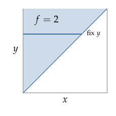

<details><summary>TikZ source</summary>

```latex
\begin{tikzpicture}[scale=2.1]
\draw[gray] (0,0) rectangle (1,1);
\fill[pyq!25] (0,0)--(0,1)--(1,1)--cycle;
\draw[pyq] (0,0)--(1,1);
\draw[accent,thick] (0,0.7)--(0.7,0.7);
\node[font=\tiny,right] at (0.7,0.7) {fix $y$};
\node[font=\scriptsize] at (0.28,0.86) {$f=2$};
\node[font=\scriptsize,below] at (0.5,0) {$x$};\node[font=\scriptsize,left] at (0,0.5) {$y$};
\end{tikzpicture}
```
</details>


### Q3.30
*NAT · 2 marks · Joint, Marginal and Conditional Densities*

$f(x,y)=e^{-y}$ for $0<x<y<\infty$. $\mathbb{E}[Y\mid X=1]$ is ____.

**Answer:** 2

**Solution:**

$f_X(x)=\int_x^\infty e^{-y}dy=e^{-x}$; $f(y\mid x)=e^{-(y-x)}$ for $y>x$ ⇒ $Y-x\mid X=x\sim\text{Exp}(1)$. $\mathbb{E}[Y\mid X=1]=1+1=2$.


### Q3.31
*NAT · 2 marks · Joint, Marginal and Conditional Densities*

$X\sim U[0,2]$ and $Y\sim U[1,3]$ are independent. $P(X\ge Y)$ is ____\ (round to 3 decimals).

**Answer:** 0.125

**Solution:**

Joint density $\frac14$ on $[0,2]\times[1,3]$. $X\ge Y$ needs $1\le y\le x\le2$: a triangle of area $\frac12$. $P=\frac18$.


### Q3.32
*NAT · 1 mark · Joint, Marginal and Conditional Densities*

$X,Y$ \text{i.i.d.}\ $U(0,1)$. $P(X+Y>1.5)$ is ____.

**Answer:** 0.125

**Solution:**

The corner triangle $x+y>1.5$ has legs $0.5$: area $\frac18$.


### Q3.33
*NAT · 2 marks · Joint, Marginal and Conditional Densities*

$X,Y$ \text{i.i.d.}\ $U(0,1)$. $P(XY\le0.5)$ is ____\ (round to 3 decimals).

**Answer:** 0.846–0.847  (solution header: 0.847)

**Solution:**

Idea: split at $x=0.5$: for $x\le0.5$ every $y$ works; for $x>0.5$ need $y\le\frac{0.5}{x}$.
Work: $0.5+\int_{0.5}^1\frac{0.5}{x}dx=0.5+0.5\ln2=0.847$.


### Q3.34
*NAT · 1 mark · Joint, Marginal and Conditional Densities*

$X,Y$ \text{i.i.d.}\ $U(0,1)$. $\mathbb{E}|X-Y|$ is ____\ (round to 3 decimals).

**Answer:** 0.333  (solution header: $1/3$)

**Solution:**

$\mathbb{E}|X-Y|=2\int_0^1\!\!\int_0^x(x-y)\,dy\,dx=2\cdot\frac16$. Equivalently $\mathbb{E}[\max]-\mathbb{E}[\min]=\frac23-\frac13$.


### Q3.35
*NAT · 2 marks · Joint, Marginal and Conditional Densities*

$X\sim\text{Exp}(1)$ and $Y\sim U(0,1)$ are independent. $P(X<Y)$ is ____\ (round to 3 decimals).

**Answer:** 0.368

**Solution:**

Condition on $Y$: $P(X<Y)=\mathbb{E}[1-e^{-Y}]=1-\int_0^1e^{-y}dy=e^{-1}$.


### Q3.36
*NAT · 2 marks · Joint, Marginal and Conditional Densities*

A point is chosen uniformly in the unit disk. The expected distance from the centre is ____\ (round to 3 decimals).

**Answer:** 0.667  (solution header: $2/3$)

**Solution:**

Idea: $R$ is \emph{not} uniform: $P(R\le r)=\frac{\pi r^2}{\pi}=r^2$, so $f_R=2r$.
Work: $\mathbb{E} R=\int_0^1 2r^2\,dr=\frac23$.
Trap: answering $\frac12$ (treating $R$ as uniform).


### Q3.37
*NAT · 1 mark · Joint, Marginal and Conditional Densities*

$X_1,X_2,X_3$ \text{i.i.d.}\ $U(0,1)$. $\mathbb{E}[\max-\min]$ is ____.

**Answer:** 0.5

**Solution:**

For $U(0,1)$, $\mathbb{E}[X_{(k)}]=\frac{k}{n+1}$: $\frac34-\frac14=\frac12$ $\;(=\frac{n-1}{n+1})$.


### Q3.38
*NAT · 2 marks · Conditional Expectation and Variance*

$X\sim U(0,1)$ and, given $X=x$, $Y\sim U(0,x)$. $\operatorname{Var}(Y)$ is ____\ (round to 4 decimals).

**Answer:** 0.0486

**Solution:**

$\mathbb{E}[Y\mid X]=\frac X2$, $\operatorname{Var}(Y\mid X)=\frac{X^2}{12}$.
$\operatorname{Var} Y=\mathbb{E}\big[\frac{X^2}{12}\big]+\operatorname{Var}\big(\frac X2\big)=\frac1{36}+\frac1{48}=\frac7{144}$.


### Q3.39
*NAT · 2 marks · Conditional Expectation and Variance*

$X\sim U(0,1)$; given $X=x$, $Y\sim U(2x-1,\,2x+1)$. $\rho(X,Y)$ is ____\ (round to 3 decimals).

**Answer:** 0.707

**Solution:**

$\mathbb{E}[Y\mid X]=2X$, $\operatorname{Var}(Y\mid X)=\frac{2^2}{12}=\frac13$.
$\operatorname{Cov}(X,Y)=\operatorname{Cov}(X,\mathbb{E}[Y\mid X])=2\operatorname{Var} X=\frac16$; $\operatorname{Var} Y=\frac13+4\cdot\frac1{12}=\frac23$.
$\rho=\frac{1/6}{\sqrt{\frac1{12}\cdot\frac23}}=\frac{\sqrt{18}}{6}=0.707$.
Note: PYQ 2026: $X\sim U(-1,1)$, $\mathbb{E}[Y\mid X]=X^2$ ⇒ $\operatorname{Cov}=\mathbb{E}[X^3]=0$, so $\rho=0$ although dependent.


### Q3.40
*NAT · 2 marks · Conditional Expectation and Variance*

$(X,Y)$ is bivariate normal with $\mu_X=50$, $\sigma_X=5$, $\mu_Y=60$, $\sigma_Y=10$, $\rho=0.6$. Enter $\mathbb{E}[Y\mid X=55]+\operatorname{Var}(Y\mid X=55)$: ____.

**Answer:** 130

**Solution:**

$\mathbb{E}[Y\mid x]=\mu_Y+\rho\frac{\sigma_Y}{\sigma_X}(x-\mu_X)=60+0.6\cdot2\cdot5=66$; $\operatorname{Var}(Y\mid X)=\sigma_Y^2(1-\rho^2)=64$ (independent of $x$).


## Day 4: Day 4 — Sampling Distributions, CLT, Estimation, Confidence Intervals, Tests


### Q4.01
*NAT · 1 mark · Sampling Distributions and the CLT*

A population has $\mu=40$, $\sigma=10$. For a random sample of size 100, $P(\bar X>41.9)$ is ____\ (round to 4 decimals).

**Answer:** 0.0287

**Solution:**

SE $=\sigma/\sqrt n=1$; $z=1.9$ ⇒ $1-0.9713$.


### Q4.02
*NAT · 2 marks · Sampling Distributions and the CLT*

$S=\sum_{i=1}^{100}U_i$ with $U_i$ \text{i.i.d.}\ $U(0,1)$. Using the CLT, $P(S>55)$ is ____\ (round to 3 decimals).

**Answer:** 0.041–0.042  (solution header: 0.042)

**Solution:**

$\mathbb{E} S=50$, $\operatorname{Var} S=\frac{100}{12}$, SD $2.887$; $z=\frac{5}{2.887}=1.732$ ⇒ $1-0.9584=0.0416$.


### Q4.03
*NAT · 1 mark · Sampling Distributions and the CLT*

$X_1,\dots,X_{64}$ are \text{i.i.d.}\ exponential with mean 2. By the CLT, $P(\bar X>2.5)$ is ____\ (round to 4 decimals).

**Answer:** 0.0228

**Solution:**

$\bar X\approx N\big(2,\ (2/8)^2\big)$; $z=\frac{0.5}{0.25}=2$ ⇒ $0.0228$. (Exponential: SD $=$ mean.)


### Q4.04
*MCQ · 2 marks · Sampling Distributions and the CLT*

$Y=\sum_{i=1}^{400}X_i$ with $X_i$ \text{i.i.d.}\ Bernoulli(0.2). By the CLT, $P(72\le Y\le88)\approx$

- **(A)** $\Phi(1)-\Phi(-1)$
- **(B)** $\Phi(2)-\Phi(-2)$
- **(C)** $\Phi(0.5)-\Phi(-0.5)$
- **(D)** $\Phi(88)-\Phi(72)$

**Answer:** A  (solution header: (A))

**Solution:**

$\mathbb{E} Y=80$, SD $=\sqrt{400\cdot0.2\cdot0.8}=8$; limits standardise to $\pm1$.


### Q4.05
*NAT · 2 marks · Sampling Distributions and the CLT*

$X\sim\text{Poisson}(100)$. Using the normal approximation \emph{with} continuity correction, $P(X\le110)$ is ____\ (round to 3 decimals).

**Answer:** 0.853

**Solution:**

Idea: a discrete count needs the $+0.5$ continuity correction when approximated by a normal.
Work: $P(X\le110)\approx\Phi\big(\frac{110.5-100}{10}\big)=\Phi(1.05)=0.853$. Without correction: $\Phi(1)=0.841$.


### Q4.06
*NAT · 1 mark · Sampling Distributions and the CLT*

A bag has 4 white and 8 black balls. 150 balls are drawn one at a time with replacement; $S$ = number of black balls. $\text{SD}(S)$ is ____\ (round to 2 decimals).

**Answer:** 5.77

**Solution:**

$S\sim\text{Bin}(150,\frac23)$: $\operatorname{Var}=150\cdot\frac23\cdot\frac13=33.3$, SD $5.77$ ($\mathbb{E} S=100$).


### Q4.07
*NAT · 2 marks · Sampling Distributions and the CLT*

Population $\{2,4,6,8\}$. All samples of size 2 are drawn without replacement. $\operatorname{Var}(\bar X)$ is ____\ (round to 3 decimals).

**Answer:** 1.667  (solution header: $5/3\approx1.667$)

**Solution:**

$\sigma^2=\frac{9+1+1+9}{4}=5$. With the finite population correction $\operatorname{Var}(\bar X)=\frac{\sigma^2}{n}\cdot\frac{N-n}{N-1}=\frac52\cdot\frac23$.
Note: check by listing: sample means $3,4,5,5,6,7$ have variance $\frac{10}{6}$.


### Q4.08
*NAT · 1 mark · Sampling Distributions and the CLT*

With $n=25$, $\operatorname{Var}(\bar X)=4$. The number of \emph{additional} observations needed to make $\operatorname{Var}(\bar X)=1$ is ____.

**Answer:** 75

**Solution:**

$\frac{\sigma^2}{25}=4$ ⇒ $\sigma^2=100$; $\frac{100}{n}=1$ ⇒ $n=100$, i.e.\ 75 more. Variance $\propto\frac1n$: quartering it needs $4\times$ the data.


### Q4.09
*MSQ · 1 mark · Sampling Distributions and the CLT*

Which are correct?

- **(A)** The CLT requires the population variance to be finite
- **(B)** For \text{i.i.d.}\ Cauchy samples, $\bar X$ is again Cauchy, so the CLT does not apply
- **(C)** The CLT says the population becomes approximately normal when $n$ is large
- **(D)** For \text{i.i.d.}\ $X_i$ with mean $\mu$ and variance $\sigma^2$, $\sqrt n(\bar X-\mu)/\sigma$ converges in distribution to $N(0,1)$

**Answer:** A, B, D  (solution header: (A), (B), (D))

**Solution:**

(C) ✗ the CLT is about the distribution of $\bar X$ (or sums), never the population.


### Q4.10
*MSQ · 2 marks · Sampling Distributions and the CLT*

$X_1,\dots,X_n$ \text{i.i.d.}\ $N(0,1)$, $\bar X$ the sample mean, $S^2=\frac1{n-1}\sum(X_i-\bar X)^2$. Which are correct?

- **(A)** $\sum X_i^2\sim\chi^2_n$
- **(B)** $\sum(X_i-\bar X)^2\sim\chi^2_{n-1}$
- **(C)** $X_1^2+X_2^2$ is exponential with mean 2
- **(D)** $\sqrt n\,\bar X/S\sim t_n$

**Answer:** A, B, C  (solution header: (A), (B), (C))

**Solution:**

(A) definition of $\chi^2_n$. (B) Cochran: $(n-1)S^2/\sigma^2\sim\chi^2_{n-1}$. (C) $\chi^2_2$ = Exp with mean 2. (D) ✗ $\sqrt n\bar X/S\sim t_{n-1}$. Also $\bar X\perp S^2$ for normal samples.


### Q4.11
*NAT · 2 marks · Sampling Distributions and the CLT*

A sample of size 11 is drawn from $N(\mu,4)$. The value $c$ with $P(S^2>c)=0.05$ is ____\ (round to 3 decimals).

**Answer:** 7.32–7.33  (solution header: 7.323)

**Solution:**

$\frac{(n-1)S^2}{\sigma^2}=\frac{10S^2}{4}\sim\chi^2_{10}$. $P(\chi^2_{10}>18.307)=0.05$ ⇒ $c=\frac{4\cdot18.307}{10}=7.323$.


### Q4.12
*MCQ · 2 marks · Estimation*

The sample $2.1,\ 0.7,\ 3.4,\ 1.9$ is drawn from $U(0,\theta)$. The (MLE, method-of-moments) estimates of $\theta$ are

- **(A)** $(3.4,\ 4.05)$
- **(B)** $(4.05,\ 3.4)$
- **(C)** $(3.4,\ 2.025)$
- **(D)** $(2.025,\ 3.4)$

**Answer:** A  (solution header: (A))

**Solution:**

Likelihood $\theta^{-n}$ for $\theta\ge\max x_i$, decreasing in $\theta$ ⇒ MLE $=\max=3.4$. MoM: $\frac\theta2=\bar x=2.025$ ⇒ $4.05$.
Note: the MLE here is biased low: $\mathbb{E}[\max]=\frac{n}{n+1}\theta$.


### Q4.13
*NAT · 1 mark · Estimation*

The counts $2,0,3,1,4$ come from Poisson($\lambda$). The MLE of $P(X=0)$ is ____\ (round to 3 decimals).

**Answer:** 0.135

**Solution:**

Idea: invariance: the MLE of $g(\lambda)$ is $g(\hat\lambda)$.
Work: $\hat\lambda=\bar x=2$ ⇒ $\widehat{P(X=0)}=e^{-2}=0.135$. (The sample fraction of zeros, $\frac15$, is a different, less efficient estimator.)


### Q4.14
*MCQ · 2 marks · Estimation*

$X_1,\dots,X_n$ \text{i.i.d.}\ $N(\mu,\sigma^2)$, $n\ge2$. The constants $c$ for which $c\sum(X_i-\bar X)^2$ is (i) unbiased for $\sigma^2$ and (ii) of minimum MSE are

- **(A)** $\frac1{n-1},\frac1{n+1}$
- **(B)** $\frac1n,\frac1{n-1}$
- **(C)** $\frac1{n-1},\frac1n$
- **(D)** $\frac1{n+1},\frac1{n-1}$

**Answer:** A  (solution header: (A))

**Solution:**

$\mathbb{E}\sum(X_i-\bar X)^2=(n-1)\sigma^2$ ⇒ unbiased $c=\frac1{n-1}$. With $W=\sum(X_i-\bar X)^2\sim\sigma^2\chi^2_{n-1}$, the MSE of $cW$ is minimised at $c=\frac1{n+1}$. The MLE uses $\frac1n$.


### Q4.15
*MSQ · 2 marks · Estimation*

$X_1,\dots,X_n$ \text{i.i.d.}\ with mean $\mu$ and variance $\sigma^2$. Which are correct?

- **(A)** $\bar X$ is unbiased and consistent for $\mu$
- **(B)** $(X_1+X_2)/2$ is unbiased but not consistent for $\mu$
- **(C)** The sample SD $S$ (divisor $n-1$) is unbiased for $\sigma$
- **(D)** $\frac1n\sum(X_i-\bar X)^2$ is consistent for $\sigma^2$

**Answer:** A, B, D  (solution header: (A), (B), (D))

**Solution:**

(B) its variance stays $\frac{\sigma^2}{2}$ as $n$ grows. (C) ✗ Jensen: $\mathbb{E} S<\sigma$ although $\mathbb{E} S^2=\sigma^2$. (D) biased but its bias $\to0$ and variance $\to0$.


### Q4.16
*NAT · 2 marks · Confidence Intervals*

A sample of $n=16$ from a normal population gives $\bar x=52$, $s=8$. The upper limit of the 95\% CI for $\mu$ is ____\ (round to 2 decimals).

**Answer:** 56.26

**Solution:**

SE $=\frac84=2$, df 15, $t=2.131$: $52\pm4.26$ ⇒ $(47.74,\ 56.26)$.
Trap: $z=1.96$ gives 55.92: small $n$ with unknown $\sigma$ needs $t$.


### Q4.17
*NAT · 1 mark · Confidence Intervals*

With $\sigma=12$ known, the minimum sample size so that a 95\% CI for $\mu$ has margin of error at most 2 is ____.

**Answer:** 139

**Solution:**

$n\ge\big(\frac{1.96\cdot12}{2}\big)^2=138.3$ ⇒ round \emph{up}.


### Q4.18
*NAT · 1 mark · Confidence Intervals*

The smallest number of tosses of a fair coin for which the CLT gives $P(|\hat p-0.5|\le0.02)\ge0.95$ is ____.

**Answer:** 2401

**Solution:**

$1.96\sqrt{\frac{0.25}{n}}\le0.02$ ⇒ $n\ge\big(\frac{1.96\cdot0.5}{0.02}\big)^2=2401$. ($pq\le\frac14$ is the worst case.)


### Q4.19
*NAT · 1 mark · Confidence Intervals*

In a sample of 400 the sample proportion is 0.4. The width of the 95\% CI for $p$ is ____\ (round to 3 decimals).

**Answer:** 0.096

**Solution:**

$2\cdot1.96\sqrt{\frac{0.4\cdot0.6}{400}}=3.92\cdot0.0245$.


### Q4.20
*NAT · 1 mark · Confidence Intervals*

A 95\% $z$-interval for $\mu$ is recomputed with 4 times the sample size and 99\% confidence. The new width divided by the old width is ____\ (round to 3 decimals).

**Answer:** 0.657

**Solution:**

Width $\propto\frac{z}{\sqrt n}$: $\frac{2.576}{1.96}\cdot\frac1{\sqrt4}=0.657$.


### Q4.21
*NAT · 2 marks · Confidence Intervals*

A sample of $n=10$ from a normal population gives $s^2=18$. The upper limit of the 95\% CI for $\sigma^2$ is ____\ (round to 1 decimal).

**Answer:** 60.0

**Solution:**

$\left[\frac{(n-1)s^2}{\chi^2_{0.025,9}},\ \frac{(n-1)s^2}{\chi^2_{0.975,9}}\right]=\left[\frac{162}{19.023},\ \frac{162}{2.700}\right]=[8.52,\ 60.0]$.
Trap: the \emph{small} $\chi^2$ quantile gives the \emph{upper} limit. The interval is not symmetric about $s^2$.


### Q4.22
*MSQ · 2 marks · Confidence Intervals*

From $n=36$ observations ($\sigma$ known), a 95\% CI for $\mu$ is $(48.2,\ 53.8)$. Which are correct?

- **(A)** $P(48.2<\mu<53.8)=0.95$
- **(B)** The sample mean is 51
- **(C)** $H_0:\mu=54$ vs $H_1:\mu\ne54$ is rejected at $\alpha=0.05$
- **(D)** The 99\% CI from the same data is narrower

**Answer:** B, C  (solution header: (B), (C))

**Solution:**

(A) ✗ $\mu$ is fixed; the procedure covers $\mu$ 95\% of the time. (B) midpoint. (C) 54 lies outside. (D) ✗ higher confidence means wider.


### Q4.23
*MSQ · 2 marks · Confidence Intervals*

A two-sided 95\% CI for $\mu$ is $(12.1,\ 15.3)$. Which are necessarily correct (two-sided tests, same data)?

- **(A)** $H_0:\mu=12$ rejected at 5\%
- **(B)** $H_0:\mu=13$ rejected at 5\%
- **(C)** $H_0:\mu=12$ rejected at 1\%
- **(D)** $H_0:\mu=16$ rejected at 10\%

**Answer:** A, D  (solution header: (A), (D))

**Solution:**

(A) 12 is outside the 95\% CI. (B) ✗ 13 is inside. (C) ✗ the 99\% CI is wider and may contain 12. (D) the 90\% CI is narrower and lies inside $(12.1,15.3)$, so it excludes 16.


### Q4.24
*NAT · 1 mark · Hypothesis Tests: $z$ and $t$*

$X_1,\dots,X_{25}\sim N(\mu,100)$. For $H_0:\mu=50$ vs $H_1:\mu>50$, $H_0$ is rejected if $\bar X>54$. The probability of a Type I error is ____\ (round to 4 decimals).

**Answer:** 0.0228

**Solution:**

Under $H_0$, $\bar X\sim N(50,4)$: $P(\bar X>54)=P(Z>2)$.


### Q4.25
*NAT · 2 marks · Hypothesis Tests: $z$ and $t$*

$X_1,\dots,X_{25}\sim N(\mu,100)$; test $H_0:\mu=50$ vs $H_1:\mu>50$ at $\alpha=0.05$. The power when the true $\mu=55$ is ____\ (round to 3 decimals).

**Answer:** 0.803–0.804  (solution header: 0.804)

**Solution:**

[FIGURE 1: figures/Q4_25_s_f1_094b68ca.png]

Critical value under $H_0$: $c=50+1.645\cdot2=53.29$.\\
Power $=P(\bar X>53.29\mid\mu=55)=P(Z>-0.855)=0.804$, so $\beta=0.196$.\\
Recipe: find $c$ under $H_0$; evaluate the tail beyond $c$ under $H_1$.

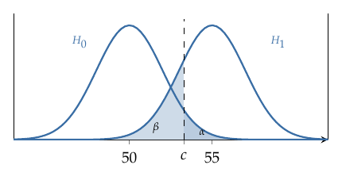

<details><summary>TikZ source</summary>

```latex
\begin{tikzpicture}
\begin{axis}[width=6.6cm,height=3.6cm,axis lines=bottom,ytick=\empty,xtick={50,53.29,55},
  xticklabels={$50$,$c$,$55$},ymin=0,ymax=0.22,xmin=43,xmax=62,tick label style={font=\scriptsize},
  samples=80,domain=43:62]
\addplot[fill=pyq!25,draw=none,domain=46:53.29] {exp(-(x-55)^2/8)/(2*sqrt(2*pi))} \closedcycle;
\addplot[fill=accent!35,draw=none,domain=53.29:58] {exp(-(x-50)^2/8)/(2*sqrt(2*pi))} \closedcycle;
\addplot[accent,thick] {exp(-(x-50)^2/8)/(2*sqrt(2*pi))};
\addplot[pyq,thick] {exp(-(x-55)^2/8)/(2*sqrt(2*pi))};
\draw[dashed] (axis cs:53.29,0)--(axis cs:53.29,0.21);
\node[font=\tiny,accent] at (axis cs:47,0.17) {$H_0$};
\node[font=\tiny,pyq] at (axis cs:59,0.17) {$H_1$};
\node[font=\tiny] at (axis cs:51.6,0.02) {$\beta$};
\node[font=\tiny] at (axis cs:54.4,0.012) {$\alpha$};
\end{axis}
\end{tikzpicture}
```
</details>


### Q4.26
*NAT · 2 marks · Hypothesis Tests: $z$ and $t$*

For a one-sided $z$-test of $H_0:\mu=50$ vs $H_1:\mu>50$ with $\sigma=10$ and $\alpha=0.05$, the smallest $n$ giving power at least 0.90 when $\mu=55$ is ____.

**Answer:** 35

**Solution:**

Idea: one-sided: $\sqrt n\,\frac{\delta}{\sigma}\ge z_\alpha+z_\beta$.
Work: $n\ge\big(\frac{(1.645+1.2816)\cdot10}{5}\big)^2=34.26$ ⇒ $35$. (Check Q4.25: $n=25$ gives only $0.80$.)


### Q4.27
*NAT · 1 mark · Hypothesis Tests: $z$ and $t$*

A two-sided $z$-test gives $z=2.1$. The $p$-value is ____\ (round to 4 decimals).

**Answer:** 0.0357–0.0358  (solution header: 0.0358)

**Solution:**

$2\big(1-\Phi(2.1)\big)=2(0.0179)$. One-sided would be half.


### Q4.28
*MSQ · 1 mark · Hypothesis Tests: $z$ and $t$*

A test gives $p$-value $0.03$. Which are correct?

- **(A)** $H_0$ is rejected at $\alpha=0.05$
- **(B)** $H_0$ is rejected at $\alpha=0.01$
- **(C)** The probability that $H_0$ is true is $0.03$
- **(D)** If $H_0$ were true, a statistic at least as extreme as the observed one would occur with probability $0.03$

**Answer:** A, D  (solution header: (A), (D))

**Solution:**

$p\le\alpha$ ⇔ reject: yes at 0.05, no at 0.01. (C) ✗ a $p$-value is computed assuming $H_0$; it is not $P(H_0)$.


### Q4.29
*NAT · 2 marks · Hypothesis Tests: $z$ and $t$*

A firm claims 60\% customer satisfaction. In a sample of 200, 108 are satisfied. The $z$-statistic for $H_0:p=0.6$ vs $H_1:p<0.6$ is ____\ (round to 3 decimals).

**Answer:** −1.732  (solution header: $-1.732$; reject)

**Solution:**

SE uses $p_0$: $\sqrt{\frac{0.6\cdot0.4}{200}}=0.0346$. $z=\frac{0.54-0.6}{0.0346}=-1.732<-1.645$ ⇒ reject (left tail).
Trap: a test uses $p_0$ in the SE; a CI uses $\hat p$.


### Q4.30
*MSQ · 2 marks · Hypothesis Tests: $z$ and $t$*

$n_1=50,\ \bar x_1=78,\ \sigma_1=10$ and $n_2=40,\ \bar x_2=74,\ \sigma_2=12$ (independent samples, $\sigma$'s known). Which are correct?

- **(A)** The test statistic for $H_0:\mu_1=\mu_2$ is about 1.69
- **(B)** $H_0$ is rejected against $H_1:\mu_1>\mu_2$ at $\alpha=0.05$
- **(C)** $H_0$ is rejected against $H_1:\mu_1\ne\mu_2$ at $\alpha=0.05$
- **(D)** The two-sided $p$-value is about 0.091

**Answer:** A, B, D  (solution header: (A), (B), (D))

**Solution:**

$z=\frac{4}{\sqrt{100/50+144/40}}=\frac{4}{\sqrt{5.6}}=1.690$. One-sided: $1.690>1.645$ ⇒ reject. Two-sided: $<1.96$ ⇒ do not reject. $p_{\text{two}}=2(1-0.9545)=0.091$.
Note: the same data can be significant one-sided and not two-sided --- the alternative must be fixed before seeing the data.


### Q4.31
*NAT · 1 mark · Hypothesis Tests: $z$ and $t$*

The data $12, 15, 11, 14, 13$ come from a normal population. The $t$-statistic for $H_0:\mu=11.5$ is ____\ (round to 2 decimals).

**Answer:** 2.12

**Solution:**

$\bar x=13$, $s^2=\frac{1+4+4+1+0}{4}=2.5$, $s=1.581$. $t=\frac{1.5}{1.581/\sqrt5}=2.12<2.776$ ⇒ do not reject.


### Q4.32
*NAT · 2 marks · Hypothesis Tests: $z$ and $t$*

Weight losses for 5 people (before $-$ after) are $3,5,2,6,4$ kg. The paired $t$-statistic for $H_0:\mu_d=0$ is ____\ (round to 2 decimals).

**Answer:** 5.66

**Solution:**

$\bar d=4$, $s_d^2=\frac{1+1+4+4+0}{4}=2.5$. $t=\frac{4}{1.581/\sqrt5}=5.66>2.776$ ⇒ reject.
Note: same subjects ⇒ one sample of differences, df $n-1$.


### Q4.33
*NAT · 2 marks · Hypothesis Tests: $z$ and $t$*

Independent normal samples with equal variances: $n_1=10,\ \bar x_1=25,\ s_1=3$; $n_2=12,\ \bar x_2=22,\ s_2=4$. The pooled $t$-statistic is ____\ (round to 3 decimals).

**Answer:** 1.955

**Solution:**

$s_p^2=\frac{9\cdot9+11\cdot16}{20}=12.85$, $s_p=3.585$; SE $=3.585\sqrt{\frac1{10}+\frac1{12}}=1.535$; $t=\frac{3}{1.535}=1.955<2.086$ ⇒ do not reject.


### Q4.34
*MCQ · 2 marks · $\chi^2$ Tests and Choosing a Test*

$n=10$ from a normal population gives $s^2=18$. Test $H_0:\sigma^2=10$ vs $H_1:\sigma^2>10$ at $\alpha=0.05$.

- **(A)** $\chi^2=16.2$, reject $H_0$
- **(B)** $\chi^2=16.2$, do not reject
- **(C)** $\chi^2=18$, reject
- **(D)** $\chi^2=14.58$, do not reject

**Answer:** B  (solution header: (B))

**Solution:**

$\chi^2=\frac{(n-1)s^2}{\sigma_0^2}=\frac{9\cdot18}{10}=16.2<16.919$.


### Q4.35
*NAT · 2 marks · $\chi^2$ Tests and Choosing a Test*

A die rolled 120 times shows faces 1--6 with frequencies $25,17,15,23,24,16$. The $\chi^2$ statistic for testing fairness is ____\ (round to 2 decimals).

**Answer:** 5.00

**Solution:**

$E_i=20$: $\frac{25+9+25+9+16+16}{20}=5.0$; df 5; $5<11.07$ ⇒ fair.


### Q4.36
*NAT · 2 marks · $\chi^2$ Tests and Choosing a Test*

In 200 families with 3 children, the numbers with 0, 1, 2, 3 boys are $20, 70, 80, 30$. The $\chi^2$ statistic for the model ``Bin$(3,\tfrac12)$'' is ____\ (round to 3 decimals).

**Answer:** 2.667

**Solution:**

Expected (Bin$(3,\frac12)$ × 200): $25,75,75,25$. $\chi^2=\frac{25}{25}+\frac{25}{75}+\frac{25}{75}+\frac{25}{25}=2.667$; df $=4-1=3$ (no parameter estimated); $<7.815$.


### Q4.37
*NAT · 1 mark · $\chi^2$ Tests and Choosing a Test*

A Poisson model is fitted to count data grouped into 6 categories, with $\lambda$ estimated from the data. The degrees of freedom of the $\chi^2$ goodness-of-fit test are ____.

**Answer:** 4

**Solution:**

df $=k-1-m=6-1-1$, where $m$ = number of parameters estimated from the data.


### Q4.38
*NAT · 2 marks · $\chi^2$ Tests and Choosing a Test*

\begin{tabular}{l|cc}
 & Pass & Fail\\\hline
Male & 30 & 20\\
Female & 40 & 10
\end{tabular}

The $\chi^2$ statistic (no continuity correction) is ____\ (round to 3 decimals).

**Answer:** 4.762

**Solution:**

Expected $\frac{RC}{N}$: $35,15,35,15$. $\chi^2=2\big(\frac{25}{35}+\frac{25}{15}\big)=4.762$, df 1, $>3.841$ ⇒ reject.
Shortcut: $\frac{N(ad-bc)^2}{(a+b)(c+d)(a+c)(b+d)}=\frac{100\cdot500^2}{50\cdot50\cdot70\cdot30}$. (Yates' correction gives 3.857 --- still reject.)


### Q4.39
*NAT · 2 marks · $\chi^2$ Tests and Choosing a Test*

\begin{tabular}{l|ccc}
 & X & Y & Z\\\hline
A & 20 & 30 & 50\\
B & 30 & 20 & 50
\end{tabular}

The $\chi^2$ statistic for independence is ____.

**Answer:** 4.0

**Solution:**

Row totals 100, 100; column totals 50, 50, 100; $N=200$ ⇒ expected $25,25,50$ in each row. $\chi^2=2\big(\frac{25}{25}+\frac{25}{25}+0\big)=4$; df $=(2-1)(3-1)=2$; $<5.991$ ⇒ do not reject.


### Q4.40
*MCQ · 1 mark · $\chi^2$ Tests and Choosing a Test*

Match List-I with List-II.\\
\begin{tabular}{@{}l l@{}}
P. Blood pressure of the same 12 patients before and after a drug & 1. $\chi^2$ goodness of fit\\
Q. Is a die fair, from 600 rolls? & 2. Paired $t$-test\\
R. Are gender and product preference (3 products) associated? & 3. Large-sample $z$-test\\
S. Does the mean life of 400 bulbs equal 1000 h ($\sigma$ unknown)? & 4. $\chi^2$ test of independence\\
\end{tabular}

- **(A)** P-2, Q-1, R-4, S-3
- **(B)** P-3, Q-1, R-4, S-2
- **(C)** P-2, Q-4, R-1, S-3
- **(D)** P-2, Q-1, R-3, S-4

**Answer:** A  (solution header: (A))

**Solution:**

Same subjects twice → paired $t$; one categorical variable vs a model → goodness of fit; two categorical variables → independence; large-sample mean → $z$.


# Part: Days 5-8: Linear Algebra


## Day 5: Vector Spaces, Independence, Rank, Nullity, Determinants


### Q5.01
*MSQ · 2 marks · Subspaces and Dimension*

Which of the following are subspaces of $\mathbb R^3$?

- **(A)** $\{x: x_1+2x_2-x_3=0\}$
- **(B)** $\{x: x_1x_2=0\}$
- **(C)** $\{\alpha^2(1,2,0)^T+\beta^2(1,0,1)^T:\ \alpha,\beta\in\mathbb R\}$
- **(D)** $\{x: x_1=x_3,\ x_2=2x_1\}$

**Answer:** A, D  (solution header: (A), (D))

**Solution:**

Idea: a subspace must contain 0 and be closed under addition and scaling; sets defined by \emph{homogeneous linear} equations always are.
Work: (A) one homogeneous equation: a plane through 0 ✓. (B) ✗ $(1,0,0)+(0,1,0)=(1,1,0)$ has $x_1x_2=1$. (C) ✗ only non-negative combinations: $(1,2,0)$ is in it but $-(1,2,0)$ is not (a cone). (D) two homogeneous equations: a line through 0 ✓.


### Q5.02
*MSQ · 1 mark · Subspaces and Dimension*

Which of the following are subspaces of the space of real $2\times2$ matrices?

- **(A)** all symmetric matrices
- **(B)** all singular matrices
- **(C)** all matrices with trace 0
- **(D)** all matrices with $A^2=A$

**Answer:** A, C  (solution header: (A), (C))

**Solution:**

(A) sums and multiples of symmetric matrices are symmetric ✓. (B) ✗ $\operatorname{diag}(1,0)+\operatorname{diag}(0,1)=I$. (C) trace is linear ✓. (D) ✗ $I^2=I$ but $(2I)^2\ne2I$.


### Q5.03
*MSQ · 1 mark · Subspaces and Dimension*

$\mathcal P_3$ is the space of real polynomials of degree at most 3. Which are subspaces of $\mathcal P_3$?

- **(A)** $\{p: p(1)=0\}$
- **(B)** $\{p: p(0)=1\}$
- **(C)** $\{p: p(-x)=p(x)\ \forall x\}$
- **(D)** $\{p: \deg p=3\}$

**Answer:** A, C  (solution header: (A), (C))

**Solution:**

(A) evaluation at 1 is linear ✓. (B) ✗ does not contain the zero polynomial. (C) even polynomials $a+bx^2$ ✓. (D) ✗ $x^3+(-x^3+x)=x$ has degree 1, and 0 is missing.


### Q5.04
*NAT · 1 mark · Subspaces and Dimension*

The dimension of the space of real $3\times3$ skew-symmetric matrices is ____.

**Answer:** 3

**Solution:**

Diagonal is forced to 0; the 3 entries above the diagonal are free. In general $\frac{n(n-1)}2$.


### Q5.05
*NAT · 1 mark · Subspaces and Dimension*

The dimension of the space of real $4\times4$ symmetric matrices with trace 0 is ____.

**Answer:** 9

**Solution:**

Symmetric $4\times4$: $\frac{4\cdot5}{2}=10$; the trace condition is one independent linear constraint: $10-1=9$.


### Q5.06
*NAT · 2 marks · Subspaces and Dimension*

In $\mathbb R^4$, $U=\{x: x_1+x_2=0\}$ and $W=\{x: x_3+x_4=0\}$. The dimension of $U\cap W$ is ____.

**Answer:** 2

**Solution:**

$U\cap W$ is cut out by 2 independent equations in $\mathbb R^4$: $\dim=4-2=2$. (Check: $\dim(U+W)=3+3-2=4$.)


### Q5.07
*MCQ · 1 mark · Subspaces and Dimension*

$U$ and $W$ are 3-dimensional subspaces of $\mathbb R^5$. The smallest possible dimension of $U\cap W$ is

- **(A)** 0
- **(B)** 1
- **(C)** 2
- **(D)** 3

**Answer:** B  (solution header: (B) 1)

**Solution:**

$\dim(U\cap W)=\dim U+\dim W-\dim(U+W)\ge3+3-5=1$.


### Q5.08
*NAT · 2 marks · Subspaces and Dimension*

$S_1=\{x\in\mathbb R^3: x^Tx\le 9\}$ and $S_2$ is any 2-dimensional subspace of $\mathbb R^3$. The area of $S_1\cap S_2$ is ____\ (round to 2 decimals).

**Answer:** 28.26–28.28  (solution header: $9\pi\approx28.27$)

**Solution:**

Idea: a 2-dimensional subspace is a plane through the centre, so it cuts the ball in a great disk.
Work: radius 3, area $9\pi$. (PYQ 2026 used radius 4: $16\pi$.)


### Q5.09
*NAT · 1 mark · Linear Independence, Bases, Coordinates*

The vectors $(1,2,3)$, $(4,5,6)$, $(7,8,k)$ are linearly dependent for $k=$ ____.

**Answer:** 9

**Solution:**

$\det\begin{pmatrix}1&2&3\\4&5&6\\7&8&k\end{pmatrix}=27-3k=0$.


### Q5.10
*MSQ · 1 mark · Linear Independence, Bases, Coordinates*

Which are correct?

- **(A)** Any set of non-zero mutually orthogonal vectors is linearly independent
- **(B)** $\mathbb R^n$ has a unique orthonormal basis
- **(C)** Any linearly independent set in $\mathbb R^n$ is orthogonal
- **(D)** Any $n+1$ vectors in $\mathbb R^n$ are linearly dependent

**Answer:** A, D  (solution header: (A), (D))

**Solution:**

(A) take dot products of $\sum c_iv_i=0$ with each $v_j$ ✓. (B) ✗ any rotation of a basis is another orthonormal basis. (C) ✗ $(1,0),(1,1)$. (D) dimension is $n$ ✓.


### Q5.11
*MSQ · 2 marks · Linear Independence, Bases, Coordinates*

$\{u,v,w\}$ is linearly independent. Which of the following sets are linearly independent?

- **(A)** $\{u+v,\ v+w,\ w+u\}$
- **(B)** $\{u-v,\ v-w,\ w-u\}$
- **(C)** $\{u,\ u+v,\ u+v+w\}$
- **(D)** $\{u+2v,\ 2u+4v,\ w\}$

**Answer:** A, C  (solution header: (A), (C))

**Solution:**

Idea: write the new vectors in the old basis; the set is independent iff the coefficient matrix is invertible.
Work: (A) $\det\begin{pmatrix}1&1&0\\0&1&1\\1&0&1\end{pmatrix}=2$ ✓. (B) the three vectors sum to 0 ✗. (C) triangular with ones on the diagonal ✓. (D) $2u+4v=2(u+2v)$ ✗.


### Q5.12
*NAT · 1 mark · Linear Independence, Bases, Coordinates*

The coordinates of $(3,5)$ in the basis $\{(1,1),(1,-1)\}$ are $(c_1,c_2)$. Then $c_1=$ ____.

**Answer:** 4

**Solution:**

$c_1+c_2=3$, $c_1-c_2=5$ ⇒ $c_1=4$, $c_2=-1$.


### Q5.13
*NAT · 1 mark · Linear Independence, Bases, Coordinates*

The dimension of $\operatorname{span}\{(1,2,1,0),\ (2,4,2,0),\ (0,1,1,1),\ (1,3,2,1)\}$ is ____.

**Answer:** 2

**Solution:**

$v_2=2v_1$ and $v_4=v_1+v_3$; $v_1,v_3$ are independent.


### Q5.14
*MCQ · 1 mark · Linear Independence, Bases, Coordinates*

Which of the following is a basis of $\mathcal P_2$ (polynomials of degree at most 2)?

- **(A)** $\{1-x,\ x-x^2,\ x^2-1\}$
- **(B)** $\{1+x,\ x+x^2,\ 1+x^2\}$
- **(C)** $\{1,\ x,\ 2+3x\}$
- **(D)** $\{x,\ x^2\}$

**Answer:** B  (solution header: (B))

**Solution:**

(A) the three sum to 0. (B) coefficient matrix has determinant 2 ✓. (C) $2+3x\in\operatorname{span}\{1,x\}$. (D) only 2 vectors, but $\dim\mathcal P_2=3$.


### Q5.15
*MCQ · 2 marks · Linear Independence, Bases, Coordinates*

$x_1,\dots,x_n$ are linearly independent vectors in $\mathbb R^n$ and $A_{ij}=x_i^Tx_j$. Which is correct?

- **(A)** $A$ is invertible
- **(B)** 0 is a singular value of $A$
- **(C)** $\det A=0$
- **(D)** $z^TAz=0$ for some $z\ne0$

**Answer:** A  (solution header: (A))

**Solution:**

$A=X^TX$ with $X=[x_1\cdots x_n]$ invertible, so $\det A=(\det X)^2>0$ and $z^TAz=\|Xz\|^2>0$ for $z\ne0$. $A$ is positive definite.


### Q5.16
*NAT · 1 mark · Rank and Nullity*

The rank of $\begin{pmatrix}1&2&3&4\\2&4&6&8\\1&3&5&7\\0&1&2&3\end{pmatrix}$ is ____.

**Answer:** 2

**Solution:**

$R_2=2R_1$; $R_3-R_1=(0,1,2,3)=R_4$. Two independent rows.


### Q5.17
*NAT · 2 marks · Rank and Nullity*

$A$ is the $5\times5$ matrix with $a_{ij}=i+j$. The rank of $A$ is ____.

**Answer:** 2

**Solution:**

Idea: $a_{ij}=i\cdot1+1\cdot j$ is a sum of two rank-1 matrices: $A=r\mathbf 1^T+\mathbf 1 r^T$ with $r=(1,\dots,5)^T$.
Work: rank $\le2$, and two rows are clearly independent, so rank 2 for any $n\ge2$.


### Q5.18
*NAT · 1 mark · Rank and Nullity*

$J$ is the $5\times5$ matrix of all ones. The nullity of $J$ is ____.

**Answer:** 4

**Solution:**

$\operatorname{rank}J=1$, nullity $=5-1$.


### Q5.19
*MSQ · 2 marks · Rank and Nullity*

For real matrices of compatible sizes, which are always correct?

- **(A)** $\operatorname{rank}(A^TA)=\operatorname{rank}(A)$
- **(B)** $\operatorname{rank}(AB)\le\min(\operatorname{rank}A,\operatorname{rank}B)$
- **(C)** $\operatorname{rank}(A+B)=\operatorname{rank}A+\operatorname{rank}B$
- **(D)** $\operatorname{rank}(A)=\operatorname{rank}(A^T)$

**Answer:** A, B, D  (solution header: (A), (B), (D))

**Solution:**

(A) $A^TAx=0\Rightarrow\|Ax\|^2=0$, so the null spaces agree. (C) ✗ e.g.\ $B=-A$.


### Q5.20
*NAT · 1 mark · Rank and Nullity*

$A$ is $5\times7$ with rank 3. $\dim N(A)+\dim N(A^T)$ is ____.

**Answer:** 6

**Solution:**

$\dim N(A)=7-3=4$, $\dim N(A^T)=5-3=2$.


### Q5.21
*NAT · 1 mark · Rank and Nullity*

$A$ is $4\times4$ with rank 2. The rank of $\operatorname{adj}(A)$ is ____.

**Answer:** 0

**Solution:**

Idea: $\operatorname{rank}(\operatorname{adj}A)=n$ if rank $n$; $1$ if rank $n-1$; $0$ if rank $\le n-2$.
Work: Rank $2=n-2$ ⇒ every $3\times3$ minor is 0 ⇒ $\operatorname{adj}A=0$.
Trap: answering 1 or 2.


### Q5.22
*NAT · 2 marks · Rank and Nullity*

$A$ is $4\times5$ with rank 4 and $B$ is $5\times3$ with rank 3. The smallest possible rank of $AB$ is ____.

**Answer:** 2

**Solution:**

Sylvester: $\operatorname{rank}(AB)\ge\operatorname{rank}A+\operatorname{rank}B-n=4+3-5=2$ (with $n=5$ the shared dimension). The bound is attained.


### Q5.23
*MCQ · 2 marks · Rank and Nullity*

$A=\begin{pmatrix}1&1&1\\1&a&1\\1&1&a\end{pmatrix}$. Then

- **(A)** rank 1 iff $a=1$; otherwise rank 3
- **(B)** rank 2 iff $a=1$; otherwise rank 3
- **(C)** rank 1 iff $a=-2$; otherwise rank 3
- **(D)** rank 2 for every $a$

**Answer:** A  (solution header: (A))

**Solution:**

$\det A=(a-1)^2$. At $a=1$ all rows equal: rank 1. Otherwise $\det\ne0$: rank 3. Rank 2 never occurs.


### Q5.24
*NAT · 1 mark · Rank and Nullity*

$u=(1,2,0)^T$, $v=(0,1,3)^T$. The rank of $uv^T+vu^T$ is ____.

**Answer:** 2

**Solution:**

$C(uv^T+vu^T)\subseteq\operatorname{span}\{u,v\}$ and $u,v$ are independent, so the rank is 2.


### Q5.25
*MSQ · 2 marks · The Four Fundamental Subspaces*

$A$ is $3\times4$ with rank 2. Which are correct?

- **(A)** $C(A)$ is a 2-dimensional subspace of $\mathbb R^3$
- **(B)** Every vector of $N(A)$ is orthogonal to every row of $A$
- **(C)** $Ax=b$ is solvable for every $b\in\mathbb R^3$
- **(D)** $\dim N(A^T)=1$

**Answer:** A, B, D  (solution header: (A), (B), (D))

**Solution:**

(C) ✗ $C(A)$ is only 2-dimensional. (D) $\dim N(A^T)=3-2$.


### Q5.26
*MCQ · 1 mark · The Four Fundamental Subspaces*

For $A=\begin{pmatrix}1&2&0&1\\0&0&1&3\end{pmatrix}$, which vector is \emph{not} in $N(A)$?

- **(A)** $(-2,1,0,0)$
- **(B)** $(-1,0,-3,1)$
- **(C)** $(0,0,0,0)$
- **(D)** $(1,-1,0,0)$

**Answer:** D  (solution header: (D))

**Solution:**

$A(1,-1,0,0)^T=(-1,0)^T\ne0$. The others give 0.


### Q5.27
*NAT · 1 mark · The Four Fundamental Subspaces*

$A$ is $6\times4$ and $Ax=0$ has only the trivial solution. $\dim N(A^T)$ is ____.

**Answer:** 2

**Solution:**

Trivial null space ⇒ rank 4 ⇒ $\dim N(A^T)=6-4$.


### Q5.28
*NAT · 1 mark · Determinants*

$\det\begin{pmatrix}2&1&1\\1&2&1\\1&1&2\end{pmatrix}$ is ____.

**Answer:** 4

**Solution:**

$I+J$ with $J$ the $3\times3$ ones matrix: eigenvalues $1+3$, $1$, $1$. Product 4.


### Q5.29
*NAT · 2 marks · Determinants*

$M=\begin{pmatrix}2&1&0\\1&2&1\\0&1&2\end{pmatrix}$. $\det(M^2-4M)$ is ____.

**Answer:** −16  (solution header: $-16$)

**Solution:**

Idea: factor: $\det(M^2-4M)=\det M\cdot\det(M-4I)$.
Work: $\det M=4$; $\det(M-4I)=\det\begin{pmatrix}-2&1&0\\1&-2&1\\0&1&-2\end{pmatrix}=-4$. Product $-16$.
Note: PYQ 2024 used $\det(M^2+12M)=\det M\det(M+12I)$.


### Q5.30
*NAT · 1 mark · Determinants*

$A$ is $3\times3$ with $\det A=5$. $\det(2\operatorname{adj}A)$ is ____.

**Answer:** 200

**Solution:**

$\det(\operatorname{adj}A)=(\det A)^{n-1}=25$; $\det(2B)=2^3\det B$ ⇒ $8\cdot25$.


### Q5.31
*NAT · 1 mark · Determinants*

$\det\begin{pmatrix}1&1&1\\1&2&4\\1&4&16\end{pmatrix}$ is ____.

**Answer:** 6

**Solution:**

Vandermonde in $1,2,4$: $(2-1)(4-1)(4-2)=6$.


### Q5.32
*NAT · 1 mark · Determinants*

$\det\begin{pmatrix}1&2&5&6\\3&4&7&8\\0&0&2&0\\0&0&1&3\end{pmatrix}$ is ____.

**Answer:** −12  (solution header: $-12$)

**Solution:**

Block upper-triangular: $\det\begin{pmatrix}1&2\\3&4\end{pmatrix}\det\begin{pmatrix}2&0\\1&3\end{pmatrix}=(-2)(6)$.


### Q5.33
*NAT · 1 mark · Determinants*

$u=(1,2,3)^T$, $v=(1,1,1)^T$. $\det(I_3+uv^T)$ is ____.

**Answer:** 7

**Solution:**

$\det(I+uv^T)=1+v^Tu=1+6$.


### Q5.34
*NAT · 2 marks · Determinants*

$T_n$ is the $n\times n$ matrix with 2 on the diagonal, $-1$ on the two adjacent diagonals and 0 elsewhere. $\det T_6$ is ____.

**Answer:** 7

**Solution:**

Idea: expand along the first row: $D_n=2D_{n-1}-D_{n-2}$, $D_1=2$, $D_2=3$.
Work: $D_n=n+1$, so $D_6=7$.


### Q5.35
*MSQ · 1 mark · Determinants*

For $n\times n$ real matrices, which are always correct?

- **(A)** $\det(A+B)=\det A+\det B$
- **(B)** $\det(kA)=k^n\det A$
- **(C)** a skew-symmetric matrix of odd order has determinant 0
- **(D)** $\det A=0$ implies $A$ has a zero row or column

**Answer:** B, C  (solution header: (B), (C))

**Solution:**

(C) $\det A=\det A^T=\det(-A)=(-1)^n\det A$. (D) ✗ $\begin{pmatrix}1&1\\1&1\end{pmatrix}$.


### Q5.36
*NAT · 2 marks · Determinants*

$A$ is the $4\times4$ matrix with $a_{ij}=|i-j|$. $\det A$ is ____.

**Answer:** −12  (solution header: $-12$)

**Solution:**

For $a_{ij}=|i-j|$ of order $n$: $\det=(-1)^{n-1}(n-1)2^{n-2}$. With $n=4$: $-3\cdot4$.
Note: direct row reduction ($R_i-R_{i+1}$ first) gives the same in a few lines.


## Day 6: Linear Systems, Gaussian Elimination, LU, Partitioned Matrices


### Q6.01
*MSQ · 2 marks · Consistency and Solution Sets*

Consider $x+y+z=6,\ \ x+2y+3z=10,\ \ x+2y+\lambda z=\mu$. Which are correct?

- **(A)** Unique solution whenever $\lambda\ne3$
- **(B)** No solution when $\lambda=3,\ \mu\ne10$
- **(C)** Infinitely many solutions when $\lambda=3,\ \mu=10$
- **(D)** No solution when $\lambda\ne3,\ \mu=10$

**Answer:** A, B, C  (solution header: (A), (B), (C))

**Solution:**

Idea: eliminate until the parameter sits alone on a pivot.
Work: $R_3-R_2$: $(\lambda-3)z=\mu-10$. $\lambda\ne3$: unique. $\lambda=3$: the row is $0=\mu-10$, inconsistent unless $\mu=10$, then one free variable. (D) ✗ $\lambda\ne3$ is always unique.


### Q6.02
*NAT · 2 marks · Consistency and Solution Sets*

The system $\begin{pmatrix}k&1&1\\1&k&1\\1&1&k\end{pmatrix}x=0$ has a non-trivial solution for some values of $k$. The sum of all such distinct values is ____.

**Answer:** −1  (solution header: $-1$)

**Solution:**

$\det=(k-1)^2(k+2)=0$ ⇒ $k=1$ or $k=-2$; sum of distinct values $-1$.
Note: $kI+(J-I)$ has eigenvalues $k+2$ and $k-1$ (twice).


### Q6.03
*NAT · 1 mark · Consistency and Solution Sets*

$A$ is $4\times6$ with rank 3 and $Ax=b$ is consistent. The number of free variables in its general solution is ____.

**Answer:** 3

**Solution:**

Free variables $=n-r=6-3$.


### Q6.04
*MSQ · 2 marks · Consistency and Solution Sets*

$A$ is $m\times n$. Which are always correct?

- **(A)** If $m<n$ and $Ax=b$ is consistent, it has infinitely many solutions
- **(B)** If $\operatorname{rank}A=m$, then $Ax=b$ is consistent for every $b$
- **(C)** If $\operatorname{rank}A=n$, then $Ax=b$ has at most one solution
- **(D)** If $m>n$, then $Ax=b$ is never consistent

**Answer:** A, B, C  (solution header: (A), (B), (C))

**Solution:**

(A) nullity $\ge n-m>0$, so solutions come in families. (B) $C(A)=\mathbb R^m$. (C) trivial null space. (D) ✗ e.g.\ $b=0$.


### Q6.05
*MSQ · 2 marks · Consistency and Solution Sets*

$x_1$ and $x_2$ are solutions of $Ax=b$ with $b\ne0$. Which are correct?

- **(A)** $x_1-x_2$ solves $Ax=0$
- **(B)** $x_1+x_2$ solves $Ax=b$
- **(C)** $\tfrac12(x_1+x_2)$ solves $Ax=b$
- **(D)** $2x_1-x_2$ solves $Ax=b$

**Answer:** A, C, D  (solution header: (A), (C), (D))

**Solution:**

Idea: a combination $\sum c_ix_i$ solves $Ax=b$ iff $\sum c_i=1$; it solves $Ax=0$ iff $\sum c_i=0$.
Work: (A) $1-1=0$ ✓. (B) $1+1=2$ ✗. (C) $\frac12+\frac12$ ✓. (D) $2-1$ ✓.


### Q6.06
*NAT · 1 mark · Consistency and Solution Sets*

Solve $2x+y-z=8,\ \ -3x-y+2z=-11,\ \ -2x+y+2z=-3$. The value of $x+y+z$ is ____.

**Answer:** 4

**Solution:**

Elimination gives $(x,y,z)=(2,3,-1)$.


### Q6.07
*NAT · 2 marks · Consistency and Solution Sets*

The quadratic $p(x)=c_0+c_1x+c_2x^2$ passes through $(0,1)$, $(1,3)$, $(2,7)$. $p(3)$ is ____.

**Answer:** 13

**Solution:**

Vandermonde system: $c_0=1$, $c_0+c_1+c_2=3$, $c_0+2c_1+4c_2=7$ ⇒ $c=(1,1,1)$, $p(3)=1+3+9$.
Note: $n$ distinct points determine a unique polynomial of degree $<n$ (Vandermonde is invertible).


### Q6.08
*NAT · 1 mark · Consistency and Solution Sets*

The system $x+y=2,\ \ x-y=0,\ \ 2x+y=k$ is consistent only for $k=$ ____.

**Answer:** 3

**Solution:**

The first two equations force $x=y=1$; the third then needs $k=3$.


### Q6.09
*NAT · 1 mark · Consistency and Solution Sets*

$A=\begin{pmatrix}1&2\\2&4\\3&6\end{pmatrix}$ and $b=(1,k,3)^T$. $Ax=b$ is consistent only for $k=$ ____.

**Answer:** 2

**Solution:**

$C(A)=\operatorname{span}\{(1,2,3)\}$, so $b$ must be a multiple of it: $k=2$.


### Q6.10
*NAT · 1 mark · Consistency and Solution Sets*

By Cramer's rule, the value of $y$ in $2x+3y=8,\ \ x-y=-1$ is ____.

**Answer:** 2

**Solution:**

$D=\det\begin{pmatrix}2&3\\1&-1\end{pmatrix}=-5$, $D_y=\det\begin{pmatrix}2&8\\1&-1\end{pmatrix}=-10$, $y=\frac{D_y}{D}=2$.


### Q6.11
*NAT · 1 mark · Consistency and Solution Sets*

The solutions of $x+y+z=3,\ \ x-y+z=1$ form a line. On this line, the point with $x=0$ has $z=$ ____.

**Answer:** 2

**Solution:**

Subtracting: $y=1$; then $x+z=2$, so $x=0$ gives $z=2$.


### Q6.12
*MSQ · 1 mark · Gaussian Elimination*

For a dense $n\times n$ system, which are correct?

- **(A)** Gaussian elimination to upper-triangular form takes $\Theta(n^3)$ operations
- **(B)** Back-substitution on a triangular system takes $\Theta(n^2)$ operations
- **(C)** Computing $A^{-1}$ and then $A^{-1}b$ is cheaper than elimination
- **(D)** Elimination on an already upper-triangular matrix needs no row operations

**Answer:** A, B, D  (solution header: (A), (B), (D))

**Solution:**

(C) ✗ forming $A^{-1}$ costs about three times as much as elimination and is less accurate.


### Q6.13
*NAT · 1 mark · Gaussian Elimination*

Gaussian elimination (no row exchanges) on $\begin{pmatrix}2&1&1\\4&3&3\\8&7&9\end{pmatrix}$ gives pivots $p_1,p_2,p_3$. $p_3$ is ____.

**Answer:** 2

**Solution:**

$R_2-2R_1=(0,1,1)$, $R_3-4R_1=(0,3,5)$, then $R_3-3R_2=(0,0,2)$. Pivots $2,1,2$ (product $=\det A=4$).


### Q6.14
*MCQ · 1 mark · Gaussian Elimination*

The reduced row echelon form of $\begin{pmatrix}1&2&3\\2&4&7\end{pmatrix}$ is

- **(A)** $\begin{pmatrix}1&2&0\\0&0&1\end{pmatrix}$
- **(B)** $\begin{pmatrix}1&0&0\\0&1&0\end{pmatrix}$
- **(C)** $\begin{pmatrix}1&2&3\\0&0&1\end{pmatrix}$
- **(D)** $\begin{pmatrix}1&2&0\\0&1&0\end{pmatrix}$

**Answer:** A  (solution header: (A))

**Solution:**

$R_2-2R_1=(0,0,1)$, then $R_1-3R_2=(1,2,0)$.


### Q6.15
*NAT · 1 mark · Gaussian Elimination*

$E$ is the $3\times3$ elementary matrix that subtracts 3 times row 1 from row 2. The $(2,1)$ entry of $E^{-1}$ is ____.

**Answer:** 3

**Solution:**

The inverse \emph{adds} back 3 times row 1: $E^{-1}=I+3e_2e_1^T$.


### Q6.16
*MSQ · 1 mark · Gaussian Elimination*

Elementary row operations on $A$ always preserve

- **(A)** the row space
- **(B)** the column space
- **(C)** the null space
- **(D)** the rank

**Answer:** A, C, D  (solution header: (A), (C), (D))

**Solution:**

(B) ✗ e.g.\ $\begin{pmatrix}1\\1\end{pmatrix}\to\begin{pmatrix}1\\0\end{pmatrix}$ changes the column space. Row operations are left-multiplication by invertible $E$, so $N(EA)=N(A)$.


### Q6.17
*NAT · 1 mark · Gaussian Elimination*

$\det A=5$ for a $3\times3$ matrix $A$. $B$ is obtained from $A$ by swapping rows 1 and 2, then multiplying row 3 by 3, then adding twice row 1 to row 2. $\det B$ is ____.

**Answer:** −15  (solution header: $-15$)

**Solution:**

Swap: $\times(-1)$. Scale a row by 3: $\times3$. Add a multiple of a row: unchanged. $5\cdot(-1)\cdot3$.


### Q6.18
*NAT · 1 mark · Gaussian Elimination*

The sum of all entries of $\begin{pmatrix}1&2\\3&5\end{pmatrix}^{-1}$ is ____.

**Answer:** −1  (solution header: $-1$)

**Solution:**

$\det=-1$, inverse $=\begin{pmatrix}-5&2\\3&-1\end{pmatrix}$; sum $-1$.


### Q6.19
*NAT · 1 mark · Gaussian Elimination*

The $(1,3)$ entry of $\begin{pmatrix}1&2&3\\0&1&4\\0&0&1\end{pmatrix}^{-1}$ is ____.

**Answer:** 5

**Solution:**

Back-substitution on $AX=I$, or: $A=I+N$ with $N$ nilpotent, $A^{-1}=I-N+N^2$. $(N^2)_{13}=2\cdot4=8$, so $(A^{-1})_{13}=-3+8=5$.


### Q6.20
*NAT · 2 marks · LU Decomposition*

$A=\begin{pmatrix}2&1&1\\4&3&3\\8&7&9\end{pmatrix}=LU$ with $L$ unit lower-triangular. The entry $l_{32}$ is ____.

**Answer:** 3

**Solution:**

Multipliers: $l_{21}=2$, $l_{31}=4$; after step 1 rows 2, 3 are $(0,1,1)$, $(0,3,5)$, so $l_{32}=3$.
Trap: $l_{32}$ uses the \emph{updated} entries, not the original $a_{32}/a_{22}$.


### Q6.21
*NAT · 2 marks · LU Decomposition*

$A=LU$ with $L=\begin{pmatrix}1&0&0\\2&1&0\\4&3&1\end{pmatrix}$, $U=\begin{pmatrix}2&1&1\\0&1&1\\0&0&2\end{pmatrix}$ and $b=(7,19,49)^T$. The solution of $Ax=b$ has $x_3=$ ____.

**Answer:** 3

**Solution:**

Forward $Ly=b$: $y=(7,5,6)$. Back $Ux=y$: $x_3=6/2=3$ (full solution $(1,2,3)$).


### Q6.22
*MSQ · 2 marks · LU Decomposition*

Which matrices have an LU factorisation ($L$ unit lower-triangular, $U$ upper-triangular) \emph{without} row exchanges?

- **(A)** $\begin{pmatrix}0&1\\1&1\end{pmatrix}$
- **(B)** $\begin{pmatrix}1&2\\2&4\end{pmatrix}$
- **(C)** $\begin{pmatrix}2&1\\4&3\end{pmatrix}$
- **(D)** $\begin{pmatrix}1&1&1\\1&1&2\\1&2&3\end{pmatrix}$

**Answer:** B, C  (solution header: (B), (C))

**Solution:**

Idea: without row exchanges, elimination fails exactly when a pivot (the ratio of consecutive leading principal minors) is 0 before the last step.
Work: (A) first pivot 0 ✗. (B) $L=\begin{pmatrix}1&0\\2&1\end{pmatrix}$, $U=\begin{pmatrix}1&2\\0&0\end{pmatrix}$ ✓ (a zero \emph{last} pivot is fine). (C) pivots 2, 1 ✓. (D) second leading minor is 0 and the matrix is invertible ✗.


### Q6.23
*NAT · 1 mark · LU Decomposition*

The Cholesky factor $L$ (lower-triangular, positive diagonal, $A=LL^T$) of $A=\begin{pmatrix}4&2\\2&5\end{pmatrix}$ has $l_{22}=$ ____.

**Answer:** 2

**Solution:**

$l_{11}=2$, $l_{21}=2/2=1$, $l_{22}=\sqrt{5-1}=2$.


### Q6.24
*NAT · 1 mark · LU Decomposition*

$A=\begin{pmatrix}4&2\\2&5\end{pmatrix}=LDL^T$ with $L$ unit lower-triangular and $D=\operatorname{diag}(d_1,d_2)$. $d_2$ is ____.

**Answer:** 4

**Solution:**

$d_1=4$, $l_{21}=\frac24$, $d_2=5-\frac{2^2}{4}=4$. (Cholesky is $L\sqrt D$.)


### Q6.25
*NAT · 1 mark · LU Decomposition*

$A=\begin{pmatrix}1&2&3\\2&5&7\\3&8&12\end{pmatrix}$. Using its LU factorisation, $\det A$ is ____.

**Answer:** 1

**Solution:**

$L=\begin{pmatrix}1&0&0\\2&1&0\\3&2&1\end{pmatrix}$, $U=\begin{pmatrix}1&2&3\\0&1&1\\0&0&1\end{pmatrix}$. $\det A=\prod u_{ii}=1$.


### Q6.26
*MCQ · 1 mark · LU Decomposition*

$A$ is dense $n\times n$. Solving $Ax=b$ for $k$ different right-hand sides using one LU factorisation costs

- **(A)** $\Theta(kn^3)$
- **(B)** $\Theta(n^3+kn^2)$
- **(C)** $\Theta(n^2+kn^3)$
- **(D)** $\Theta(kn^2)$

**Answer:** B  (solution header: (B))

**Solution:**

Factor once $\Theta(n^3)$; each right-hand side needs two triangular solves, $\Theta(n^2)$.


### Q6.27
*MCQ · 1 mark · LU Decomposition*

For $A=\begin{pmatrix}0&1\\1&1\end{pmatrix}$, which is correct?

- **(A)** $A=LU$ with $L$ unit lower-triangular
- **(B)** $A$ is singular, so no factorisation exists
- **(C)** $PA=LU$ where $P$ swaps the two rows
- **(D)** $A=LL^T$ (Cholesky)

**Answer:** C  (solution header: (C))

**Solution:**

$a_{11}=0$, so elimination needs a row exchange; $A$ is invertible ($\det=-1$). It is not symmetric, so no Cholesky.


### Q6.28
*NAT · 2 marks · LU Decomposition*

$A=\begin{pmatrix}2&-1&0\\-1&2&-1\\0&-1&2\end{pmatrix}=LU$. The entry $u_{33}$ is ____\ (round to 3 decimals).

**Answer:** 1.333  (solution header: $4/3\approx1.333$)

**Solution:**

Pivots of the $(-1,2,-1)$ matrix are $\frac{k+1}{k}$: $2,\ \frac32,\ \frac43$. (Product $=4=\det$.)


### Q6.29
*MCQ · 1 mark · Partitioned Matrices*

For square blocks, $\begin{pmatrix}I&B\\0&I\end{pmatrix}^{-1}=$

- **(A)** $\begin{pmatrix}I&B\\0&I\end{pmatrix}$
- **(B)** $\begin{pmatrix}I&-B\\0&I\end{pmatrix}$
- **(C)** $\begin{pmatrix}I&0\\-B&I\end{pmatrix}$
- **(D)** $\begin{pmatrix}-I&B\\0&-I\end{pmatrix}$

**Answer:** B  (solution header: (B))

**Solution:**

$\begin{pmatrix}I&B\\0&I\end{pmatrix}\begin{pmatrix}I&-B\\0&I\end{pmatrix}=I$.


### Q6.30
*NAT · 2 marks · Partitioned Matrices*

$M=\begin{pmatrix}A&B\\C&D\end{pmatrix}$ with $A=2I_2$, $B=\begin{pmatrix}1\\1\end{pmatrix}$, $C=\begin{pmatrix}1&1\end{pmatrix}$, $D=(3)$. $\det M$ is ____.

**Answer:** 8

**Solution:**

$\det M=\det A\cdot\det(D-CA^{-1}B)=4\cdot\left(3-\tfrac12(1+1)\right)=4\cdot2$.


### Q6.31
*NAT · 2 marks · Partitioned Matrices*

$u=(1,1,0)^T$, $v=(0,1,1)^T$. The $(1,2)$ entry of $(I_3+uv^T)^{-1}$ is ____.

**Answer:** −0.5  (solution header: $-0.5$)

**Solution:**

$(I+uv^T)^{-1}=I-\dfrac{uv^T}{1+v^Tu}$ with $v^Tu=1$; $(uv^T)_{12}=u_1v_2=1$, so the entry is $-\frac12$.


### Q6.32
*MSQ · 2 marks · Partitioned Matrices*

$x\in\mathbb R^n$ with $x^Tx=1$, $n\ge2$, and $A=I_n+2xx^T$. Which are correct?

- **(A)** The eigenvalues of $A$ are 3 and 1
- **(B)** $\det A=3$
- **(C)** $A^{-1}=I_n-\tfrac23xx^T$
- **(D)** $\operatorname{rank}(A-I_n)=n-1$

**Answer:** A, B, C  (solution header: (A), (B), (C))

**Solution:**

$Ax=3x$; any $y\perp x$ has $Ay=y$. So eigenvalues 3 (once), 1 ($n-1$ times); $\det A=3$. Sherman--Morrison gives (C). (D) ✗ $A-I=2xx^T$ has rank 1.
Note: PYQ 2025 had $I+xx^T$: eigenvalues 2 and 1, full rank, $A^{-1}$ positive definite.


### Q6.33
*NAT · 1 mark · Partitioned Matrices*

$M=\begin{pmatrix}1&2&0&0\\3&4&0&0\\5&6&1&0\\7&8&0&1\end{pmatrix}$. $\det(M^{-1})$ is ____.

**Answer:** −0.5  (solution header: $-0.5$)

**Solution:**

Block lower-triangular: $\det M=\det\begin{pmatrix}1&2\\3&4\end{pmatrix}\cdot\det I=-2$; $\det M^{-1}=-\frac12$.


### Q6.34
*MCQ · 1 mark · Partitioned Matrices*

$M=\begin{pmatrix}A&B\\0&D\end{pmatrix}$ with $A=\begin{pmatrix}1&2\\0&3\end{pmatrix}$, $D=\begin{pmatrix}4&0\\5&6\end{pmatrix}$ and any $2\times2$ block $B$. The eigenvalues of $M$ are

- **(A)** $\{1,3,4,6\}$
- **(B)** depend on $B$
- **(C)** $\{1,2,3,4\}$
- **(D)** $\{5,9\}$

**Answer:** A  (solution header: (A))

**Solution:**

Block triangular ⇒ eigenvalues of $A$ together with those of $D$: $\{1,3\}\cup\{4,6\}$. $B$ is irrelevant.


### Q6.35
*NAT · 1 mark · Partitioned Matrices*

$A$ is $3\times3$ with rank 2. The rank of $\begin{pmatrix}A&A\\A&A\end{pmatrix}$ is ____.

**Answer:** 2

**Solution:**

$\begin{pmatrix}A&A\\A&A\end{pmatrix}=\begin{pmatrix}1&1\\1&1\end{pmatrix}\otimes A$; rank $=1\cdot2$. Directly: subtract block row 1 from block row 2, then block column 1 from block column 2.


### Q6.36
*NAT · 2 marks · Partitioned Matrices*

$A$ is $3\times2$ with linearly independent columns. The rank of the $5\times5$ matrix $\begin{pmatrix}I_3&A\\A^T&A^TA\end{pmatrix}$ is ____.

**Answer:** 3

**Solution:**

Idea: block elimination with the Schur complement of $I_3$.
Work: $\operatorname{rank}=\operatorname{rank}(I_3)+\operatorname{rank}(A^TA-A^TI^{-1}A)=3+0$.


## Day 7: Eigenvalues, Diagonalisation, Special Matrices, Quadratic Forms


### Q7.01
*MCQ · 1 mark · Eigenvalues*

For $M=\begin{pmatrix}1&-2\\1&3\end{pmatrix}$, which is true?

- **(A)** Both eigenvalues are real and non-negative
- **(B)** The eigenvalues are a complex conjugate pair
- **(C)** One eigenvalue is positive and the other is zero
- **(D)** One eigenvalue is positive and the other is negative

**Answer:** B  (solution header: (B))

**Solution:**

$\lambda^2-4\lambda+5=0$ ⇒ $\lambda=2\pm i$. Discriminant $\operatorname{tr}^2-4\det=16-20<0$.


### Q7.02
*NAT · 1 mark · Eigenvalues*

The largest eigenvalue of $\begin{pmatrix}4&1\\2&3\end{pmatrix}$ is ____.

**Answer:** 5

**Solution:**

$\operatorname{tr}=7$, $\det=10$ ⇒ $\lambda=5,2$.


### Q7.03
*NAT · 2 marks · Eigenvalues*

$A=\begin{pmatrix}2&0&0\\1&3&0\\4&5&6\end{pmatrix}$. $\operatorname{tr}(A^2-2A+I)$ is ____.

**Answer:** 30

**Solution:**

Triangular ⇒ eigenvalues $2,3,6$. $p(\lambda)=(\lambda-1)^2$ gives $1,4,25$; trace $30$.


### Q7.04
*NAT · 2 marks · Eigenvalues*

$J$ is the $4\times4$ all-ones matrix. $\det(2I_4+3J)$ is ____.

**Answer:** 112

**Solution:**

$aI+bJ$ ($n\times n$) has eigenvalues $a+nb$ once and $a$ ($n-1$ times): $14$ and $2,2,2$. $\det=14\cdot8$.


### Q7.05
*NAT · 1 mark · Eigenvalues*

$u=(1,2,3)^T$, $v=(2,0,1)^T$. The only non-zero eigenvalue of $uv^T$ is ____.

**Answer:** 5

**Solution:**

$uv^T u=u(v^Tu)$, so $v^Tu=2+0+3$ is the eigenvalue; the other two are 0.


### Q7.06
*MSQ · 2 marks · Eigenvalues*

For $n\times n$ real matrices, which are always correct?

- **(A)** $A$ and $A^T$ have the same eigenvalues
- **(B)** $A$ and $A^T$ have the same eigenvectors
- **(C)** $AB$ and $BA$ have the same non-zero eigenvalues
- **(D)** Every eigenvalue of $A+B$ is the sum of an eigenvalue of $A$ and one of $B$

**Answer:** A, C  (solution header: (A), (C))

**Solution:**

(A) same characteristic polynomial. (B) ✗ e.g.\ $\begin{pmatrix}1&1\\0&2\end{pmatrix}$. (D) ✗ only true when $A,B$ share eigenvectors.


### Q7.07
*NAT · 2 marks · Eigenvalues*

A $3\times3$ matrix $A$ has eigenvalues $1,2,3$. $\det(A^{-1}+2I)$ is ____.

**Answer:** 17.5

**Solution:**

Eigenvalues of $A^{-1}+2I$: $3,\ 2.5,\ \frac73$; product $17.5$.


### Q7.08
*NAT · 1 mark · Eigenvalues*

The sum of the squares of the eigenvalues of $\begin{pmatrix}2&1&1\\1&2&1\\1&1&2\end{pmatrix}$ is ____.

**Answer:** 18

**Solution:**

$\sum\lambda_i^2=\operatorname{tr}(A^2)=\sum_{i,j}a_{ij}^2$ for symmetric $A$: $3\cdot4+6\cdot1=18$ (eigenvalues $4,1,1$).


### Q7.09
*MCQ · 2 marks · Eigenvalues*

$\gamma_1,\gamma_2,\gamma_3$ are the eigenvalues of $\begin{pmatrix}1&0&0\\0&\cos t&\sin t\\0&-\sin t&\cos t\end{pmatrix}$, $t\in[-\pi,\pi]$. All $t$ with $\gamma_1+\gamma_2+\gamma_3=2$ are

- **(A)** $\{\tfrac\pi3,-\tfrac\pi3\}$
- **(B)** $\{\tfrac\pi6,-\tfrac\pi6\}$
- **(C)** $\{\tfrac\pi3,\tfrac{2\pi}3\}$
- **(D)** $\{\tfrac\pi4,-\tfrac\pi4\}$

**Answer:** A  (solution header: (A))

**Solution:**

Eigenvalues $1,e^{\pm it}$; sum $1+2\cos t=2$ ⇒ $\cos t=\frac12$ ⇒ $t=\pm\frac\pi3$.
Note: PYQ 2026 asked for sum $1+\sqrt2$, i.e.\ $\cos t=\frac{1}{\sqrt2}$.


### Q7.10
*MCQ · 1 mark · Eigenvalues*

$M=\begin{pmatrix}\cos\theta&-\sin\theta\\\sin\theta&\cos\theta\end{pmatrix}$ with $\theta=\tfrac{2\pi}{7}$. $M^{100}$ equals

- **(A)** $M$
- **(B)** $M^2$
- **(C)** $M^{-1}$
- **(D)** $I_2$

**Answer:** B  (solution header: (B))

**Solution:**

$M^k$ rotates by $k\theta$; $M^7=I$. $100=14\cdot7+2$ ⇒ $M^{100}=M^2$. (PYQ 2026: $\theta=\frac{2\pi}5$, $M^{2026}=M$.)


### Q7.11
*NAT · 1 mark · Eigenvalues*

A $3\times3$ diagonalisable matrix has eigenvalues $1,-1,2$. $\operatorname{tr}(A^{10})$ is ____.

**Answer:** 1026

**Solution:**

$1^{10}+(-1)^{10}+2^{10}=1+1+1024$.


### Q7.12
*NAT · 1 mark · Eigenvectors and Diagonalisation*

For $\begin{pmatrix}2&1&0\\0&2&0\\0&0&3\end{pmatrix}$, the geometric multiplicity of the eigenvalue 2 is ____.

**Answer:** 1

**Solution:**

$\operatorname{rank}(A-2I)=2$ ⇒ GM $=3-2=1$, while AM $=2$: not diagonalisable.


### Q7.13
*MSQ · 2 marks · Eigenvectors and Diagonalisation*

Which are correct?

- **(A)** An $n\times n$ matrix with $n$ distinct eigenvalues is diagonalisable
- **(B)** $\begin{pmatrix}1&1\\0&1\end{pmatrix}$ is diagonalisable
- **(C)** Every real symmetric matrix is orthogonally diagonalisable
- **(D)** Every diagonalisable matrix is invertible

**Answer:** A, C  (solution header: (A), (C))

**Solution:**

(B) ✗ only one independent eigenvector. (D) ✗ $\operatorname{diag}(1,0)$.


### Q7.14
*NAT · 2 marks · Eigenvectors and Diagonalisation*

$A=\begin{pmatrix}4&1\\2&3\end{pmatrix}$. $\operatorname{tr}(A^5)$ is ____.

**Answer:** 3157

**Solution:**

Eigenvalues $5,2$: $5^5+2^5=3125+32$.


### Q7.15
*NAT · 2 marks · Eigenvectors and Diagonalisation*

A two-state chain has transition matrix $P=\begin{pmatrix}0.9&0.1\\0.2&0.8\end{pmatrix}$ (rows sum to 1). The stationary distribution $\pi=(\pi_1,\pi_2)$ satisfies $\pi P=\pi$. $\pi_1$ is ____\ (round to 3 decimals).

**Answer:** 0.667

**Solution:**

Idea: a 2-state chain with leave probabilities $a$ (state 1) and $b$ (state 2) has $\pi=\big(\frac{b}{a+b},\frac{a}{a+b}\big)$.
Work: $a=0.1$, $b=0.2$ ⇒ $\pi_1=\frac{0.2}{0.3}$. The other eigenvalue is $1-a-b=0.7$.


### Q7.16
*NAT · 1 mark · Eigenvectors and Diagonalisation*

The largest eigenvalue of $\begin{pmatrix}1&1\\1&0\end{pmatrix}$ is ____\ (round to 3 decimals).

**Answer:** 1.618

**Solution:**

$\lambda^2-\lambda-1=0$ ⇒ $\lambda=\frac{1+\sqrt5}2$ (growth rate of Fibonacci numbers).


### Q7.17
*NAT · 1 mark · Eigenvectors and Diagonalisation*

The unit eigenvector of $\begin{pmatrix}2&1\\1&2\end{pmatrix}$ for its largest eigenvalue, with positive entries, has first entry ____\ (round to 3 decimals).

**Answer:** 0.707

**Solution:**

$\lambda=3$, eigenvector $(1,1)/\sqrt2$.


### Q7.18
*NAT · 1 mark · Cayley--Hamilton*

Using the Cayley--Hamilton theorem, the $(1,1)$ entry of $\begin{pmatrix}1&2\\3&4\end{pmatrix}^{-1}$ is ____.

**Answer:** −2  (solution header: $-2$)

**Solution:**

$A^2-5A-2I=0$ ⇒ $A(A-5I)=2I$ ⇒ $A^{-1}=\frac12(A-5I)$; $(1,1)$ entry $\frac{1-5}{2}$.


### Q7.19
*NAT · 2 marks · Cayley--Hamilton*

$A=\begin{pmatrix}1&1\\1&0\end{pmatrix}$ satisfies $A^2=A+I$. $\operatorname{tr}(A^4)$ is ____.

**Answer:** 7

**Solution:**

$A^2=A+I$ ⇒ $A^3=2A+I$ ⇒ $A^4=3A+2I$; trace $3\cdot1+2\cdot2$.


### Q7.20
*NAT · 2 marks · Cayley--Hamilton*

The characteristic polynomial of a $3\times3$ matrix $A$ is $\lambda^3-6\lambda^2+11\lambda-6$. $\operatorname{tr}(A^{-1})$ is ____\ (round to 3 decimals).

**Answer:** 1.833

**Solution:**

Roots $1,2,3$. $\operatorname{tr}A^{-1}=\sum\frac1{\lambda_i}=\frac{e_2}{e_3}=\frac{11}{6}$ (no need to factor).


### Q7.21
*MSQ · 2 marks · Special Matrices*

$M=I_n-\tfrac1n\mathbf 1\mathbf 1^T$ with $n\ge2$. Which are correct?

- **(A)** $M^T=M$
- **(B)** $M^2=I_n$
- **(C)** $\operatorname{rank}M=n-1$
- **(D)** $M\mathbf 1=0$

**Answer:** A, C, D  (solution header: (A), (C), (D))

**Solution:**

$M$ is the orthogonal projection onto $\mathbf 1^\perp$: symmetric, idempotent ($M^2=M$, not $I$), eigenvalues 1 ($n-1$ times) and 0, trace $=$ rank $=n-1$.
Note: PYQ 2026: $\max_{\|x\|=1}x^TMx=1$.


### Q7.22
*MCQ · 2 marks · Special Matrices*

$A\in\mathbb R^{n\times n}$ with $A^2=A$. Which is always correct?

- **(A)** $A$ is invertible
- **(B)** $\operatorname{rank}A=\operatorname{tr}A$
- **(C)** $\det A=1$
- **(D)** the eigenvalues of $A$ are $\pm1$

**Answer:** B  (solution header: (B))

**Solution:**

Eigenvalues are 0 or 1 and an idempotent is diagonalisable, so rank $=$ number of 1s $=$ trace. (A), (C) fail for $\operatorname{diag}(1,0)$.
Note: PYQ 2025 ($A^3=A$): eigenvalues in $\{0,\pm1\}$, and $A$, $A^2$ have the same rank.


### Q7.23
*MSQ · 2 marks · Special Matrices*

$A$ is a non-zero $n\times n$ real matrix with $A^2=0$. Which are correct?

- **(A)** $\det A=0$
- **(B)** $\operatorname{rank}A\le n/2$
- **(C)** $(I+A)^{-1}=I-A$
- **(D)** $A$ is diagonalisable

**Answer:** A, B, C  (solution header: (A), (B), (C))

**Solution:**

(A) all eigenvalues 0. (B) $C(A)\subseteq N(A)$ ⇒ $r\le n-r$. (C) $(I+A)(I-A)=I-A^2=I$. (D) ✗ a diagonalisable matrix with all eigenvalues 0 is 0.


### Q7.24
*MSQ · 2 marks · Special Matrices*

$Q\in\mathbb R^{3\times3}$ satisfies $\|Qx\|_2=\|x\|_2$ for all $x$. Which are correct?

- **(A)** $\det Q=\pm1$
- **(B)** All eigenvalues of $Q$ are real
- **(C)** $Q^{-1}=Q^T$
- **(D)** $Q$ has at least one eigenvalue equal to $1$ or $-1$

**Answer:** A, C, D  (solution header: (A), (C), (D))

**Solution:**

Norm-preserving ⇒ $Q^TQ=I$. (B) ✗ rotations have complex eigenvalues. (D) complex eigenvalues come in conjugate pairs, so in odd dimension one is real, and $|\lambda|=1$ forces $\pm1$.
Note: PYQ 2025: such $A$ must be orthogonal and full rank, but $A=I$ is not the only one.


### Q7.25
*NAT · 1 mark · Special Matrices*

$v=(1,2,3,4)^T$ and $H=I_4-\dfrac{2vv^T}{v^Tv}$. $\operatorname{tr}H$ is ____.

**Answer:** 2

**Solution:**

$H$ reflects across $v^\perp$: eigenvalues $-1$ (once) and $1$ (three times). Trace $=2$, $\det=-1$.


### Q7.26
*MSQ · 1 mark · Special Matrices*

$A$ is real skew-symmetric. Which are always correct?

- **(A)** $x^TAx=0$ for every real $x$
- **(B)** Every non-zero eigenvalue is purely imaginary
- **(C)** $I+A$ is invertible
- **(D)** $\det A>0$ whenever $n$ is even

**Answer:** A, B, C  (solution header: (A), (B), (C))

**Solution:**

(A) $x^TAx$ is a scalar equal to its own negative. (C) eigenvalues $1+i\mu\ne0$. (D) ✗ the zero matrix (det $\ge0$ only).


### Q7.27
*NAT · 2 marks · Special Matrices*

$A$ is $5\times5$ with $A^2=I$ and $\operatorname{tr}A=1$. $\operatorname{rank}(A+I)$ is ____.

**Answer:** 3

**Solution:**

Eigenvalues $\pm1$: $p+q=5$, $p-q=1$ ⇒ $p=3$ (value $+1$), $q=2$. $A$ is diagonalisable, so $\operatorname{rank}(A+I)$ counts the $+1$s: 3.


### Q7.28
*NAT · 1 mark · Special Matrices*

$P$ is a $4\times4$ matrix with $P^2=P$ and $\operatorname{tr}P=2$. $\det(P+I)$ is ____.

**Answer:** 4

**Solution:**

Eigenvalues: two 1s (trace 2) and two 0s. $P+I$: $2,2,1,1$.


### Q7.29
*NAT · 1 mark · Quadratic Forms and Definiteness*

The maximum of $2x^2+2xy+2y^2$ subject to $x^2+y^2=1$ is ____.

**Answer:** 3

**Solution:**

$\begin{pmatrix}2&1\\1&2\end{pmatrix}$ has eigenvalues 3, 1; the maximum on the unit circle is $\lambda_{\max}$.


### Q7.30
*MCQ · 1 mark · Quadratic Forms and Definiteness*

The quadratic form $x^2+4xy+y^2$ is

- **(A)** positive definite
- **(B)** positive semidefinite
- **(C)** negative definite
- **(D)** indefinite

**Answer:** D  (solution header: (D))

**Solution:**

$\begin{pmatrix}1&2\\2&1\end{pmatrix}$ has eigenvalues $3$ and $-1$.
Trap: the off-diagonal entry is \emph{half} the $xy$ coefficient.


### Q7.31
*NAT · 1 mark · Quadratic Forms and Definiteness*

The number of integers $k$ for which $\begin{pmatrix}2&k\\k&8\end{pmatrix}$ is positive definite is ____.

**Answer:** 7

**Solution:**

Sylvester: $2>0$ and $16-k^2>0$ ⇒ $|k|<4$ ⇒ $k\in\{-3,\dots,3\}$.


### Q7.32
*NAT · 2 marks · Quadratic Forms and Definiteness*

The minimum of $x_1^2+2x_2^2+3x_3^2+2x_1x_2$ over the unit sphere $\|x\|_2=1$ is ____\ (round to 3 decimals).

**Answer:** 0.382

**Solution:**

Matrix $\begin{pmatrix}1&1&0\\1&2&0\\0&0&3\end{pmatrix}$; the $2\times2$ block has eigenvalues $\frac{3\pm\sqrt5}{2}$. Minimum $\frac{3-\sqrt5}{2}$.


### Q7.33
*MSQ · 1 mark · Quadratic Forms and Definiteness*

$A$ is real symmetric positive definite. Which are always correct?

- **(A)** all eigenvalues of $A$ are positive
- **(B)** all diagonal entries are positive
- **(C)** all entries are positive
- **(D)** $A^{-1}$ is positive definite

**Answer:** A, B, D  (solution header: (A), (B), (D))

**Solution:**

(B) $a_{ii}=e_i^TAe_i>0$. (C) ✗ $\begin{pmatrix}2&-1\\-1&2\end{pmatrix}$. (D) eigenvalues $1/\lambda_i>0$.


### Q7.34
*NAT · 1 mark · Quadratic Forms and Definiteness*

The number of positive eigenvalues of $\begin{pmatrix}0&1&1\\1&0&1\\1&1&0\end{pmatrix}$ is ____.

**Answer:** 1

**Solution:**

$J-I$: eigenvalues $3-1=2$ and $-1,-1$.


### Q7.35
*NAT · 2 marks · Quadratic Forms and Definiteness*

$A=3I_4+2\mathbf 1\mathbf 1^T$. The maximum of $x^TAx$ over $x^Tx=1$ is ____.

**Answer:** 11

**Solution:**

$\mathbf 1$ is an eigenvector: $3+2\cdot4=11$; others give 3.


### Q7.36
*NAT · 2 marks · Quadratic Forms and Definiteness*

The area of the region $\{x\in\mathbb R^2: x^TAx\le1\}$ with $A=\begin{pmatrix}5&2\\2&2\end{pmatrix}$ is ____\ (round to 3 decimals).

**Answer:** 1.282–1.283  (solution header: 1.283)

**Solution:**

In principal axes $6y_1^2+y_2^2\le1$: semi-axes $\frac1{\sqrt6}$ and $1$, area $\frac{\pi}{\sqrt{\det A}}=\frac{\pi}{\sqrt6}$.


## Day 8: Projections, Least Squares, QR, Singular Value Decomposition


### Q8.01
*NAT · 1 mark · Projections*

$b=(2,3,4)^T$ is projected onto the line through $a=(1,1,1)^T$. The length of the error $b-p$ is ____\ (round to 3 decimals).

**Answer:** 1.414  (solution header: $\sqrt2\approx1.414$)

**Solution:**

[FIGURE 1: figures/Q8_01_s_f1_6c1ffbd7.png]

$p=\dfrac{a^Tb}{a^Ta}\,a=\dfrac93(1,1,1)=(3,3,3)$, $e=b-p=(-1,0,1)$, $\|e\|=\sqrt2$.\\
$e\perp a$ always; $\|b\|^2=\|p\|^2+\|e\|^2$ ($29=27+2$).

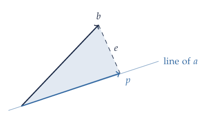

<details><summary>TikZ source</summary>

```latex
\begin{tikzpicture}[scale=1.1]
\draw[accent!60] (-0.3,-0.1)--(3.2,1.05) node[right,font=\scriptsize,text=accent]{line of $a$};
\draw[->,thick,ink] (0,0)--(1.8,1.9) node[above,font=\scriptsize]{$b$};
\draw[->,thick,accent] (0,0)--(2.3,0.77) node[below right,font=\scriptsize]{$p$};
\draw[dashed,ink] (1.8,1.9)--(2.3,0.77) node[midway,right,font=\scriptsize]{$e$};
\fill[accent,fill opacity=0.15] (0,0)--(1.8,1.9)--(2.3,0.77)--cycle;
\end{tikzpicture}
```
</details>


### Q8.02
*NAT · 1 mark · Projections*

$P$ is the projection matrix onto the line through $a=(1,2,2)^T$. The entry $P_{23}$ is ____\ (round to 3 decimals).

**Answer:** 0.444

**Solution:**

$P=\dfrac{aa^T}{a^Ta}$, $P_{23}=\dfrac{a_2a_3}{9}=\dfrac49$.


### Q8.03
*MSQ · 2 marks · Projections*

$M\in\mathbb R^{3\times3}$ is the (orthogonal) projection onto a subspace $U$ of $\mathbb R^3$. Which are correct?

- **(A)** If $\dim U=1$, then $N(M)$ is 1-dimensional
- **(B)** If $\dim U=2$, then $N(M)$ is 1-dimensional
- **(C)** $M^2=M$
- **(D)** $M^3=M$

**Answer:** B, C, D  (solution header: (B), (C), (D))

**Solution:**

$N(M)=U^\perp$ has dimension $3-\dim U$. (A) ✗ it is 2. $M^2=M$ implies $M^3=M$.


### Q8.04
*NAT · 1 mark · Projections*

$P$ is the projection matrix onto the plane $x+y+z=0$ in $\mathbb R^3$. $\operatorname{tr}P$ is ____.

**Answer:** 2

**Solution:**

Trace of a projection $=$ rank $=$ dimension of the subspace.


### Q8.05
*NAT · 1 mark · Projections*

The distance from $(1,2,3)$ to the plane $x+y+z=0$ is ____\ (round to 3 decimals).

**Answer:** 3.464

**Solution:**

Distance $=\dfrac{|n^Tx|}{\|n\|}=\dfrac{6}{\sqrt3}$, i.e.\ the length of the projection onto the normal.


### Q8.06
*MSQ · 1 mark · Projections*

$P\ne I$ is an orthogonal projection matrix ($P^2=P=P^T$). Which are correct?

- **(A)** every eigenvalue is 0 or 1
- **(B)** $I-P$ is an orthogonal projection
- **(C)** $P$ is invertible
- **(D)** $\|Px\|\le\|x\|$ for all $x$

**Answer:** A, B, D  (solution header: (A), (B), (D))

**Solution:**

(C) ✗ $P\ne I$ has eigenvalue 0. (D) $\|x\|^2=\|Px\|^2+\|(I-P)x\|^2$.


### Q8.07
*MCQ · 1 mark · Projections*

$P=\begin{pmatrix}1&1\\0&0\end{pmatrix}$ is

- **(A)** an orthogonal projection matrix
- **(B)** a projection ($P^2=P$) that is not an orthogonal projection
- **(C)** not a projection
- **(D)** an orthogonal matrix

**Answer:** B  (solution header: (B))

**Solution:**

$P^2=P$ but $P^T\ne P$: an oblique projection onto the $x$-axis along $(1,-1)$.


### Q8.08
*NAT · 1 mark · Projections*

A regression has $n=20$ observations, an intercept and 3 features, design matrix $X$ of full column rank, and $H=X(X^TX)^{-1}X^T$. $\operatorname{tr}(I-H)$ is ____.

**Answer:** 16

**Solution:**

$\operatorname{tr}H=\operatorname{rank}X=4$ (intercept + 3), so $\operatorname{tr}(I-H)=20-4$: the residual degrees of freedom.


### Q8.09
*MCQ · 1 mark · Projections*

The matrix that reflects $\mathbb R^2$ across the line spanned by $(1,1)$ is

- **(A)** $\begin{pmatrix}\tfrac12&\tfrac12\\\tfrac12&\tfrac12\end{pmatrix}$
- **(B)** $\begin{pmatrix}0&1\\1&0\end{pmatrix}$
- **(C)** $\begin{pmatrix}0&-1\\-1&0\end{pmatrix}$
- **(D)** $\begin{pmatrix}1&0\\0&-1\end{pmatrix}$

**Answer:** B  (solution header: (B))

**Solution:**

Reflection $=2P-I$ with $P=\frac12\begin{pmatrix}1&1\\1&1\end{pmatrix}$; it swaps the coordinates. (A) is $P$ itself.


### Q8.10
*NAT · 2 marks · Least Squares*

The least-squares line $y=C+Dt$ through $(0,6)$, $(1,0)$, $(2,0)$ has $C=$ ____.

**Answer:** 5

**Solution:**

$A=\begin{pmatrix}1&0\\1&1\\1&2\end{pmatrix}$, $A^TA=\begin{pmatrix}3&3\\3&5\end{pmatrix}$, $A^Tb=\begin{pmatrix}6\\0\end{pmatrix}$ ⇒ $(C,D)=(5,-3)$.


### Q8.11
*NAT · 2 marks · Least Squares*

For the fit in Q8.10, the sum of squared residuals is ____.

**Answer:** 6

**Solution:**

$Ax\hat{}=(5,2,-1)$, residual $(1,-2,1)$, squared norm $6$. Check: residual $\perp$ both columns.


### Q8.12
*NAT · 1 mark · Least Squares*

The least-squares line $y=mx$ (through the origin) for $(1,2)$, $(2,3)$, $(3,7)$ has $m=$ ____\ (round to 3 decimals).

**Answer:** 2.071

**Solution:**

$m=\dfrac{\sum xy}{\sum x^2}=\dfrac{2+6+21}{14}$.


### Q8.13
*NAT · 2 marks · Least Squares*

The least-squares line $y=\beta_0+\beta_1x$ for $(0,1)$, $(1,3)$, $(2,4)$, $(3,4)$ has slope $\beta_1=$ ____.

**Answer:** 1

**Solution:**

$\bar x=1.5$, $\bar y=3$; $S_{xy}=(-1.5)(-2)+(-0.5)(0)+(0.5)(1)+(1.5)(1)=5$, $S_{xx}=5$ ⇒ $\beta_1=1$ (and $\beta_0=1.5$).


### Q8.14
*MSQ · 2 marks · Least Squares*

For $A\in\mathbb R^{m\times n}$ and $b\in\mathbb R^m$, which are always correct?

- **(A)** $A^TAx=A^Tb$ has at least one solution
- **(B)** its solution is unique iff the columns of $A$ are independent
- **(C)** the least-squares residual is orthogonal to every column of $A$
- **(D)** the least-squares residual is zero

**Answer:** A, B, C  (solution header: (A), (B), (C))

**Solution:**

(A) $A^Tb\in C(A^T)=C(A^TA)$. (B) $A^TA$ invertible iff $N(A)=\{0\}$. (D) ✗ only if $b\in C(A)$.


### Q8.15
*NAT · 1 mark · Least Squares*

The least-squares solution of the inconsistent system $x=1,\ x=2,\ x=6$ is ____.

**Answer:** 3

**Solution:**

$A=\mathbf 1$: $\hat x=\frac{\mathbf 1^Tb}{\mathbf 1^T\mathbf 1}$ is the mean of $1,2,6$.


### Q8.16
*NAT · 2 marks · Gram--Schmidt and QR*

Gram--Schmidt on $a_1=(1,1,0)$, $a_2=(1,0,1)$ gives orthonormal $q_1,q_2$. The third entry of $q_2$ is ____\ (round to 3 decimals).

**Answer:** 0.816

**Solution:**

$a_2-\frac{a_1^Ta_2}{a_1^Ta_1}a_1=(1,0,1)-\frac12(1,1,0)=\left(\tfrac12,-\tfrac12,1\right)$; normalised $(1,-1,2)/\sqrt6$, third entry $\frac2{\sqrt6}$.


### Q8.17
*NAT · 2 marks · Gram--Schmidt and QR*

$A=\begin{pmatrix}3&1\\4&2\end{pmatrix}=QR$ with $Q$ orthogonal and $R$ upper-triangular with positive diagonal. $r_{22}$ is ____.

**Answer:** 0.4

**Solution:**

Idea: $r_{11}=\|a_1\|$ and $r_{11}r_{22}=|\det A|$ for a $2\times2$ matrix.
Work: $r_{11}=5$, $\det A=2$, so $r_{22}=\frac25$. ($r_{12}=q_1^Ta_2=\frac{11}5$.)


### Q8.18
*MSQ · 2 marks · Gram--Schmidt and QR*

$A$ is square invertible and $A=QR$ ($Q$ orthogonal, $R$ upper-triangular). Which are correct?

- **(A)** $|\det A|=\prod_i|r_{ii}|$
- **(B)** $Q^TQ=I$
- **(C)** the solution of $Ax=b$ satisfies $Rx=Q^Tb$
- **(D)** $R$ is symmetric

**Answer:** A, B, C  (solution header: (A), (B), (C))

**Solution:**

(A) $|\det Q|=1$. (C) $QRx=b$ ⇒ $Rx=Q^Tb$, solved by back-substitution. (D) ✗ $R$ is triangular.


### Q8.19
*NAT · 1 mark · Gram--Schmidt and QR*

The maximum of $x+2y+2z$ subject to $x^2+y^2+z^2=1$ is ____.

**Answer:** 3

**Solution:**

Cauchy--Schwarz: $c^Tx\le\|c\|\,\|x\|=\sqrt{1+4+4}$, attained at $x=c/\|c\|$.


### Q8.20
*NAT · 1 mark · Singular Value Decomposition*

$u=(1,2,2)^T$ and $v=(3,4)^T$. The largest singular value of $uv^T$ is ____.

**Answer:** 15

**Solution:**

$uv^T$ has rank 1 with $\sigma_1=\|u\|\,\|v\|=3\cdot5$.
Note: PYQ 2024: $\sum\sigma_i(uu^T)=\|u\|^2=55$ for $u=(1,\dots,5)$.


### Q8.21
*NAT · 2 marks · Singular Value Decomposition*

The largest singular value of $\begin{pmatrix}3&0\\4&5\end{pmatrix}$ is ____\ (round to 3 decimals).

**Answer:** 6.708

**Solution:**

$A^TA=\begin{pmatrix}25&20\\20&25\end{pmatrix}$, eigenvalues $45$ and $5$; $\sigma_1=\sqrt{45}$. Check: $\sigma_1\sigma_2=\sqrt{225}=15=|\det A|$.


### Q8.22
*MSQ · 2 marks · Singular Value Decomposition*

A real $2\times2$ matrix $A$ has singular values 5 and 3. Which are correct?

- **(A)** $|\det A|=15$
- **(B)** $\|A\|_F=\sqrt{34}$
- **(C)** $\|A\|_2=5$
- **(D)** the eigenvalues of $A$ are 5 and 3

**Answer:** A, B, C  (solution header: (A), (B), (C))

**Solution:**

$|\det|=\prod\sigma_i$, $\|A\|_F^2=\sum\sigma_i^2$, $\|A\|_2=\sigma_1$. (D) ✗ eigenvalues need not equal singular values unless $A$ is symmetric PSD.


### Q8.23
*MSQ · 2 marks · Singular Value Decomposition*

$x_1,x_2,x_3$ are orthonormal vectors in $\mathbb R^5$ and $A=x_1x_1^T+2x_2x_2^T+3x_3x_3^T$. Which are correct?

- **(A)** $\|A\|_2=3$
- **(B)** $\operatorname{tr}A=6$
- **(C)** $\det A=6$
- **(D)** $A$ is a projection matrix

**Answer:** A, B  (solution header: (A), (B))

**Solution:**

This is a spectral decomposition: eigenvalues $3,2,1,0,0$ (symmetric PSD, so these are also the singular values). (C) ✗ $\det=0$ in $\mathbb R^5$. (D) ✗ $A^2\ne A$.
Note: PYQ 2025: $\sum_{i=1}^5x_ix_i^T$ in $\mathbb R^{10}$ is a projection: $\sigma\in\{0,1\}$, not invertible.


### Q8.24
*NAT · 2 marks · Singular Value Decomposition*

$A$ has singular values $4,3,1$ and $A_1$ is its best rank-1 approximation. $\|A-A_1\|_F$ is ____\ (round to 3 decimals).

**Answer:** 3.162

**Solution:**

Eckart--Young: $\|A-A_1\|_F=\sqrt{\sigma_2^2+\sigma_3^2}=\sqrt{10}$; in the 2-norm the error is $\sigma_2=3$.


### Q8.25
*MCQ · 1 mark · Singular Value Decomposition*

The singular values of $\begin{pmatrix}2&0\\0&-3\end{pmatrix}$ are

- **(A)** $2,\,-3$
- **(B)** $3,\,2$
- **(C)** $9,\,4$
- **(D)** $\sqrt3,\,\sqrt2$

**Answer:** B  (solution header: (B))

**Solution:**

For symmetric $A$, $\sigma_i=|\lambda_i|$: 3 and 2. Signs move into $U$ or $V$.


### Q8.26
*NAT · 1 mark · Singular Value Decomposition*

The Moore--Penrose pseudoinverse of the column vector $a=(1,2,2)^T$ is a row vector. Its second entry is ____\ (round to 3 decimals).

**Answer:** 0.222

**Solution:**

For a non-zero column $a$, $a^+=\dfrac{a^T}{a^Ta}=\dfrac19(1,2,2)$.


### Q8.27
*NAT · 1 mark · Singular Value Decomposition*

Among all solutions of $x_1+x_2+x_3=3$, the one of smallest Euclidean norm has $x_1=$ ____.

**Answer:** 1

**Solution:**

The minimum-norm solution lies in the row space: $x=t(1,1,1)$, $3t=3$. (It is $A^+b$.)


### Q8.28
*MSQ · 1 mark · Singular Value Decomposition*

Which are correct?

- **(A)** Every real $m\times n$ matrix has an SVD
- **(B)** The squared singular values of $A$ are the eigenvalues of $A^TA$
- **(C)** The left singular vectors are eigenvectors of $AA^T$
- **(D)** For every square $A$, the singular values are the absolute values of the eigenvalues

**Answer:** A, B, C  (solution header: (A), (B), (C))

**Solution:**

(D) ✗ $\begin{pmatrix}0&1\\0&0\end{pmatrix}$ has eigenvalues 0, 0 but $\sigma_1=1$.


### Q8.29
*NAT · 1 mark · Singular Value Decomposition*

The 2-norm condition number of $\begin{pmatrix}2&1\\1&2\end{pmatrix}$ is ____.

**Answer:** 3

**Solution:**

Symmetric PD: $\kappa=\frac{\lambda_{\max}}{\lambda_{\min}}=\frac31$.


### Q8.30
*NAT · 1 mark · Singular Value Decomposition*

The sum of the singular values of $\begin{pmatrix}0&2\\-2&0\end{pmatrix}$ is ____.

**Answer:** 4

**Solution:**

$A=2R$ with $R$ a rotation: $A^TA=4I$, so $\sigma=2,2$, even though the eigenvalues are $\pm2i$.


### Q8.31
*NAT · 1 mark · Norms and PCA*

A centred dataset in $\mathbb R^4$ has covariance eigenvalues $9,4,1,0$. The fraction of total variance captured by the first two principal components is ____\ (round to 3 decimals).

**Answer:** 0.929

**Solution:**

$\frac{9+4}{9+4+1+0}=\frac{13}{14}$.
Note: PYQ 2025: $\frac1n\sum_i(u^Tx^{(i)})^2=u^TCu=\lambda_{\max}$ along the top principal direction.


### Q8.32
*NAT · 1 mark · Norms and PCA*

For $A=\begin{pmatrix}1&-2\\3&4\end{pmatrix}$, the induced norm $\|A\|_\infty$ (maximum absolute row sum) is ____.

**Answer:** 7

**Solution:**

Row sums of absolute values: $3$ and $7$. (Column-sum norm $\|A\|_1=6$.)


### Q8.33
*MSQ · 2 marks · Norms and PCA*

For $x\in\mathbb R^n$ and real matrices of compatible sizes, which are always correct?

- **(A)** $\|x\|_\infty\le\|x\|_2\le\|x\|_1$
- **(B)** $\|x\|_2\le\sqrt n\,\|x\|_\infty$
- **(C)** $\|A\|_2\le\|A\|_F$
- **(D)** $\|AB\|_F=\|A\|_F\,\|B\|_F$

**Answer:** A, B, C  (solution header: (A), (B), (C))

**Solution:**

(C) $\sigma_1^2\le\sum\sigma_i^2$. (D) ✗ only $\|AB\|_F\le\|A\|_F\|B\|_F$.


### Q8.34
*NAT · 1 mark · Norms and PCA*

A real symmetric matrix has eigenvalues $1,2,-2$. Its Frobenius norm is ____.

**Answer:** 3

**Solution:**

$\|A\|_F^2=\sum\sigma_i^2=\sum\lambda_i^2=1+4+4$.


### Q8.35
*NAT · 1 mark · Norms and PCA*

A $100\times80$ matrix is stored by its rank-5 truncated SVD $U_5\Sigma_5V_5^T$ (keeping only the needed columns and singular values). The number of stored numbers is ____.

**Answer:** 905

**Solution:**

$U_5$: $100\cdot5$, $V_5$: $80\cdot5$, $\Sigma_5$: 5. Total $5(100+80+1)$ versus $8000$ for the full matrix.


### Q8.36
*NAT · 2 marks · Norms and PCA*

The points $(1,1),(2,2),(3,3),(4,4)$ are centred and $C=\frac1n\sum_i x_ix_i^T$ is formed. The largest eigenvalue of $C$ is ____.

**Answer:** 2.5

**Solution:**

Centred points $t(1,1)$ with $t=-1.5,-0.5,0.5,1.5$: $C=1.25\begin{pmatrix}1&1\\1&1\end{pmatrix}$, eigenvalues $2.5$ and 0. All variance lies along $(1,1)/\sqrt2$.


# Part: Days 9-12: Calculus and Optimisation


## Day 9: Limits and Continuity


### Q9.01
*NAT · 1 mark · Standard Limits and Series Expansions*

$\displaystyle\lim_{x\to0}\frac{x-\sin x}{x^3}$ is ____\ (round to 3 decimals).

**Answer:** 0.166–0.167  (solution header: $1/6\approx0.167$)

**Solution:**

$\sin x=x-\frac{x^3}{6}+O(x^5)$ ⇒ $x-\sin x\approx\frac{x^3}{6}$.


### Q9.02
*NAT · 1 mark · Standard Limits and Series Expansions*

$\displaystyle\lim_{x\to0}\frac{e^x-1-x}{x^2}$ is ____.

**Answer:** 0.5

**Solution:**

$e^x=1+x+\frac{x^2}2+\cdots$.


### Q9.03
*NAT · 1 mark · Standard Limits and Series Expansions*

$\displaystyle\lim_{x\to0}\frac{\tan x-\sin x}{x^3}$ is ____.

**Answer:** 0.5

**Solution:**

$\tan x-\sin x=\tan x(1-\cos x)\approx x\cdot\frac{x^2}{2}$.
Trap: expanding $\tan x\approx x$, $\sin x\approx x$ separately gives 0; keep terms to $x^3$.


### Q9.04
*NAT · 2 marks · Standard Limits and Series Expansions*

$\displaystyle\lim_{x\to0}\frac{1-\cos x\cos2x}{x^2}$ is ____.

**Answer:** 2.5

**Solution:**

$\cos x\cos2x\approx\big(1-\frac{x^2}2\big)\big(1-2x^2\big)\approx1-\frac52x^2$. In general $1-\prod\cos(a_ix)\approx\frac{\sum a_i^2}{2}x^2$.


### Q9.05
*NAT · 1 mark · Standard Limits and Series Expansions*

$\displaystyle\lim_{x\to0}\frac{8^x-2^x}{x}$ is ____\ (round to 3 decimals).

**Answer:** 1.386  (solution header: $\ln4\approx1.386$)

**Solution:**

$\frac{a^x-1}{x}\to\ln a$, so the limit is $\ln8-\ln2$.


### Q9.06
*NAT · 1 mark · Standard Limits and Series Expansions*

$\displaystyle\lim_{x\to\infty}x\Big(\frac\pi2-\tan^{-1}x\Big)$ is ____.

**Answer:** 1

**Solution:**

$\frac\pi2-\tan^{-1}x=\tan^{-1}\frac1x\approx\frac1x$.


### Q9.07
*NAT · 2 marks · Standard Limits and Series Expansions*

$\displaystyle\lim_{x\to0}\Big(\frac{1}{\sin^2x}-\frac{1}{x^2}\Big)$ is ____\ (round to 3 decimals).

**Answer:** 0.333  (solution header: $1/3\approx0.333$)

**Solution:**

Idea: combine into one fraction, then expand to enough order.
Work: $\frac{x^2-\sin^2x}{x^2\sin^2x}$; $\sin^2x=x^2-\frac{x^4}3+\cdots$ ⇒ numerator $\frac{x^4}{3}$, denominator $x^4$.


### Q9.08
*MCQ · 1 mark · Standard Limits and Series Expansions*

Which of the following limits does \emph{not} exist?

- **(A)** $\displaystyle\lim_{x\to0}x\sin\frac1x$
- **(B)** $\displaystyle\lim_{x\to0}\frac{|x|}{x}$
- **(C)** $\displaystyle\lim_{x\to0}\frac{\sin 3x}{x}$
- **(D)** $\displaystyle\lim_{x\to0^+}x\ln x$

**Answer:** B  (solution header: (B))

**Solution:**

$|x|/x=\pm1$ from the right and left. (A) squeeze gives 0; (C) 3; (D) 0.


### Q9.09
*MSQ · 2 marks · Standard Limits and Series Expansions*

Which are correct?

- **(A)** $\displaystyle\lim_{x\to\infty}\frac{x+\sin x}{x}=1$
- **(B)** L'Hôpital's rule can be used to find the limit in (A), since $\displaystyle\lim_{x\to\infty}\frac{1+\cos x}{1}$ exists
- **(C)** L'Hôpital's rule applies only to $\frac00$ or $\frac\infty\infty$ forms
- **(D)** $\displaystyle\lim_{x\to0}\frac{\sin x}{x^2}$ does not exist

**Answer:** A, C, D  (solution header: (A), (C), (D))

**Solution:**

(A) $\frac{\sin x}{x}\to0$. (B) ✗ $1+\cos x$ oscillates, so L'Hôpital is inconclusive even though the limit exists: the rule needs the derivative ratio to have a limit. (D) $\frac{\sin x}{x^2}\approx\frac1x\to\pm\infty$ from the two sides.


### Q9.10
*MSQ · 1 mark · Standard Limits and Series Expansions*

Which of the following limits equal 0?

- **(A)** $\displaystyle\lim_{x\to\infty}\frac{(\ln x)^{10}}{x^{0.1}}$
- **(B)** $\displaystyle\lim_{x\to\infty}\frac{x^{100}}{e^x}$
- **(C)** $\displaystyle\lim_{x\to\infty}\frac{2^x}{x!}$ ($x$ integer)
- **(D)** $\displaystyle\lim_{x\to\infty}x^{1/x}$

**Answer:** A, B, C  (solution header: (A), (B), (C))

**Solution:**

Hierarchy: $(\ln x)^a\ll x^b\ll c^x\ll x!\ll x^x$ for any $a,b>0$, $c>1$. (D) $x^{1/x}=e^{\ln x/x}\to1$.


### Q9.11
*NAT · 2 marks · Exponential Forms, Sums and Integrals in Limits*

$\displaystyle\lim_{x\to0}\frac{\ln\big((1+2x^2)\cos x\big)}{x^2}$ is ____.

**Answer:** 1.5

**Solution:**

Idea: $\ln(ab)=\ln a+\ln b$, then $\ln(1+u)\approx u$.
Work: $\ln(1+2x^2)\approx2x^2$; $\ln\cos x\approx\ln(1-\frac{x^2}2)\approx-\frac{x^2}{2}$. Sum $\frac32x^2$.
Note: PYQ 2024: $\frac{\ln((x^2+1)\cos x)}{x^2}\to1-\frac12=\frac12$.


### Q9.12
*NAT · 1 mark · Exponential Forms, Sums and Integrals in Limits*

$\displaystyle\lim_{x\to\infty}\Big(1+\frac3x\Big)^{2x}$ is ____\ (round to 2 decimals).

**Answer:** 403.42–403.43  (solution header: $e^6\approx403.43$)

**Solution:**

$1^\infty$ form: $\lim(1+\frac ax)^{bx}=e^{ab}$.


### Q9.13
*NAT · 1 mark · Exponential Forms, Sums and Integrals in Limits*

$\displaystyle\lim_{x\to\infty}\Big(\frac{x+2}{x-1}\Big)^{x}$ is ____\ (round to 2 decimals).

**Answer:** 20.08–20.09  (solution header: $e^3\approx20.09$)

**Solution:**

$\frac{x+2}{x-1}=1+\frac{3}{x-1}$; $1^\infty$ rule: $\exp\big(\lim x\cdot\frac{3}{x-1}\big)=e^3$.


### Q9.14
*NAT · 2 marks · Exponential Forms, Sums and Integrals in Limits*

$\displaystyle\lim_{x\to1}x^{\frac{1}{1-x}}$ is ____\ (round to 3 decimals).

**Answer:** 0.368  (solution header: $e^{-1}\approx0.368$)

**Solution:**

$1^\infty$: $\exp\big(\lim\frac{\ln x}{1-x}\big)=\exp(-1)$ (L'Hôpital or $x=1+h$).


### Q9.15
*NAT · 2 marks · Exponential Forms, Sums and Integrals in Limits*

$\displaystyle\lim_{x\to0}\Big(\frac{\sin x}{x}\Big)^{1/x^2}$ is ____\ (round to 3 decimals).

**Answer:** 0.846  (solution header: $e^{-1/6}\approx0.846$)

**Solution:**

Idea: $1^\infty$: exponent $\lim\frac{1}{x^2}\big(\frac{\sin x}{x}-1\big)$.
Work: $\frac{\sin x}{x}-1\approx-\frac{x^2}{6}$, so the exponent is $-\frac16$.


### Q9.16
*NAT · 2 marks · Exponential Forms, Sums and Integrals in Limits*

$\displaystyle\lim_{x\to0}(\cos x)^{1/x^2}$ is ____\ (round to 3 decimals).

**Answer:** 0.606–0.607  (solution header: $e^{-1/2}\approx0.607$)

**Solution:**

$\frac{\cos x-1}{x^2}\to-\frac12$.


### Q9.17
*NAT · 1 mark · Exponential Forms, Sums and Integrals in Limits*

$\displaystyle\lim_{x\to0^+}(\sin x)^x$ is ____.

**Answer:** 1

**Solution:**

$x\ln\sin x\approx x\ln x\to0$ ⇒ limit $e^0$.


### Q9.18
*NAT · 1 mark · Exponential Forms, Sums and Integrals in Limits*

$\displaystyle\lim_{x\to\infty}\big(\sqrt{x^2+3x}-x\big)$ is ____.

**Answer:** 1.5

**Solution:**

Rationalise: $\frac{3x}{\sqrt{x^2+3x}+x}\to\frac32$. In general $\sqrt{x^2+ax}-x\to\frac a2$.


### Q9.19
*NAT · 1 mark · Exponential Forms, Sums and Integrals in Limits*

$\displaystyle\lim_{n\to\infty}n\sin\frac{2\pi}{n}$ is ____\ (round to 3 decimals).

**Answer:** 6.283  (solution header: $2\pi\approx6.283$)

**Solution:**

$\sin\frac{2\pi}n\approx\frac{2\pi}{n}$.


### Q9.20
*NAT · 1 mark · Exponential Forms, Sums and Integrals in Limits*

$\displaystyle\lim_{n\to\infty}\frac{1^3+2^3+\cdots+n^3}{n^4}$ is ____.

**Answer:** 0.25

**Solution:**

$\sum k^3=\big(\frac{n(n+1)}2\big)^2\sim\frac{n^4}4$. (Riemann sum: $\int_0^1x^3dx$.)


### Q9.21
*NAT · 2 marks · Exponential Forms, Sums and Integrals in Limits*

$\displaystyle\lim_{n\to\infty}\sum_{k=1}^{n}\frac{n}{n^2+k^2}$ is ____\ (round to 3 decimals).

**Answer:** 0.785  (solution header: $\pi/4\approx0.785$)

**Solution:**

Idea: rewrite as $\frac1n\sum g\big(\frac kn\big)$, a Riemann sum.
Work: $\frac{n}{n^2+k^2}=\frac1n\cdot\frac{1}{1+(k/n)^2}$ ⇒ $\int_0^1\frac{dx}{1+x^2}=\tan^{-1}1$.


### Q9.22
*NAT · 2 marks · Exponential Forms, Sums and Integrals in Limits*

$\displaystyle\lim_{x\to0}\frac{\int_0^xe^{t^2}\,dt-x}{x^3}$ is ____\ (round to 3 decimals).

**Answer:** 0.333  (solution header: $1/3\approx0.333$)

**Solution:**

L'Hôpital with FTC: $\frac{e^{x^2}-1}{3x^2}\to\frac13$. (Or integrate the series: $\int_0^x(1+t^2)dt=x+\frac{x^3}3$.)


### Q9.23
*NAT · 1 mark · Exponential Forms, Sums and Integrals in Limits*

$\displaystyle\lim_{x\to0^+}x\Big\lfloor\frac1x\Big\rfloor$ is ____.

**Answer:** 1

**Solution:**

$\frac1x-1<\lfloor\frac1x\rfloor\le\frac1x$ ⇒ $1-x<x\lfloor\frac1x\rfloor\le1$; squeeze.


### Q9.24
*NAT · 1 mark · Continuity*

$f(x)=\dfrac{1-\cos2x}{x^2}$ for $x\ne0$ and $f(0)=k$. $f$ is continuous at 0 for $k=$ ____.

**Answer:** 2

**Solution:**

$1-\cos2x=2\sin^2x\approx2x^2$.


### Q9.25
*NAT · 1 mark · Continuity*

$f(x)=\dfrac{\sqrt{1+ax}-1}{x}$ for $x\ne0$ and $f(0)=2$. $f$ is continuous at 0 for $a=$ ____.

**Answer:** 4

**Solution:**

$\frac{\sqrt{1+ax}-1}{x}\to\frac a2$.


### Q9.26
*NAT · 1 mark · Continuity*

$f(x)=\dfrac{x^2-4}{x-2}$ has a removable discontinuity at $x=2$. The value that removes it is ____.

**Answer:** 4

**Solution:**

$\frac{(x-2)(x+2)}{x-2}=x+2\to4$.


### Q9.27
*MSQ · 1 mark · Continuity*

Which functions have a \emph{removable} discontinuity at the given point?

- **(A)** $\dfrac{x^2-1}{x-1}$ at $x=1$
- **(B)** $\dfrac{\sin x}{x}$ at $x=0$
- **(C)** $\lfloor x\rfloor$ at $x=1$
- **(D)** $e^{1/x}$ at $x=0$

**Answer:** A, B  (solution header: (A), (B))

**Solution:**

Removable: the limit exists but differs from (or lacks) the value. (C) jump. (D) right limit $\infty$, left limit 0: infinite discontinuity.


### Q9.28
*MSQ · 1 mark · Continuity*

Which functions are continuous at every real $x$ (with the stated value at 0 where needed)?

- **(A)** $|x|$
- **(B)** $\lfloor x\rfloor$
- **(C)** $x\sin(1/x)$, with value 0 at 0
- **(D)** $\operatorname{sign}(x)$

**Answer:** A, C  (solution header: (A), (C))

**Solution:**

(C) $|x\sin(1/x)|\le|x|\to0$. (B) jumps at integers; (D) jump at 0.


### Q9.29
*NAT · 2 marks · Continuity*

$f(x)=\lfloor x\rfloor+\lfloor -x\rfloor$. The number of points in the open interval $(-2,2)$ at which $f$ is discontinuous is ____.

**Answer:** 3

**Solution:**

Idea: $\lfloor x\rfloor+\lfloor-x\rfloor=0$ at integers and $-1$ elsewhere.
Work: So $f$ jumps at every integer: $-1,0,1$ in $(-2,2)$.
Trap: each floor is discontinuous, but you must check the \emph{sum}.


### Q9.30
*NAT · 1 mark · Continuity*

The number of points in the open interval $(0,2)$ at which $f(x)=\lfloor x^2\rfloor$ is discontinuous is ____.

**Answer:** 3

**Solution:**

$x^2$ crosses an integer at $x=1,\sqrt2,\sqrt3$ inside $(0,2)$.


### Q9.31
*NAT · 2 marks · Continuity*

$f(x)=\displaystyle\lim_{n\to\infty}\frac{x^{2n}}{1+x^{2n}}$. The number of real points at which $f$ is discontinuous is ____.

**Answer:** 2

**Solution:**

$f=0$ for $|x|<1$, $\frac12$ at $|x|=1$, $1$ for $|x|>1$. Jumps at $x=\pm1$.


### Q9.32
*NAT · 1 mark · Continuity*

The number of points at which $f(x)=|x-1|+|x-2|+|x-3|$ is not differentiable is ____.

**Answer:** 3

**Solution:**

Each $|x-a|$ has a corner at $a$, and the corners do not cancel (all slopes change by $+2$).


### Q9.33
*MCQ · 2 marks · Continuity*

$f(x)=-2x$ for $x<-1$; $\ f(x)=ax^2+bx+c$ for $-1\le x\le1$; $\ f(x)=2x$ for $x>1$. The values making $f$ continuous and differentiable everywhere are

- **(A)** $a=1,\ b=0,\ c=1$
- **(B)** $a=2,\ b=0,\ c=0$
- **(C)** $a=1,\ b=1,\ c=0$
- **(D)** $a=0,\ b=0,\ c=2$

**Answer:** A  (solution header: (A))

**Solution:**

Idea: match values \emph{and} slopes at both joints.
Work: At $x=1$: $a+b+c=2$ and $2a+b=2$. At $x=-1$: $a-b+c=2$ and $-2a+b=-2$. So $b=0$, $a=1$, $c=1$.
Note: PYQ 2024 ($-x$, $ax^2+bx+c$, $x$ on $[-2,2]$): $a=\frac14$, $b=0$, $c=1$.


### Q9.34
*NAT · 1 mark · Continuity*

The number of real roots of $x^3-3x+1=0$ is ____.

**Answer:** 3

**Solution:**

$f(-2)=-1$, $f(-1)=3$, $f(1)=-1$, $f(2)=3$: three sign changes, and a cubic has at most 3 roots.


### Q9.35
*MSQ · 1 mark · Continuity*

$f$ is continuous on $[0,1]$ with $f(0)=0$ and $f(1)=1$. Which are always correct?

- **(A)** $f$ attains a maximum on $[0,1]$
- **(B)** $f(c)=0.5$ for some $c\in[0,1]$
- **(C)** $f$ is differentiable at some point
- **(D)** $f$ is bounded on $[0,1]$

**Answer:** A, B, D  (solution header: (A), (B), (D))

**Solution:**

Extreme value theorem (A, D) and intermediate value theorem (B). (C) ✗ continuous nowhere-differentiable functions exist.


### Q9.36
*MCQ · 2 marks · Continuity*

$f$ is continuous on $[0,1]$ with $f(0)=f(1)$. Which is always true?

- **(A)** $f(c)=0$ for some $c$
- **(B)** $f$ is constant
- **(C)** $f'(c)=0$ for some $c$
- **(D)** $f(c)=f\big(c+\tfrac12\big)$ for some $c\in[0,\tfrac12]$

**Answer:** D  (solution header: (D))

**Solution:**

Idea: apply the IVT to $g(x)=f(x+\frac12)-f(x)$ on $[0,\frac12]$.
Work: $g(0)+g(\frac12)=f(1)-f(0)=0$, so $g$ changes sign (or is 0) and has a root. (C) needs differentiability.


## Day 10: Derivatives and Taylor Series


### Q10.01
*MCQ · 1 mark · Differentiability*

At $x=0$, the function $f(x)=x^{2/3}$ is

- **(A)** differentiable
- **(B)** discontinuous
- **(C)** continuous but not differentiable
- **(D)** undefined

**Answer:** C  (solution header: (C))

**Solution:**

$f'(x)=\frac23x^{-1/3}\to\pm\infty$: a cusp.


### Q10.02
*NAT · 1 mark · Differentiability*

The number of points at which $f(x)=\max(x,\,x^2)$ is not differentiable is ____.

**Answer:** 2

**Solution:**

$x$ and $x^2$ cross at $0$ and $1$ with different slopes there.


### Q10.03
*MSQ · 1 mark · Differentiability*

Which are correct?

- **(A)** $\max(0,x)$ is continuous everywhere
- **(B)** $\max(0,x)$ is differentiable at 0
- **(C)** $x|x|$ is differentiable at 0
- **(D)** $|x|^3$ is twice differentiable at 0

**Answer:** A, C, D  (solution header: (A), (C), (D))

**Solution:**

ReLU has slopes 0 and 1 at 0. $x|x|$: derivative $2|x|$. $|x|^3$: $f''=6|x|$ exists everywhere (but $f'''(0)$ does not).


### Q10.04
*MSQ · 2 marks · Differentiability*

$f_n(x)=x^n\sin(1/x)$ for $x\ne0$, $f_n(0)=0$. Which are correct?

- **(A)** $f_1$ is continuous but not differentiable at 0
- **(B)** $f_2$ is differentiable at 0 and $f_2'$ is continuous at 0
- **(C)** $f_2'(0)=0$
- **(D)** $f_3$ is differentiable everywhere

**Answer:** A, C, D  (solution header: (A), (C), (D))

**Solution:**

$f_1'(0)=\lim\sin(1/h)$ does not exist. $f_2'(0)=\lim h\sin(1/h)=0$, but $f_2'(x)=2x\sin\frac1x-\cos\frac1x$ has no limit at 0, so (B) ✗. $f_3$: $f_3'(0)=0$ and $f_3'$ is continuous.


### Q10.05
*MCQ · 2 marks · Differentiability*

For $f(x)=x^2|x|$, the highest $k$ such that $f^{(k)}(0)$ exists is

- **(A)** 1
- **(B)** every $k$
- **(C)** 3
- **(D)** 2

**Answer:** D  (solution header: (D) 2)

**Solution:**

$f=x^3$ for $x\ge0$, $-x^3$ for $x<0$: $f'=3x|x|$, $f''=6|x|$, and $f''$ has a corner at 0.


### Q10.06
*MSQ · 2 marks · Differentiability*

$f:\mathbb R\to\mathbb R$ and $g:\mathbb R\to(1,\infty)$ are both differentiable at $c$. Which are always differentiable at $c$?

- **(A)** $f+g$
- **(B)** $f\cdot g$
- **(C)** $f/g$
- **(D)** $|f|$

**Answer:** A, B, C  (solution header: (A), (B), (C))

**Solution:**

Sums, products and quotients (non-zero denominator, guaranteed by $g>1$) of differentiable functions are differentiable. (D) ✗ $f(x)=x$ at $c=0$.


### Q10.07
*MSQ · 2 marks · Differentiability*

$f:\mathbb R\to\mathbb R$ is differentiable everywhere. Which are always correct?

- **(A)** $f'$ has the intermediate value property
- **(B)** $f'$ is continuous
- **(C)** If $f$ is even, then $f'$ is odd
- **(D)** If $f'(x)=0$ for all $x$, then $f$ is constant

**Answer:** A, C, D  (solution header: (A), (C), (D))

**Solution:**

(A) Darboux's theorem. (B) ✗ $x^2\sin\frac1x$. (C) differentiate $f(-x)=f(x)$: $-f'(-x)=f'(x)$. (D) mean value theorem.


### Q10.08
*NAT · 1 mark · Derivatives and Mean Value Theorems*

$\sigma(x)=\dfrac{1}{1+e^{-x}}$. The value of $\sigma'(x)$ at the point where $\sigma(x)=0.3$ is ____\ (round to 2 decimals).

**Answer:** 0.21

**Solution:**

$\sigma'=\sigma(1-\sigma)=0.3\cdot0.7$. (PYQ 2024 used $0.4$: $0.24$.)


### Q10.09
*NAT · 1 mark · Derivatives and Mean Value Theorems*

The derivative of $\ln(1+e^x)$ at $x=0$ is ____.

**Answer:** 0.5

**Solution:**

$\frac{d}{dx}\ln(1+e^x)=\sigma(x)$; $\sigma(0)=\frac12$.


### Q10.10
*NAT · 1 mark · Derivatives and Mean Value Theorems*

$\dfrac{d}{dx}\,x^x$ at $x=1$ is ____.

**Answer:** 1

**Solution:**

$\frac{d}{dx}e^{x\ln x}=x^x(\ln x+1)$; at 1: $1$.


### Q10.11
*NAT · 1 mark · Derivatives and Mean Value Theorems*

$\dfrac{d}{dx}\ln\big(x+\sqrt{1+x^2}\big)$ at $x=\sqrt3$ is ____.

**Answer:** 0.5

**Solution:**

$\frac{d}{dx}\sinh^{-1}x=\frac1{\sqrt{1+x^2}}=\frac12$.


### Q10.12
*NAT · 1 mark · Derivatives and Mean Value Theorems*

$f(x)=x^3+x$ and $g=f^{-1}$. $g'(2)$ is ____.

**Answer:** 0.25

**Solution:**

$f(1)=2$, so $g'(2)=\frac{1}{f'(1)}=\frac1{3+1}$.


### Q10.13
*NAT · 1 mark · Derivatives and Mean Value Theorems*

On the curve $x^2+xy+y^2=7$, the slope $\dfrac{dy}{dx}$ at $(1,2)$ is ____.

**Answer:** −0.8  (solution header: $-0.8$)

**Solution:**

$2x+y+xy'+2yy'=0$ ⇒ $y'=-\frac{2x+y}{x+2y}=-\frac45$.


### Q10.14
*NAT · 2 marks · Derivatives and Mean Value Theorems*

A curve is given by $x=t^2$, $y=t^3$. $\dfrac{d^2y}{dx^2}$ at $t=1$ is ____.

**Answer:** 0.75

**Solution:**

$\frac{dy}{dx}=\frac{3t^2}{2t}=\frac32t$; $\frac{d^2y}{dx^2}=\frac{d}{dt}\big(\frac32t\big)\big/\frac{dx}{dt}=\frac{3/2}{2t}$.
Trap: $\frac{d^2y/dt^2}{d^2x/dt^2}=\frac{6t}{2}$ is wrong.


### Q10.15
*NAT · 2 marks · Derivatives and Mean Value Theorems*

$F(x)=\displaystyle\int_x^{x^2}e^{t^2}\,dt$. $F'(1)$ is ____\ (round to 3 decimals).

**Answer:** 2.718  (solution header: $e\approx2.718$)

**Solution:**

$F'(x)=e^{x^4}\cdot2x-e^{x^2}$; at 1: $2e-e$.


### Q10.16
*NAT · 1 mark · Derivatives and Mean Value Theorems*

$f(x)=e^{2x}$. $f^{(5)}(0)$ is ____.

**Answer:** 32

**Solution:**

$f^{(n)}=2^ne^{2x}$.


### Q10.17
*NAT · 1 mark · Derivatives and Mean Value Theorems*

$f(x)=\sin^2x$. $f^{(4)}(0)$ is ____.

**Answer:** −8  (solution header: $-8$)

**Solution:**

$\sin^2x=\frac{1-\cos2x}{2}$; $f^{(4)}=-\frac12\cdot2^4\cos2x$ ⇒ $-8$. (Odd derivatives at 0 vanish: $f$ is even.)


### Q10.18
*NAT · 2 marks · Derivatives and Mean Value Theorems*

$f(x)=\dfrac{e^x+e^{-x}}{2}$. $f^{(10)}(0)$ is ____.

**Answer:** 1

**Solution:**

Even derivatives of $\cosh$ are $\cosh$, and $\cosh0=1$. (PYQ 2025: $\sinh$, $f^{(10)}(0)=\sinh0=0$.)


### Q10.19
*NAT · 1 mark · Derivatives and Mean Value Theorems*

$\dfrac{d}{dx}|x|^3$ at $x=-2$ is ____.

**Answer:** −12  (solution header: $-12$)

**Solution:**

$\frac{d}{dx}|x|^3=3x|x|$; at $-2$: $3(-2)(2)$.


### Q10.20
*MCQ · 1 mark · Derivatives and Mean Value Theorems*

Rolle's theorem for $f(x)=x^2-4x+3$ on $[1,3]$ gives $c=$

- **(A)** 2
- **(B)** 1.5
- **(C)** 2.5
- **(D)** Rolle's theorem does not apply

**Answer:** A  (solution header: (A))

**Solution:**

$f(1)=f(3)=0$; $f'(c)=2c-4=0$.


### Q10.21
*NAT · 1 mark · Derivatives and Mean Value Theorems*

The value $c\in(0,3)$ given by the mean value theorem for $f(x)=x^3$ on $[0,3]$ is ____\ (round to 3 decimals).

**Answer:** 1.732  (solution header: $\sqrt3\approx1.732$)

**Solution:**

$f'(c)=\frac{27-0}{3}=9=3c^2$.


### Q10.22
*NAT · 1 mark · Taylor Series*

The linear (first-order Taylor) approximation of $\sqrt{4.1}$ about 4 is ____\ (round to 3 decimals).

**Answer:** 2.025

**Solution:**

$\sqrt{4+h}\approx2+\frac{h}{4}$.


### Q10.23
*NAT · 1 mark · Taylor Series*

Using the Maclaurin polynomial of degree 2, $\cos(0.2)\approx$ ____\ (round to 2 decimals).

**Answer:** 0.98

**Solution:**

$1-\frac{0.04}{2}$. (True value $0.98007$.)


### Q10.24
*MCQ · 1 mark · Taylor Series*

The tangent line to $y=\ln x$ at $x=1$ is used to estimate $\ln1.2$. The estimate is

- **(A)** 0.2, an overestimate
- **(B)** 0.2, an underestimate
- **(C)** 0.18, exact to 2 decimals
- **(D)** 0.22, an overestimate

**Answer:** A  (solution header: (A))

**Solution:**

Tangent $y=x-1$ gives $0.2$; $\ln$ is concave, so its tangent lies above it: overestimate ($\ln1.2=0.182$).


### Q10.25
*NAT · 1 mark · Taylor Series*

Using the first three non-zero terms of the Maclaurin series of $\ln(1+x)$, $\ln(1.1)\approx$ ____\ (round to 4 decimals).

**Answer:** 0.0953

**Solution:**

$0.1-\frac{0.01}{2}+\frac{0.001}{3}=0.09533$ (true $0.09531$).


### Q10.26
*NAT · 1 mark · Taylor Series*

$f(x)=\ln(1+x)$. $f^{(5)}(0)$ is ____.

**Answer:** 24

**Solution:**

$\ln(1+x)=\sum(-1)^{n+1}\frac{x^n}{n}$; $f^{(5)}(0)=5!\cdot\frac15=4!$.


### Q10.27
*NAT · 2 marks · Taylor Series*

$f(x)=x^2e^x$. $f^{(6)}(0)$ is ____.

**Answer:** 30

**Solution:**

Idea: $f^{(n)}(0)=n!\times(\text{coefficient of }x^n)$.
Work: $x^2e^x=\sum\frac{x^{k+2}}{k!}$: coefficient of $x^6$ is $\frac1{4!}$; $6!/4!=30$.


### Q10.28
*NAT · 1 mark · Taylor Series*

$f(x)=x^3e^{-x}$. $f^{(4)}(0)$ is ____.

**Answer:** −24  (solution header: $-24$)

**Solution:**

$x^3e^{-x}=x^3-x^4+\cdots$; $f^{(4)}(0)=4!\cdot(-1)$.


### Q10.29
*NAT · 2 marks · Taylor Series*

The coefficient of $x^4$ in the Maclaurin series of $e^x\cos x$ is ____\ (round to 3 decimals).

**Answer:** −0.167  (solution header: $-1/6\approx-0.167$)

**Solution:**

Idea: $e^x\cos x=\operatorname{Re}\,e^{(1+i)x}$, so the coefficient of $x^n$ is $\operatorname{Re}\frac{(1+i)^n}{n!}$.
Work: $(1+i)^4=(2i)^2=-4$; coefficient $-\frac{4}{24}$. (Or multiply the series: $\frac1{24}-\frac12\cdot\frac12+\frac1{24}$.)


### Q10.30
*NAT · 1 mark · Taylor Series*

The coefficient of $x^5$ in the Maclaurin series of $\tan x$ is ____\ (round to 3 decimals).

**Answer:** 0.133  (solution header: $2/15\approx0.133$)

**Solution:**

$\tan x=x+\frac{x^3}3+\frac{2x^5}{15}+\cdots$.


### Q10.31
*MCQ · 1 mark · Taylor Series*

The Maclaurin series of $\dfrac{1}{(1-x)^2}$ for $|x|<1$ is

- **(A)** $\sum_{n\ge0}x^{2n}$
- **(B)** $\sum_{n\ge0}\frac{x^n}{n+1}$
- **(C)** $\sum_{n\ge0}nx^{n}$
- **(D)** $\sum_{n\ge0}(n+1)x^n$

**Answer:** D  (solution header: (D))

**Solution:**

Differentiate $\frac1{1-x}=\sum x^n$: $\sum nx^{n-1}=\sum(n+1)x^n$.


### Q10.32
*NAT · 2 marks · Taylor Series*

$\displaystyle\lim_{x\to0}\frac{\cos x-1+\frac{x^2}{2}}{x^4}$ is ____\ (round to 4 decimals).

**Answer:** 0.0417  (solution header: $1/24\approx0.0417$)

**Solution:**

$\cos x=1-\frac{x^2}2+\frac{x^4}{24}-\cdots$.


### Q10.33
*NAT · 1 mark · Taylor Series*

$\displaystyle\lim_{x\to0}\frac{\tan^{-1}x-x}{x^3}$ is ____\ (round to 3 decimals).

**Answer:** −0.333  (solution header: $-1/3\approx-0.333$)

**Solution:**

$\tan^{-1}x=x-\frac{x^3}3+\cdots$.


### Q10.34
*NAT · 2 marks · Taylor Series*

$e^1$ is approximated by $1+1+\frac12+\frac16$. Using the Lagrange remainder with $\max_{[0,1]}e^t=e$, the error bound is ____\ (round to 3 decimals).

**Answer:** 0.113

**Solution:**

$|R_3(1)|\le\frac{\max|f^{(4)}|}{4!}\cdot1^4=\frac{e}{24}$. (Actual error $0.0516$.)


### Q10.35
*NAT · 2 marks · Taylor Series*

The smallest degree $n$ of a Maclaurin polynomial of $e^x$ guaranteed (by the Lagrange bound with $\max e^t=e$) to approximate $e^1$ with error below $10^{-3}$ is ____.

**Answer:** 6

**Solution:**

Need $\frac{e}{(n+1)!}<10^{-3}$, i.e.\ $(n+1)!>2718$: $6!=720$ fails, $7!=5040$ works, so $n=6$.


### Q10.36
*MSQ · 2 marks · Taylor Series*

Which are correct?

- **(A)** The degree-$n$ Taylor polynomial of $f$ at $a$ matches $f,f',\dots,f^{(n)}$ at $a$
- **(B)** If $f$ is a polynomial of degree $\le n$, its degree-$n$ Taylor polynomial equals $f$
- **(C)** $f(x)=e^{-1/x^2}$ ($f(0)=0$) has Maclaurin series identically 0, yet $f\ne0$
- **(D)** $\ln x$ has a Maclaurin series

**Answer:** A, B, C  (solution header: (A), (B), (C))

**Solution:**

(C) every derivative of $e^{-1/x^2}$ at 0 is 0: smooth but not analytic. (D) ✗ $\ln x$ is undefined at 0.


## Day 11: Maxima, Minima and Optimisation


### Q11.01
*MSQ · 2 marks · Critical Points and Extrema*

$f(x)=\dfrac{x^4}{4}-x^3+x^2$. Which are correct?

- **(A)** $x=0$ is a local minimum
- **(B)** $x=1$ is a local maximum
- **(C)** $x=2$ is a local maximum
- **(D)** $f$ has exactly three critical points

**Answer:** A, B, D  (solution header: (A), (B), (D))

**Solution:**

[FIGURE 1: figures/Q11_01_s_f1_fd8706e1.png]

$f'=x^3-3x^2+2x=x(x-1)(x-2)$; $f''=3x^2-6x+2$.\\
$f''(0)=2>0$ (min), $f''(1)=-1<0$ (max), $f''(2)=2>0$ (min).\\
Note: PYQ 2024 used $f'=x(x-3)(x+1)$: minima at $-1,3$, maximum at 0.

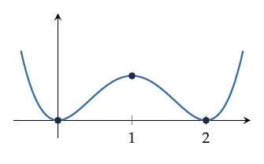

<details><summary>TikZ source</summary>

```latex
\begin{tikzpicture}
\begin{axis}[width=5.4cm,height=3.6cm,axis x line=middle,axis y line=middle,xmin=-0.6,xmax=2.6,ymin=-0.1,ymax=0.6,
  xtick={1,2},ytick=\empty,tick label style={font=\scriptsize},samples=80,domain=-0.5:2.5]
\addplot[accent,thick]{x^4/4-x^3+x^2};
\addplot[only marks,mark=*,mark size=1.4pt,ink] coordinates{(0,0)(1,0.25)(2,0)};
\end{axis}
\end{tikzpicture}
```
</details>


### Q11.02
*NAT · 1 mark · Critical Points and Extrema*

The number of local extrema of $f(x)=x^4-4x^3$ is ____.

**Answer:** 1

**Solution:**

$f'=4x^2(x-3)$: sign changes only at 3 (minimum $-27$). At 0, $f'$ stays $\le0$: no extremum.


### Q11.03
*MCQ · 1 mark · Critical Points and Extrema*

$f$ is three times differentiable with $f'(a)=f''(a)=0$ and $f'''(a)\ne0$. Then $x=a$ is

- **(A)** a local minimum
- **(B)** a local maximum
- **(C)** neither (a point of inflection)
- **(D)** a global minimum

**Answer:** C  (solution header: (C))

**Solution:**

The first non-zero derivative has odd order ⇒ $f'$ does not change sign ⇒ inflection (e.g.\ $x^3$).


### Q11.04
*NAT · 2 marks · Critical Points and Extrema*

$f(x)=x^{2/3}(x-5)$. The local minimum value of $f$ is ____\ (round to 3 decimals).

**Answer:** −4.762  (solution header: $-3\sqrt[3]4\approx-4.762$)

**Solution:**

Idea: critical points include where $f'$ does not exist.
Work: $f=x^{5/3}-5x^{2/3}$, $f'=\frac53x^{-1/3}(x-2)$. At $x=0$ ($f'$ undefined) $f'$ changes $+\to-$: local max 0. At $x=2$: local min $2^{2/3}(-3)$.


### Q11.05
*MSQ · 2 marks · Critical Points and Extrema*

$f(x)=xe^{-x^2}$. Which are correct?

- **(A)** The global maximum is about 0.429
- **(B)** $f$ has exactly 3 inflection points
- **(C)** $f$ is an even function
- **(D)** The global minimum is about $-0.429$

**Answer:** A, B, D  (solution header: (A), (B), (D))

**Solution:**

$f'=e^{-x^2}(1-2x^2)$ ⇒ extrema at $\pm\frac1{\sqrt2}$, values $\pm\frac{1}{\sqrt{2e}}=\pm0.429$. $f''=e^{-x^2}(4x^3-6x)$: zeros $0,\pm\sqrt{3/2}$, all sign changes. $f$ is odd.


### Q11.06
*NAT · 2 marks · Critical Points and Extrema*

$f(x)=2x^3-3x^2-12x+5$ on $[-2,3]$. (global maximum) $-$ (global minimum) is ____.

**Answer:** 27

**Solution:**

Idea: on a closed interval compare critical points \emph{and} endpoints.
Work: $f'=6(x-2)(x+1)$. $f(-2)=1$, $f(-1)=12$, $f(2)=-15$, $f(3)=-4$. $12-(-15)=27$.


### Q11.07
*NAT · 1 mark · Critical Points and Extrema*

The minimum of $f(x)=x^2-6x+10$ on $[4,7]$ is ____.

**Answer:** 2

**Solution:**

The vertex $x=3$ lies outside $[4,7]$; $f$ is increasing there, so the minimum is $f(4)=2$.
Trap: answering $f(3)=1$.


### Q11.08
*NAT · 2 marks · Critical Points and Extrema*

$P(x)=-x^3+12x^2-36x+50$ on $[0,8]$. The number of points in $[0,8]$ at which $P$ attains its global maximum is ____.

**Answer:** 2

**Solution:**

$P'=-3(x-2)(x-6)$. $P(0)=50$, $P(2)=18$, $P(6)=50$, $P(8)=18$: the maximum 50 is attained at $x=0$ and $x=6$.


### Q11.09
*MSQ · 2 marks · Critical Points and Extrema*

$f(x)=x^3-3x+1$ on the interval $(-2,2]$. Which are correct?

- **(A)** The maximum value 3 is attained at $x=-1$ and at $x=2$
- **(B)** The minimum value $-1$ is attained only at $x=1$
- **(C)** $f$ has exactly one root in $(0,1)$
- **(D)** $f$ has a root at $x=1$

**Answer:** A, B, C  (solution header: (A), (B), (C))

**Solution:**

$f'=3(x^2-1)$: local max $f(-1)=3$, local min $f(1)=-1$. Endpoint $f(2)=3$ ties the max. The open end $x=-2$ would give $-1$ but is excluded, so the minimum is attained only at 1. On $(0,1)$, $f$ decreases from 1 to $-1$: exactly one root. (D) ✗ $f(1)=-1$.
Note: PYQ 2026 used $x^3-3x^2+2$ on $(-1,3]$ in the same way.


### Q11.10
*MSQ · 2 marks · Critical Points and Extrema*

$f$ is twice differentiable with $f''(x)<0$ for all $x\in\mathbb R$. Which are always correct?

- **(A)** $f$ has a global maximum
- **(B)** $f'$ is strictly decreasing
- **(C)** $f$ has at most one local maximum
- **(D)** $f(x)\le f(a)+f'(a)(x-a)$ for all $x,a$

**Answer:** B, C, D  (solution header: (B), (C), (D))

**Solution:**

(A) ✗ $-e^x$ is strictly concave with no maximum. (D) concave functions lie below their tangents.
Note: PYQ 2025 (convex, $f''>0$): at most one critical point, at most one global/local minimum, but a minimum need not exist.


### Q11.11
*NAT · 1 mark · Classic Optima*

The maximum of $xe^{-x}$ on $[0,\infty)$ is ____\ (round to 3 decimals).

**Answer:** 0.368  (solution header: $1/e\approx0.368$)

**Solution:**

$f'=e^{-x}(1-x)=0$ at $x=1$.


### Q11.12
*NAT · 1 mark · Classic Optima*

The maximum of $x^{1/x}$ for $x>0$ is ____\ (round to 3 decimals).

**Answer:** 1.445  (solution header: $e^{1/e}\approx1.445$)

**Solution:**

$\ln f=\frac{\ln x}{x}$ is maximised at $x=e$.


### Q11.13
*NAT · 1 mark · Classic Optima*

The minimum of $x^x$ for $x>0$ is ____\ (round to 3 decimals).

**Answer:** 0.692  (solution header: $e^{-1/e}\approx0.692$)

**Solution:**

$\ln f=x\ln x$ is minimised at $x=\frac1e$, value $-\frac1e$.


### Q11.14
*NAT · 1 mark · Classic Optima*

The maximum of $\sin x+\cos x$ is ____\ (round to 3 decimals).

**Answer:** 1.414  (solution header: $\sqrt2\approx1.414$)

**Solution:**

$\sin x+\cos x=\sqrt2\sin(x+\frac\pi4)$. In general $\max(a\sin x+b\cos x)=\sqrt{a^2+b^2}$.


### Q11.15
*NAT · 1 mark · Classic Optima*

The minimum of $|x-1|+|x-3|+|x-8|$ over real $x$ is ____.

**Answer:** 7

**Solution:**

$\sum|x-a_i|$ is minimised at the median, $x=3$: $2+0+5$.


### Q11.16
*NAT · 2 marks · Classic Optima*

The shortest distance from the point $(0,3)$ to the parabola $y=x^2$ is ____\ (round to 3 decimals).

**Answer:** 1.658  (solution header: $\sqrt{11}/2\approx1.658$)

**Solution:**

Minimise $D(x)=x^2+(x^2-3)^2$: $D'=2x(2x^2-5)=0$ ⇒ $x^2=\frac52$, $D=\frac52+\frac14=\frac{11}4$. ($x=0$ gives 9, a local maximum of $D$.)


### Q11.17
*NAT · 1 mark · Classic Optima*

The minimum of $x^2+y^2$ on the line $3x+4y=10$ is attained at distance ____\ from the origin.

**Answer:** 2

**Solution:**

$\frac{|0+0-10|}{\sqrt{3^2+4^2}}$; equivalently minimise $x^2+y^2$ after substituting the line.


### Q11.18
*NAT · 2 marks · Classic Optima*

A closed cylinder has volume $16\pi$. Its minimum total surface area is ____\ (round to 2 decimals).

**Answer:** 75.39–75.40  (solution header: $24\pi\approx75.40$)

**Solution:**

$h=\frac{16}{r^2}$, $S=2\pi r^2+\frac{32\pi}{r}$, $S'=0$ ⇒ $r^3=8$, $r=2$, $h=4=2r$. $S=8\pi+16\pi$.


### Q11.19
*NAT · 2 marks · Applied and Statistical Optimisation*

Equal squares are cut from the corners of a $12\times12$ sheet and the sides folded up to form an open box. The maximum volume is ____.

**Answer:** 128

**Solution:**

$V=x(12-2x)^2$, $V'=(12-2x)(12-6x)=0$ ⇒ $x=2$ (for an $a\times a$ sheet, $x=a/6$). $V=2\cdot64$.


### Q11.20
*NAT · 1 mark · Applied and Statistical Optimisation*

A rectangle is inscribed in a semicircle of radius 2 with one side on the diameter. Its maximum area is ____.

**Answer:** 4

**Solution:**

Corners $(\pm x,y)$ with $x^2+y^2=4$: area $2xy$ is maximised at $x=y=\sqrt2$, giving $r^2=4$.


### Q11.21
*NAT · 2 marks · Applied and Statistical Optimisation*

$x,y>0$ with $x+y=10$. The maximum of $x^2y$ is ____\ (round to 2 decimals).

**Answer:** 148.14–148.15  (solution header: 148.15)

**Solution:**

$f=x^2(10-x)$, $f'=x(20-3x)=0$ ⇒ $x=\frac{20}3$, $y=\frac{10}{3}$: $\frac{4000}{27}$.


### Q11.22
*NAT · 1 mark · Applied and Statistical Optimisation*

The minimum of $x+\dfrac4x$ for $x>0$ is ____.

**Answer:** 4

**Solution:**

AM--GM: $x+\frac4x\ge2\sqrt4$, equality at $x=2$.


### Q11.23
*NAT · 1 mark · Applied and Statistical Optimisation*

The maximum of $xy$ subject to $2x+3y=12$, $x,y>0$, is ____.

**Answer:** 6

**Solution:**

Substitute $y=\frac{12-2x}{3}$: maximise $\frac{x(12-2x)}3$ ⇒ $x=3$, $y=2$. (Equal shares of the budget: $2x=3y=6$.)


### Q11.24
*NAT · 1 mark · Applied and Statistical Optimisation*

The value of $w$ minimising $L(w)=\sum_i(y_i-wx_i)^2$ for $x=(1,2,3)$, $y=(2,4,5)$ is ____\ (round to 3 decimals).

**Answer:** 1.786

**Solution:**

$L'(w)=-2\sum x_i(y_i-wx_i)=0$ ⇒ $w=\frac{\sum xy}{\sum x^2}=\frac{25}{14}$.


### Q11.25
*NAT · 2 marks · Applied and Statistical Optimisation*

The value of $w$ minimising $\sum_i(y_i-wx_i)^2+\lambda w^2$ for $x=(1,2)$, $y=(1,3)$, $\lambda=5$ is ____.

**Answer:** 0.7

**Solution:**

$w=\frac{\sum xy}{\sum x^2+\lambda}=\frac{1+6}{1+4+5}$. Regularisation shrinks the OLS value $\frac75$.


### Q11.26
*NAT · 1 mark · Applied and Statistical Optimisation*

The value of $p\in(0,1)$ maximising $p^3(1-p)^2$ is ____.

**Answer:** 0.6

**Solution:**

Maximise $3\ln p+2\ln(1-p)$: $\frac3p=\frac2{1-p}$. (Bernoulli MLE = fraction of successes.)


### Q11.27
*NAT · 1 mark · Applied and Statistical Optimisation*

$n$ observations from the density $\lambda e^{-\lambda x}$ have sample mean 4. The value of $\lambda$ maximising the likelihood is ____.

**Answer:** 0.25

**Solution:**

$\ell=n\ln\lambda-\lambda\sum x_i$ ⇒ $\hat\lambda=\frac1{\bar x}$.


### Q11.28
*MSQ · 1 mark · Convexity and Iterative Methods*

Which functions are convex on $\mathbb R$?

- **(A)** $e^{-x}$
- **(B)** $x^3$
- **(C)** $\max(x^2,2x)$
- **(D)** $\ln(1+e^x)$

**Answer:** A, C, D  (solution header: (A), (C), (D))

**Solution:**

(A) $f''=e^{-x}>0$. (B) ✗ $f''=6x<0$ for $x<0$. (C) maximum of convex functions. (D) softplus: $f''=\sigma(1-\sigma)>0$.


### Q11.29
*MSQ · 2 marks · Convexity and Iterative Methods*

Which are correct for functions $\mathbb R\to\mathbb R$?

- **(A)** If $f$ is convex and differentiable and $f'(x^*)=0$, then $x^*$ is a global minimiser
- **(B)** A strictly convex function has at most one minimiser
- **(C)** The sum of two convex functions is convex
- **(D)** The product of two convex functions is convex

**Answer:** A, B, C  (solution header: (A), (B), (C))

**Solution:**

(D) ✗ $x$ and $x^2$ are convex but $x^3$ is not.


### Q11.30
*NAT · 1 mark · Convexity and Iterative Methods*

Gradient descent on $f(x)=(x-3)^2$ with $x_0=0$ and $\eta=0.25$. The value $x_2$ is ____.

**Answer:** 2.25

**Solution:**

$x_1=0-0.25\cdot(-6)=1.5$; $x_2=1.5-0.25\cdot(-3)=2.25$. The gap to 3 halves each step.


### Q11.31
*MCQ · 1 mark · Convexity and Iterative Methods*

Gradient descent $x_{k+1}=x_k-\eta f'(x_k)$ on $f(x)=2x^2$ converges to 0 from every start exactly when

- **(A)** $0<\eta<0.25$
- **(B)** $0<\eta<1$
- **(C)** $0<\eta<0.5$
- **(D)** $0<\eta<2$

**Answer:** C  (solution header: (C))

**Solution:**

$x_{k+1}=(1-4\eta)x_k$ converges iff $|1-4\eta|<1$. In general, for $f=\frac a2x^2$: $0<\eta<\frac2a$; $\eta=\frac1a$ converges in one step.


### Q11.32
*MCQ · 1 mark · Convexity and Iterative Methods*

Gradient descent with $\eta=1$ on $f(x)=x^2-2x+3$, starting from $x_0=0$,

- **(A)** oscillates between 0 and 2
- **(B)** converges to 1
- **(C)** diverges to $\infty$
- **(D)** reaches 1 in one step

**Answer:** A  (solution header: (A))

**Solution:**

$x_{k+1}=x_k-(2x_k-2)=2-x_k$: $0,2,0,2,\dots$ Here $\eta=1=\frac2a$ with $a=2$: the boundary case.


### Q11.33
*NAT · 2 marks · Convexity and Iterative Methods*

The loss $L(w)=(wx-y)^2$ is minimised by gradient descent with learning rate $0.05$. If $w=2$ and the sample is $(x,y)=(3,4)$, the updated $w$ is ____.

**Answer:** 1.4

**Solution:**

$\frac{dL}{dw}=2(wx-y)x=2(6-4)\cdot3=12$; $w\leftarrow2-0.05\cdot12$.
Note: PYQ 2026 had $f_w(x)=wx$: gradient $x$, so $w\leftarrow10-0.1\cdot10=9$.


### Q11.34
*NAT · 1 mark · Convexity and Iterative Methods*

Newton's method for $x^2-2=0$ from $x_0=1$. The value $x_2$ is ____\ (round to 4 decimals).

**Answer:** 1.4167

**Solution:**

$x_{k+1}=\frac{x_k}2+\frac1{x_k}$: $1\to1.5\to1.41667$ (true $\sqrt2=1.41421$; quadratic convergence).


### Q11.35
*NAT · 2 marks · Convexity and Iterative Methods*

Newton's method for minimising $f(x)=e^x-2x$ (i.e.\ $x_{k+1}=x_k-f'(x_k)/f''(x_k)$) from $x_0=0$. The value $x_2$ is ____\ (round to 3 decimals).

**Answer:** 0.736

**Solution:**

$x_1=0-\frac{1-2}{1}=1$; $x_2=1-\frac{e-2}{e}=\frac2e$. The minimiser is $\ln2=0.693$.
Note: Newton minimises a quadratic in one step.


### Q11.36
*MCQ · 1 mark · Convexity and Iterative Methods*

Newton's method $x_{k+1}=x_k-f(x_k)/f'(x_k)$ is applied to $f(x)=x^{1/3}$ from $x_0=1$. The iterates

- **(A)** converge to 0
- **(B)** stay at 1
- **(C)** satisfy $x_{k+1}=-2x_k$ and diverge
- **(D)** converge to $-1$

**Answer:** C  (solution header: (C))

**Solution:**

$\frac{f}{f'}=\frac{x^{1/3}}{\frac13x^{-2/3}}=3x$, so $x_{k+1}=-2x_k$: $1,-2,4,-8,\dots$ Newton needs $f'$ well-behaved at the root.


## Day 12: Integration, Applications and Mixed Problems


### Q12.01
*MCQ · 1 mark · Indefinite Integrals*

For $x>0$ and integer $n\ge1$, $\displaystyle\int\frac{dx}{x\,(x^n+1)}=$

- **(A)** $\ln\Big|\dfrac{x^n}{x^n+1}\Big|+C$
- **(B)** $\dfrac1n\ln\Big|\dfrac{x^n+1}{x^n}\Big|+C$
- **(C)** $\dfrac1n\ln\Big|\dfrac{x^n}{x^n+1}\Big|+C$
- **(D)** $\dfrac1n\ln\big|x^n(x^n+1)\big|+C$

**Answer:** C  (solution header: (C))

**Solution:**

Idea: multiply top and bottom by $x^{n-1}$ and substitute $u=x^n$.
Work: $\int\frac{x^{n-1}dx}{x^n(x^n+1)}=\frac1n\int\frac{du}{u(u+1)}=\frac1n\ln\big|\frac{u}{u+1}\big|$.
Trap: (B) has the reciprocal inside the log, i.e.\ the wrong sign.


### Q12.02
*MCQ · 1 mark · Indefinite Integrals*

$\displaystyle\int e^x\Big(\frac1x-\frac1{x^2}\Big)dx=$

- **(A)** $\dfrac{e^x}{x^2}+C$
- **(B)** $-\dfrac{e^x}{x}+C$
- **(C)** $e^x\ln x+C$
- **(D)** $\dfrac{e^x}{x}+C$

**Answer:** D  (solution header: (D))

**Solution:**

Idea: $\int e^x\big(f(x)+f'(x)\big)dx=e^xf(x)+C$.
Work: $f=\frac1x$, $f'=-\frac1{x^2}$. (Same pattern: $\int e^x\frac{x}{(1+x)^2}dx=\frac{e^x}{1+x}$.)


### Q12.03
*MCQ · 2 marks · Indefinite Integrals*

For $x>0$, $\displaystyle\int\frac{x^2+1}{x^4+1}\,dx=$

- **(A)** $\tfrac{1}{2\sqrt2}\ln\Big|\dfrac{x^2-\sqrt2x+1}{x^2+\sqrt2x+1}\Big|+C$
- **(B)** $\tfrac{1}{\sqrt2}\tan^{-1}\Big(\dfrac{x^2-1}{\sqrt2\,x}\Big)+C$
- **(C)** $\tfrac{1}{\sqrt2}\tan^{-1}\Big(\dfrac{x^2+1}{\sqrt2\,x}\Big)+C$
- **(D)** $\tan^{-1}(x^2)+C$

**Answer:** B  (solution header: (B))

**Solution:**

Idea: divide by $x^2$: $\frac{1+1/x^2}{x^2+1/x^2}$ and set $t=x-\frac1x$, $dt=(1+\frac1{x^2})dx$, $x^2+\frac1{x^2}=t^2+2$.
Work: $\int\frac{dt}{t^2+2}=\frac1{\sqrt2}\tan^{-1}\frac{t}{\sqrt2}$ with $t=\frac{x^2-1}{x}$.
Note: for $\frac{x^2-1}{x^4+1}$ use $t=x+\frac1x$ and get the log form (A), up to sign and constant.


### Q12.04
*MCQ · 1 mark · Indefinite Integrals*

$\displaystyle\int\frac{dx}{1+\sin x}=$

- **(A)** $\tan x-\sec x+C$
- **(B)** $\sec x-\tan x+C$
- **(C)** $\tan x+\sec x+C$
- **(D)** $\ln|1+\sin x|+C$

**Answer:** A  (solution header: (A))

**Solution:**

$\frac{1}{1+\sin x}=\frac{1-\sin x}{\cos^2x}=\sec^2x-\sec x\tan x$, which integrates to $\tan x-\sec x$.
Trap: differentiating (B) gives $-\frac{1}{1+\sin x}$.


### Q12.05
*NAT · 1 mark · Definite Integrals: Partial Fractions, Absolute Values, Floors*

$\displaystyle\int_2^3\frac{dx}{x^2-1}$ is ____\ (round to 4 decimals).

**Answer:** 0.2027

**Solution:**

$\frac{1}{x^2-1}=\frac12\big(\frac1{x-1}-\frac1{x+1}\big)$ ⇒ $\frac12\ln\frac{x-1}{x+1}\Big|_2^3=\frac12\big(\ln\frac12-\ln\frac13\big)=\frac12\ln\frac32$.


### Q12.06
*NAT · 2 marks · Definite Integrals: Partial Fractions, Absolute Values, Floors*

$\displaystyle\int_0^{\pi}\sqrt{1+4\sin^2\frac x2-4\sin\frac x2}\;dx$ is ____\ (round to 3 decimals).

**Answer:** 1.881  (solution header: $4\sqrt3-4-\frac\pi3\approx1.881$)

**Solution:**

Idea: the radicand is a perfect square: $\big(1-2\sin\frac x2\big)^2$, so the integrand is $\big|1-2\sin\frac x2\big|$.
Work: The sign changes at $\frac x2=\frac\pi6$, i.e.\ $x=\frac\pi3$.
$\int_0^{\pi/3}\big(1-2\sin\frac x2\big)dx+\int_{\pi/3}^{\pi}\big(2\sin\frac x2-1\big)dx=\big(\frac\pi3+4\cos\frac\pi6-4\big)+\big(4\cos\frac\pi6-\frac{2\pi}3\big)$.
Trap: dropping the absolute value. (JEE Main 2014.)


### Q12.07
*NAT · 2 marks · Definite Integrals: Partial Fractions, Absolute Values, Floors*

$\displaystyle\int_0^{2}x\,\lfloor x^2\rfloor\,dx$ is ____.

**Answer:** 3

**Solution:**

Idea: substitute $u=x^2$: $\int_0^2x\lfloor x^2\rfloor dx=\frac12\int_0^4\lfloor u\rfloor du$.
Work: $\frac12(0+1+2+3)=3$. (AIEEE 2011 had the upper limit 1.5: answer $\frac34$.)


### Q12.08
*NAT · 2 marks · Definite Integrals: Partial Fractions, Absolute Values, Floors*

$\displaystyle\int_0^{\pi}\lfloor\cot x\rfloor\,dx$ is ____\ (round to 3 decimals).

**Answer:** −1.571  (solution header: $-\pi/2\approx-1.571$)

**Solution:**

Idea: King's rule: $\cot(\pi-x)=-\cot x$, and $\lfloor y\rfloor+\lfloor-y\rfloor=-1$ for non-integer $y$.
Work: $2I=\int_0^\pi\big(\lfloor\cot x\rfloor+\lfloor-\cot x\rfloor\big)dx=\int_0^\pi(-1)\,dx$ (integer values occur on a set of measure 0).


### Q12.09
*NAT · 2 marks · Properties and Special Techniques*

$\displaystyle\int_0^{\pi}\frac{x\sin x}{1+\cos^2x}\,dx$ is ____\ (round to 3 decimals).

**Answer:** 2.467  (solution header: $\pi^2/4\approx2.467$)

**Solution:**

Idea: King's rule: $I=\int_0^\pi(\pi-x)g(x)\,dx$ when $g(\pi-x)=g(x)$, so $I=\frac\pi2\int_0^\pi g$.
Work: $\frac\pi2\int_0^\pi\frac{\sin x}{1+\cos^2x}dx=\frac\pi2\big[-\tan^{-1}(\cos x)\big]_0^\pi=\frac\pi2\cdot\frac\pi2$.


### Q12.10
*NAT · 1 mark · Properties and Special Techniques*

$\displaystyle\int_3^5\frac{\sqrt x}{\sqrt x+\sqrt{8-x}}\,dx$ is ____.

**Answer:** 1

**Solution:**

King's rule on $[a,b]$: $x\to a+b-x=8-x$ swaps $\sqrt x$ and $\sqrt{8-x}$. Adding gives $2I=\int_3^5 1\,dx=2$.
Note: general form $\int_a^b\frac{f(x)}{f(x)+f(a+b-x)}dx=\frac{b-a}{2}$ (JEE Main 2015, 2013 variants).


### Q12.11
*NAT · 2 marks · Properties and Special Techniques*

$\displaystyle\int_{-\pi/2}^{\pi/2}\frac{\cos x}{1+e^x}\,dx$ is ____.

**Answer:** 1

**Solution:**

Idea: for even $g$: $\int_{-a}^a\frac{g(x)}{1+e^x}dx=\int_0^ag(x)\,dx$.
Work: Replace $x\to-x$: $\frac{g}{1+e^{-x}}=\frac{e^xg}{1+e^x}$; adding the two forms gives $\int_{-a}^ag=2I$. So $I=\int_0^{\pi/2}\cos x=1$.
Note: JEE Main 2018: $\int_{-\pi/2}^{\pi/2}\frac{\sin^2x}{1+2^x}dx=\frac\pi4$.


### Q12.12
*NAT · 2 marks · Properties and Special Techniques*

$\displaystyle\int_0^{\pi/2}\ln(\sin x)\,dx$ is ____\ (round to 3 decimals).

**Answer:** −1.089  (solution header: $-\frac\pi2\ln2\approx-1.089$)

**Solution:**

Idea: King gives $I=\int\ln\cos x$, so $2I=\int_0^{\pi/2}\ln\frac{\sin2x}{2}dx$.
Work: $\int_0^{\pi/2}\ln\sin2x\,dx=I$ (substitute $u=2x$ and use symmetry), so $2I=I-\frac\pi2\ln2$.


### Q12.13
*NAT · 2 marks · Properties and Special Techniques*

$\displaystyle\int_0^1\frac{\ln(1+x)}{1+x^2}\,dx$ is ____\ (round to 4 decimals).

**Answer:** 0.2722  (solution header: $\frac\pi8\ln2\approx0.2722$)

**Solution:**

Idea: $x=\tan\theta$ turns it into $\int_0^{\pi/4}\ln(1+\tan\theta)\,d\theta$; then King.
Work: $1+\tan(\frac\pi4-\theta)=\frac{2}{1+\tan\theta}$, so $2I=\int_0^{\pi/4}\ln2=\frac\pi4\ln2$. (AIEEE 2011: $8\times$ this $=\pi\ln2$.)


### Q12.14
*NAT · 2 marks · Properties and Special Techniques*

$f$ is differentiable with $f'(x)=f'(2-x)$ for all $x$, $f(0)=3$ and $f(2)=7$. $\displaystyle\int_0^2f(x)\,dx$ is ____.

**Answer:** 10

**Solution:**

Idea: integrate the symmetry: $f'(x)=f'(2-x)$ ⇒ $f(x)=-f(2-x)+C$.
Work: $f(x)+f(2-x)=C=f(0)+f(2)=10$. King: $2\int_0^2f=\int_0^2\big(f(x)+f(2-x)\big)=20$. (AIEEE 2010 pattern.)


### Q12.15
*NAT · 2 marks · Properties and Special Techniques*

$\displaystyle\int_0^1\frac{x^4(1-x)^4}{1+x^2}\,dx$ is ____\ (round to 5 decimals).

**Answer:** 0.00126  (solution header: $\frac{22}{7}-\pi\approx0.00126$)

**Solution:**

Long division: $\frac{x^4(1-x)^4}{1+x^2}=x^6-4x^5+5x^4-4x^2+4-\frac{4}{1+x^2}$. Integrating: $\frac17-\frac23+1-\frac43+4-\pi$. (The positive integrand proves $\frac{22}7>\pi$.)


### Q12.16
*NAT · 2 marks · Properties and Special Techniques*

$I_n=\displaystyle\int_0^{\pi/4}\tan^nx\,dx$. Using $I_n+I_{n-2}=\frac{1}{n-1}$, the value of $I_3$ is ____\ (round to 4 decimals).

**Answer:** 0.1534  (solution header: $\frac12-\frac12\ln2\approx0.1534$)

**Solution:**

$I_n+I_{n-2}=\int_0^{\pi/4}\tan^{n-2}x\sec^2x\,dx=\frac1{n-1}$. $I_1=\frac12\ln2$, so $I_3=\frac12-I_1$.


### Q12.17
*NAT · 2 marks · Properties and Special Techniques*

$\displaystyle\int_0^{\infty}\frac{dx}{1+x^4}$ is ____\ (round to 3 decimals).

**Answer:** 1.111  (solution header: $\frac{\pi}{2\sqrt2}\approx1.111$)

**Solution:**

Idea: $x\to\frac1x$ shows $\int_0^\infty\frac{dx}{1+x^4}=\int_0^\infty\frac{x^2dx}{1+x^4}$, so $I=\frac12\int_0^\infty\frac{1+x^2}{1+x^4}dx$.
Work: With $t=x-\frac1x$ (from Q12.03): $\frac12\int_{-\infty}^{\infty}\frac{dt}{t^2+2}=\frac12\cdot\frac{\pi}{\sqrt2}$.


### Q12.18
*NAT · 2 marks · Properties and Special Techniques*

$\displaystyle\int_0^{1}\frac{x^3-1}{\ln x}\,dx$ is ____\ (round to 3 decimals).

**Answer:** 1.386  (solution header: $\ln4\approx1.386$)

**Solution:**

Idea: differentiate under the integral (Feynman): $J(a)=\int_0^1\frac{x^a-1}{\ln x}dx$, $J'(a)=\int_0^1x^a\,dx=\frac{1}{a+1}$.
Work: $J(0)=0$ ⇒ $J(a)=\ln(a+1)$; $a=3$.


### Q12.19
*MSQ · 1 mark · Improper Integrals, Limits, Integral Equations, Area*

Which improper integrals converge?

- **(A)** $\displaystyle\int_1^\infty\frac{dx}{x^2}$
- **(B)** $\displaystyle\int_0^1\frac{dx}{\sqrt x}$
- **(C)** $\displaystyle\int_1^\infty\frac{dx}{x}$
- **(D)** $\displaystyle\int_0^1\frac{dx}{x}$

**Answer:** A, B  (solution header: (A), (B))

**Solution:**

$p$-test: $\int_1^\infty x^{-p}$ converges iff $p>1$; $\int_0^1x^{-p}$ converges iff $p<1$. $\frac1x$ fails both.


### Q12.20
*NAT · 2 marks · Improper Integrals, Limits, Integral Equations, Area*

$\displaystyle\lim_{n\to\infty}\Big(\frac{n!}{n^n}\Big)^{1/n}$ is ____\ (round to 3 decimals).

**Answer:** 0.368  (solution header: $1/e\approx0.368$)

**Solution:**

Idea: take logs to get a Riemann sum: $\frac1n\sum_{k=1}^n\ln\frac kn\to\int_0^1\ln x\,dx=-1$.
Work: Limit $e^{-1}$. (Stirling gives the same.)


### Q12.21
*MSQ · 2 marks · Improper Integrals, Limits, Integral Equations, Area*

$I=\displaystyle\int_0^1e^{x^2}\,dx$. Which are correct?

- **(A)** $1<I<e$
- **(B)** $I>1+\tfrac13$
- **(C)** $I<1+\tfrac13+\tfrac1{10}+\tfrac{e}{42}$
- **(D)** $I>e-1$

**Answer:** A, B, C  (solution header: (A), (B), (C))

**Solution:**

Since $1+t\le e^t\le1+t+\frac{t^2}2+\frac{e\,t^3}{6}$ on $[0,1]$, with $t=x^2$: $1+\frac13\le I\le1+\frac13+\frac1{10}+\frac{e}{42}\approx1.498$. In fact $I\approx1.463$. (D) ✗ $e-1\approx1.718$.


### Q12.22
*NAT · 2 marks · Improper Integrals, Limits, Integral Equations, Area*

$F(x)=\displaystyle\int_0^x(t^2-4t+3)\,e^{-t}\,dt$. The point $x>0$ at which $F$ has a local maximum is ____.

**Answer:** 1

**Solution:**

$F'(x)=(x-1)(x-3)e^{-x}$: sign $+$, $-$, $+$, so a maximum at 1 and a minimum at 3.


### Q12.23
*NAT · 2 marks · Improper Integrals, Limits, Integral Equations, Area*

A continuous $f$ satisfies $f(x)=x+\displaystyle\int_0^1t\,f(t)\,dt$ for all $x$. $f(1)$ is ____\ (round to 3 decimals).

**Answer:** 1.667  (solution header: $5/3\approx1.667$)

**Solution:**

Idea: the integral is a constant $c$, so $f(x)=x+c$.
Work: $c=\int_0^1t(t+c)\,dt=\frac13+\frac c2$ ⇒ $c=\frac23$, $f(1)=\frac53$.


### Q12.24
*NAT · 1 mark · Improper Integrals, Limits, Integral Equations, Area*

The total area between $y=\sin x$ and $y=\cos x$ for $0\le x\le\frac\pi2$ is ____\ (round to 3 decimals).

**Answer:** 0.828  (solution header: $2(\sqrt2-1)\approx0.828$)

**Solution:**

Curves cross at $\frac\pi4$; by symmetry $2\int_0^{\pi/4}(\cos x-\sin x)\,dx=2(\sqrt2-1)$.


### Q12.25
*NAT · 1 mark · Calculus with Probability*

$f(x)=cx^2$ on $[0,3]$ is a density. $\mathbb{E}[X]$ is ____.

**Answer:** 2.25

**Solution:**

$c=\frac19$; $\mathbb{E} X=\int_0^3\frac{x^3}{9}dx=\frac{81}{36}$.


### Q12.26
*NAT · 1 mark · Calculus with Probability*

The median of the density $f(x)=2x$ on $[0,1]$ is ____\ (round to 3 decimals).

**Answer:** 0.707

**Solution:**

$F(m)=m^2=\frac12$.


### Q12.27
*NAT · 1 mark · Calculus with Probability*

A density is proportional to $x^2e^{-x}$ on $(0,\infty)$. Its mode is ____.

**Answer:** 2

**Solution:**

Maximise $2\ln x-x$: $\frac2x=1$. (Gamma$(k,1)$ mode is $k-1$.)


### Q12.28
*NAT · 2 marks · Calculus with Probability*

A non-negative random variable has $P(X>x)=e^{-x^2}$. $\mathbb{E}[X]$ is ____\ (round to 3 decimals).

**Answer:** 0.886  (solution header: $\sqrt\pi/2\approx0.886$)

**Solution:**

$\mathbb{E} X=\int_0^\infty e^{-x^2}dx$ (survival integral, then the half-Gaussian integral).


### Q12.29
*NAT · 2 marks · Calculus with Probability*

A random variable has MGF $M(t)=(1-2t)^{-3}$ for $t<\tfrac12$. Its variance is ____.

**Answer:** 12

**Solution:**

$M'(0)=6$, $M''(0)=48$; $48-36$. (This is $\chi^2_6$: mean 6, variance 12.)


### Q12.30
*NAT · 2 marks · Calculus with Probability*

$x_1,\dots,x_4$ are drawn from $f(x;\theta)=\theta x^{\theta-1}$ on $(0,1)$, $\theta>0$, and $\sum\ln x_i=-2$. The maximum likelihood estimate of $\theta$ is ____.

**Answer:** 2

**Solution:**

$\ell(\theta)=n\ln\theta+(\theta-1)\sum\ln x_i$ ⇒ $\hat\theta=-\frac{n}{\sum\ln x_i}=\frac42$.


### Q12.31
*NAT · 2 marks · Calculus with Probability*

$Z\sim N(0,1)$. The value of $c$ maximising $P(c<Z<c+1)$ is ____.

**Answer:** −0.5  (solution header: $-0.5$)

**Solution:**

$\frac{d}{dc}\big[\Phi(c+1)-\Phi(c)\big]=\varphi(c+1)-\varphi(c)=0$ ⇒ $|c+1|=|c|$ ⇒ the window is centred at 0.


### Q12.32
*NAT · 1 mark · Calculus with Probability*

The maximum of $H(p)=-p\log_2p-(1-p)\log_2(1-p)$ over $p\in(0,1)$ is ____.

**Answer:** 1

**Solution:**

$H'(p)=\log_2\frac{1-p}{p}=0$ at $p=\frac12$, and $H$ is concave.


### Q12.33
*NAT · 2 marks · Calculus with Linear Algebra*

$f(x)=x^TAx$ with $A=\begin{pmatrix}2&1\\1&3\end{pmatrix}$. $\|\nabla f(x)\|_2$ at $x=(1,1)^T$ is ____.

**Answer:** 10

**Solution:**

$\nabla(x^TAx)=2Ax$ for symmetric $A$: $2(3,4)=(6,8)$.


### Q12.34
*NAT · 2 marks · Calculus with Linear Algebra*

The minimum value of $f(x)=x^TAx-2b^Tx$ with $A=\begin{pmatrix}2&0\\0&4\end{pmatrix}$ and $b=(2,4)^T$ is ____.

**Answer:** −6  (solution header: $-6$)

**Solution:**

$\nabla f=2Ax-2b=0$ ⇒ $x^*=A^{-1}b=(1,1)$; $f^*=-b^TA^{-1}b=-(2+4)$. $A$ is PD, so this is the global minimum.


### Q12.35
*MCQ · 1 mark · Calculus with Linear Algebra*

At the origin, $f(x,y)=x^2+4xy+y^2$ has

- **(A)** a local minimum
- **(B)** a local maximum
- **(C)** a saddle point
- **(D)** a degenerate critical point

**Answer:** C  (solution header: (C))

**Solution:**

Hessian $\begin{pmatrix}2&4\\4&2\end{pmatrix}$ has eigenvalues $6$ and $-2$: indefinite. ($D=f_{xx}f_{yy}-f_{xy}^2=4-16<0$.)


### Q12.36
*NAT · 2 marks · Calculus with Linear Algebra*

$A=\begin{pmatrix}1&2\\3&4\end{pmatrix}$. $\dfrac{d}{dt}\det(I+tA)$ at $t=0$ is ____.

**Answer:** 5

**Solution:**

$\det(I+tA)=1+t\operatorname{tr}A+t^2\det A$; derivative at 0 is $\operatorname{tr}A$.


### Q12.37
*NAT · 2 marks · Calculus with Linear Algebra*

Gradient descent $x_{k+1}=x_k-\eta\nabla f(x_k)$ on $f(x)=\tfrac12x^TAx$ with $A=\operatorname{diag}(1,10)$ converges from every start iff $0<\eta<\eta_{\max}$. $\eta_{\max}$ is ____.

**Answer:** 0.2

**Solution:**

Each eigen-direction contracts by $1-\eta\lambda_i$; need $|1-10\eta|<1$ ⇒ $\eta<\frac2{\lambda_{\max}}$.
Note: convergence speed is governed by the condition number $\frac{10}{1}$.


### Q12.38
*NAT · 2 marks · Calculus with Linear Algebra*

The second-order Taylor approximation of $f(x,y)=e^{x+2y}$ about $(0,0)$, evaluated at $(0.1,0.1)$, is ____\ (round to 3 decimals).

**Answer:** 1.345

**Solution:**

With $u=x+2y=0.3$: $1+u+\frac{u^2}{2}$. The Hessian is $\begin{pmatrix}1&2\\2&4\end{pmatrix}$ (rank 1). True value $1.3499$.


### Q12.39
*NAT · 2 marks · Mixed Problems*

$\displaystyle\int_{-\infty}^{\infty}x^4e^{-x^2/2}\,dx$ is ____\ (round to 3 decimals).

**Answer:** 7.520  (solution header: $3\sqrt{2\pi}\approx7.520$)

**Solution:**

$\int x^4\varphi(x)\,dx=\mathbb{E}[Z^4]=3$, and $e^{-x^2/2}=\sqrt{2\pi}\,\varphi(x)$.


### Q12.40
*NAT · 2 marks · Mixed Problems*

$Z\sim N(0,1)$. $\mathbb{E}[\max(0,Z)]$ is ____\ (round to 3 decimals).

**Answer:** 0.399  (solution header: $1/\sqrt{2\pi}\approx0.399$)

**Solution:**

$\int_0^\infty z\varphi(z)\,dz=\big[-\varphi(z)\big]_0^\infty=\varphi(0)$.


### Q12.41
*NAT · 1 mark · Mixed Problems*

$\sigma(x)=\dfrac{1}{1+e^{-x}}$. $\displaystyle\int_{-1}^{1}\sigma(x)\,dx$ is ____.

**Answer:** 1

**Solution:**

Idea: $\sigma(x)+\sigma(-x)=1$, so on a symmetric interval the integrand averages $\frac12$.
Work: $\int_{-1}^1\sigma=\int_0^1\big(\sigma(x)+\sigma(-x)\big)dx=1$.


### Q12.42
*NAT · 2 marks · Mixed Problems*

$Y\sim U(0,2)$. The minimum over constants $w$ of $\mathbb{E}[(Y-w)^2]$ is ____\ (round to 3 decimals).

**Answer:** 0.333  (solution header: $1/3\approx0.333$)

**Solution:**

$\mathbb{E}[(Y-w)^2]=\operatorname{Var} Y+(\mathbb{E} Y-w)^2$ is minimised at $w=\mathbb{E} Y$; the minimum is $\operatorname{Var} Y=\frac{2^2}{12}$.


# Part: Days 13-16: Programming, Data Structures and Algorithms


## Day 13: Programming in Python


> **Shared context `Day13-ctx1`**

{All programs are Python 3 and run exactly as printed.}


### Q13.01
*MCQ · 1 mark · Operators and Expressions · uses `Day13-ctx1`*

```python
print(-7 // 2, -7 % 2, 7 % -2, 2 ** 3 ** 2)
```

The output is

- **(A)** \texttt{-3 -1 1 64}
- **(B)** \texttt{-4 1 -1 512}
- **(C)** \texttt{-4 1 1 512}
- **(D)** \texttt{-3 1 -1 64}

**Answer:** B  (solution header: (B) \texttt{-4 1 -1 512})

**Solution:**

\texttt{//} floors toward $-\infty$: $-3.5\to-4$. \texttt{\%} takes the sign of the divisor: $-7=2(-4)+1$; $7=(-2)(-4)-1$. \texttt{**} is right-associative: $2^{9}$.


### Q13.02
*MCQ · 1 mark · Operators and Expressions · uses `Day13-ctx1`*

```python
print(0 or [] or 'a' and 0 or None)
```

The output is

- **(A)** \texttt{[]}
- **(B)** \texttt{a}
- **(C)** \texttt{None}
- **(D)** \texttt{0}

**Answer:** C  (solution header: (C) \texttt{None})

**Solution:**

\texttt{and} binds tighter: \texttt{0 or [] or ('a' and 0) or None}. \texttt{'a' and 0} is \texttt{0}. \texttt{or} returns the first truthy operand, else the \emph{last} one: \texttt{None}.


### Q13.03
*MCQ · 1 mark · Operators and Expressions · uses `Day13-ctx1`*

```python
print(1 < 2 < 3 == 3 > 2, 3 > 2 == True)
```

The output is

- **(A)** \texttt{True True}
- **(B)** \texttt{False False}
- **(C)** \texttt{True False}
- **(D)** \texttt{False True}

**Answer:** C  (solution header: (C) \texttt{True False})

**Solution:**

Chains expand pairwise: \texttt{1<2 and 2<3 and 3==3 and 3>2}. The second is \texttt{3>2 and 2==True}, and \texttt{2==True} is \texttt{False} (\texttt{True==1}).


### Q13.04
*NAT · 1 mark · Operators and Expressions · uses `Day13-ctx1`*

```python
x = 10
x //= 3
x **= 2
x %= 5
print(x)
```

The value printed is ____.

**Answer:** 4

**Solution:**

$10//3=3$, $3^2=9$, $9\bmod5=4$.


### Q13.05
*NAT · 1 mark · Operators and Expressions · uses `Day13-ctx1`*

```python
print(int('101', 2) + int(3.9) + round(2.5) + round(3.5))
```

The value printed is ____.

**Answer:** 14

**Solution:**

$5+3+2+4$: \texttt{int} truncates; \texttt{round} uses banker's rounding (halves go to the even neighbour), so \texttt{round(2.5)=2}, \texttt{round(3.5)=4}.


### Q13.06
*MCQ · 1 mark · Operators and Expressions · uses `Day13-ctx1`*

```python
s = 'GATEDA2027'
print(s[::-2], s[2:-3])
```

The output is

- **(A)** \texttt{70AEA TEDA2}
- **(B)** \texttt{70AEA TEDA20}
- **(C)** \texttt{72AEA TEDA2}
- **(D)** \texttt{7AE0A TEDA}

**Answer:** A  (solution header: (A) \texttt{70AEA TEDA2})

**Solution:**

Indices 0--9: \texttt{G A T E D A 2 0 2 7}. \texttt{[::-2]} takes 9, 7, 5, 3, 1: \texttt{7 0 A E A}. \texttt{[2:-3]} is indices 2--6: \texttt{TEDA2}.


### Q13.07
*MCQ · 1 mark · Operators and Expressions · uses `Day13-ctx1`*

```python
w = 'mississippi'
print(len(set(w)), 'ss' in w, w.count('ss'), w.find('z'))
```

The output is

- **(A)** \texttt{4 False 1 -1}
- **(B)** \texttt{4 True 2 -1}
- **(C)** \texttt{4 True 2} followed by an error
- **(D)** \texttt{11 True 2 -1}

**Answer:** B  (solution header: (B) \texttt{4 True 2 -1})

**Solution:**

Distinct letters m, i, s, p. \texttt{count} counts non-overlapping matches. \texttt{find} returns $-1$ when absent (\texttt{index} would raise).


### Q13.08
*MCQ · 1 mark · Lists, Mutability and Aliasing · uses `Day13-ctx1`*

```python
def add(x, L=[]):
    L.append(x)
    return len(L)

print(add(1), add(2), add(3, []), add(4))
```

The output is

- **(A)** \texttt{1 2 1 4}
- **(B)** \texttt{1 2 3 4}
- **(C)** \texttt{1 2 1 3}
- **(D)** \texttt{1 1 1 1}

**Answer:** C  (solution header: (C) \texttt{1 2 1 3})

**Solution:**

The default list is created once, when \texttt{def} runs, and shared by every call that omits \texttt{L}. The explicit \texttt{[]} is a fresh list.
Note: PYQ 2026: the same trap printed \texttt{[1]}, \texttt{[1, 2]}, \texttt{[3]}.


### Q13.09
*NAT · 2 marks · Lists, Mutability and Aliasing · uses `Day13-ctx1`*

```python
a = [[0] * 3] * 3
a[0][0] = 1
b = [[0] * 3 for _ in range(3)]
b[0][0] = 1
print(sum(map(sum, a)) + 10 * sum(map(sum, b)))
```

The value printed is ____.

**Answer:** 13

**Solution:**

\texttt{[[0]*3]*3} holds three references to one row: setting \texttt{a[0][0]} sets column 0 of every row (sum 3). The comprehension builds independent rows (sum 1). $3+10$.


### Q13.10
*MCQ · 1 mark · Lists, Mutability and Aliasing · uses `Day13-ctx1`*

```python
a = [1, 2, 3]
b = a
b += [4]
c = a
c = c + [5]
print(len(a), len(c))
```

The output is

- **(A)** \texttt{4 4}
- **(B)** \texttt{4 5}
- **(C)** \texttt{3 5}
- **(D)** \texttt{5 5}

**Answer:** B  (solution header: (B) \texttt{4 5})

**Solution:**

\texttt{b += [4]} mutates the shared list in place. \texttt{c = c + [5]} builds a new list and rebinds only \texttt{c}.


### Q13.11
*NAT · 1 mark · Lists, Mutability and Aliasing · uses `Day13-ctx1`*

```python
A = [1, 2]
A.append([3, 4])
A.extend([5, 6])
A += 'ab'
print(len(A))
```

The value printed is ____.

**Answer:** 7

**Solution:**

\texttt{append} adds one element (the list \texttt{[3, 4]}); \texttt{extend} adds each element; \texttt{+=} with a string extends by characters: \texttt{[1, 2, [3, 4], 5, 6, 'a', 'b']}.
Note: PYQ 2025: \texttt{A.extend(B)} gives \texttt{[1,2,3,4,5,6]}.


### Q13.12
*MCQ · 1 mark · Lists, Mutability and Aliasing · uses `Day13-ctx1`*

```python
L = [3, 1, 2]
print(L.sort(), sorted(L, reverse=True), L)
```

The output is

- **(A)** \texttt{None [3, 2, 1] [1, 2, 3]}
- **(B)** \texttt{[1, 2, 3] [3, 2, 1] [3, 2, 1]}
- **(C)** \texttt{[1, 2, 3] [3, 2, 1] [1, 2, 3]}
- **(D)** \texttt{None [3, 2, 1] [3, 1, 2]}

**Answer:** A  (solution header: (A))

**Solution:**

\texttt{list.sort()} sorts in place and returns \texttt{None}; \texttt{sorted} returns a new list. Arguments are evaluated left to right, so \texttt{L} is already sorted when printed.


### Q13.13
*MCQ · 1 mark · Lists, Mutability and Aliasing · uses `Day13-ctx1`*

```python
L = [0, 1, 2, 3, 4, 5]
L[1:4] = ['a']
del L[-1]
print(L)
```

The output is

- **(A)** \texttt{[0, 'a', 4]}
- **(B)** \texttt{[0, 'a', 4, 5]}
- **(C)** an error
- **(D)** \texttt{[0, 'a']}

**Answer:** A  (solution header: (A))

**Solution:**

\texttt{L[1:4]=['a']} replaces three items with one: \texttt{[0,'a',4,5]}; then \texttt{del L[-1]}.


### Q13.14
*MCQ · 2 marks · Lists, Mutability and Aliasing · uses `Day13-ctx1`*

```python
L = [2, 4, 6, 7, 8]
for x in L:
    if x % 2 == 0:
        L.remove(x)
print(L)
```

The output is

- **(A)** \texttt{[7]}
- **(B)** \texttt{[4, 7]}
- **(C)** \texttt{[4, 8]}
- **(D)** \texttt{[2, 6, 7]}

**Answer:** B  (solution header: (B) \texttt{[4, 7]})

**Solution:**

Idea: removing while iterating shifts later items left, and the loop index skips the next one.
Work: idx 0: 2 removed → \texttt{[4,6,7,8]}; idx 1: 6 removed → \texttt{[4,7,8]}; idx 2: 8 removed → \texttt{[4,7]}; loop ends. 4 was never examined.


### Q13.15
*MCQ · 2 marks · Lists, Mutability and Aliasing · uses `Day13-ctx1`*

```python
import copy
a = [[1, 2], [3]]
b = a.copy()
c = copy.deepcopy(a)
a[0].append(9)
a.append([7])
print(len(b), len(b[0]), len(c[0]))
```

The output is

- **(A)** \texttt{3 3 2}
- **(B)** \texttt{2 3 2}
- **(C)** \texttt{3 3 3}
- **(D)** \texttt{2 2 2}

**Answer:** B  (solution header: (B) \texttt{2 3 2})

**Solution:**

Shallow copy: new outer list, shared inner lists. \texttt{a.append} does not affect \texttt{b}; \texttt{a[0].append(9)} does. The deep copy is fully independent.


### Q13.16
*MCQ · 2 marks · Lists, Mutability and Aliasing · uses `Day13-ctx1`*

```python
t = ([1], 2)
t[0].append(3)
try:
    t[0] += [4]
except TypeError:
    print('error', end=' ')
print(t)
```

The output is

- **(A)** \texttt{error ([1, 3, 4], 2)}
- **(B)** \texttt{([1, 3, 4], 2)}
- **(C)** \texttt{error ([1, 3], 2)}
- **(D)** only \texttt{error}, then the program stops

**Answer:** A  (solution header: (A))

**Solution:**

\texttt{t[0] += [4]} first runs \texttt{t[0].\_\_iadd\_\_([4])} (mutating the list), then tries \texttt{t[0] = \dots}, which a tuple forbids: the list changes \emph{and} \texttt{TypeError} is raised.


### Q13.17
*NAT · 1 mark · Lists, Mutability and Aliasing · uses `Day13-ctx1`*

```python
print(sum([i * j for i in range(1, 4) for j in range(i)]))
```

The value printed is ____.

**Answer:** 11

**Solution:**

Products for $(i,j)$: $i=1$: 0; $i=2$: 0, 2; $i=3$: 0, 3, 6. Sum 11.


### Q13.18
*MCQ · 1 mark · Strings, Dictionaries and Sets · uses `Day13-ctx1`*

```python
d = {}
for w in 'the cat the hat the end'.split():
    d[w] = d.get(w, 0) + 1
print(max(d, key=d.get), len(d))
```

The output is

- **(A)** \texttt{the 6}
- **(B)** \texttt{cat 4}
- **(C)** \texttt{the 3}
- **(D)** \texttt{the 4}

**Answer:** D  (solution header: (D) \texttt{the 4})

**Solution:**

Counts: the 3, cat 1, hat 1, end 1. \texttt{max(d, key=d.get)} returns the key with the largest value.


### Q13.19
*MCQ · 2 marks · Strings, Dictionaries and Sets · uses `Day13-ctx1`*

```python
A = {1, 2, 3}
B = {3, 4}
for k in range(3):
    A, B = A | B, A & B
    B = B | {k}
print(len(A), len(B))
```

The output is

- **(A)** \texttt{5 3}
- **(B)** \texttt{4 3}
- **(C)** \texttt{5 1}
- **(D)** \texttt{4 1}

**Answer:** A  (solution header: (A) \texttt{5 3})

**Solution:**

Right side is evaluated with the old values. $k=0$: $A=\{1,2,3,4\}$, $B=\{3\}\cup\{0\}$. $k=1$: $A=\{0,\dots,4\}$, $B=\{3\}\cup\{1\}$. $k=2$: $A$ unchanged, $B=\{1,3\}\cup\{2\}$.
Note: PYQ 2025 used the same simultaneous assignment \texttt{A,B,C = A-B, B-C, C-A}.


### Q13.20
*MCQ · 1 mark · Strings, Dictionaries and Sets · uses `Day13-ctx1`*

```python
d = {1: 'a', True: 'b', 1.0: 'c'}
print(len(d), d[1])
```

The output is

- **(A)** \texttt{1 a}
- **(B)** \texttt{1 c}
- **(C)** \texttt{3 a}
- **(D)** \texttt{2 c}

**Answer:** B  (solution header: (B) \texttt{1 c})

**Solution:**

\texttt{1 == True == 1.0} and they hash equally, so all three are one key. The first key object is kept; the value is overwritten by the last.


### Q13.21
*MCQ · 1 mark · Strings, Dictionaries and Sets · uses `Day13-ctx1`*

```python
s = 'abc'
t = s
s += 'd'
print(t, s is t)
```

The output is

- **(A)** \texttt{abc False}
- **(B)** \texttt{abcd False}
- **(C)** \texttt{abc True}
- **(D)** \texttt{abcd True}

**Answer:** A  (solution header: (A) \texttt{abc False})

**Solution:**

Strings are immutable: \texttt{s += 'd'} creates a new object and rebinds \texttt{s}; \texttt{t} still refers to \texttt{'abc'}.


### Q13.22
*MCQ · 1 mark · Strings, Dictionaries and Sets · uses `Day13-ctx1`*

```python
w = 'banana'
print(''.join(sorted(w, key=lambda c: (-w.count(c), c))))
```

The output is

- **(A)** \texttt{aaannb}
- **(B)** \texttt{bnnaaa}
- **(C)** \texttt{aaabnn}
- **(D)** \texttt{abn}

**Answer:** A  (solution header: (A) \texttt{aaannb})

**Solution:**

Key $(-\text{count},\text{char})$: a (3) first, then n (2), then b (1). Sorting is stable.


### Q13.23
*NAT · 1 mark · Strings, Dictionaries and Sets · uses `Day13-ctx1`*

```python
d = dict(zip('abcab', range(5)))
print(sum(d.values()))
```

The value printed is ____.

**Answer:** 9

**Solution:**

Pairs \texttt{a0 b1 c2 a3 b4}; later keys overwrite: \texttt{a:3, b:4, c:2}.


### Q13.24
*NAT · 2 marks · Functions, Scope, Closures, Recursion, Classes · uses `Day13-ctx1`*

```python
def make():
    c = 0
    def inc():
        nonlocal c
        c += 2
        return c
    return inc

a = make()
b = make()
a(); a()
print(a() + b())
```

The value printed is ____.

**Answer:** 8

**Solution:**

Each call to \texttt{make} creates a separate \texttt{c}. \texttt{a}: 2, 4, 6; \texttt{b}: 2.
Note: PYQ 2026: two closures from \texttt{outer()} do not share their list.


### Q13.25
*MCQ · 2 marks · Functions, Scope, Closures, Recursion, Classes · uses `Day13-ctx1`*

```python
fs = [lambda: i * i for i in range(4)]
gs = [lambda i=i: i * i for i in range(4)]
print(sum(f() for f in fs), sum(g() for g in gs))
```

The output is

- **(A)** \texttt{14 36}
- **(B)** \texttt{36 36}
- **(C)** \texttt{14 14}
- **(D)** \texttt{36 14}

**Answer:** D  (solution header: (D) \texttt{36 14})

**Solution:**

Closures look up \texttt{i} when \emph{called}, after the loop has ended with $i=3$: $4\times9$. A default argument captures the value at definition time: $0+1+4+9$.


### Q13.26
*MCQ · 1 mark · Functions, Scope, Closures, Recursion, Classes · uses `Day13-ctx1`*

```python
x = 5
def f():
    print(x)
    x = 3
f()
```

The program

- **(A)** prints \texttt{5}
- **(B)** prints \texttt{3}
- **(C)** raises \texttt{UnboundLocalError}
- **(D)** prints \texttt{5} then \texttt{3}

**Answer:** C  (solution header: (C))

**Solution:**

Because \texttt{x} is assigned inside \texttt{f}, it is local to the whole function, so the earlier \texttt{print(x)} reads an unassigned local.


### Q13.27
*MCQ · 1 mark · Functions, Scope, Closures, Recursion, Classes · uses `Day13-ctx1`*

```python
x = 1
def g():
    global x
    x += 1
    return x
print(g() + g(), x)
```

The output is

- **(A)** \texttt{5 1}
- **(B)** \texttt{5 3}
- **(C)** \texttt{4 3}
- **(D)** \texttt{3 3}

**Answer:** B  (solution header: (B) \texttt{5 3})

**Solution:**

First \texttt{g()} returns 2, the second 3; sum 5; global \texttt{x} is now 3.


### Q13.28
*NAT · 2 marks · Functions, Scope, Closures, Recursion, Classes · uses `Day13-ctx1`*

```python
calls = 0
def m(n):
    global calls
    calls += 1
    if n <= 1:
        return 1
    return m(n - 1) + m(n - 2)
m(5)
print(calls)
```

The value printed (total number of calls to \texttt{m}, including the first) is ____.

**Answer:** 15

**Solution:**

$C(n)=1+C(n-1)+C(n-2)$, $C(0)=C(1)=1$: $1,1,3,5,9,15$. In general $C(n)=2F_{n+1}-1$.
Note: PYQ 2026 (base case $n\le0$): \texttt{mystery(4)} makes 15 calls.


### Q13.29
*NAT · 2 marks · Functions, Scope, Closures, Recursion, Classes · uses `Day13-ctx1`*

```python
def f(a, b):
    if a == 0:
        return 0
    if a % 2 == 0:
        return f(a // 2, 2 * b)
    return b + f(a - 1, b)
print(f(13, 7))
```

The value printed is ____.

**Answer:** 91

**Solution:**

Idea: halve even $a$ and double $b$; peel one $b$ off odd $a$: this computes $a\cdot b$ (Russian peasant multiplication).
Work: $13\cdot7=91$.
Note: PYQ 2025's version doubled the result on odd $a$: $f(15,10)=2f(7,10)=\dots=16\,f(0,10)=160$. Trace small cases to find the pattern.


### Q13.30
*NAT · 1 mark · Functions, Scope, Closures, Recursion, Classes · uses `Day13-ctx1`*

```python
def g(n):
    return n if n < 10 else g(sum(int(d) for d in str(n)))
print(g(98765))
```

The value printed is ____.

**Answer:** 8

**Solution:**

$98765\to35\to8$ (digital root $=1+(n-1)\bmod9$).


### Q13.31
*NAT · 2 marks · Functions, Scope, Closures, Recursion, Classes · uses `Day13-ctx1`*

```python
def fun(L, i=0):
    if i >= len(L) - 1:
        return 0
    if L[i] > L[i + 1]:
        L[i], L[i + 1] = L[i + 1], L[i]
        return 1 + fun(L, i + 1)
    return fun(L, i + 1)

data = [2, 6, 3, 1, 5, 4]
count = 0
for _ in range(len(data)):
    count += fun(data)
print(count)
```

The value printed is ____.

**Answer:** 7

**Solution:**

Each call of \texttt{fun} is one bubble-sort pass and returns its number of swaps. Bubble sort makes exactly one swap per inversion. Inversions of \texttt{[2,6,3,1,5,4]}: $(2,1),(6,3),(6,1),(6,5),(6,4),(3,1),(5,4)$.
Note: PYQ 2026 asked the same for \texttt{[5,3,4,1,2]}: 8 inversions.


### Q13.32
*NAT · 2 marks · Functions, Scope, Closures, Recursion, Classes · uses `Day13-ctx1`*

```python
def h(t, i):
    return 1 + max((h(t, j) for j in t.get(i, [])), default=0)

t = {0: [1, 2], 1: [3], 3: [4], 2: [5, 6]}
print(h(t, 0))
```

The value printed is ____.

**Answer:** 4

**Solution:**

Counts nodes on the longest root-to-leaf path: $0\to1\to3\to4$.
Note: PYQ 2024: the same recursive pattern counting \emph{all} nodes gave 9.


### Q13.33
*MCQ · 1 mark · Functions, Scope, Closures, Recursion, Classes · uses `Day13-ctx1`*

```python
def fun(D, i=0):
    if i < len(D) // 2:
        D[i], D[-1 - i] = D[-1 - i], D[i]
        fun(D, i + 1)

D = [1, 2, 3, 4, 5]
fun(D)
print(D)
```

The function \texttt{fun}

- **(A)** sorts \texttt{D} in place
- **(B)** rotates \texttt{D} by one position
- **(C)** leaves \texttt{D} unchanged
- **(D)** reverses \texttt{D} in place

**Answer:** D  (solution header: (D) reverses \texttt{D} in place)

**Solution:**

Swaps positions $i$ and $-1-i$ for $i<n/2$. (PYQ 2024 used indices \texttt{s1}, \texttt{s2} closing in.)


### Q13.34
*MCQ · 1 mark · Functions, Scope, Closures, Recursion, Classes · uses `Day13-ctx1`*

```python
def gen():
    for i in range(3):
        yield i * i

g = gen()
print(next(g), sum(g), sum(g))
```

The output is

- **(A)** \texttt{0 5 5}
- **(B)** \texttt{0 5 0}
- **(C)** \texttt{1 5 0}
- **(D)** \texttt{0 9 0}

**Answer:** B  (solution header: (B) \texttt{0 5 0})

**Solution:**

\texttt{next} takes 0; \texttt{sum} consumes $1+4$; the generator is then exhausted, so the second \texttt{sum} is 0.


### Q13.35
*MCQ · 1 mark · Functions, Scope, Closures, Recursion, Classes · uses `Day13-ctx1`*

```python
def f():
    try:
        return 'a'
    finally:
        print('b', end=' ')

print(f())
```

The output is

- **(A)** \texttt{b a}
- **(B)** \texttt{a b}
- **(C)** \texttt{b}
- **(D)** \texttt{a}

**Answer:** A  (solution header: (A) \texttt{b a})

**Solution:**

\texttt{finally} runs before the function actually returns, so \texttt{b} is printed before \texttt{print} receives \texttt{'a'}.


### Q13.36
*MCQ · 2 marks · Functions, Scope, Closures, Recursion, Classes · uses `Day13-ctx1`*

```python
class A:
    items = []
    count = 0
    def __init__(self, v):
        self.items.append(v)
        self.count += 1

a = A(1)
b = A(2)
print(len(A.items), A.count, a.count)
```

The output is

- **(A)** \texttt{2 0 1}
- **(B)** \texttt{2 2 2}
- **(C)** \texttt{1 0 1}
- **(D)** \texttt{2 1 1}

**Answer:** A  (solution header: (A) \texttt{2 0 1})

**Solution:**

\texttt{self.items.append} mutates the shared class list. \texttt{self.count += 1} reads the class value 0 and creates an \emph{instance} attribute 1, so \texttt{A.count} stays 0.


## Day 14: Stacks, Queues, Linked Lists, Trees, Hash Tables


### Q14.01
*NAT · 1 mark · Stacks and Queues*

The postfix expression \texttt{6 2 3 + - 3 8 2 / + *} evaluates to ____.

**Answer:** 7

**Solution:**

Stack trace: $2+3=5$; $6-5=1$; $8/2=4$; $3+4=7$; $1\times7=7$. For \texttt{-} and \texttt{/}, the \emph{second} popped item is the left operand.


### Q14.02
*MCQ · 1 mark · Stacks and Queues*

The postfix form of \texttt{a + b * (c - d) / e} (usual precedence, left associativity) is

- **(A)** \texttt{a b c d - * e / +}
- **(B)** \texttt{a b + c d - * e /}
- **(C)** \texttt{a b c - d * e / +}
- **(D)** \texttt{a b c d - e / * +}

**Answer:** A  (solution header: (A))

**Solution:**

\texttt{c - d} first; then \texttt{b * (c-d)}; then \texttt{/ e} (same precedence, left to right); finally \texttt{a +}.


### Q14.03
*NAT · 1 mark · Stacks and Queues*

A stack checks the string \texttt{(()(()))} for balance, pushing on \texttt{(} and popping on \texttt{)}. The maximum stack size reached is ____.

**Answer:** 3

**Solution:**

Depth after each character: 1 2 1 2 3 2 1 0.


### Q14.04
*MCQ · 1 mark · Stacks and Queues*

The numbers $1,2,3,4,5$ are pushed in this order onto an initially empty stack, with pops allowed at any time. Which output sequence is \emph{impossible}?

- **(A)** $3,2,1,5,4$
- **(B)** $4,5,3,2,1$
- **(C)** $3,1,2,5,4$
- **(D)** $1,2,3,4,5$

**Answer:** C  (solution header: (C))

**Solution:**

Idea: a sequence is impossible iff it contains a ``3-1-2'' pattern: some $c$ output before $a$ before $b$ with $a<b<c$.
Work: In $3,1,2,\dots$: after popping 3, the stack holds 2 above 1, so 1 cannot come before 2.


### Q14.05
*NAT · 1 mark · Stacks and Queues*

The number of distinct output sequences obtainable by pushing $1,2,3,4$ in order onto a stack (with pops at any time) is ____.

**Answer:** 14

**Solution:**

Stack permutations of $n$ items number $C_n=\frac1{n+1}\binom{2n}{n}$: $1,1,2,5,14$.


### Q14.06
*NAT · 2 marks · Stacks and Queues*

```python
from collections import deque
D = deque()
D.appendleft(5)        # insertFirst(5)
D.append(8)            # insertLast(8)
D.appendleft(3)        # insertFirst(3)
a = D.pop()            # removeLast()
D.append(a + 1)        # insertLast(a+1)
D.appendleft(a - 5)    # insertFirst(a-5)
b = D.popleft()        # removeFirst()
print(sum(D))
```

The value printed is ____.

**Answer:** 17

**Solution:**

$[5]\to[5,8]\to[3,5,8]$; $a=8$, $[3,5]$; $[3,5,9]$; $[3,3,5,9]$; $b=3$, $[3,5,9]$. Sum 17.


### Q14.07
*MCQ · 1 mark · Stacks and Queues*

A queue is implemented with two stacks (push to the in-stack; pop from the out-stack, refilling it from the in-stack only when it is empty). Over any sequence of $n$ operations, the amortised cost per operation is

- **(A)** $O(\sqrt n)$
- **(B)** $O(\log n)$
- **(C)** $O(n)$
- **(D)** $O(1)$

**Answer:** D  (solution header: (D) $O(1)$)

**Solution:**

Each element is pushed and popped at most twice in total, so $n$ operations cost $O(n)$ overall, even though one dequeue can cost $O(n)$.


### Q14.08
*NAT · 1 mark · Stacks and Queues*

A circular queue uses an array of size 8 with indices $0..7$. \texttt{front} is the index of the first element and \texttt{rear} the index one past the last. If \texttt{front}$=6$ and \texttt{rear}$=2$, the number of elements is ____.

**Answer:** 4

**Solution:**

$(\text{rear}-\text{front}+8)\bmod8=(2-6+8)\bmod8$: indices 6, 7, 0, 1.


### Q14.09
*NAT · 1 mark · Stacks and Queues*

```python
S = []
for i in range(1, 7):
    if i % 3 == 0:
        x = S.pop()
        y = S.pop()
        S.append(x + y)
    else:
        S.append(i)
print(S[-1])
```

The value printed is ____.

**Answer:** 9

**Solution:**

Push 1, 2; $i=3$: pop 2, 1, push 3; push 4, 5; $i=6$: pop 5, 4, push 9. Stack $[3,9]$.


### Q14.10
*MCQ · 1 mark · Linked Lists*

A singly linked list keeps both a head and a tail pointer. The worst-case time to delete the \emph{last} node is

- **(A)** $O(1)$
- **(B)** $O(\log n)$
- **(C)** $O(n)$
- **(D)** $O(n\log n)$

**Answer:** C  (solution header: (C) $O(n)$)

**Solution:**

The new tail is the predecessor of the last node, and a singly linked list must walk from the head to find it. (A doubly linked list does this in $O(1)$.)


### Q14.11
*MCQ · 2 marks · Linked Lists*

```python
class Node:
    def __init__(self, d, nxt=None):
        self.d, self.next = d, nxt

head = Node(1, Node(2, Node(3, Node(4, Node(5)))))
p = head
while p and p.next:
    p.d, p.next.d = p.next.d, p.d
    p = p.next.next

out = []
while head:
    out.append(head.d)
    head = head.next
print(out)
```

The output is

- **(A)** \texttt{[2, 3, 4, 5, 1]}
- **(B)** \texttt{[5, 4, 3, 2, 1]}
- **(C)** \texttt{[2, 1, 4, 3, 5]}
- **(D)** \texttt{[1, 2, 3, 4, 5]}

**Answer:** C  (solution header: (C) \texttt{[2, 1, 4, 3, 5]})

**Solution:**

Swaps data in pairs (1,2), (3,4); the odd last node stays.


### Q14.12
*NAT · 2 marks · Linked Lists*

A list has nodes $1,2,\dots,10$ in order, and node 10 points back to node 4. Floyd's algorithm starts \texttt{slow} and \texttt{fast} at node 1; each iteration moves \texttt{slow} one step and \texttt{fast} two steps, then compares them. The number of iterations until they first meet is ____.

**Answer:** 7

**Solution:**

Cycle $4\to5\to\dots\to10\to4$ has length 7. Positions (slow, fast) after each iteration: (2,3), (3,5), (4,7), (5,9), (6,4), (7,6), (8,8).


### Q14.13
*MSQ · 1 mark · Linked Lists*

Which are correct?

- **(A)** An array gives $O(1)$ access to its $k$-th element
- **(B)** Inserting at the head of a singly linked list takes $O(1)$
- **(C)** Binary search on a sorted singly linked list takes $O(\log n)$ in the worst case
- **(D)** In a doubly linked list, deleting a node given a pointer to it takes $O(1)$

**Answer:** A, B, D  (solution header: (A), (B), (D))

**Solution:**

(C) ✗ reaching the middle of a linked list takes $O(n)$, so binary search gives no speed-up. (PYQ 2025: binary search is $O(\log n)$ only on a sorted \emph{array}.)


### Q14.14
*NAT · 1 mark · Linked Lists*

The maximum number of key comparisons needed to merge two sorted linked lists of lengths 5 and 7 is ____.

**Answer:** 11

**Solution:**

Each comparison outputs one element; the last element is output without a comparison: $m+n-1$. (Minimum $\min(m,n)=5$.)


### Q14.15
*MCQ · 1 mark · Linked Lists*

```python
def f(h):
    if h is None or h.next is None:
        return h
    r = f(h.next)
    h.next.next = h
    h.next = None
    return r
```

For the head \texttt{h} of a singly linked list, \texttt{f(h)}

- **(A)** returns the last node and leaves the list unchanged
- **(B)** removes every second node
- **(C)** returns the head of the reversed list
- **(D)** creates a cycle

**Answer:** C  (solution header: (C))

**Solution:**

Recursively reverse the rest, then hang the current node after its old successor and cut its forward link. Returns the old tail as the new head.


### Q14.16
*NAT · 1 mark · Trees and Heaps*

A binary tree has 20 leaves and 10 nodes with exactly one child. The total number of nodes is ____.

**Answer:** 49

**Solution:**

In a binary tree $n_0=n_2+1$, so $n_2=19$. Total $n_0+n_1+n_2=20+10+19$.


### Q14.17
*NAT · 1 mark · Trees and Heaps*

The maximum number of nodes in a binary tree of height 5 (a single node has height 0) is ____.

**Answer:** 63

**Solution:**

$2^{h+1}-1$ with $h=5$.


### Q14.18
*NAT · 1 mark · Trees and Heaps*

The number of distinct binary search trees on the keys $1,2,3,4,5$ is ____.

**Answer:** 42

**Solution:**

Catalan $C_5$.


### Q14.19
*MSQ · 2 marks · Trees and Heaps*

A binary tree has preorder \texttt{F B A D C E G I H} and inorder \texttt{A B C D E F G H I}. Which are correct?

- **(A)** Its postorder is \texttt{A C E D B H I G F}
- **(B)** Its height (in edges) is 3
- **(C)** It has 4 leaves
- **(D)** \texttt{I} is the left child of \texttt{G}

**Answer:** A, B, C  (solution header: (A), (B), (C))

**Solution:**

[FIGURE 1: figures/Q14_19_s_f1_3de576d0.png]

Idea: the first preorder item is the root; it splits the inorder list into left and right subtrees; recurse.\\
F splits inorder into \texttt{ABCDE} and \texttt{GHI}; B splits \texttt{ABCDE}; and so on. Leaves A, C, E, H. (D) ✗ I is the \emph{right} child of G.

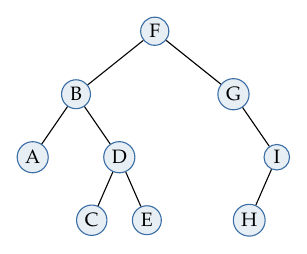

<details><summary>TikZ source</summary>

```latex
\begin{tikzpicture}[level distance=8mm,every node/.style={circle,draw=accent,fill=accent!12,inner sep=1.4pt,font=\scriptsize},
  level 1/.style={sibling distance=20mm},level 2/.style={sibling distance=11mm},level 3/.style={sibling distance=7mm}]
\node {F}
  child {node {B} child {node {A}} child {node {D} child {node {C}} child {node {E}}}}
  child {node {G} child[missing] {} child {node {I} child {node {H}} child[missing] {}}};
\end{tikzpicture}
```
</details>


### Q14.20
*MSQ · 2 marks · Trees and Heaps*

The keys $50,30,70,20,40,60,80,35,45,65$ are inserted in this order into an empty BST. Which are correct?

- **(A)** The height (in edges) is 3
- **(B)** The inorder successor of 45 is 50
- **(C)** Deleting 30 by replacing it with its inorder successor makes 35 the left child of 50
- **(D)** The preorder traversal is $50,30,20,40,35,45,70,60,80,65$

**Answer:** A, B, C  (solution header: (A), (B), (C))

**Solution:**

Longest path $50\to30\to40\to35$. Inorder successor of 45 (no right child) is the nearest ancestor reached from a left child: 50. Deleting 30: its successor is the minimum of its right subtree, 35. (D) ✗ correct preorder ends \texttt{70, 60, 65, 80}.


### Q14.21
*NAT · 1 mark · Trees and Heaps*

The minimum number of nodes in an AVL tree of height 4 (a single node has height 0) is ____.

**Answer:** 12

**Solution:**

$N(h)=N(h-1)+N(h-2)+1$ with $N(0)=1$, $N(1)=2$: $1,2,4,7,12$.


### Q14.22
*MCQ · 1 mark · Trees and Heaps*

Which pair of traversals does \emph{not} always determine a binary tree with distinct keys uniquely?

- **(A)** inorder and preorder
- **(B)** inorder and postorder
- **(C)** preorder and postorder
- **(D)** inorder and level-order

**Answer:** C  (solution header: (C))

**Solution:**

Preorder and postorder cannot tell whether a single child is on the left or the right (unless the tree is full). Each of the others with inorder suffices.


### Q14.23
*NAT · 1 mark · Trees and Heaps*

The number of leaves in a complete binary tree with 100 nodes is ____.

**Answer:** 50

**Solution:**

Leaves of an array-based complete tree: $\lceil n/2\rceil$; internal nodes are indices $0..\lfloor n/2\rfloor-1$.


### Q14.24
*NAT · 1 mark · Trees and Heaps*

A binary heap is stored in an array with the root at index 0. The parent of the node at index 13 is at index ____.

**Answer:** 6

**Solution:**

Root at 0: parent $\lfloor(i-1)/2\rfloor$, children $2i+1$, $2i+2$. (Root at 1: parent $\lfloor i/2\rfloor$.)


### Q14.25
*NAT · 2 marks · Trees and Heaps*

The array $[3,9,2,1,4,5]$ is turned into a max-heap by the bottom-up (heapify) method. The element at index 4 (root at index 0) is ____.

**Answer:** 3

**Solution:**

Sift down from index 2: $2\leftrightarrow5$ ⇒ $[3,9,5,1,4,2]$. Index 1: 9 is fine. Index 0: $3\leftrightarrow9$, then $3\leftrightarrow4$ ⇒ $[9,4,5,1,3,2]$.


### Q14.26
*MCQ · 2 marks · Trees and Heaps*

In the min-heap $[1,3,2,5,9,8,6]$ (root at index 0), one extract-min is performed. The resulting array is

- **(A)** $[2,3,6,5,9,8]$
- **(B)** $[2,5,6,3,9,8]$
- **(C)** $[2,3,8,5,9,6]$
- **(D)** $[3,5,2,6,9,8]$

**Answer:** A  (solution header: (A))

**Solution:**

Move the last element 6 to the root: $[6,3,2,5,9,8]$; swap with the smaller child 2; at index 2, child 8 is larger, so stop.


### Q14.27
*MSQ · 1 mark · Trees and Heaps*

For a binary min-heap of $n$ elements, which are correct?

- **(A)** building it bottom-up takes $O(n)$
- **(B)** finding the minimum takes $O(1)$
- **(C)** searching for an arbitrary key takes $O(\log n)$
- **(D)** heap sort is stable

**Answer:** A, B  (solution header: (A), (B))

**Solution:**

(C) ✗ a heap is not a search tree: arbitrary search is $O(n)$. (D) ✗ heap sort is not stable.


### Q14.28
*NAT · 2 marks · Hash Tables*

Keys $12,22,32,5,15,25,9,19$ are inserted in order into a table of size 10 with $h(k)=k\bmod10$ and linear probing. The total number of slots examined over all insertions (counting the final empty slot each time) is ____.

**Answer:** 15

**Solution:**

Slots examined: 12:1, 22:2, 32:3, 5:1, 15:2, 25:3, 9:1, 19:2 (slot 9 full, wraps to 0). Primary clustering makes later keys walk the whole cluster.
Note: PYQ 2025 asked for final positions after inserting $1,4,5,6,14,15$.


### Q14.29
*NAT · 1 mark · Hash Tables*

Keys $10,21,32$ are inserted into a table of size 11 with $h(k,i)=(k+i^2)\bmod 11$, $i=0,1,2,\dots$. The slot of key 32 is ____.

**Answer:** 3

**Solution:**

32: $h=10$ (taken by 10), $10+1=0$ (taken by 21), $(32+4)\bmod11=3$.


### Q14.30
*NAT · 2 marks · Hash Tables*

Keys $18,41,22,44,59,32,31,73$ are inserted in order into a table of size 13 with double hashing $h(k,i)=\big(h_1(k)+i\,h_2(k)\big)\bmod13$, $h_1(k)=k\bmod13$, $h_2(k)=1+(k\bmod11)$. The slot of key 73 is ____.

**Answer:** 8

**Solution:**

Final table: 41@2, 32@4, 18@5, 44@6, 59@7, 73@8, 22@9, 31@12. For 73: $h_1=8$, free on the first probe.
Trap: 44 collides at 5 with 18 and moves by $h_2(44)=1$ to 6; 32 collides at 6 and jumps by $h_2=11$ to 4.


### Q14.31
*NAT · 1 mark · Hash Tables*

Under uniform hashing with open addressing and load factor $0.75$, the upper bound on the expected number of probes in an unsuccessful search is ____.

**Answer:** 4

**Solution:**

$\frac1{1-\alpha}$. (PYQ 2024 used the same bound for insertion.)


### Q14.32
*NAT · 1 mark · Hash Tables*

Under uniform hashing with open addressing and load factor $0.75$, the bound $\frac1\alpha\ln\frac{1}{1-\alpha}$ on the expected probes in a successful search is ____\ (round to 3 decimals).

**Answer:** 1.848

**Solution:**

$\frac{1}{0.75}\ln4=1.333\times1.386$.


### Q14.33
*NAT · 2 marks · Hash Tables*

1000 keys are hashed independently and uniformly into 200 chained slots. The expected number of empty slots is ____\ (round to 2 decimals).

**Answer:** 1.33

**Solution:**

Indicator per slot: $m\left(1-\frac1m\right)^n=200(0.995)^{1000}=1.33$ ($\approx me^{-n/m}=1.35$).


### Q14.34
*MSQ · 1 mark · Hash Tables*

Which are correct?

- **(A)** With chaining, the load factor may exceed 1
- **(B)** With open addressing, the load factor cannot exceed 1
- **(C)** Linear probing suffers from primary clustering
- **(D)** In open addressing, a key is deleted by simply marking its slot empty

**Answer:** A, B, C  (solution header: (A), (B), (C))

**Solution:**

(D) ✗ emptying a slot breaks probe chains for keys inserted after it; use a ``deleted'' marker (tombstone).


### Q14.35
*MCQ · 1 mark · Hash Tables*

Match each requirement with the most suitable structure.\\
\begin{tabular}{@{}l l@{}}
P. Remove the highest-priority item & 1. Stack\\
Q. Last in, first out & 2. Queue\\
R. First in, first out & 3. Hash table\\
S. Average $O(1)$ lookup by key & 4. Binary heap\\
\end{tabular}

- **(A)** P-2, Q-1, R-4, S-3
- **(B)** P-4, Q-2, R-1, S-3
- **(C)** P-3, Q-1, R-2, S-4
- **(D)** P-4, Q-1, R-2, S-3

**Answer:** D  (solution header: (D))

**Solution:**

Priority queue → heap; LIFO → stack; FIFO → queue; key lookup → hash table. (PYQ 2024 matched FIFO, LIFO, lookup.)


### Q14.36
*NAT · 1 mark · Hash Tables*

6 keys are hashed independently and uniformly into 8 slots. The probability that no two keys share a slot is ____\ (round to 4 decimals).

**Answer:** 0.0769

**Solution:**

$\frac{8\cdot7\cdot6\cdot5\cdot4\cdot3}{8^6}=\frac{20160}{262144}$ (birthday problem for hash slots).


## Day 15: Complexity, Searching, Sorting, Divide and Conquer


### Q15.01
*MCQ · 1 mark · Complexity and Recurrences*

Which function grows fastest as $n\to\infty$?

- **(A)** $2^n$
- **(B)** $n^{\log n}$
- **(C)** $(\log n)^n$
- **(D)** $n!$

**Answer:** D  (solution header: (D) $n!$)

**Solution:**

Idea: compare logarithms. $\ln 2^n=0.69n$, $\ln n^{\log n}=(\ln n)^2/\ln 2$, $\ln(\log n)^n=n\ln\log n$, $\ln n!\approx n\ln n-n$.
Work: $n\ln n-n$ beats $n\ln\ln n$ beats $0.69n$ beats $(\ln n)^2$. Order: $n^{\log n}\prec2^n\prec(\log n)^n\prec n!$.
Trap: $n^{\log n}$ looks huge but is only quasi-polynomial: $e^{(\ln n)^2}$.


### Q15.02
*MSQ · 2 marks · Complexity and Recurrences*

Which solutions are correct?

- **(A)** $T(n)=2T(n/2)+n$: $\Theta(n\log n)$
- **(B)** $T(n)=T(n/2)+1$: $\Theta(\log n)$
- **(C)** $T(n)=4T(n/2)+n^2$: $\Theta(n^2)$
- **(D)** $T(n)=3T(n/3)+n$: $\Theta(n\log n)$

**Answer:** A, B, D  (solution header: (A), (B), (D))

**Solution:**

Master theorem with $n^{\log_ba}$: (A) $a=b=2$, $f=n=n^1$ ⇒ case 2, $n\log n$. (B) $a=1,b=2$, $n^0=1=f$ ⇒ $\log n$. (D) $a=b=3$, same as (A).
Trap: (C) $a=4,b=2$: $n^{\log_24}=n^2=f(n)$, so case 2 gives $\Theta(n^2\log n)$, not $\Theta(n^2)$.


### Q15.03
*NAT · 1 mark · Complexity and Recurrences*

$T(1)=1$ and $T(n)=T(n-1)+n$ for $n\ge2$. $T(10)$ is ____.

**Answer:** 55

**Solution:**

Unrolling: $T(n)=1+2+\dots+n=\frac{n(n+1)}2$, so $T(10)=55$.


### Q15.04
*NAT · 1 mark · Complexity and Recurrences*

$T(1)=1$ and $T(n)=2T(n/2)+1$ for $n$ a power of 2. $T(16)$ is ____.

**Answer:** 31

**Solution:**

$T(n)=2T(n/2)+1$ ⇒ $T(n)=2n-1$ (the recursion tree has $n$ leaves and $n-1$ internal nodes, each costing 1). Check: $T(2)=3$, $T(4)=7$, $T(8)=15$, $T(16)=31$.


### Q15.05
*MCQ · 1 mark · Complexity and Recurrences*

$T(n)=T(\sqrt n)+1$ with $T(2)=1$. Then $T(n)$ is

- **(A)** $\Theta(\log n)$
- **(B)** $\Theta(\log\log n)$
- **(C)** $\Theta(\sqrt n)$
- **(D)** $\Theta(1)$

**Answer:** B  (solution header: (B) $\Theta(\log\log n)$)

**Solution:**

Idea: substitute $n=2^m$: $S(m)=T(2^m)$ satisfies $S(m)=S(m/2)+1$, so $S(m)=\Theta(\log m)$.
Work: $m=\log n$ ⇒ $T(n)=\Theta(\log\log n)$. Square-rooting $n$ halves $\log n$.
Note: $T(n)=2T(\sqrt n)+\log n$ gives $\Theta(\log n\log\log n)$ by the same substitution.


### Q15.06
*NAT · 1 mark · Complexity and Recurrences*

```python
n = 16
count = 0
for i in range(n):
    j = 1
    while j < n:
        j *= 2
        count += 1
print(count)
```

The value printed is ____.

**Answer:** 64

**Solution:**

The inner \texttt{while} doubles $j$ from 1 until $j\ge16$: $j=2,4,8,16$, i.e.\ 4 iterations, independent of $i$. Total $16\times4=64$ ($n\log_2n$).


### Q15.07
*NAT · 2 marks · Complexity and Recurrences*

```python
n = 10
count = 0
for i in range(1, n + 1):
    for j in range(1, n + 1, i):
        count += 1
print(count)
```

The value printed is ____.

**Answer:** 33

**Solution:**

For step $i$ the inner loop runs $\lceil n/i\rceil$ times: $10+5+4+3+2+2+2+2+2+1=33$.
Note: in general $\sum_{i\le n}\lceil n/i\rceil=\Theta(n\log n)$ (harmonic sum).


### Q15.08
*MCQ · 1 mark · Complexity and Recurrences*

Quicksort always picks the \emph{first} element as pivot and is run on an already sorted array. Its running time satisfies

- **(A)** $T(n)=2T(n/2)+O(n)$
- **(B)** $T(n)=T(n/4)+T(3n/4)+O(n)$
- **(C)** $T(n)=T(n-1)+O(n)$
- **(D)** $T(n)=T(n-1)+O(1)$

**Answer:** C  (solution header: (C))

**Solution:**

On sorted input the first element is the minimum, so each partition peels off one element and leaves $n-1$: $T(n)=T(n-1)+\Theta(n)=\Theta(n^2)$.
Trap: (B) is the ``1:3 split'' recurrence, still $\Theta(n\log n)$.


### Q15.09
*NAT · 1 mark · Searching*

Binary search is run on a sorted array of 500 distinct integers. Each step makes one three-way comparison of the middle element with the key. The maximum number of comparisons when the key is \emph{absent} is ____.

**Answer:** 9

**Solution:**

Idea: an unsuccessful search goes down to an empty range; the number of three-way comparisons is at most $\lfloor\log_2n\rfloor+1$.
Work: $2^8=256\le500<512$, so $\lfloor\log_2500\rfloor+1=9$.
Trap: $\lceil\log_2500\rceil=9$ coincides here, but for $n=512$ the answer is $10$, not $9$.


### Q15.10
*MSQ · 1 mark · Searching*

For which inputs can a (suitably modified) binary search find a key in $O(\log n)$ worst-case time?

- **(A)** a sorted array
- **(B)** a sorted singly linked list
- **(C)** an unsorted array
- **(D)** a sorted array rotated by an unknown amount (e.g.\ $[15,18,3,6,9,12]$)

**Answer:** A, D  (solution header: (A), (D))

**Solution:**

(A) ✓ standard. (D) ✓ in a rotated sorted array at least one half around \texttt{mid} is sorted; check whether the key lies in that half and recurse, $O(\log n)$.
(B) ✗ reaching the middle of a linked list costs $\Theta(n)$. (C) ✗ any algorithm must inspect all $n$ cells in the worst case.


### Q15.11
*MCQ · 2 marks · Searching*

```python
def search(A, x):
    lo, hi, steps = 0, len(A), 0
    while lo < hi:
        steps += 1
        mid = (lo + hi) // 2
        if A[mid] < x:
            lo = mid + 1
        else:
            hi = mid
    return lo, steps

A = [1, 2, 2, 2, 3, 5, 7, 9]
print(search(A, 2), search(A, 4))
```

The output is

- **(A)** \texttt{(1, 4) (5, 3)}
- **(B)** \texttt{(1, 3) (5, 3)}
- **(C)** \texttt{(3, 4) (5, 4)}
- **(D)** \texttt{(1, 4) (4, 3)}

**Answer:** A  (solution header: (A) \texttt{(1, 4) (5, 3)})

**Solution:**

Idea: this is \texttt{bisect\_left}: it returns the first index with $A[i]\ge x$.
Work: Key 2: ranges $[0,8)\to[0,4)\to[0,2)\to[0,1)\to[1,1)$: index 1, 4 steps. Key 4 (absent): $[0,8)\to[5,8)\to[5,6)\to[5,5)$: index 5 (insertion point), 3 steps.
Note: \texttt{bisect\_right(A, 2)} would give 4, so the number of 2s is $4-1=3$.


### Q15.12
*NAT · 1 mark · Searching*

A key is equally likely to be any of the 99 elements of an unsorted array. The expected number of comparisons in a linear search is ____.

**Answer:** 50

**Solution:**

$\frac1n\sum_{i=1}^ni=\frac{n+1}2=\frac{100}{2}=50$.
Note: if the key is absent with probability $q$: $q\,n+(1-q)\frac{n+1}2$.


### Q15.13
*MCQ · 1 mark · Searching*

The number of occurrences of a key in a sorted array of $n$ elements can be found in worst-case time

- **(A)** $\Theta(n)$
- **(B)** $\Theta(\sqrt n)$
- **(C)** $\Theta(n\log n)$
- **(D)** $\Theta(\log n)$

**Answer:** D  (solution header: (D) $\Theta(\log n)$)

**Solution:**

Two binary searches: first occurrence (\texttt{bisect\_left}) and last occurrence (\texttt{bisect\_right}); count $=r-l$.
Trap: finding one copy and then scanning both ways is $\Theta(n)$ when all elements are equal.


### Q15.14
*MCQ · 2 marks · Searching*

```python
def search(A, x):
    lo, hi = 0, len(A) - 1
    while lo < hi:
        mid = (lo + hi) // 2
        if A[mid] < x:
            lo = mid
        else:
            hi = mid
    return lo
```

The call \texttt{search([1, 3, 5, 7], 7)}

- **(A)** returns 3
- **(B)** returns 2
- **(C)** never terminates
- **(D)** raises \texttt{IndexError}

**Answer:** C  (solution header: (C) never terminates)

**Solution:**

Trace: $lo=0,hi=3$: $mid=1$, $3<7$ ⇒ $lo=1$; $mid=2$, $5<7$ ⇒ $lo=2$; $mid=\lfloor5/2\rfloor=2$ again, $lo$ stays 2. Forever.
Trap: with \texttt{lo = mid} the loop needs $mid=\lceil(lo+hi)/2\rceil$, or use \texttt{lo = mid + 1}.


### Q15.15
*MCQ · 2 marks · Elementary Sorting*

```python
def bubble(A):
    A, comps = A[:], 0
    for i in range(len(A) - 1):
        swapped = False
        for j in range(len(A) - 1 - i):
            comps += 1
            if A[j] > A[j + 1]:
                A[j], A[j + 1] = A[j + 1], A[j]
                swapped = True
        if not swapped:
            break
    return comps

def insertion(A):
    A, comps = A[:], 0
    for i in range(1, len(A)):
        key, j = A[i], i - 1
        while j >= 0:
            comps += 1
            if A[j] > key:
                A[j + 1] = A[j]
                j -= 1
            else:
                break
        A[j + 1] = key
    return comps

P = [2, 1, 3, 4, 6, 5]
print(bubble(P), insertion(P))
```

The output is

- **(A)** \texttt{5 6}
- **(B)** \texttt{9 6}
- **(C)** \texttt{15 7}
- **(D)** \texttt{9 7}

**Answer:** B  (solution header: (B) \texttt{9 6})

**Solution:**

Bubble: pass 1 makes 5 comparisons (swaps $2,1$ and $6,5$); pass 2 makes 4 comparisons with no swap, so it stops: $5+4=9$.
Insertion: inserting $1,3,4,6$ costs one comparison each; inserting 5 costs 2 (past 6, stop at 4): $1+1+1+1+2=6$.
Note: insertion sort comparisons $=$ inversions $+$ (number of inserts that stop on a comparison) $=2+4$.


### Q15.16
*MSQ · 2 marks · Elementary Sorting*

Insertion sort is applied to $[2,4,6,8,x,12,10]$ and performs exactly 3 swaps (adjacent exchanges) in total. Which values of $x$ are possible?

- **(A)** 3
- **(B)** 5
- **(C)** 11
- **(D)** 13

**Answer:** B, D  (solution header: (B), (D))

**Solution:**

Idea: swaps of insertion sort $=$ number of inversions.
Work: The fixed elements already give one inversion $(12,10)$. $x$ adds the elements before it that are larger, plus the elements after it that are smaller.
$x=3$: $4,6,8$ before $=3$ ⇒ total 4. $x=5$: $6,8$ ⇒ 3 ✓. $x=11$: $12,10$ after (12 larger, 10 smaller) ⇒ $1+1=2$. $x=13$: $12,10$ after are smaller ⇒ $2+1=3$ ✓.


### Q15.17
*MSQ · 2 marks · Elementary Sorting*

The array $[3,1,2,4,5]$ is sorted in increasing order. A ``pass'' is one sweep of bubble sort, one insertion step of insertion sort (inserting $A[i]$, $i=1,2,\dots$), or one minimum-placement of selection sort. For which algorithms does the array become sorted for the \emph{first} time after exactly two passes?

- **(A)** bubble sort
- **(B)** insertion sort
- **(C)** selection sort
- **(D)** none of these

**Answer:** B, C  (solution header: (B), (C))

**Solution:**

Bubble: one sweep carries 3 past 1 and 2, giving $[1,2,3,4,5]$ after \emph{one} pass.
Insertion: insert 1 ⇒ $[1,3,2,4,5]$; insert 2 ⇒ sorted after two steps.
Selection: place 1 ⇒ $[1,3,2,4,5]$; place 2 ⇒ sorted after two passes.


### Q15.18
*NAT · 1 mark · Elementary Sorting*

Selection sort (swapping only when the minimum is not already in place) is run on $[3,1,2,5,4]$. The number of swaps is ____.

**Answer:** 3

**Solution:**

$[3,1,2,5,4]\to[1,3,2,5,4]\to[1,2,3,5,4]\to$ (3 in place, no swap) $\to[1,2,3,4,5]$.
Note: selection sort makes at most $n-1$ swaps, the fewest of the elementary sorts.


### Q15.19
*NAT · 1 mark · Elementary Sorting*

The number of swaps made by bubble sort on $[5,1,4,2,8,3]$ is ____.

**Answer:** 7

**Solution:**

Bubble sort swaps $=$ inversions. Count, for each element, the smaller ones to its right: $5{:}\,4$ (1,4,2,3), $1{:}\,0$, $4{:}\,2$, $2{:}\,0$, $8{:}\,1$. Total 7.


### Q15.20
*MCQ · 1 mark · Elementary Sorting*

```python
A = [29, 10, 14, 37, 13]
for i in range(2):
    m = min(range(i, len(A)), key=lambda k: A[k])
    A[i], A[m] = A[m], A[i]
print(A)
```

The output is

- **(A)** \texttt{[10, 13, 14, 37, 29]}
- **(B)** \texttt{[10, 13, 29, 37, 14]}
- **(C)** \texttt{[10, 14, 29, 37, 13]}
- **(D)** \texttt{[10, 13, 14, 29, 37]}

**Answer:** A  (solution header: (A))

**Solution:**

Pass 1 swaps 29 and 10: $[10,29,14,37,13]$. Pass 2 finds 13 at index 4 and swaps it with 29: $[10,13,14,37,29]$.
Trap: (D) is the fully sorted list; only two passes run.


### Q15.21
*MSQ · 1 mark · Elementary Sorting*

Which are correct for the standard textbook versions?

- **(A)** insertion sort is stable
- **(B)** selection sort is stable
- **(C)** merge sort is in place
- **(D)** heap sort is in place

**Answer:** A, D  (solution header: (A), (D))

**Solution:**

(A) ✓ an element only moves past strictly larger ones. (B) ✗ the long-range swap can jump equal keys: $[2_a,2_b,1]\to[1,2_b,2_a]$. (C) ✗ merging uses $\Theta(n)$ extra space. (D) ✓ heap sort uses $O(1)$ extra space (but is unstable).


### Q15.22
*NAT · 1 mark · Elementary Sorting*

The minimum number of comparisons any comparison-based algorithm needs in the worst case to sort 5 distinct elements is at least ____.

**Answer:** 7

**Solution:**

A decision tree must have at least $5!=120$ leaves, so its height is at least $\lceil\log_2120\rceil=7$. (7 comparisons is also achievable for $n=5$.)


### Q15.23
*MSQ · 1 mark · Elementary Sorting*

Which are correct about best-case running times?

- **(A)** insertion sort runs in $\Theta(n)$ on sorted input
- **(B)** selection sort runs in $\Theta(n^2)$ on every input
- **(C)** bubble sort with an early-exit flag runs in $\Theta(n)$ on sorted input
- **(D)** merge sort runs in $\Theta(n)$ on sorted input

**Answer:** A, B, C  (solution header: (A), (B), (C))

**Solution:**

(A) ✓ each insert stops after one comparison. (B) ✓ selection always scans the whole unsorted part: $\frac{n(n-1)}2$ comparisons. (C) ✓ one pass with no swap. (D) ✗ merge sort is $\Theta(n\log n)$ on every input (unless an ``already sorted'' check is added).


### Q15.24
*NAT · 1 mark · Elementary Sorting*

The maximum number of inversions in a permutation of 8 distinct elements is ____.

**Answer:** 28

**Solution:**

Reverse order: every pair is inverted, $\binom82=28$.
Note: average number of inversions is $\frac{n(n-1)}4$.


### Q15.25
*NAT · 2 marks · Merge Sort, Quicksort, Divide and Conquer*

The worst-case number of key comparisons made by top-down merge sort on 8 elements is ____.

**Answer:** 17

**Solution:**

Idea: merging lists of sizes $p,q$ costs at most $p+q-1$.
Work: Level by level: four merges of $1{+}1$ (1 each) $=4$; two merges of $2{+}2$ (3 each) $=6$; one merge of $4{+}4$ (7) $=7$. Total 17.
Shortcut: $n\lceil\log_2n\rceil-2^{\lceil\log_2n\rceil}+1=24-8+1=17$.


### Q15.26
*NAT · 1 mark · Merge Sort, Quicksort, Divide and Conquer*

Merging $[1,3,5,7]$ and $[2,4,6,8]$ requires ____\ comparisons.

**Answer:** 7

**Solution:**

The lists interleave perfectly, so the last element is placed without a comparison: $4+4-1=7$.
Note: the best case is $\min(p,q)=4$, e.g.\ $[1,2,3,4]$ with $[5,6,7,8]$.


### Q15.27
*NAT · 1 mark · Merge Sort, Quicksort, Divide and Conquer*

Top-down merge sort on 10 elements (recursing until subarrays have size 1) performs ____\ merge operations.

**Answer:** 9

**Solution:**

Every merge joins two pieces into one, starting from 10 single elements and ending with 1 list: $10-1=9$ merges.
Note: the number of recursive calls (including the first) is $2n-1=19$.


### Q15.28
*NAT · 2 marks · Merge Sort, Quicksort, Divide and Conquer*

```python
swaps = 0
def partition(A, lo, hi):
    global swaps
    pivot, i = A[hi], lo - 1
    for j in range(lo, hi):
        if A[j] <= pivot:
            i += 1
            A[i], A[j] = A[j], A[i]
            swaps += 1
    A[i + 1], A[hi] = A[hi], A[i + 1]
    swaps += 1
    return i + 1

def quicksort(A, lo, hi):
    if lo < hi:
        p = partition(A, lo, hi)
        quicksort(A, lo, p - 1)
        quicksort(A, p + 1, hi)

A = [3, 5, 1, 4, 2]
quicksort(A, 0, len(A) - 1)
print(A, swaps)
```

The second value printed (the number of swaps, including swaps of an element with itself) is ____.

**Answer:** 7

**Solution:**

Partition $[3,5,1,4,2]$ with pivot 2: only 1 is $\le2$, one swap, then the pivot swap ⇒ $[1,2,3,4,5]$, 2 swaps.
Right part $[3,4,5]$, pivot 5: 3 and 4 swap with themselves, plus the pivot swap ⇒ 3 swaps. Then $[3,4]$, pivot 4: 2 swaps. Total $2+3+2=7$.
Trap: Lomuto on already sorted parts still performs self-swaps; they count here.


### Q15.29
*MCQ · 2 marks · Merge Sort, Quicksort, Divide and Conquer*

```python
def partition(A, lo, hi):
    pivot, i = A[hi], lo - 1
    for j in range(lo, hi):
        if A[j] <= pivot:
            i += 1
            A[i], A[j] = A[j], A[i]
    A[i + 1], A[hi] = A[hi], A[i + 1]
    return i + 1

A = [7, 2, 9, 4, 3, 8, 6]
p = partition(A, 0, len(A) - 1)
print(A, p)
```

The output is

- **(A)** \texttt{[2, 4, 3, 6, 7, 8, 9] 3}
- **(B)** \texttt{[2, 3, 4, 6, 9, 8, 7] 3}
- **(C)** \texttt{[6, 2, 4, 3, 7, 9, 8] 0}
- **(D)** \texttt{[2, 4, 3, 6, 9, 8, 7] 3}

**Answer:** D  (solution header: (D))

**Solution:**

Pivot 6. Elements $\le6$ seen in order: 2, 4, 3; they are swapped to positions 0, 1, 2, giving $[2,4,3,7,9,8,6]$. The final swap puts 6 at index 3: $[2,4,3,6,9,8,7]$.
Trap: Lomuto does not sort either side; (B) wrongly orders the left part.


### Q15.30
*MSQ · 2 marks · Merge Sort, Quicksort, Divide and Conquer*

Which arrays could be the result of the \emph{first} partition step of quicksort on some input (one element in its final sorted position, all smaller elements to its left and all larger to its right)?

- **(A)** $[2,1,3,7,5,9]$
- **(B)** $[4,1,2,6,5,8]$
- **(C)** $[2,3,1,6,4,5]$
- **(D)** $[5,4,6,2,3,1]$

**Answer:** A, B  (solution header: (A), (B))

**Solution:**

Idea: a valid pivot is larger than everything on its left and smaller than everything on its right.
Work: (A) 3 works (and so does 9). (B) 8 (last) works. (C) $[2,3,1,6,4,5]$: no element qualifies (1 has larger elements before it; 6 has smaller after it). (D) no element qualifies.


### Q15.31
*NAT · 1 mark · Merge Sort, Quicksort, Divide and Conquer*

Quicksort with the first element as pivot is run on a sorted array of 10 elements. The number of key comparisons is ____.

**Answer:** 45

**Solution:**

Partitions of sizes $10,9,\dots,2$ make $9+8+\dots+1=\frac{10\cdot9}2=45$ comparisons.


### Q15.32
*MCQ · 1 mark · Merge Sort, Quicksort, Divide and Conquer*

If quicksort always picks the exact median as pivot using an $O(n)$ selection algorithm, its worst-case time is

- **(A)** $\Theta(n)$
- **(B)** $\Theta(n\log n)$
- **(C)** $\Theta(n^2)$
- **(D)** $\Theta(n\log^2n)$

**Answer:** B  (solution header: (B) $\Theta(n\log n)$)

**Solution:**

$T(n)=2T(n/2)+\Theta(n)$ (selection $+$ partition are both linear).
Note: the linear-time selection has a large constant, so this is a theoretical guarantee; randomised pivots are used in practice.


### Q15.33
*NAT · 2 marks · Merge Sort, Quicksort, Divide and Conquer*

The minimum number of comparisons needed (in the worst case) to find both the maximum and the minimum of 100 numbers is ____.

**Answer:** 148

**Solution:**

Idea: compare elements in pairs; the larger of each pair competes for the max, the smaller for the min.
Work: 50 pair comparisons, then 49 for the max among 50 winners and 49 for the min among 50 losers: $50+49+49=148=\lceil\frac{3n}2\rceil-2$.
Trap: two separate scans need $2n-2=198$.


### Q15.34
*NAT · 1 mark · Merge Sort, Quicksort, Divide and Conquer*

```python
def sort_count(A):
    if len(A) <= 1:
        return A, 0
    m = len(A) // 2
    L, a = sort_count(A[:m])
    R, b = sort_count(A[m:])
    out, i, j, c = [], 0, 0, a + b
    while i < len(L) and j < len(R):
        if L[i] <= R[j]:
            out.append(L[i]); i += 1
        else:
            out.append(R[j]); j += 1
            c += len(L) - i
    return out + L[i:] + R[j:], c

print(sort_count([2, 4, 1, 3, 5])[1])
```

The value printed is ____.

**Answer:** 3

**Solution:**

The merge step adds \texttt{len(L) - i} whenever an element of the right half is taken first. Inversions of $[2,4,1,3,5]$: $(2,1),(4,1),(4,3)$.
Note: this is the $O(n\log n)$ inversion counter; brute force is $\Theta(n^2)$.


### Q15.35
*NAT · 1 mark · Merge Sort, Quicksort, Divide and Conquer*

Strassen's algorithm satisfies $T(n)=7T(n/2)+O(n^2)$, so $T(n)=\Theta(n^{c})$. The value of $c$ is ____\ (round to 3 decimals).

**Answer:** 2.807

**Solution:**

Master case 1: $\log_27\approx2.807>2$, so $T(n)=\Theta(n^{\log_27})$.
Note: naive block multiplication has 8 subproducts: $\log_28=3$.


### Q15.36
*MCQ · 1 mark · Merge Sort, Quicksort, Divide and Conquer*

The expected running time of randomised quickselect (finding the $k$-th smallest of $n$ elements) is

- **(A)** $\Theta(\log n)$
- **(B)** $\Theta(n\log n)$
- **(C)** $\Theta(n)$
- **(D)** $\Theta(n^2)$

**Answer:** C  (solution header: (C) $\Theta(n)$)

**Solution:**

After partitioning, recurse into one side only: expected $n+\frac{3n}4+\dots=O(n)$. Worst case is still $\Theta(n^2)$; median of medians makes the worst case $O(n)$.


## Day 16: Graph Theory, Traversals, Shortest Paths


### Q16.01
*NAT · 2 marks · Graph Theory*

The smallest $m$ such that \emph{every} simple undirected graph on 10 vertices with $m$ edges is connected is ____.

**Answer:** 37

**Solution:**

Idea: the densest disconnected graph is $K_9$ plus an isolated vertex: $\binom92=36$ edges.
Work: So 36 edges do not force connectivity, but 37 do: any graph on $n$ vertices with more than $\binom{n-1}2$ edges is connected.
Trap: the \emph{minimum} edges for \emph{some} connected graph is $n-1=9$; the question asks for every graph.


### Q16.02
*NAT · 1 mark · Graph Theory*

A simple graph has degree sequence $(3,3,2,2,2)$. Its number of edges is ____.

**Answer:** 6

**Solution:**

Handshake lemma: $\sum\deg=2|E|$ ⇒ $12=2|E|$.


### Q16.03
*MSQ · 2 marks · Graph Theory*

Which sequences are degree sequences of some simple undirected graph?

- **(A)** $(3,3,3,3)$
- **(B)** $(3,3,3,1)$
- **(C)** $(4,3,3,2,2)$
- **(D)** $(5,3,2,2,1,1)$

**Answer:** A, C, D  (solution header: (A), (C), (D))

**Solution:**

Idea: Havel--Hakimi: remove the largest degree $d$, subtract 1 from the next $d$ entries, repeat.
Work: (A) $K_4$ ✓. (B) $(3,3,3,1)\to(2,2,0)\to(1,-1)$ ✗ (sum is even, still fails). (C) $(4,3,3,2,2)\to(2,2,1,1)\to(1,0,1)\to$ sorted $(1,1,0)\to(0,0)$ ✓. (D) $(5,3,2,2,1,1)\to(2,1,1,0,0)\to(0,0,0,0)$ ✓.
Trap: an even degree sum is necessary, not sufficient.


### Q16.04
*NAT · 1 mark · Graph Theory*

The number of spanning trees of the complete graph $K_5$ (vertices labelled) is ____.

**Answer:** 125

**Solution:**

Cayley's formula $n^{n-2}=5^3$.
Note: for other graphs use Kirchhoff's matrix-tree theorem: any cofactor of the Laplacian $D-A$.


### Q16.05
*NAT · 1 mark · Graph Theory*

A forest has 20 vertices and 4 connected components. Its number of edges is ____.

**Answer:** 16

**Solution:**

A forest with $c$ trees has $n-c=20-4$ edges.


### Q16.06
*NAT · 1 mark · Graph Theory*

The maximum number of edges in a simple planar graph on 10 vertices is ____.

**Answer:** 24

**Solution:**

Euler: $V-E+F=2$ and every face has at least 3 edges ⇒ $E\le3V-6=24$.
Note: triangle-free (e.g.\ bipartite): $E\le2V-4$. $K_5$ ($10>9$) and $K_{3,3}$ ($9>8$) are non-planar by these bounds.


### Q16.07
*MSQ · 1 mark · Graph Theory*

Which are correct?

- **(A)** a graph is bipartite iff it has no odd cycle
- **(B)** every tree is bipartite
- **(C)** the cycle $C_5$ is bipartite
- **(D)** $K_{3,3}$ has 9 edges

**Answer:** A, B, D  (solution header: (A), (B), (D))

**Solution:**

(A) ✓ König's theorem. (B) ✓ trees have no cycles at all; colour by depth parity. (C) ✗ $C_5$ is an odd cycle. (D) ✓ $|E(K_{m,n})|=mn$.


### Q16.08
*NAT · 1 mark · Graph Theory*

$A$ is the adjacency matrix of $K_4$. The number of triangles, $\operatorname{tr}(A^3)/6$, is ____.

**Answer:** 4

**Solution:**

$\operatorname{tr}(A^3)$ counts closed walks of length 3; each triangle gives 6 (3 starting points $\times$ 2 directions). $K_4$: $\binom43=4$ triangles.
Note: eigenvalues of $A(K_4)$ are $3,-1,-1,-1$: $\operatorname{tr}A^3=27-3=24$, $24/6=4$.


### Q16.09
*NAT · 1 mark · Graph Theory*

The wheel $W_5$ is a 5-cycle plus one extra vertex adjacent to all five. Its chromatic number is ____.

**Answer:** 4

**Solution:**

The rim $C_5$ is an odd cycle, needing 3 colours; the hub is adjacent to all rim vertices and needs a fourth.
Note: $W_n$ with an even rim has $\chi=3$.


### Q16.10
*MCQ · 1 mark · Graph Theory*

Which graph has an Euler path but no Euler circuit?

- **(A)** $K_4$
- **(B)** $K_{2,3}$
- **(C)** $C_6$
- **(D)** $K_{3,3}$

**Answer:** B  (solution header: (B) $K_{2,3}$)

**Solution:**

Euler path without circuit $\iff$ connected with exactly two odd-degree vertices. $K_{2,3}$: two vertices of degree 3, three of degree 2 ✓.
$K_4$ and $K_{3,3}$: all degrees 3 (4 or 6 odd vertices). $C_6$: all degrees even, so it has an Euler circuit.


### Q16.11
*MSQ · 1 mark · Representations and Traversals*

For a graph with $V$ vertices and $E$ edges, which are correct?

[FIGURE 1: figures/Q16_11_q_f1_ff5bef33.png]
\\
{Graph $G$ used in the next two questions (adjacency lists in alphabetical order).}

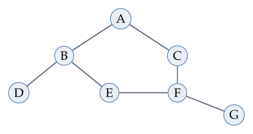

<details><summary>TikZ source</summary>

```latex
\begin{tikzpicture}[every node/.style={circle,draw=accent,fill=accent!12,inner sep=2pt,font=\small},x=1.45cm,y=0.95cm]
\node (A) at (0,0) {A}; \node (B) at (-1,-1) {B}; \node (C) at (1,-1) {C};
\node (D) at (-1.8,-2) {D}; \node (E) at (-0.2,-2) {E}; \node (F) at (1,-2) {F}; \node (G) at (2,-2.6) {G};
\draw[ink!70,thick] (A)--(B) (A)--(C) (B)--(D) (B)--(E) (C)--(F) (E)--(F) (F)--(G);
\end{tikzpicture}
```
</details>

- **(A)** BFS with adjacency lists takes $O(V+E)$
- **(B)** BFS with an adjacency matrix takes $O(V^2)$
- **(C)** testing whether edge $(u,v)$ exists takes $O(1)$ with an adjacency matrix
- **(D)** adjacency lists need $\Theta(V^2)$ space

**Answer:** A, B, C  (solution header: (A), (B), (C))

**Solution:**

(D) ✗ adjacency lists use $\Theta(V+E)$ space; the matrix uses $\Theta(V^2)$.
Note: list: edge test $O(\deg u)$; matrix: listing neighbours is $\Theta(V)$.


### Q16.12
*MCQ · 1 mark · Representations and Traversals*

```python
from collections import deque
G = {'A': ['B', 'C'], 'B': ['A', 'D', 'E'], 'C': ['A', 'F'],
     'D': ['B'], 'E': ['B', 'F'], 'F': ['C', 'E', 'G'], 'G': ['F']}

def bfs(s):
    seen, order, Q = {s}, [], deque([s])
    while Q:
        u = Q.popleft()
        order.append(u)
        for v in G[u]:
            if v not in seen:
                seen.add(v)
                Q.append(v)
    return ''.join(order)

print(bfs('A'), bfs('G'))
```

The output is

- **(A)** \texttt{ABCDEFG GFECBAD}
- **(B)** \texttt{ABCDEFG GFCEABD}
- **(C)** \texttt{ABDECFG GFCEABD}
- **(D)** \texttt{ABCEDFG GFCEBAD}

**Answer:** B  (solution header: (B) \texttt{ABCDEFG GFCEABD})

**Solution:**

From A: pop A ⇒ add B, C. Pop B ⇒ add D, E. Pop C ⇒ add F. Pop D, pop E (F already queued). Pop F ⇒ add G.
From G: pop G ⇒ add F. Pop F ⇒ add C, E. Pop C ⇒ add A. Pop E ⇒ add B. Pop A (nothing new). Pop B ⇒ add D. Pop D.
Trap: (A) reverses C and E: F's list is C, E, G, so C is queued first.


### Q16.13
*MCQ · 1 mark · Representations and Traversals*

```python
G = {'A': ['B', 'C'], 'B': ['A', 'D', 'E'], 'C': ['A', 'F'],
     'D': ['B'], 'E': ['B', 'F'], 'F': ['C', 'E', 'G'], 'G': ['F']}

def dfs(u, seen, order):
    seen.add(u)
    order.append(u)
    for v in G[u]:
        if v not in seen:
            dfs(v, seen, order)
    return ''.join(order)

print(dfs('A', set(), []), dfs('D', set(), []))
```

The output is

- **(A)** \texttt{ABDEFCG DBACFEG}
- **(B)** \texttt{ABCDEFG DBEFCAG}
- **(C)** \texttt{ABDEFGC DBACFEG}
- **(D)** \texttt{ACFGEBD DBEFCAG}

**Answer:** A  (solution header: (A) \texttt{ABDEFCG DBACFEG})

**Solution:**

From A: A $\to$ B $\to$ D (dead end) $\to$ back to B $\to$ E $\to$ F $\to$ C (A seen) $\to$ back to F $\to$ G.
From D: D $\to$ B $\to$ A $\to$ C $\to$ F $\to$ E (B seen) $\to$ back to F $\to$ G.
Trap: (C) visits G before C, ignoring the alphabetical order of F's list (C, E, G).


### Q16.14
*NAT · 2 marks · Representations and Traversals*

A directed graph has vertices $0,1,\dots,60$ and edges $(i,j)$ whenever $0<j-i\le3$. Each adjacency list is in \emph{decreasing} order of vertex number, and DFS is started at vertex 0. The number of vertices discovered after vertex 30 is ____.

**Answer:** 50

**Solution:**

Idea: with decreasing lists DFS always jumps $+3$ first.
Work: It visits $0,3,6,\dots,60$ (21 vertices) in one chain; then while backtracking it picks up $59,58,56,55,53,\dots,2,1$. Vertex 30 is the 11th vertex discovered, so $61-11=50$ come after it.
Note: a recurring GATE pattern; the same graph with increasing lists gives the order $0,1,2,\dots,60$.


### Q16.15
*MSQ · 2 marks · Representations and Traversals*

Which are correct?

- **(A)** In BFS of an undirected graph, every non-tree edge joins vertices whose levels differ by at most 1
- **(B)** In DFS of an undirected graph, every non-tree edge is a back edge
- **(C)** DFS of a directed graph can produce cross edges
- **(D)** BFS of a weighted graph gives shortest weighted distances

**Answer:** A, B, C  (solution header: (A), (B), (C))

**Solution:**

(A) ✓ levels of adjacent vertices differ by at most 1. (B) ✓ undirected DFS has only tree and back edges. (C) ✓ cross edges arise in directed DFS. (D) ✗ BFS counts edges, not weights (use Dijkstra).


### Q16.16
*MSQ · 2 marks · Representations and Traversals*

$G$ is a directed graph and $G^R$ is $G$ with every edge reversed. Which are correct?

- **(A)** From a vertex $v$, BFS and DFS of $G$ visit the same set of vertices
- **(B)** $u$ is reachable from $v$ in $G$ iff $v$ is reachable from $u$ in $G^R$
- **(C)** BFS order of $G^R$ from $v$ is the reverse of DFS order of $G$ from $v$
- **(D)** $G$ and $G^R$ have the same strongly connected components

**Answer:** A, B, D  (solution header: (A), (B), (D))

**Solution:**

(A) ✓ both visit exactly the reachable set. (B) ✓ reverse the path. (D) ✓ mutual reachability is symmetric under reversal (Kosaraju uses this).
(C) ✗ no such relation holds in general.


### Q16.17
*NAT · 1 mark · Representations and Traversals*

```python
edges = [(1, 2), (2, 3), (4, 5), (6, 7), (7, 8), (8, 6), (9, 9)]
n = 10
adj = {v: [] for v in range(1, n + 1)}
for a, b in edges:
    adj[a].append(b)
    adj[b].append(a)

seen, comps = set(), 0
for s in adj:
    if s not in seen:
        comps += 1
        stack = [s]
        while stack:
            u = stack.pop()
            if u not in seen:
                seen.add(u)
                stack.extend(adj[u])
print(comps)
```

The value printed is ____.

**Answer:** 5

**Solution:**

Components: $\{1,2,3\}$, $\{4,5\}$, $\{6,7,8\}$, $\{9\}$ (self-loop), $\{10\}$ (isolated).
Trap: vertex 10 never appears in \texttt{edges}, but it is a key of \texttt{adj}, so it still counts.


### Q16.18
*NAT · 1 mark · Representations and Traversals*

In the graph $G$ drawn above, the number of edges on a shortest path from D to G is ____.

**Answer:** 4

**Solution:**

D--B--E--F--G. BFS levels from D: B (1), A, E (2), C, F (3), G (4).


### Q16.19
*MSQ · 2 marks · Representations and Traversals*

A DAG on vertices $1,\dots,6$ has edges $1\to2,\ 1\to3,\ 2\to4,\ 3\to4,\ 4\to5,\ 3\to6$. Which are valid topological orders?

- **(A)** $1,2,3,4,5,6$
- **(B)** $1,3,6,2,4,5$
- **(C)** $1,2,4,3,6,5$
- **(D)** $1,3,2,6,4,5$

**Answer:** A, B, D  (solution header: (A), (B), (D))

**Solution:**

Check every edge goes forward. (C) ✗ puts 4 before 3, but $3\to4$ is an edge.


### Q16.20
*NAT · 2 marks · Representations and Traversals*

A DAG has edges $a\to c,\ b\to c,\ c\to d,\ c\to e$ (and no others). The number of distinct topological orders is ____.

**Answer:** 4

**Solution:**

$a,b$ in either order (2 ways), then $c$, then $d,e$ in either order (2 ways): $2\times2=4$.


### Q16.21
*MCQ · 1 mark · Representations and Traversals*

A directed graph contains a cycle if and only if a DFS of the graph finds

- **(A)** a cross edge
- **(B)** a forward edge
- **(C)** a tree edge
- **(D)** a back edge

**Answer:** D  (solution header: (D) a back edge)

**Solution:**

A back edge $u\to v$ to an ancestor $v$ closes the cycle $v\leadsto u\to v$; conversely, the first vertex of a cycle to be discovered is an ancestor of all others on it.


### Q16.22
*NAT · 2 marks · Representations and Traversals*

A directed graph has edges $u\to v,\ u\to x,\ v\to y,\ w\to y,\ w\to z,\ x\to v,\ y\to x,\ z\to z$. DFS visits start vertices and adjacency lists in alphabetical order, with a single clock starting at 1 for discovery and finish events. The finish time of $v$ is ____.

**Answer:** 7

**Solution:**

Start at $u$ (1): $v$ (2), $y$ (3), $x$ (4); $x\to v$ is a back edge, so $x$ finishes at 5, $y$ at 6, $v$ at 7, $u$ at 8 ($x$ already found). Then $w$ (9), $z$ (10) with a self-loop, $z$ finishes at 11, $w$ at 12.
Note: $v\to y\to x\to v$ is a cycle, detected by the back edge $x\to v$.


### Q16.23
*NAT · 1 mark · Representations and Traversals*

A directed graph on $1,\dots,7$ has edges $1\to2,\ 2\to3,\ 3\to1,\ 3\to4,\ 4\to5,\ 5\to6,\ 6\to4,\ 6\to7$. The number of strongly connected components is ____.

**Answer:** 3

**Solution:**

$\{1,2,3\}$ (cycle), $\{4,5,6\}$ (cycle), $\{7\}$. The condensation is the DAG $\{1,2,3\}\to\{4,5,6\}\to\{7\}$.


> **Shared context `Day16-ctx2`**

\\
{Weighted digraph $H$ used in the next two questions.}

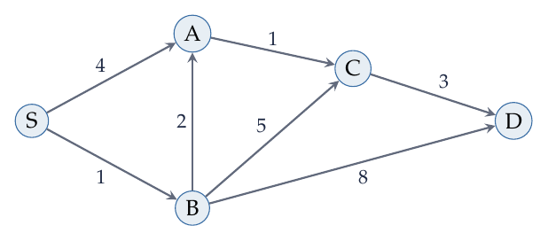

<details><summary>TikZ source</summary>

```latex
\begin{tikzpicture}[>=stealth,every node/.style={circle,draw=accent,fill=accent!12,inner sep=2pt,font=\small},x=2.3cm,y=1.25cm]
\node (S) at (0,0) {S}; \node (A) at (1,1) {A}; \node (B) at (1,-1) {B}; \node (C) at (2,0.6) {C}; \node (D) at (3,0) {D};
\begin{scope}[every node/.style={font=\footnotesize,color=ink,inner sep=2pt}]
\draw[->,ink!70,thick] (S)--node[above left]{4}(A);
\draw[->,ink!70,thick] (S)--node[below left]{1}(B);
\draw[->,ink!70,thick] (B)--node[left]{2}(A);
\draw[->,ink!70,thick] (A)--node[above]{1}(C);
\draw[->,ink!70,thick] (B)--node[above left]{5}(C);
\draw[->,ink!70,thick] (C)--node[above right]{3}(D);
\draw[->,ink!70,thick] (B)--node[below right]{8}(D);
\end{scope}
\end{tikzpicture}
```
</details>


### Q16.24
*NAT · 1 mark · Shortest Paths · uses `Day16-ctx2`*

The shortest distance from S to D in $H$ is ____.

**Answer:** 7

**Solution:**

S$\to$B$\to$A$\to$C$\to$D: $1+2+1+3=7$. The direct edges give $S\to A=4$ and $B\to D=9$, both worse.


### Q16.25
*MCQ · 1 mark · Shortest Paths · uses `Day16-ctx2`*

Dijkstra's algorithm is run on $H$ from S. The order in which vertices are finalised (removed from the priority queue) is

- **(A)** S, A, B, C, D
- **(B)** S, B, A, C, D
- **(C)** S, B, C, A, D
- **(D)** S, B, A, D, C

**Answer:** B  (solution header: (B))

**Solution:**

Distances when finalised: S 0, B 1 (then A becomes 3, C 6, D 9), A 3 (C becomes 4), C 4 (D becomes 7), D 7.


### Q16.26
*MCQ · 2 marks · Shortest Paths · uses `Day16-ctx2`*

A digraph has edges $S\to A$ (1), $S\to B$ (4), $B\to A$ ($-4$), $A\to C$ (1). Dijkstra's algorithm (each vertex finalised once) is run from S. The distance it reports for C, and the true shortest distance, are

- **(A)** 2 and 2
- **(B)** 1 and 1
- **(C)** 2 and 1
- **(D)** 1 and 2

**Answer:** C  (solution header: (C) 2 and 1)

**Solution:**

Dijkstra finalises S, then A (1), sets C $=2$ and finalises C, then B (4). The edge $B\to A$ would give A $=0$, but A is already final.
True shortest path: S$\to$B$\to$A$\to$C $=4-4+1=1$.
Trap: there is no negative cycle here; Dijkstra still fails. Bellman--Ford gives 1.


### Q16.27
*MSQ · 2 marks · Shortest Paths · uses `Day16-ctx2`*

Which are correct?

- **(A)** Dijkstra's algorithm can give wrong answers when some edge weights are negative
- **(B)** Bellman--Ford detects a negative cycle reachable from the source
- **(C)** Adding the same positive constant to every edge weight preserves all shortest paths
- **(D)** Multiplying every edge weight by the same positive constant preserves all shortest paths

**Answer:** A, B, D  (solution header: (A), (B), (D))

**Solution:**

(C) ✗ adding $c$ to each edge penalises paths with more edges: a 1-edge path of weight 5 beats a 3-edge path of weight 3 once $c\ge2$ ($5+c$ vs $3+3c$). (D) ✓ all path lengths scale by the same factor.


### Q16.28
*NAT · 1 mark · Shortest Paths · uses `Day16-ctx2`*

On a graph with 6 vertices and no negative cycles, the number of rounds of relaxing all edges that Bellman--Ford needs in the worst case is ____.

**Answer:** 5

**Solution:**

A shortest path without negative cycles is simple, so it has at most $V-1=5$ edges; after round $i$, all shortest paths with at most $i$ edges are correct. A 6th round that still relaxes something reveals a negative cycle.


### Q16.29
*NAT · 2 marks · Shortest Paths · uses `Day16-ctx2`*

Floyd--Warshall is run on the directed graph with weight matrix (rows = from, columns = to, $\infty$ = no edge)
\[\begin{pmatrix}0&3&\infty&7\\8&0&2&\infty\\5&\infty&0&1\\2&\infty&\infty&0\end{pmatrix}.\]
The shortest distance from vertex 4 to vertex 3 is ____.

**Answer:** 7

**Solution:**

$4\to1\to2\to3$: $2+3+2=7$.
Final matrix: $\begin{pmatrix}0&3&5&6\\5&0&2&3\\3&6&0&1\\2&5&7&0\end{pmatrix}$.
Note: the order of the outer loop over the intermediate vertex $k$ matters; $i,j$ loops may be in any order.


### Q16.30
*NAT · 2 marks · Shortest Paths · uses `Day16-ctx2`*

A DAG has weighted edges $a\to b$ (3), $a\to c$ (2), $b\to d$ (4), $c\to d$ (6), $c\to e$ (9), $d\to e$ (1). The length of the \emph{longest} path from $a$ to $e$ is ____.

**Answer:** 11

**Solution:**

Paths: $a\,b\,d\,e=8$, $a\,c\,d\,e=9$, $a\,c\,e=11$. In a DAG longest path is linear time: relax with $\max$ in topological order (or negate weights).
Trap: longest path in a general graph is NP-hard.


### Q16.31
*MSQ · 2 marks · Shortest Paths · uses `Day16-ctx2`*

In a simple, unweighted, undirected graph, $a\!-\!b\!-\!c\!-\!d$ is a shortest path from $a$ to $d$. Which of the following can \emph{not} be edges of the graph?

- **(A)** $a\!-\!c$
- **(B)** $b\!-\!d$
- **(C)** $a\!-\!d$
- **(D)** $b\!-\!c$

**Answer:** A, B, C  (solution header: (A), (B), (C))

**Solution:**

Each of $a\!-\!c$, $b\!-\!d$, $a\!-\!d$ would give a path from $a$ to $d$ shorter than 3 edges. $b\!-\!c$ is on the path itself, so it must exist.


### Q16.32
*NAT · 1 mark · Shortest Paths · uses `Day16-ctx2`*

In the grid graph of lattice points, moving only right or up, the number of shortest paths from $(0,0)$ to $(3,2)$ is ____.

**Answer:** 10

**Solution:**

Choose which 2 of the 5 moves are ``up'': $\binom52=10$.


### Q16.33
*NAT · 2 marks · Minimum Spanning Trees · uses `Day16-ctx2`*

An undirected graph on A--E has edge weights AB 4, AC 1, BC 2, BD 5, CD 8, CE 10, DE 2, BE 6. The weight of a minimum spanning tree is ____.

**Answer:** 10

**Solution:**

Kruskal: AC 1 ✓, BC 2 ✓, DE 2 ✓, AB 4 ✗ (cycle A--B--C), BD 5 ✓ (joins $\{A,B,C\}$ and $\{D,E\}$). Four edges, weight $1+2+2+5=10$.


### Q16.34
*MSQ · 1 mark · Minimum Spanning Trees · uses `Day16-ctx2`*

For a connected weighted undirected graph on $n$ vertices, which are correct?

- **(A)** If all edge weights are distinct, the MST is unique
- **(B)** Some MST contains a minimum-weight edge
- **(C)** Every MST contains a maximum-weight edge
- **(D)** Every spanning tree has exactly $n-1$ edges

**Answer:** A, B, D  (solution header: (A), (B), (D))

**Solution:**

(A) ✓ standard. (B) ✓ cut property: a lightest edge is a lightest edge across some cut. (D) ✓ any tree on $n$ vertices.
(C) ✗ the cycle property excludes a unique heaviest edge on a cycle from every MST.


### Q16.35
*NAT · 1 mark · Minimum Spanning Trees · uses `Day16-ctx2`*

The number of edges in a spanning tree of a connected graph with 12 vertices is ____.

**Answer:** 11

**Solution:**

$n-1$.


### Q16.36
*MCQ · 1 mark · Minimum Spanning Trees · uses `Day16-ctx2`*

Prim's algorithm is run on the graph of Q16.33 starting from A. The order in which vertices join the tree is

- **(A)** A, C, B, D, E
- **(B)** A, C, B, E, D
- **(C)** A, B, C, D, E
- **(D)** A, C, D, E, B

**Answer:** A  (solution header: (A) A, C, B, D, E)

**Solution:**

From $\{A\}$: AC (1). From $\{A,C\}$: BC (2). From $\{A,B,C\}$: BD (5) beats BE 6, CD 8, CE 10. Then DE (2) brings E.
Note: Kruskal adds edges in the order AC, BC, DE, BD: same tree, different order.


# Part: Days 17-20: Database Management and Warehousing


## Day 17: ER Model, Keys, Relational Algebra, Tuple Calculus


### Q17.01
*MCQ · 1 mark · ER Model and Mapping to Relations*

Entity sets $E_1(\underline{A},B)$ and $E_2(\underline{C},D)$ are linked by a relationship $R$ that is many-to-one from $E_1$ to $E_2$ (each $E_1$ entity is related to at most one $E_2$ entity). $R$ has one attribute $F$, and participation is partial on both sides. The minimum number of tables needed in a relational design that keeps every table in 3NF is

- **(A)** 1
- **(B)** 2
- **(C)** 3
- **(D)** 4

**Answer:** B  (solution header: (B) 2)

**Solution:**

Idea: a many-to-one relationship is absorbed into the table of the ``many'' side.
Work: $E_1(\underline{A},B,C,F)$ with $C$ a foreign key to $E_2$ (\texttt{NULL} when unrelated), and $E_2(\underline{C},D)$. Each table has a single key and no other dependencies, so both are in 3NF.
Trap: absorbing into $E_2$ is wrong: one $E_2$ entity relates to many $E_1$ entities.


### Q17.02
*NAT · 1 mark · ER Model and Mapping to Relations*

$\mathit{Student}(\underline{roll},name)$ and $\mathit{Course}(\underline{cid},title)$ are linked by a many-to-many relationship $\mathit{Enrols}$ with attribute $grade$. Each student also has a multivalued attribute $phone$. The minimum number of tables in a design where every table is in 1NF is ____.

**Answer:** 4

**Solution:**

$\mathit{Student}(\underline{roll},name)$, $\mathit{Course}(\underline{cid},title)$, $\mathit{Enrols}(\underline{roll,cid},grade)$ and $\mathit{Phone}(\underline{roll,phone})$. A multivalued attribute always needs its own table for 1NF.


### Q17.03
*MCQ · 1 mark · ER Model and Mapping to Relations*

Two entity sets are linked by a one-to-one relationship with \emph{total} participation on both sides and no relationship attributes. The minimum number of tables needed is

- **(A)** 3
- **(B)** 2
- **(C)** 1
- **(D)** 4

**Answer:** C  (solution header: (C) 1)

**Solution:**

With total participation on both sides, every entity of each set is paired with exactly one entity of the other, so both can be stored in one table with either key as primary key.
Note: one-to-one with partial participation on one side: 2 tables (the foreign key goes on the total side). Partial on both: 2 tables, foreign key on either side, which allows \texttt{NULL}s.


### Q17.04
*MSQ · 1 mark · ER Model and Mapping to Relations*

The weak entity set $\mathit{Dependent}(name,age)$ is identified by $\mathit{Employee}(\underline{eid},ename)$ through the identifying relationship $\mathit{HasDep}$. Which are correct?

- **(A)** The table for $\mathit{Dependent}$ has primary key $(eid,name)$
- **(B)** $\mathit{HasDep}$ needs a table of its own
- **(C)** A weak entity set always has total participation in its identifying relationship
- **(D)** $eid$ in the $\mathit{Dependent}$ table is a foreign key to $\mathit{Employee}$, normally with \texttt{ON DELETE CASCADE}

**Answer:** A, C, D  (solution header: (A), (C), (D))

**Solution:**

(A) ✓ owner key $+$ partial key (discriminator). (B) ✗ the identifying relationship is captured by the foreign key inside $\mathit{Dependent}$. (C) ✓ a weak entity cannot exist without its owner. (D) ✓.


### Q17.05
*MCQ · 1 mark · ER Model and Mapping to Relations*

The ER diagram below is mapped to relations (keys underlined).

[FIGURE 1: figures/Q17_05_q_f1_ac17ecd9.png]

Which relation does \emph{not} belong to a correct mapping?

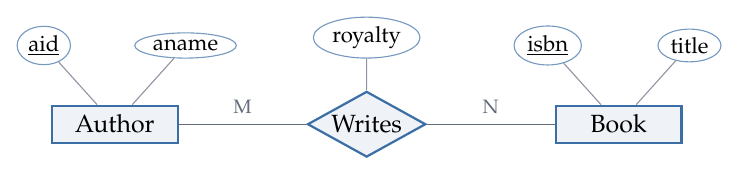

<details><summary>TikZ source</summary>

```latex
\begin{tikzpicture}[font=\small,every node/.style={draw=accent,fill=accent!8,thick},x=1cm,y=1cm]
\node[rectangle,minimum width=1.6cm] (A) at (0,0) {Author};
\node[diamond,aspect=1.8,inner sep=1pt] (W) at (3.2,0) {Writes};
\node[rectangle,minimum width=1.6cm] (B) at (6.4,0) {Book};
\begin{scope}[every node/.style={ellipse,draw=accent!70,fill=white,inner sep=1.2pt,font=\footnotesize}]
\node (a1) at (-0.9,1.0) {\underline{aid}}; \node (a2) at (0.9,1.0) {aname};
\node (w1) at (3.2,1.1) {royalty};
\node (b1) at (5.5,1.0) {\underline{isbn}}; \node (b2) at (7.3,1.0) {title};
\end{scope}
\draw[ink!70] (A)--node[above,draw=none,fill=none,font=\scriptsize]{M}(W)--node[above,draw=none,fill=none,font=\scriptsize]{N}(B);
\draw[ink!50] (A)--(a1) (A)--(a2) (W)--(w1) (B)--(b1) (B)--(b2);
\end{tikzpicture}
```
</details>

- **(A)** $\mathit{Author}(\underline{aid},aname)$
- **(B)** $\mathit{Book}(\underline{isbn},aid,title)$
- **(C)** $\mathit{Writes}(\underline{aid,isbn},royalty)$
- **(D)** $\mathit{Book}(\underline{isbn},title)$

**Answer:** B  (solution header: (B))

**Solution:**

For a many-to-many relationship, neither entity table may hold the other's key: one book has many authors, so $\mathit{Book}(\underline{isbn},aid,title)$ would repeat the book per author or lose authors. (A), (C), (D) form the correct three-table mapping.


### Q17.06
*NAT · 2 marks · ER Model and Mapping to Relations*

An ER diagram has four strong entity sets $E_1,\dots,E_4$, each with a simple key, and four binary relationships without attributes: $R_1$ between $E_1$ and $E_2$ (one-to-many), $R_2$ between $E_2$ and $E_3$ (many-to-many), $R_3$ between $E_3$ and $E_4$ (one-to-one, partial on both sides) and $R_4$ between $E_1$ and $E_4$ (many-to-many). $E_3$ also has one multivalued attribute. The minimum number of tables, each in 1NF, is ____.

**Answer:** 7

**Solution:**

Four entity tables. $R_1$ (one-to-many) goes into $E_2$; $R_3$ (one-to-one) goes into $E_3$ or $E_4$. $R_2$ and $R_4$ (many-to-many) need 2 tables. The multivalued attribute needs 1. Total $4+2+1=7$.
Shortcut: tables $=$ entities $+$ many-to-many relationships $+$ multivalued attributes (when all one-to-many and one-to-one relationships are absorbed).


### Q17.07
*MSQ · 1 mark · ER Model and Mapping to Relations*

Which are correct?

- **(A)** Age computed from date of birth is a derived attribute
- **(B)** Address with parts street, city and pin is a composite attribute
- **(C)** A set of phone numbers per person is a multivalued attribute
- **(D)** A multivalued attribute can be stored as a single column of a 1NF table

**Answer:** A, B, C  (solution header: (A), (B), (C))

**Solution:**

(D) ✗ 1NF needs atomic values; a multivalued attribute goes into a separate table (owner key, value).


### Q17.08
*MCQ · 1 mark · ER Model and Mapping to Relations*

A ternary relationship $\mathit{Supplies}$ connects $\mathit{Supplier}(\underline{sid})$, $\mathit{Part}(\underline{pid})$ and $\mathit{Project}(\underline{jid})$, is many-to-many in every direction and has the attribute $qty$. The primary key of the table for $\mathit{Supplies}$ is

- **(A)** $sid$
- **(B)** $(sid,pid)$
- **(C)** $(sid,pid,jid,qty)$
- **(D)** $(sid,pid,jid)$

**Answer:** D  (solution header: (D) $(sid,pid,jid)$)

**Solution:**

A many-many-many relationship is identified by the combination of all participating keys; $qty$ is a descriptive attribute and is not part of the key.
Note: if each (supplier, part) pair goes to at most one project (an arrow to Project), the key shrinks to $(sid,pid)$.


### Q17.09
*MSQ · 2 marks · ER Model and Mapping to Relations*

The requirement is: ``every professor teaches exactly one course, and every course is taught by at least one professor''. A designer creates $\mathit{Course}(\underline{cid},cname)$ and
\texttt{Professor(ssn PRIMARY KEY, name, cid NOT NULL REFERENCES Course(cid))}. Which statements hold for this design (with no further constraints)?

- **(A)** It guarantees that each professor teaches at most one course
- **(B)** It guarantees that each professor teaches at least one course
- **(C)** It guarantees that every course is taught by some professor
- **(D)** It allows a course to be taught by several professors

**Answer:** A, B, D  (solution header: (A), (B), (D))

**Solution:**

(A) ✓ one $cid$ per professor row. (B) ✓ \texttt{NOT NULL} forces a course. (D) ✓ many professors can share a $cid$.
(C) ✗ nothing stops a $\mathit{Course}$ row that no professor references; total participation on the ``one'' side needs an assertion or trigger.
Trap: this is the classic gap: total participation on the many side is easy, on the one side it is not expressible with keys alone.


### Q17.10
*NAT · 2 marks · Keys and Integrity Constraints*

$R(A,B,C,D,E,F)$ has exactly the candidate keys $A$, $BC$ and $CD$. The number of superkeys of $R$ is ____.

**Answer:** 44

**Solution:**

Idea: inclusion--exclusion over ``contains key $K_i$''. A set containing $k$ fixed attributes out of $n=6$ has $2^{6-k}$ supersets.
Work: $|A|+|BC|+|CD|-|ABC|-|ACD|-|BCD|+|ABCD|=32+16+16-8-8-8+4=44$.
Trap: $BC\cup CD=BCD$ has 3 attributes, not 4.


### Q17.11
*NAT · 1 mark · Keys and Integrity Constraints*

In $R(A_1,\dots,A_6)$ every pair of distinct attributes is a candidate key. The number of superkeys is ____.

**Answer:** 57

**Solution:**

Superkeys are exactly the sets with at least two attributes: $2^6-1-6=57$.


### Q17.12
*MSQ · 1 mark · Keys and Integrity Constraints*

Which are correct?

- **(A)** Every candidate key is a superkey
- **(B)** A relation can have several primary keys
- **(C)** Removing any attribute from a candidate key gives a set that is not a superkey
- **(D)** Every relation has at least one candidate key

**Answer:** A, C, D  (solution header: (A), (C), (D))

**Solution:**

(B) ✗ one primary key is chosen among the candidate keys; the rest are alternate keys. (C) ✓ minimality. (D) ✓ the set of all attributes is a superkey (no duplicate tuples), and it contains a minimal one.


### Q17.13
*MSQ · 1 mark · Keys and Integrity Constraints*

Relations $r(\underline{A},B)$ and $s(\underline{E},C)$ are given, where $C$ in $s$ is a foreign key referencing $A$ in $r$ (no referential actions are declared). Which operations \emph{may} violate the foreign key constraint?

- **(A)** Inserting tuples into $r$
- **(B)** Deleting tuples from $s$
- **(C)** Deleting tuples from $r$
- **(D)** Inserting tuples into $s$

**Answer:** C, D  (solution header: (C), (D))

**Solution:**

The constraint is ``every $s.C$ value appears in $r.A$''. Adding to $s$ can add a dangling reference; removing from $r$ can orphan existing references. Inserting into $r$ or deleting from $s$ never breaks it.
Note: PYQ 2026 asked the dual: which operation \emph{never} violates (deleting from the referencing table). Updating $r.A$ or $s.C$ can also violate.


### Q17.14
*NAT · 2 marks · Keys and Integrity Constraints*

Table $T(\underline{A},C)$ has $C$ as a foreign key referencing $A$ of the same table, with \texttt{ON DELETE CASCADE}. Its rows $(A,C)$ are
$(1,3),\ (2,1),\ (3,5),\ (4,2),\ (5,5),\ (6,2),\ (7,6),\ (8,7)$.
When the row $(1,3)$ is deleted, the number of \emph{additional} rows deleted is ____.

**Answer:** 5

**Solution:**

Deleting 1 deletes rows referencing 1: $(2,1)$. Then rows referencing 2: $(4,2),(6,2)$. Referencing 4: none; referencing 6: $(7,6)$; referencing 7: $(8,7)$; referencing 8: none.
Additional rows: $2,4,6,7,8$. Rows $(3,5)$ and $(5,5)$ survive.


### Q17.15
*MCQ · 2 marks · Keys and Integrity Constraints*

The table $\mathit{geq}(lb,ub)$ stores pairs with $ub\ge lb$; $lb$ is the primary key and $ub$ is a foreign key referencing $lb$ of the same table with \texttt{ON DELETE CASCADE}. A row $(x,y)$ is deleted. Which of the following is possible?

- **(A)** A row $(z,w)$ with $z>y$ is also deleted
- **(B)** A row $(z,w)$ with $z>x$ is also deleted
- **(C)** A row $(z,w)$ with $w<x$ is also deleted
- **(D)** The deletion of $(x,y)$ is rejected

**Answer:** C  (solution header: (C))

**Solution:**

Deleting $(x,y)$ cascades to rows with $ub=x$, i.e.\ $(z,x)$ with $z\le x$ (and $z\ne x$, since $lb$ is a key), then to rows with $ub=z<x$, and so on. So the deleted rows have $w\le x$, and rows with $w<x$ can be deleted at the second step.
(A), (B) ✗ every deleted row has $lb<x\le y$. (D) ✗ cascade never rejects.


### Q17.16
*MSQ · 1 mark · Keys and Integrity Constraints*

Which are correct?

- **(A)** Entity integrity: no primary key attribute may be \texttt{NULL}
- **(B)** A foreign key value may be \texttt{NULL} unless it is declared \texttt{NOT NULL}
- **(C)** A foreign key cannot reference its own relation
- **(D)** A foreign key must reference a primary key or another candidate key (\texttt{UNIQUE}) of the referenced table

**Answer:** A, B, D  (solution header: (A), (B), (D))

**Solution:**

(C) ✗ self-references are allowed (manager $\to$ employee, the $\mathit{geq}$ table above).


### Q17.17
*MCQ · 1 mark · Keys and Integrity Constraints*

A relation is a \emph{set} of tuples. This implies that

- **(A)** the relational model supports multivalued attributes stored as sets
- **(B)** two tuples may agree on every attribute
- **(C)** different tuples of a relation may have different attributes
- **(D)** any two tuples differ in the value of at least one attribute

**Answer:** D  (solution header: (D))

**Solution:**

A set has no duplicates, so two tuples cannot agree everywhere. (A) breaks first normal form, (B) contradicts the set property and (C) contradicts the fixed schema.


### Q17.18
*MSQ · 1 mark · Keys and Integrity Constraints*

Which are correct about standard SQL data types?

- **(A)** \texttt{CHAR(10)} is fixed length (padded); \texttt{VARCHAR(10)} stores up to 10 characters
- **(B)** \texttt{NUMERIC(5,2)} can store 123.45 but not 1234.5
- **(C)** \texttt{DATE '2026-02-30'} is a valid date literal
- **(D)** A \texttt{BOOLEAN} condition can be \texttt{TRUE}, \texttt{FALSE} or \texttt{UNKNOWN}

**Answer:** A, B, D  (solution header: (A), (B), (D))

**Solution:**

(B) ✓ precision 5, scale 2: at most 3 digits before the point. (C) ✗ February has no 30th. (D) ✓ a predicate can be \texttt{UNKNOWN} when \texttt{NULL}s are involved.


### Q17.19
*MCQ · 1 mark · Relational Algebra*

Relations $\mathit{Defender}(name,\dots)$, $\mathit{Forward}(name,\dots)$ and $\mathit{Team}(name,club,price)$ are given. Which expression checks that every name in $\mathit{Team}$ appears in \emph{both} $\mathit{Defender}$ and $\mathit{Forward}$ ($\phi$ is the empty set)?

- **(A)** $\Pi_{name}(\mathit{Team})-\big(\Pi_{name}(\mathit{Defender})\cup\Pi_{name}(\mathit{Forward})\big)=\phi$
- **(B)** $\big(\Pi_{name}(\mathit{Defender})\cap\Pi_{name}(\mathit{Forward})\big)-\Pi_{name}(\mathit{Team})=\phi$
- **(C)** $\big(\Pi_{name}(\mathit{Defender})\cup\Pi_{name}(\mathit{Forward})\big)-\Pi_{name}(\mathit{Team})=\phi$
- **(D)** $\Pi_{name}(\mathit{Team})-\big(\Pi_{name}(\mathit{Defender})\cap\Pi_{name}(\mathit{Forward})\big)=\phi$

**Answer:** D  (solution header: (D))

**Solution:**

``Every $x$ in $T$ is in $S$'' $\iff T-S=\phi$. Here $S$ is the set of names in both, i.e.\ the intersection.
Note: PYQ 2024 asked ``in either'': use the union, option (A) pattern.


### Q17.20
*MCQ · 1 mark · Relational Algebra*

$\mathit{Student}(\underline{sid},name)$, $\mathit{Course}(\underline{cid},dept)$, $\mathit{Enrol}(\underline{sid,cid},grade)$. The expression
$\Pi_{name}\big(\mathit{Student}\bowtie\sigma_{grade='A'}(\mathit{Enrol}\bowtie\sigma_{dept='CS'}(\mathit{Course}))\big)$ returns the names of students who

- **(A)** got an A in every CS course
- **(B)** got an A in at least one CS course
- **(C)** took only CS courses and got A in all of them
- **(D)** got an A in some course and took some CS course

**Answer:** B  (solution header: (B))

**Solution:**

The selections and joins keep each (student, CS course, grade A) combination; projection keeps the student if at least one such combination exists. ``Every'' would need division.


### Q17.21
*NAT · 2 marks · Relational Algebra*

$\mathit{Takes}(student,course)$ contains: S1: C1, C2, C3; \ S2: C1, C2; \ S3: C1, C2, C3, C4; \ S4: C2, C3; \ S5: C1, C2, C3, C4; \ S6: C1, C4.
With $T_1\leftarrow\Pi_{course}\big(\sigma_{student='S2'}(\mathit{Takes})\big)$ and $T_2\leftarrow\mathit{Takes}\div T_1$, the number of tuples in $T_2$ is ____.

**Answer:** 4

**Solution:**

$T_1=\{C1,C2\}$. Students with both C1 and C2: S1, S2, S3, S5. S4 lacks C1; S6 lacks C2.
Note: the student used to build the divisor is always in the result.


### Q17.22
*MCQ · 1 mark · Relational Algebra*

For $r(A,B)$ and $s(B)$, the division $r\div s$ equals

- **(A)** $\Pi_A(r)-\Pi_A\big((\Pi_A(r)\times s)-r\big)$
- **(B)** $\Pi_A\big((\Pi_A(r)\times s)-r\big)$
- **(C)** $\Pi_A(r\bowtie s)$
- **(D)** $\Pi_A(r)-\Pi_A(r\bowtie s)$

**Answer:** A  (solution header: (A))

**Solution:**

$\Pi_A(r)\times s$ lists every pair that \emph{should} exist; subtracting $r$ leaves the missing pairs; their $A$ values are disqualified.


### Q17.23
*NAT · 2 marks · Relational Algebra*

$R(\underline{A},B,C)$ has 150 tuples, $S(\underline{B},D)$ has 60 tuples and $T(\underline{D},E)$ has 40 tuples (keys underlined; no foreign keys are declared). The maximum number of tuples in $R\bowtie S\bowtie T$ is ____.

**Answer:** 150

**Solution:**

$B$ is the key of $S$, so each $R$ tuple joins at most one $S$ tuple; $D$ is the key of $T$, so each result tuple joins at most one $T$ tuple. Hence $\le|R|=150$, attained when every value matches.
Shortcut: when joining on the key of one side, the result is at most the size of the other side.


### Q17.24
*MCQ · 1 mark · Relational Algebra*

$\mathit{Student}(\underline{roll},name)$ has 120 tuples and $\mathit{Enrol}(\underline{roll,cno})$ has 8 tuples, where $roll$ in $\mathit{Enrol}$ is a foreign key referencing $\mathit{Student}$. The minimum and maximum numbers of tuples in $\mathit{Student}\bowtie\mathit{Enrol}$ are

- **(A)** 0 and 8
- **(B)** 8 and 960
- **(C)** 0 and 960
- **(D)** 8 and 8

**Answer:** D  (solution header: (D) 8 and 8)

**Solution:**

Each $\mathit{Enrol}$ tuple matches exactly one student (the foreign key guarantees existence, the key of $\mathit{Student}$ guarantees uniqueness).
Trap: without the foreign key the minimum would be 0; 960 ignores that $roll$ is a key.


### Q17.25
*MSQ · 2 marks · Relational Algebra*

For union-compatible relations $r,s$ with an attribute set $A$, which equalities hold for \emph{all} instances?

- **(A)** $\sigma_{c_1\wedge c_2}(r)=\sigma_{c_1}(\sigma_{c_2}(r))$
- **(B)** $\Pi_A(r\cup s)=\Pi_A(r)\cup\Pi_A(s)$
- **(C)** $\Pi_A(r-s)=\Pi_A(r)-\Pi_A(s)$
- **(D)** $\Pi_A(r\cap s)=\Pi_A(r)\cap\Pi_A(s)$

**Answer:** A, B  (solution header: (A), (B))

**Solution:**

(C) ✗ $r=\{(1,a)\}$, $s=\{(1,b)\}$, $A$ the first column: $\Pi_A(r-s)=\{1\}$ but $\Pi_A(r)-\Pi_A(s)=\phi$.
(D) ✗ with $r=\{(1,a)\}$, $s=\{(1,b)\}$: $\Pi_A(r\cap s)=\phi$ but $\Pi_A(r)\cap\Pi_A(s)=\{1\}$. In general only $\subseteq$ holds.


### Q17.26
*NAT · 1 mark · Relational Algebra*

Union-compatible relations satisfy $|r|=12$, $|s|=9$ and $|r\cap s|=4$. The value of $|r\cup s|+|r-s|+|s-r|$ is ____.

**Answer:** 30

**Solution:**

$|r\cup s|=12+9-4=17$, $|r-s|=8$, $|s-r|=5$.


### Q17.27
*MCQ · 1 mark · Relational Algebra*

$\mathit{Adj}(X,Y)$ stores the edges $X\to Y$ of a directed graph. Which expression returns the vertices of out-degree at least 2?

- **(A)** $\Pi_X\big(\mathit{Adj}\bowtie_{X=X_1\wedge Y\neq Y_1}\rho_{X_1,Y_1}(\mathit{Adj})\big)$
- **(B)** $\Pi_X\big(\mathit{Adj}\bowtie_{X=X_1\wedge Y=Y_1}\rho_{X_1,Y_1}(\mathit{Adj})\big)$
- **(C)** $\Pi_X\big(\mathit{Adj}\bowtie_{X=X_1}\rho_{X_1,Y_1}(\mathit{Adj})\big)$
- **(D)** $\Pi_X\big(\mathit{Adj}\bowtie_{X\neq X_1\wedge Y\neq Y_1}\rho_{X_1,Y_1}(\mathit{Adj})\big)$

**Answer:** A  (solution header: (A))

**Solution:**

Two edges with the same source and different targets. (B) pairs each edge with itself (out-degree $\ge1$); (C) is the same; (D) compares different sources.


### Q17.28
*MCQ · 1 mark · Relational Algebra*

For $\mathit{Student}(\underline{roll},marks)$, the expression
\[\Pi_{marks}(\mathit{Student})-\Pi_{S_1.marks}\big(\sigma_{S_1.marks<S_2.marks}(\rho_{S_1}(\mathit{Student})\times\rho_{S_2}(\mathit{Student}))\big)\]
returns

- **(A)** the highest marks
- **(B)** the lowest marks
- **(C)** all marks except the highest
- **(D)** the second highest marks

**Answer:** A  (solution header: (A))

**Solution:**

The subtracted part is every mark that is smaller than some other mark; only the maximum survives.
Note: replacing $<$ by $>$ gives the minimum; to get the second highest, apply the pattern again to the remaining marks.


### Q17.29
*NAT · 1 mark · Relational Algebra*

$\mathit{Emp}(eid,sal)=\{(1,50),(2,70),(3,70),(4,40),(5,90)\}$. The number of tuples in
$\Pi_{E_1.sal}\big(\sigma_{E_1.sal<E_2.sal}(\rho_{E_1}(\mathit{Emp})\times\rho_{E_2}(\mathit{Emp}))\big)$ is ____.

**Answer:** 3

**Solution:**

Salaries smaller than some salary: 40, 50, 70 (70 $<$ 90). Projection removes the duplicate 70s, and 90 is excluded.


### Q17.30
*NAT · 1 mark · Relational Algebra*

$R(A,B)=\{(1,a),(2,b),(3,c)\}$ and $S(B,C)=\{(a,x),(a,y),(d,z)\}$. The number of tuples in the natural full outer join of $R$ and $S$ (on $B$) is ____.

**Answer:** 5

**Solution:**

Matches: $(1,a,x)$, $(1,a,y)$. Unmatched left: $(2,b,-)$, $(3,c,-)$. Unmatched right: $(-,d,z)$.


### Q17.31
*MCQ · 1 mark · Tuple Relational Calculus*

The tuple calculus query $\{t\mid t\in r\wedge(t[A]=10\vee t[B]=20)\}$ is equivalent to

- **(A)** $\sigma_{A=10}(r)\cap\sigma_{B=20}(r)$
- **(B)** $\sigma_{A=10}(r)\cup\sigma_{B=20}(r)$
- **(C)** $\sigma_{A=10}(r)-\sigma_{B=20}(r)$
- **(D)** $\sigma_{A=10\wedge B=20}(r)$

**Answer:** B  (solution header: (B))

**Solution:**

A disjunction in the condition corresponds to a union of selections; a conjunction corresponds to an intersection (or a combined selection).


### Q17.32
*MCQ · 1 mark · Tuple Relational Calculus*

Which tuple calculus expression is \emph{not} safe?

- **(A)** $\{t\mid\neg(t\in r_1)\}$
- **(B)** $\{t\mid t\in r_1\wedge\neg(t\in r_2)\}$
- **(C)** $\{t\mid\exists u\in r_1\,(t[A]=u[A])\wedge\exists s\in r_2\,(t[A]=s[A])\}$
- **(D)** $\{t\mid t\in r_1\wedge\forall u\in r_2\,(u[B]\ne t[B])\}$

**Answer:** A  (solution header: (A))

**Solution:**

$\neg(t\in r_1)$ describes infinitely many tuples outside $r_1$. The others restrict $t$ to values taken from $r_1$.


### Q17.33
*MSQ · 1 mark · Tuple Relational Calculus*

Which are correct?

- **(A)** Relational algebra and safe tuple calculus have the same expressive power
- **(B)** Safe tuple calculus and safe domain calculus have the same expressive power
- **(C)** Basic relational algebra can compute the sum of a column
- **(D)** Basic relational algebra cannot compute the transitive closure of an arbitrary graph

**Answer:** A, B, D  (solution header: (A), (B), (D))

**Solution:**

Codd's theorem: RA $\equiv$ safe TRC $\equiv$ safe DRC (relational completeness). (C) ✗ aggregation is an extension. (D) ✓ a fixed RA expression only follows paths of bounded length.


### Q17.34
*MCQ · 2 marks · Tuple Relational Calculus*

With $\mathit{Student}(sid,name)$, $\mathit{Course}(cid)$ and $\mathit{Enrol}(sid,cid)$, the query
\[\{t\mid\exists s\in\mathit{Student}\,\big(t[name]=s[name]\wedge\forall c\in\mathit{Course}\,\exists e\in\mathit{Enrol}\,(e[sid]=s[sid]\wedge e[cid]=c[cid])\big)\}\]
returns names of students who are enrolled in

- **(A)** at least one course
- **(B)** every course
- **(C)** no course
- **(D)** exactly one course

**Answer:** B  (solution header: (B))

**Solution:**

$\forall c\in\mathit{Course}\,\exists e\ldots$ is the calculus form of division.


### Q17.35
*MCQ · 2 marks · Tuple Relational Calculus*

$\mathit{Emp}(eid,name)$ and $\mathit{Cust}(cid,rep,rating)$, where $rep$ references $eid$. The query
\[\{t\mid\exists e\in\mathit{Emp}\,\big(t[name]=e[name]\wedge\neg\exists c\in\mathit{Cust}\,(c[rep]=e[eid]\wedge c[rating]\ne\text{`GOOD'})\big)\}\]
returns the names of employees

- **(A)** with at least one customer rated GOOD
- **(B)** none of whose customers is rated GOOD
- **(C)** all of whose customers (if any) are rated GOOD
- **(D)** with exactly one customer rated GOOD

**Answer:** C  (solution header: (C))

**Solution:**

``No customer of $e$ with rating $\ne$ GOOD'' means every customer of $e$ is GOOD; an employee with no customers satisfies it vacuously.
Note: GATE 2014 used the same \texttt{NOT EXISTS} pattern in SQL.


### Q17.36
*NAT · 2 marks · Tuple Relational Calculus*

$r(A,B)=\{(1,2),(1,3),(2,3),(2,1),(3,4),(4,4),(4,2)\}$. The number of tuples (each over the single attribute $A$) returned by
$\{t\mid\exists u\in r\,\big(t[A]=u[A]\wedge\forall v\in r\,(v[A]=u[A]\Rightarrow v[B]>1)\big)\}$ is ____.

**Answer:** 3

**Solution:**

Group by $A$: $A=1$: $B\in\{2,3\}$ ✓; $A=2$: $B\in\{3,1\}$ ✗; $A=3$: $\{4\}$ ✓; $A=4$: $\{4,2\}$ ✓.


## Day 18: SQL


> **Shared context `Day18-ctx1`**

\textbf{Database $\mathcal D$} (used in every question that mentions \texttt{Emp} or \texttt{Dept}). Standard SQL semantics; \texttt{NULL} shown as --.

Table Emp:

\begin{tabular}{rllrr}\toprule
eid & name & dept & salary & mgr\\\midrule
1 & Asha & CS & 70 & --\\
2 & Bala & CS & 50 & 1\\
3 & Chen & EE & 60 & 1\\
4 & Dev & EE & -- & 3\\
5 & Esha & ME & 65 & 3\\
6 & Farid & CS & 55 & 2\\
7 & Gita & -- & 45 & 1\\\bottomrule
\end{tabular}

Table Dept:

\begin{tabular}{ll}\toprule
dname & building\\\midrule
CS & A\\ EE & B\\ CE & C\\\bottomrule
\end{tabular}


### Q18.01
*NAT · 1 mark · Queries, Joins and Duplicates · uses `Day18-ctx1`*

```sql
SELECT DISTINCT dept
FROM Emp;
```

On $\mathcal D$, the number of rows returned is ____.

**Answer:** 4

**Solution:**

CS, EE, ME and \texttt{NULL}. \texttt{DISTINCT} (like \texttt{GROUP BY}) treats all \texttt{NULL}s as one value.
Trap: answering 3 by ignoring Gita's \texttt{NULL} department.


### Q18.02
*NAT · 1 mark · Queries, Joins and Duplicates · uses `Day18-ctx1`*

```sql
SELECT E.name, D.building
FROM Emp E, Dept D
WHERE E.dept = D.dname;
```

On $\mathcal D$, the number of rows returned is ____.

**Answer:** 5

**Solution:**

CS matches Asha, Bala, Farid; EE matches Chen, Dev. Esha (ME, not in \texttt{Dept}) and Gita (\texttt{NULL}) find no partner; CE finds no employee.


### Q18.03
*NAT · 1 mark · Queries, Joins and Duplicates · uses `Day18-ctx1`*

```sql
SELECT E.name
FROM Emp E, Emp M
WHERE E.mgr = M.eid AND E.salary > M.salary;
```

On $\mathcal D$, the number of rows returned is ____.

**Answer:** 2

**Solution:**

Esha $65>$ Chen 60 and Farid $55>$ Bala 50. Bala, Chen and Gita earn less than Asha; Dev's \texttt{NULL} comparison is \texttt{UNKNOWN}; Asha has no manager.


### Q18.04
*NAT · 1 mark · Queries, Joins and Duplicates · uses `Day18-ctx1`*

```sql
SELECT name
FROM Emp
WHERE name LIKE '_a%' OR salary BETWEEN 60 AND 70;
```

On $\mathcal D$, the number of rows returned is ____.

**Answer:** 5

**Solution:**

\texttt{'\_a\%'}: second letter \texttt{a}, giving Bala and Farid. \texttt{BETWEEN} is inclusive: Asha 70, Chen 60, Esha 65.


### Q18.05
*MCQ · 1 mark · Queries, Joins and Duplicates · uses `Day18-ctx1`*

```sql
SELECT dept FROM Emp
UNION
SELECT dname FROM Dept;
```

On $\mathcal D$, the numbers of rows returned by this query and by the same query with \texttt{UNION ALL} are

- **(A)** 4 and 10
- **(B)** 5 and 10
- **(C)** 5 and 9
- **(D)** 4 and 9

**Answer:** B  (solution header: (B) 5 and 10)

**Solution:**

\texttt{UNION} removes duplicates: CS, EE, ME, \texttt{NULL}, CE. \texttt{UNION ALL} keeps all $7+3$ rows.


### Q18.06
*NAT · 2 marks · Queries, Joins and Duplicates · uses `Day18-ctx1`*

```sql
SELECT dept FROM Emp
EXCEPT
SELECT dname FROM Dept;
```

On $\mathcal D$, the number of rows returned is ____.

**Answer:** 2

**Solution:**

\{CS, EE, ME, \texttt{NULL}\} minus \{CS, EE, CE\} leaves ME and \texttt{NULL}. Set operations compare rows as ``not distinct'', so \texttt{NULL} is a value here and it is absent from \texttt{Dept}.
Trap: answering 1 by dropping the \texttt{NULL} row.


### Q18.07
*NAT · 2 marks · Queries, Joins and Duplicates · uses `Day18-ctx1`*

Tables \texttt{Player} and \texttt{Squad} are given; \texttt{Squad.pid} references \texttt{Player.pid}.

Table Player:

\begin{tabular}{rlrr}\toprule
pid & name & runs & wickets\\\midrule
1 & Arjun & 420 & 3\\ 2 & Bhuvi & 120 & 25\\ 3 & Chetan & 310 & 12\\
4 & Dhruv & 305 & 2\\ 5 & Eshan & 500 & 0\\ 6 & Faiz & 290 & 18\\\bottomrule
\end{tabular}

Table Squad:

\begin{tabular}{lrr}\toprule
city & pid & price\\\midrule
Pune & 2 & 200\\ Delhi & 3 & 195\\ Pune & 5 & 175\\
Pune & 1 & 250\\ Delhi & 4 & 200\\ Pune & 6 & 200\\\bottomrule
\end{tabular}

```sql
SELECT *
FROM Player P, Squad S
WHERE P.pid = S.pid AND S.city = 'Pune'
  AND P.runs > 300 OR P.wickets > 20;
```

The number of rows returned is ____.

**Answer:** 8

**Solution:**

Idea: \texttt{AND} binds tighter than \texttt{OR}: the condition is (join $\wedge$ Pune $\wedge$ runs $>300$) $\vee$ (wickets $>20$).
Work: First part: Arjun and Eshan in Pune, 2 rows. Second part has \emph{no} join condition: Bhuvi (25 wickets) is paired with all 6 \texttt{Squad} rows. No overlap, so $2+6=8$.
Note: with brackets around the \texttt{OR}, the answer is 3 (Arjun, Eshan, Bhuvi). PYQ 2024 used a similar join with an extra filter.


### Q18.08
*MCQ · 1 mark · Queries, Joins and Duplicates · uses `Day18-ctx1`*

Table \texttt{Staff(eid, name, did)} has rows (1, Ravi, 10), (2, Sara, 20), (3, Tara, 10), (4, Uma, 30), and table \texttt{Unit(did, name)} has rows (10, Sales), (20, Audit), (30, Legal), where \texttt{Unit.name} is the unit's name.

```sql
SELECT *
FROM Staff NATURAL JOIN Unit;
```

The number of rows returned is

- **(A)** 4
- **(B)** 12
- **(C)** 0
- **(D)** 3

**Answer:** C  (solution header: (C) 0)

**Solution:**

\texttt{NATURAL JOIN} equates \emph{all} common columns: \texttt{did} and \texttt{name}. No staff member is called Sales, Audit or Legal.
Trap: the intended join is \texttt{JOIN Unit USING (did)}, which gives 4 rows.


### Q18.09
*MCQ · 1 mark · Queries, Joins and Duplicates · uses `Day18-ctx1`*

For relations $r(w,x)$ and $s(y,z)$, the result of \texttt{SELECT DISTINCT w, x FROM r, s} is guaranteed to be the same as $r$ provided

- **(A)** $r$ and $s$ have no duplicates
- **(B)** $s$ has no duplicates and $r$ is non-empty
- **(C)** $r$ and $s$ have the same number of tuples
- **(D)** $r$ has no duplicates and $s$ is non-empty

**Answer:** D  (solution header: (D))

**Solution:**

If $s$ is empty, $r\times s$ is empty. If $s$ is non-empty, each $(w,x)$ row of $r$ appears $|s|$ times and \texttt{DISTINCT} collapses them, which equals $r$ only if $r$ had no duplicates.


### Q18.10
*NAT · 1 mark · NULLs, Three-Valued Logic and Aggregates · uses `Day18-ctx1`*

```sql
SELECT AVG(salary)
FROM Emp;
```

On $\mathcal D$, the value returned is ____.

**Answer:** 57.5

**Solution:**

$\frac{70+50+60+65+55+45}{6}=\frac{345}{6}$. \texttt{AVG} ignores \texttt{NULL}s; the divisor is 6, not 7.


### Q18.11
*MCQ · 1 mark · NULLs, Three-Valued Logic and Aggregates · uses `Day18-ctx1`*

```sql
SELECT COUNT(*), COUNT(dept), COUNT(DISTINCT dept)
FROM Emp;
```

On $\mathcal D$, the row returned is

- **(A)** 7, 7, 4
- **(B)** 7, 6, 4
- **(C)** 7, 6, 3
- **(D)** 6, 6, 3

**Answer:** C  (solution header: (C) 7, 6, 3)

**Solution:**

\texttt{COUNT(*)} counts rows; \texttt{COUNT(dept)} skips Gita's \texttt{NULL}; \texttt{COUNT(DISTINCT dept)} counts CS, EE, ME.


### Q18.12
*NAT · 2 marks · NULLs, Three-Valued Logic and Aggregates · uses `Day18-ctx1`*

```sql
SELECT name
FROM Emp
WHERE eid NOT IN (SELECT mgr FROM Emp);
```

On $\mathcal D$, the number of rows returned is ____.

**Answer:** 0

**Solution:**

Idea: \texttt{x NOT IN (list)} is \texttt{x<>v1 AND x<>v2 AND \dots}; one \texttt{NULL} in the list makes it \texttt{UNKNOWN} or \texttt{FALSE}, never \texttt{TRUE}.
Work: The subquery returns $1,1,3,3,1,2,\texttt{NULL}$ (Asha has no manager). For eid 4: $4\ne1$, $4\ne3$, $4\ne2$ are true but $4\ne\texttt{NULL}$ is \texttt{UNKNOWN}.
Trap: the intended answer 4 needs \texttt{WHERE mgr IS NOT NULL} in the subquery, or \texttt{NOT EXISTS}.


### Q18.13
*NAT · 1 mark · NULLs, Three-Valued Logic and Aggregates · uses `Day18-ctx1`*

```sql
SELECT name
FROM Emp E
WHERE NOT EXISTS (SELECT *
                  FROM Emp M
                  WHERE M.mgr = E.eid);
```

On $\mathcal D$, the number of rows returned is ____.

**Answer:** 4

**Solution:**

Managers are eids 1, 2, 3. Employees managing nobody: Dev, Esha, Farid, Gita. \texttt{NOT EXISTS} is immune to the \texttt{NULL} problem of Q18.12.


### Q18.14
*NAT · 1 mark · NULLs, Three-Valued Logic and Aggregates · uses `Day18-ctx1`*

```sql
SELECT *
FROM Emp
WHERE salary > 50 OR salary <= 50;
```

On $\mathcal D$, the number of rows returned is ____.

**Answer:** 6

**Solution:**

For Dev, both comparisons are \texttt{UNKNOWN} and \texttt{UNKNOWN OR UNKNOWN} is \texttt{UNKNOWN}; \texttt{WHERE} keeps only \texttt{TRUE}.
Note: a tautology in two-valued logic is not one in SQL.


### Q18.15
*MSQ · 1 mark · NULLs, Three-Valued Logic and Aggregates · uses `Day18-ctx1`*

Under SQL's three-valued logic, which are correct?

- **(A)** \texttt{NULL = NULL} evaluates to \texttt{UNKNOWN}
- **(B)** \texttt{TRUE OR UNKNOWN} is \texttt{TRUE}
- **(C)** \texttt{FALSE AND UNKNOWN} is \texttt{UNKNOWN}
- **(D)** \texttt{NOT UNKNOWN} is \texttt{UNKNOWN}

**Answer:** A, B, D  (solution header: (A), (B), (D))

**Solution:**

(C) ✗ \texttt{FALSE AND anything} is \texttt{FALSE}. Truth tables: think of \texttt{UNKNOWN} as $\tfrac12$ with AND $=\min$, OR $=\max$, NOT $=1-x$.


### Q18.16
*MCQ · 1 mark · NULLs, Three-Valued Logic and Aggregates · uses `Day18-ctx1`*

```sql
SELECT SUM(salary), COUNT(*), MAX(salary)
FROM Emp
WHERE dept = 'CE';
```

On $\mathcal D$, the row returned is

- **(A)** 0, 0, 0
- **(B)** \texttt{NULL}, 0, \texttt{NULL}
- **(C)** \texttt{NULL}, \texttt{NULL}, \texttt{NULL}
- **(D)** 0, 0, \texttt{NULL}

**Answer:** B  (solution header: (B))

**Solution:**

No row has dept CE: \texttt{COUNT} of an empty set is 0, while \texttt{SUM}, \texttt{MAX}, \texttt{MIN} and \texttt{AVG} give \texttt{NULL}. One row is still returned (no \texttt{GROUP BY}).
Note: with \texttt{GROUP BY dept}, an empty input gives zero rows.


### Q18.17
*NAT · 1 mark · NULLs, Three-Valued Logic and Aggregates · uses `Day18-ctx1`*

Table \texttt{T(roll, marks)} has rows $(1,10),(2,25),(3,\texttt{NULL}),(4,40),(5,\texttt{NULL}),(6,13)$.

```sql
UPDATE T SET marks = marks + 5;
SELECT AVG(marks) FROM T;
```

The value returned by the \texttt{SELECT} is ____.

**Answer:** 27

**Solution:**

\texttt{NULL + 5} stays \texttt{NULL}. New marks: 15, 30, 45, 18 and two \texttt{NULL}s; $\frac{108}{4}=27$.


### Q18.18
*NAT · 1 mark · NULLs, Three-Valued Logic and Aggregates · uses `Day18-ctx1`*

```sql
SELECT AVG(COALESCE(salary, 0))
FROM Emp;
```

On $\mathcal D$, the value returned is ____\ (round to 2 decimals).

**Answer:** 49.28–49.29  (solution header: 49.29)

**Solution:**

\texttt{COALESCE} turns Dev's \texttt{NULL} into 0: $\frac{345}{7}=49.2857$. Compare with Q18.10.


### Q18.19
*NAT · 2 marks · Grouping, Nested and Correlated Queries · uses `Day18-ctx1`*

```sql
SELECT dept, AVG(salary)
FROM Emp
GROUP BY dept
HAVING AVG(salary) > 55;
```

On $\mathcal D$, the number of rows returned is ____.

**Answer:** 3

**Solution:**

Groups: CS $\frac{70+50+55}{3}=58.33$ ✓; EE $\frac{60}{1}=60$ ✓ (\texttt{NULL} ignored); ME 65 ✓; the \texttt{NULL} group (Gita) 45 ✗.
Trap: treating Dev's salary as 0 gives EE an average of 30.


### Q18.20
*MCQ · 1 mark · Grouping, Nested and Correlated Queries · uses `Day18-ctx1`*

Which query is \emph{invalid} in standard SQL on $\mathcal D$?

- **(A)** \texttt{SELECT dept, name FROM Emp GROUP BY dept}
- **(B)** \texttt{SELECT dept, COUNT(*) FROM Emp GROUP BY dept}
- **(C)** \texttt{SELECT dept FROM Emp GROUP BY dept HAVING MAX(salary) > 60}
- **(D)** \texttt{SELECT COUNT(*) FROM Emp WHERE salary > 50}

**Answer:** A  (solution header: (A))

**Solution:**

\texttt{name} is neither grouped nor aggregated, so a group with several names has no single value. (C) is fine: \texttt{HAVING} may use aggregates not in the \texttt{SELECT} list.


### Q18.21
*NAT · 2 marks · Grouping, Nested and Correlated Queries · uses `Day18-ctx1`*

Table Account:

\begin{tabular}{llr@{ }llr}\toprule
acc & branch & bal & acc & branch & bal\\\midrule
A11 & Indiranagar & 90000 & A23 & Hebbal & 80000\\
A14 & Jayanagar & 50000 & A25 & Jayanagar & 70000\\
A15 & Whitefield & 40000 & A19 & Whitefield & 65000\\
A22 & Whitefield & 25000 & A31 & Hebbal & 65000\\\bottomrule
\end{tabular}

```sql
SELECT A1.acc
FROM Account A1
WHERE A1.bal > (SELECT AVG(A2.bal)
                FROM Account A2
                WHERE A2.branch = 'Whitefield');
```

The number of rows returned is ____.

**Answer:** 6

**Solution:**

Whitefield average $=\frac{40000+25000+65000}{3}=43333.33$. All accounts except A15 and A22 exceed it.
Note: PYQ 2025 used \texttt{MAX} of one branch inside the subquery; the method is the same.


### Q18.22
*NAT · 2 marks · Grouping, Nested and Correlated Queries · uses `Day18-ctx1`*

```sql
SELECT name
FROM Emp
WHERE salary > ALL (SELECT salary
                    FROM Emp
                    WHERE dept = 'EE');
```

On $\mathcal D$, the number of rows returned is ____.

**Answer:** 0

**Solution:**

Idea: \texttt{x > ALL (S)} is the conjunction of \texttt{x > s} for $s\in S$.
Work: EE salaries are 60 and \texttt{NULL}. For any $x$: $(x>60)\wedge\texttt{UNKNOWN}$ is \texttt{FALSE} or \texttt{UNKNOWN}, never \texttt{TRUE}.


### Q18.23
*NAT · 2 marks · Grouping, Nested and Correlated Queries · uses `Day18-ctx1`*

```sql
SELECT name
FROM Emp
WHERE salary > ALL (SELECT salary
                    FROM Emp
                    WHERE dept = 'CE');
```

On $\mathcal D$, the number of rows returned is ____.

**Answer:** 7

**Solution:**

\texttt{ALL} over an empty set is vacuously \texttt{TRUE}, for every row, including Dev with a \texttt{NULL} salary.
Trap: many expect 0 here, and 7 in Q18.22; it is the other way round.


### Q18.24
*NAT · 1 mark · Grouping, Nested and Correlated Queries · uses `Day18-ctx1`*

```sql
SELECT name
FROM Emp
WHERE salary > ANY (SELECT salary
                    FROM Emp
                    WHERE dept = 'CS');
```

On $\mathcal D$, the number of rows returned is ____.

**Answer:** 4

**Solution:**

\texttt{> ANY} means greater than the minimum CS salary, 50: Asha, Chen, Esha, Farid.


### Q18.25
*MCQ · 2 marks · Grouping, Nested and Correlated Queries · uses `Day18-ctx1`*

\texttt{book(title, price)} has no two books with the same price. The query
\texttt{SELECT title FROM book B WHERE (SELECT COUNT(*) FROM book T WHERE T.price > B.price) = 2}
returns

- **(A)** the third most expensive book
- **(B)** the two most expensive books
- **(C)** the second most expensive book
- **(D)** the three most expensive books

**Answer:** A  (solution header: (A))

**Solution:**

A book with exactly 2 dearer books is the third most expensive. With \texttt{< 5} the query returns the five most expensive (GATE 2005).


### Q18.26
*NAT · 2 marks · Grouping, Nested and Correlated Queries · uses `Day18-ctx1`*

```sql
SELECT E.name
FROM Emp E
WHERE E.salary > (SELECT AVG(E2.salary)
                  FROM Emp E2
                  WHERE E2.dept = E.dept);
```

On $\mathcal D$, the number of rows returned is ____.

**Answer:** 1

**Solution:**

CS average 58.33: only Asha (70). EE average 60: Chen's 60 is not greater; Dev is \texttt{NULL}. ME: Esha equals her own average. Gita: \texttt{E2.dept = NULL} matches nothing, the average is \texttt{NULL}, the comparison is \texttt{UNKNOWN}.


### Q18.27
*NAT · 2 marks · Grouping, Nested and Correlated Queries · uses `Day18-ctx1`*

Table \texttt{R(A, B, C)} has rows $(4,3,4)$, $(2,7,2)$, $(6,8,5)$.

```sql
SELECT *
FROM R AS T1
WHERE EXISTS (SELECT COUNT(*)
              FROM R AS T2
              WHERE T1.A < T2.A);
```

The number of rows returned is ____.

**Answer:** 3

**Solution:**

An aggregate query without \texttt{GROUP BY} always returns exactly one row (here a count, possibly 0), so \texttt{EXISTS} is always \texttt{TRUE}.
Trap: with \texttt{SELECT *} in the subquery the answer would be 2 (rows with $A=4$ and $A=2$).


### Q18.28
*NAT · 1 mark · Grouping, Nested and Correlated Queries · uses `Day18-ctx1`*

```sql
SELECT MAX(salary)
FROM Emp
WHERE salary < (SELECT MAX(salary) FROM Emp);
```

On $\mathcal D$, the value returned is ____.

**Answer:** 65

**Solution:**

Largest salary below the maximum 70. \texttt{NULL}s are ignored by \texttt{MAX}.


### Q18.29
*NAT · 2 marks · Grouping, Nested and Correlated Queries · uses `Day18-ctx1`*

\texttt{Arc(x, y)} holds the (duplicate) rows $(1,2),(1,2),(2,3),(2,3),(2,3),(3,1),(1,3),(3,1)$.

```sql
SELECT a1.x, a2.y, COUNT(*)
FROM Arc a1, Arc a2
WHERE a1.y = a2.x
GROUP BY a1.x, a2.y;
```

The value of \texttt{COUNT(*)} in the output row with $x=3$ and $y=2$ is ____.

**Answer:** 4

**Solution:**

Paths $3\to1\to2$: two copies of $(3,1)$ times two copies of $(1,2)$ give 4 joined rows in group $(3,2)$.
Note: duplicates multiply in joins: group $(1,3)$ counts $2\times3=6$.


### Q18.30
*NAT · 2 marks · Grouping, Nested and Correlated Queries · uses `Day18-ctx1`*

\texttt{Scheme(sno, district, capacity)} has rows (1, Agra, 30), (1, Bhopal, 10), (2, Bhopal, 10), (3, Bhopal, 20), (1, Churu, 10), (2, Churu, 25), (1, Dewas, 5), (1, Erode, 15), (2, Erode, 15).

```sql
WITH total(name, cap) AS
       (SELECT district, SUM(capacity)
        FROM Scheme
        GROUP BY district),
     total_avg(cap) AS
       (SELECT AVG(cap) FROM total)
SELECT name
FROM total, total_avg
WHERE total.cap >= total_avg.cap;
```

The number of rows returned is ____.

**Answer:** 4

**Solution:**

Totals: Agra 30, Bhopal 40, Churu 35, Dewas 5, Erode 30; average 28. Districts with total $\ge28$: Agra, Bhopal, Churu, Erode. (GATE 2016 pattern.)


### Q18.31
*MCQ · 1 mark · Outer Joins, Grouping Extensions, Constraints, Views · uses `Day18-ctx1`*

```sql
SELECT D.dname, COUNT(E.eid), COUNT(*)
FROM Dept D LEFT OUTER JOIN Emp E
     ON D.dname = E.dept
GROUP BY D.dname;
```

On $\mathcal D$, the output row for \texttt{CE} is

- **(A)** CE, 0, 0
- **(B)** CE, 1, 1
- **(C)** no row for CE
- **(D)** CE, 0, 1

**Answer:** D  (solution header: (D) CE, 0, 1)

**Solution:**

The left join keeps CE with \texttt{NULL}s on the \texttt{Emp} side. \texttt{COUNT(E.eid)} skips that \texttt{NULL}; \texttt{COUNT(*)} counts the padded row.


### Q18.32
*NAT · 1 mark · Outer Joins, Grouping Extensions, Constraints, Views · uses `Day18-ctx1`*

```sql
SELECT *
FROM Emp E FULL OUTER JOIN Dept D
     ON E.dept = D.dname;
```

On $\mathcal D$, the number of rows returned is ____.

**Answer:** 8

**Solution:**

5 matched rows, plus Esha and Gita from the left, plus CE from the right.


### Q18.33
*NAT · 1 mark · Outer Joins, Grouping Extensions, Constraints, Views · uses `Day18-ctx1`*

\texttt{Facts(D1, D2, val)} contains exactly one row for each of the 6 combinations of $D1\in\{a,b,c\}$ and $D2\in\{x,y\}$.

```sql
SELECT D1, D2, SUM(val)
FROM Facts
GROUP BY ROLLUP (D1, D2);
```

The number of rows returned is ____.

**Answer:** 10

**Solution:**

\texttt{ROLLUP(D1, D2)} computes the grouping sets $(D1,D2)$, $(D1)$, $()$: $6+3+1$.
Note: \texttt{ROLLUP} on $n$ columns gives $n+1$ grouping sets; \texttt{CUBE} gives $2^n$.


### Q18.34
*NAT · 1 mark · Outer Joins, Grouping Extensions, Constraints, Views · uses `Day18-ctx1`*

```sql
SELECT D1, D2, SUM(val)
FROM Facts
GROUP BY GROUPING SETS ((D1), (D2));
```

On the same \texttt{Facts} table, the number of rows returned is ____.

**Answer:** 5

**Solution:**

One row per $D1$ value (3) plus one per $D2$ value (2); no detail rows and no grand total.


### Q18.35
*NAT · 2 marks · Outer Joins, Grouping Extensions, Constraints, Views · uses `Day18-ctx1`*

The script runs with foreign keys enforced.

```sql
CREATE TABLE Dept(dname TEXT PRIMARY KEY);
CREATE TABLE Emp(eid INT PRIMARY KEY,
  dept TEXT REFERENCES Dept(dname) ON DELETE CASCADE);
CREATE TABLE Proj(pid TEXT PRIMARY KEY,
  lead INT REFERENCES Emp(eid) ON DELETE SET NULL);
INSERT INTO Dept VALUES ('CS'), ('EE'), ('ME');
INSERT INTO Emp VALUES (1,'CS'), (2,'CS'), (3,'EE'),
                       (4,'ME'), (5,'CS');
INSERT INTO Proj VALUES ('P1',1), ('P2',3), ('P3',5),
                        ('P4',NULL), ('P5',2), ('P6',4);
DELETE FROM Dept WHERE dname = 'CS';
SELECT (SELECT COUNT(*) FROM Emp),
       (SELECT COUNT(*) FROM Proj WHERE lead IS NULL);
```

The second value printed is ____.

**Answer:** 4

**Solution:**

Deleting CS cascades to employees 1, 2, 5. Projects P1, P3, P5 lose their lead (\texttt{SET NULL}); P4 was already \texttt{NULL}. The first value printed is 2 (employees 3 and 4 remain).


### Q18.36
*MSQ · 1 mark · Outer Joins, Grouping Extensions, Constraints, Views · uses `Day18-ctx1`*

Which are correct?

- **(A)** A view over a single table, with no aggregates, \texttt{DISTINCT} or grouping, that includes the table's key, is updatable
- **(B)** A view defined with \texttt{GROUP BY} is updatable
- **(C)** Views support logical data independence and access control
- **(D)** An ordinary (non-materialised) view stores its own copy of the data

**Answer:** A, C  (solution header: (A), (C))

**Solution:**

(B) ✗ a group row has no unique base row to change. (D) ✗ only a materialised view stores data; an ordinary view is a stored query.


## Day 19: Functional Dependencies and Normalisation


### Q19.01
*MSQ · 2 marks · Functional Dependencies, Closure and Covers*

On $R(A,B,C,D,E,G)$ the set $F=\{A\to BC,\ C\to D,\ BD\to E,\ E\to G\}$ holds. Which dependencies can be derived from $F$?

- **(A)** $A\to EG$
- **(B)** $C\to E$
- **(C)** $BC\to E$
- **(D)** $BD\to A$

**Answer:** A, C  (solution header: (A), (C))

**Solution:**

Idea: $X\to Y$ follows from $F$ iff $Y\subseteq X^+$.
Work: $A^+$: $A\to BC\to D$ (from $C$) $\to E$ (from $BD$) $\to G$, so $A^+=ABCDEG$ ✓ (A). $C^+=CD$ ✗ (B). $(BC)^+=BCDEG$ ✓ (C). $(BD)^+=BDEG$, no $A$ ✗ (D).
Note: PYQ 2024 asked exactly this (derivable FDs from a set of five).


### Q19.02
*NAT · 1 mark · Functional Dependencies, Closure and Covers*

For $F$ of Q19.01, the number of attributes in $(BD)^+$ is ____.

**Answer:** 4

**Solution:**

$(BD)^+=\{B,D,E,G\}$.


### Q19.03
*MCQ · 1 mark · Functional Dependencies, Closure and Covers*

On $R(A,B,C,D,E,F)$ let $\mathcal F=\{AB\to C,\ C\to D,\ D\to E,\ E\to B,\ AE\to F\}$. Which statement is \emph{false}?

- **(A)** $(AB)^+=ABCDEF$
- **(B)** $(CE)^+=BCDE$
- **(C)** $(AD)^+=ABDE$
- **(D)** $(DF)^+=BDEF$

**Answer:** C  (solution header: (C))

**Solution:**

$(AD)^+$: $D\to E$, $E\to B$, $AB\to C$, $AE\to F$, so $(AD)^+=ABCDEF$, not $ABDE$. The others are correct ($A$ alone determines nothing, $(CE)^+=CDEB$, $(DF)^+=DEBF$).


### Q19.04
*MCQ · 2 marks · Functional Dependencies, Closure and Covers*

$F=\{A\to B,\ B\to C,\ C\to A\}$ and $G=\{A\to BC,\ B\to A\}$. Then

- **(A)** $F$ and $G$ are equivalent
- **(B)** $F$ covers $G$, but $G$ does not cover $F$
- **(C)** $G$ covers $F$, but $F$ does not cover $G$
- **(D)** neither covers the other

**Answer:** B  (solution header: (B))

**Solution:**

Under $F$, $A^+=ABC$ and $B^+=ABC$, so $A\to BC$ and $B\to A$ follow: $F$ covers $G$.
Under $G$, $C^+=C$, so $C\to A$ does not follow: $G$ does not cover $F$.


### Q19.05
*MSQ · 1 mark · Functional Dependencies, Closure and Covers*

Which inference rules are sound for functional dependencies?

- **(A)** $X\to Y,\ Y\to Z\ \vdash\ X\to Z$
- **(B)** $XY\to Z\ \vdash\ X\to Z$
- **(C)** $X\to YZ\ \vdash\ X\to Y$
- **(D)** $X\to Y,\ W\to Z\ \vdash\ XW\to YZ$

**Answer:** A, C, D  (solution header: (A), (C), (D))

**Solution:**

Transitivity, decomposition and composition (from augmentation and transitivity) are sound. (B) ✗ e.g.\ $\{AB\to C\}$ does not give $A\to C$.


### Q19.06
*NAT · 1 mark · Functional Dependencies, Closure and Covers*

On $R(A,B,C)$, the number of trivial dependencies $X\to Y$ with $X$ and $Y$ non-empty is ____.

**Answer:** 19

**Solution:**

$X\to Y$ is trivial iff $Y\subseteq X$. For $|X|=k$ there are $2^k-1$ non-empty $Y$: $3\cdot1+3\cdot3+1\cdot7=19$.


### Q19.07
*MSQ · 1 mark · Functional Dependencies, Closure and Covers*

An instance of $R(A,B,C)$ is $\{(1,a,p),\ (1,a,q),\ (2,b,p),\ (3,b,q),\ (4,c,p)\}$. Which dependencies are \emph{not violated} by this instance?

- **(A)** $A\to B$
- **(B)** $B\to C$
- **(C)** $C\to B$
- **(D)** $BC\to A$

**Answer:** A, D  (solution header: (A), (D))

**Solution:**

An FD is violated when two rows agree on the left side and differ on the right side.
(A) $A=1$ rows both have $B=a$ ✓. (B) $B=b$ has $C=p,q$ ✗. (C) $C=p$ has $B=a,b,c$ ✗. (D) all $(B,C)$ pairs are distinct ✓.
Trap: an instance can disprove an FD but never prove that it holds on the schema.


### Q19.08
*MCQ · 1 mark · Functional Dependencies, Closure and Covers*

In $F=\{AB\to C,\ A\to B,\ BC\to D\}$, which attributes are extraneous in the left side of $AB\to C$?

- **(A)** only $A$
- **(B)** both $A$ and $B$
- **(C)** neither
- **(D)** only $B$

**Answer:** D  (solution header: (D) only $B$)

**Solution:**

$B$ is extraneous since $A^+=ABCD\ni C$ (via $A\to B$). $A$ is not: $B^+=B$.


### Q19.09
*MCQ · 1 mark · Functional Dependencies, Closure and Covers*

Which dependency in $F=\{A\to B,\ B\to C,\ A\to C,\ AC\to D\}$ is redundant (implied by the others)?

- **(A)** $A\to B$
- **(B)** $B\to C$
- **(C)** $A\to C$
- **(D)** $AC\to D$

**Answer:** C  (solution header: (C) $A\to C$)

**Solution:**

Without it, $A^+=ABCD$ still contains $C$ (via $A\to B\to C$). Also, $C$ is extraneous in $AC\to D$; a minimal cover is $\{A\to B,\ B\to C,\ A\to D\}$.


### Q19.10
*MCQ · 1 mark · Candidate Keys and Superkeys*

The candidate keys of $R(A,B,C,D,E,G)$ with $F=\{AB\to C,\ C\to D,\ D\to B,\ E\to G\}$ are

- **(A)** $ABE$, $ACE$, $ADE$
- **(B)** $ABE$ only
- **(C)** $AE$ only
- **(D)** $ABE$, $ACE$

**Answer:** A  (solution header: (A))

**Solution:**

$A$ and $E$ never appear on a right side, so they are in every key. $(AE)^+=AEG$ needs one of $B$, $C$, $D$ (they form a cycle $C\to D\to B$, $AB\to C$): $ABE$, $ACE$, $ADE$ each determine everything.


### Q19.11
*NAT · 2 marks · Candidate Keys and Superkeys*

The number of candidate keys of $R(A,B,C,D,E)$ with $F=\{A\to B,\ B\to C,\ C\to A,\ AD\to E,\ E\to D\}$ is ____.

**Answer:** 6

**Solution:**

$A,B,C$ are mutually equivalent ($A\to B\to C\to A$) and $D,E$ are equivalent given one of them ($AD\to E$, $E\to D$). A key is one of $\{A,B,C\}$ with one of $\{D,E\}$: $3\times2=6$.
Shortcut: when attributes form equivalent groups, multiply the choices.


### Q19.12
*NAT · 1 mark · Candidate Keys and Superkeys*

For $R$ and $\mathcal F$ of Q19.03, the number of prime attributes is ____.

**Answer:** 5

**Solution:**

Candidate keys are $AB$, $AC$, $AD$, $AE$ ($A$ is never on a right side; $B,C,D,E$ form the cycle $C\to D\to E\to B$, $AB\to C$). Prime: $A,B,C,D,E$; only $F$ is non-prime.


### Q19.13
*NAT · 2 marks · Candidate Keys and Superkeys*

The number of superkeys of $R(A,B,C,D,E)$ with $F=\{A\to B,\ BC\to DE,\ E\to C\}$ is ____.

**Answer:** 12

**Solution:**

Keys: $A$ is in every key; $(AC)^+=ABCDE$ and $(AE)^+=ABCDE$ (via $E\to C$, $A\to B$, $BC\to DE$), while $(AB)^+$ and $(AD)^+$ fail. Superkeys contain $AC$ or $AE$: $2^3+2^3-2^2=12$.


### Q19.14
*NAT · 1 mark · Candidate Keys and Superkeys*

The number of superkeys of $R(A,B,C,D,E)$ with $F=\{A\to B,\ B\to C,\ C\to D,\ D\to E,\ E\to A\}$ is ____.

**Answer:** 31

**Solution:**

The cycle makes every single attribute a key, so every non-empty subset is a superkey: $2^5-1$.


### Q19.15
*MSQ · 1 mark · Candidate Keys and Superkeys*

$S$ is the attribute set of $R$ and $T\subseteq S$ is a candidate key. Which are always correct?

- **(A)** $T\to S-T$
- **(B)** some proper subset $P\subset T$ satisfies $P\to S-P$
- **(C)** every $Q\supseteq T$ satisfies $Q\to S-Q$
- **(D)** $T$ together with any extra attribute is again a candidate key

**Answer:** A, C  (solution header: (A), (C))

**Solution:**

(B) ✗ that would contradict minimality. (D) ✗ adding an attribute gives a superkey that is not minimal.


### Q19.16
*MCQ · 2 marks · Candidate Keys and Superkeys*

$R(A,B,C,D,E)$ has $F=\{A\to D,\ B\to C,\ D\to E,\ CE\to B\}$. The candidate keys of the projection $R_1(A,B,C)$, under the dependencies of $F^+$ that hold on $R_1$, are

- **(A)** $AB$ only
- **(B)** $AB$ and $AC$
- **(C)** $A$ only
- **(D)** $AC$ only

**Answer:** B  (solution header: (B) $AB$ and $AC$)

**Solution:**

Idea: project with closures: for $X\subseteq\{A,B,C\}$, keep $X^+\cap\{A,B,C\}$.
Work: $(AB)^+=ABCDE$ and $(AC)^+=ACDEB$ (via $A\to D\to E$, then $CE\to B$), so both are keys of $R_1$; $A^+=ADE$ alone is not.
Trap: only copying FDs that lie inside $ABC$ (here $B\to C$) misses $AC\to B$.


### Q19.17
*MCQ · 2 marks · Candidate Keys and Superkeys*

$R(A,B,C,D,E)$ has $F=\{B\to CD,\ DE\to A,\ A\to B\}$. Which statement is correct?

- **(A)** $AE$ and $DE$ are the only candidate keys
- **(B)** $A$, $B$ and $DE$ are the only candidate keys
- **(C)** $E$ and $AB$ are the only candidate keys
- **(D)** $AE$, $BE$ and $DE$ are the only candidate keys

**Answer:** D  (solution header: (D))

**Solution:**

$E$ is never on a right side. $(AE)^+=AEBCD$, $(BE)^+=BECDA$, $(DE)^+=DEABC$, while $(CE)^+=CE$. Each key is minimal ($E^+=E$, $A^+=ABCD$ lacks $E$, and so on). (PYQ 2026 asked this with $F=\{A\to BC, CD\to E, E\to A\}$: keys $AD$, $CD$, $ED$.)


### Q19.18
*MSQ · 1 mark · Candidate Keys and Superkeys*

For a relation $R$ with a set $F$ of dependencies, which are correct?

- **(A)** An attribute that appears in no dependency belongs to every candidate key
- **(B)** An attribute that appears only on right-hand sides belongs to no candidate key
- **(C)** An attribute that appears only on left-hand sides belongs to every candidate key
- **(D)** If $R$ has exactly one candidate key, every attribute of $R$ is prime

**Answer:** A, B, C  (solution header: (A), (B), (C))

**Solution:**

(B) ✓ if $A$ is only on right sides and $X\ni A$ is a key, $X-A$ already derives every left side and hence $A$. (D) ✗ e.g.\ $R(A,B)$ with $A\to B$: $B$ is not prime.


### Q19.19
*MCQ · 2 marks · Normal Forms*

The highest normal form of $R(A,B,C,D,E)$ with $F=\{AB\to C,\ C\to D,\ D\to B,\ D\to E\}$ is

- **(A)** BCNF
- **(B)** 3NF
- **(C)** 2NF
- **(D)** 1NF

**Answer:** D  (solution header: (D) 1NF)

**Solution:**

Keys: $AB$, $AC$, $AD$ (from the cycle $C\to D\to B$). Prime: $A,B,C,D$; $E$ is non-prime. $D\to E$ with $D$ a proper subset of the key $AD$ is a partial dependency, so not 2NF.


### Q19.20
*MSQ · 2 marks · Normal Forms*

Which relations are in BCNF?

- **(A)** Any relation with exactly two attributes
- **(B)** $R(A,B,C)$ with $\{A\to B,\ B\to A\}$
- **(C)** $R(A,B,C,D)$ with $\{AB\to C,\ BC\to D,\ CD\to A,\ AD\to B\}$
- **(D)** $R(A,B,C,D,E)$ with $\{AB\to C,\ DE\to C,\ B\to D\}$

**Answer:** A, C  (solution header: (A), (C))

**Solution:**

(A) ✓ any FD in a 2-attribute relation has a key on the left. (B) ✗ keys $AC$, $BC$; $A\to B$ has a non-superkey left side (3NF, since $B$ is prime). (C) ✓ $AB$, $BC$, $CD$, $AD$ are all keys. (D) ✗ key $ABE$; $B\to D$ is partial.


### Q19.21
*NAT · 2 marks · Normal Forms*

$R(A,B,C,D,E,G)$ has $F=\{AB\to C,\ AC\to B,\ AD\to E,\ B\to D,\ BC\to A,\ E\to G\}$. Of the sub-relations $R_1(A,B,C)$, $R_2(A,B,C,D)$, $R_3(A,B,C,E,G)$ and $R_4(A,D,E)$ (each with the dependencies of $F^+$ that hold on it), the number in BCNF is ____.

**Answer:** 2

**Solution:**

$R_1(ABC)$: keys $AB$, $AC$, $BC$, every dependency has a key on the left: BCNF ✓. $R_2(ABCD)$: $B\to D$ with $B$ not a key ✗. $R_3(ABCEG)$: $(AB)\to E$ (via $D$), $E\to G$ with $E$ not a key ✗. $R_4(ADE)$: only $AD\to E$, key $AD$ ✓.


### Q19.22
*MCQ · 1 mark · Normal Forms*

$\mathit{Address}(street,city,pin)$ satisfies $\{street,city\}\to pin$ and $pin\to city$. Its highest normal form is

- **(A)** 1NF
- **(B)** 2NF
- **(C)** 3NF
- **(D)** BCNF

**Answer:** C  (solution header: (C) 3NF)

**Solution:**

Keys: $\{street,city\}$ and $\{street,pin\}$. $pin\to city$ violates BCNF ($pin$ is not a superkey) but $city$ is prime, so 3NF holds.
Note: decomposing to BCNF ($\{pin,city\}$, $\{street,pin\}$) loses $\{street,city\}\to pin$: the textbook example of why 3NF exists.


### Q19.23
*MSQ · 1 mark · Normal Forms*

Which are correct?

- **(A)** Every relation in BCNF is in 3NF
- **(B)** Every relation has a lossless, dependency-preserving decomposition into 3NF
- **(C)** Every relation has a lossless, dependency-preserving decomposition into BCNF
- **(D)** A relation in which every candidate key is a single attribute is in 2NF

**Answer:** A, B, D  (solution header: (A), (B), (D))

**Solution:**

(B) ✓ 3NF synthesis. (C) ✗ see Q19.22. (D) ✓ a partial dependency needs a key with at least two attributes.


### Q19.24
*MCQ · 2 marks · Normal Forms*

$K_1$ and $K_2$ are the only candidate keys of $R$. A dependency $X\to A$ holds with $A\in K_1$, $A\notin K_2$, and $X$ not a superkey. Then

- **(A)** $R$ could be in BCNF
- **(B)** $R$ is surely not in BCNF, but could be in 3NF
- **(C)** $R$ is surely not in 3NF, but could be in 2NF
- **(D)** $R$ is surely not in 2NF

**Answer:** B  (solution header: (B))

**Solution:**

$X\to A$ with $X$ not a superkey violates BCNF. $A\in K_1$ makes $A$ prime, so the 3NF condition can still hold.


### Q19.25
*MCQ · 1 mark · Normal Forms*

If a decomposition is lossless but \emph{not} dependency preserving, which operation must be performed more often to check the lost dependencies on updates?

- **(A)** Join
- **(B)** Projection
- **(C)** Selection
- **(D)** Union

**Answer:** A  (solution header: (A) Join)

**Solution:**

A lost dependency spans attributes in different fragments, so checking it means joining them (or keeping a materialised join). (PYQ 2025.)


### Q19.26
*MCQ · 2 marks · Normal Forms*

$\mathit{Orders}(oid,item,qty,cust,city)$ has key $(oid,item)$ and dependencies $oid\to cust$, $cust\to city$, $(oid,item)\to qty$. It is redesigned as $(oid,item,qty)$ and $(oid,cust,city)$. The weakest normal form satisfied by the new design but not by the old one is

- **(A)** 1NF
- **(B)** 2NF
- **(C)** 3NF
- **(D)** BCNF

**Answer:** B  (solution header: (B) 2NF)

**Solution:**

Old: $oid\to cust$ is a partial dependency on the key $(oid,item)$, so only 1NF. New: $(oid,item,qty)$ is BCNF; $(oid,cust,city)$ has key $oid$ and the transitive $cust\to city$, so it is 2NF but not 3NF. The new design is 2NF overall, and the old one is not.


### Q19.27
*MSQ · 1 mark · Normal Forms*

Which are correct about normalisation?

- **(A)** It reduces redundant storage of the same fact
- **(B)** It reduces the number of joins needed by queries
- **(C)** It reduces insertion, deletion and update anomalies
- **(D)** A BCNF schema has no redundancy caused by functional dependencies

**Answer:** A, C, D  (solution header: (A), (C), (D))

**Solution:**

(B) ✗ normalisation usually \emph{increases} the joins needed by queries; that is the cost.


### Q19.28
*NAT · 2 marks · Decomposition, Minimal Cover, Synthesis*

$R(A,B,C,D)$ has $F=\{A\to B,\ B\to C,\ C\to D\}$. Of the decompositions
$\{AB,BCD\}$, $\{ABC,CD\}$, $\{AB,CD\}$, $\{AD,BCD\}$, $\{ABD,BC\}$, the number that are lossless-join is ____.

**Answer:** 3

**Solution:**

Idea: binary decomposition $\{R_1,R_2\}$ is lossless iff $R_1\cap R_2\to R_1$ or $R_1\cap R_2\to R_2$.
Work: $\{AB,BCD\}$: $B\to CD$ ✓. $\{ABC,CD\}$: $C\to D$ ✓. $\{AB,CD\}$: empty intersection ✗. $\{AD,BCD\}$: $D^+=D$ ✗. $\{ABD,BC\}$: $B\to C$ ✓.


### Q19.29
*NAT · 2 marks · Decomposition, Minimal Cover, Synthesis*

Of the five decompositions in Q19.28, the number that are both lossless-join and dependency preserving is ____.

**Answer:** 2

**Solution:**

$\{AB,BCD\}$ and $\{ABC,CD\}$ keep every FD inside a fragment. $\{ABD,BC\}$ loses $C\to D$ (no fragment has $C$ and $D$, and no chain of projected FDs recovers it).


### Q19.30
*NAT · 2 marks · Decomposition, Minimal Cover, Synthesis*

$R(A,B,C,D,E,F,G)$ has $F=\{A\to B,\ AB\to C,\ C\to D,\ C\to E,\ EF\to G\}$. The 3NF synthesis algorithm (minimal cover, one relation per left side, plus a key relation if no relation contains a key, removing relations contained in others) produces ____\ relations.

**Answer:** 4

**Solution:**

Minimal cover: $AB\to C$ loses $B$ (since $A\to B$): $\{A\to B,\ A\to C,\ C\to D,\ C\to E,\ EF\to G\}$. Group by left side: $ABC$, $CDE$, $EFG$. The only key is $AF$ ($A^+=ABCDE$, so $F$ is needed), which is in none of them: add $AF$. Total 4.


### Q19.31
*NAT · 1 mark · Decomposition, Minimal Cover, Synthesis*

$R(A,B,C,D)$ has $F=\{A\to B,\ C\to D\}$. The minimum number of relations in a lossless, dependency-preserving BCNF decomposition is ____.

**Answer:** 3

**Solution:**

Key $AC$. $AB$ and $CD$ are BCNF and preserve both FDs, but $\{AB,CD\}$ is lossy (no common attribute); adding the key relation $AC$ makes it lossless: $\{AB,CD,AC\}$.


### Q19.32
*MCQ · 2 marks · Decomposition, Minimal Cover, Synthesis*

A minimal cover of $F=\{A\to BC,\ B\to C,\ AB\to D,\ D\to A\}$ is

- **(A)** $\{A\to B,\ A\to C,\ B\to C,\ A\to D,\ D\to A\}$
- **(B)** $\{A\to B,\ B\to C,\ AB\to D,\ D\to A\}$
- **(C)** $\{A\to B,\ B\to C,\ D\to A\}$
- **(D)** $\{A\to B,\ B\to C,\ A\to D,\ D\to A\}$

**Answer:** D  (solution header: (D))

**Solution:**

Split right sides: $A\to B$, $A\to C$. $AB\to D$: $A^+\ni B$, so $B$ is extraneous: $A\to D$. $A\to C$ is implied by $A\to B\to C$: remove it.
(A) keeps the redundant $A\to C$. (B) keeps the extraneous $B$. (C) is not equivalent (loses $A\to D$).


### Q19.33
*MSQ · 2 marks · Decomposition, Minimal Cover, Synthesis*

For which dependency sets on $R(A,B,C,D)$ is there \emph{no} lossless, dependency-preserving decomposition into BCNF?

- **(A)** $\{B\to C,\ D\to A\}$
- **(B)** $\{ABC\to D,\ D\to A\}$
- **(C)** $\{AB\to CD,\ C\to A,\ D\to B\}$
- **(D)** $\{A\to B,\ B\to C,\ C\to D\}$

**Answer:** B, C  (solution header: (B), (C))

**Solution:**

(A) ✓ $\{BC,AD,BD\}$ works. (D) ✓ $\{AB,BC,CD\}$ works.
(B) $D\to A$ forces splitting off $DA$; then $ABC\to D$ spans both fragments and is lost, the same structure as Q19.22. (C) keys $AB$, $BC$, $AD$, $CD$; $C\to A$ and $D\to B$ violate BCNF and every split loses $AB\to CD$. An exhaustive check over all BCNF fragment families confirms both.


### Q19.34
*MCQ · 2 marks · Decomposition, Minimal Cover, Synthesis*

$R(A,B,C,D,E)$ has $F=\{A\to C,\ B\to C,\ C\to D,\ DE\to C,\ CE\to A\}$. It is decomposed into the five relations $AD$, $AB$, $BE$, $CDE$ and $AE$. The decomposition is

- **(A)** lossless-join
- **(B)** lossy, because no pair of fragments shares a key of either fragment
- **(C)** lossy, because $DE\to C$ is not preserved
- **(D)** impossible to classify without an instance of $R$

**Answer:** A  (solution header: (A) lossless-join)

**Solution:**

Idea: for more than two fragments use the chase (tableau) test: one row per fragment, with ``a'' symbols on its own attributes; apply FDs to equate symbols; lossless iff some row becomes all ``a''.
Work: $A\to C$ equates $C$ in rows $AD$, $AB$, $AE$; $B\to C$ links row $BE$; $C\to D$ then spreads the ``a'' of $D$; $DE\to C$ makes $C$ an ``a'' in rows $BE$ and $AE$; $CE\to A$ gives row $BE$ an ``a'' for $A$, and that row becomes all ``a''.


### Q19.35
*MSQ · 2 marks · Decomposition, Minimal Cover, Synthesis*

$R(L,M,N,O,P)$ has $F=\{M\to O,\ NO\to P,\ P\to L,\ L\to MN\}$ and is decomposed into $R_1(M,O)$ and $R_2(L,M,N,P)$. Which are correct?

- **(A)** The decomposition is lossless-join
- **(B)** Both $R_1$ and $R_2$ are in BCNF
- **(C)** It is not dependency preserving, because $O\to P$ is lost
- **(D)** It is not dependency preserving, because $NO\to P$ is lost

**Answer:** A, B, D  (solution header: (A), (B), (D))

**Solution:**

(A) ✓ $R_1\cap R_2=M$ and $M\to O$, so $M$ is a key of $R_1$. (B) ✓ $R_1$ has two attributes; in $R_2$ the keys are $L$, $P$, $MN$ and every projected FD ($L\to MN$, $P\to L$, $MN\to P$) has a key on the left.
(D) ✓ $NO\to P$: from $NO$, $R_1$ adds nothing ($O^+\cap MO=O$) and $R_2$ adds nothing ($N^+=N$), so $P$ is never reached. (C) ✗ $O\to P$ is not in $F^+$ at all.


### Q19.36
*MCQ · 1 mark · Decomposition, Minimal Cover, Synthesis*

$R(A,B,C,D,E)$ has $F=\{A\to BC,\ CD\to E,\ B\to D,\ E\to A\}$ and is decomposed into $R_1(A,B,C)$ and $R_2(C,D,E)$. The decomposition is

- **(A)** lossless and dependency preserving
- **(B)** lossless but not dependency preserving
- **(C)** lossy but dependency preserving
- **(D)** lossy and not dependency preserving

**Answer:** D  (solution header: (D))

**Solution:**

Common attribute $C$, and $C^+=C$: lossy. $B\to D$ lies in no fragment and cannot be recovered: not dependency preserving.


## Day 20: File Organisation, Indexing, Data Transformation, Warehousing


### Q20.01
*NAT · 1 mark · File Organisation and Indexing*

A file has 30\,000 fixed-length records of 100 bytes, stored unspanned in 1024-byte blocks. The number of blocks occupied is ____.

**Answer:** 3000

**Solution:**

Blocking factor $\lfloor1024/100\rfloor=10$; blocks $\lceil30000/10\rceil=3000$. Unspanned: the 24 leftover bytes per block are wasted.


### Q20.02
*NAT · 1 mark · File Organisation and Indexing*

For the file of Q20.01, an index entry is a 9-byte search key and a 6-byte pointer. The number of blocks in a \emph{dense} single-level index is ____.

**Answer:** 442

**Solution:**

Entry 15 bytes, so $\lfloor1024/15\rfloor=68$ entries per block. Dense: one entry per record, $\lceil30000/68\rceil=442$.


### Q20.03
*NAT · 1 mark · File Organisation and Indexing*

The file of Q20.01 is sorted on its key, and a \emph{sparse} primary index (one entry per data block) is built with the entry size of Q20.02. The number of index blocks is ____.

**Answer:** 45

**Solution:**

One entry per data block: $\lceil3000/68\rceil=45$.


### Q20.04
*NAT · 1 mark · File Organisation and Indexing*

A multilevel index is built on top of the sparse index of Q20.03 until the top level fits in one block. The number of block accesses needed to fetch one record by key (all index levels plus the data block) is ____.

**Answer:** 3

**Solution:**

Second level: $\lceil45/68\rceil=1$ block. Two index levels plus one data block.
Shortcut: with fan-out $fo=68$, the number of levels is $\lceil\log_{fo}N\rceil$ for $N$ first-level entries.


### Q20.05
*MCQ · 2 marks · File Organisation and Indexing*

A file has 32\,768 records of 64 bytes, ordered on a non-key field, in 1024-byte blocks. A secondary index is built on a 10-byte key field with 6-byte block pointers, and a multilevel index is built on it. The numbers of first-level and second-level index blocks are

- **(A)** 256 and 4
- **(B)** 2048 and 32
- **(C)** 512 and 8
- **(D)** 512 and 16

**Answer:** C  (solution header: (C) 512 and 8)

**Solution:**

Entry $10+6=16$ bytes, 64 per block. The file is not ordered on the key, so the first level is dense: $32768/64=512$ blocks. Second level: one entry per first-level block, $512/64=8$. (Third level: 1 block.)
Note: GATE 2008 asked the same with 16384 records of 32 bytes: 256 and 4.


### Q20.06
*MSQ · 1 mark · File Organisation and Indexing*

Which are correct?

- **(A)** An index on the ordering key field of a sorted file is a primary index
- **(B)** An index on an ordering non-key field (the file is sorted on it) is a clustering index
- **(C)** A secondary index on a key field must be dense
- **(D)** A file can have several primary indexes

**Answer:** A, B, C  (solution header: (A), (B), (C))

**Solution:**

(C) ✓ the file is not in key order, so every record needs an entry. (D) ✗ a file is physically ordered on at most one field, so it has at most one primary or clustering index (but many secondary indexes).


### Q20.07
*NAT · 1 mark · File Organisation and Indexing*

Records of sizes 30, 45, 60, 25, 50, 40 bytes (in this order) are stored unspanned in 100-byte blocks; a new block is started whenever the next record does not fit in the current one. The percentage of allocated space that is wasted is ____\ (round to 2 decimals).

**Answer:** 16.6–16.7  (solution header: 16.67)

**Solution:**

Blocks: $30+45=75$ (60 does not fit), $60+25=85$, $50+40=90$. Used $250$ of $300$ bytes; waste $\frac{50}{300}=16.67\%$.


### Q20.08
*MCQ · 1 mark · File Organisation and Indexing*

A large table is queried mostly with \texttt{WHERE salary BETWEEN 40 AND 60}. The most suitable access structure is

- **(A)** a B$^+$ tree index on salary
- **(B)** a hash index on salary
- **(C)** a hash index on the primary key
- **(D)** no index (a full scan is optimal)

**Answer:** A  (solution header: (A))

**Solution:**

B$^+$ trees keep keys in order and chain the leaves: find 40, then scan to 60. A hash index only answers equality.


### Q20.09
*NAT · 1 mark · B-Trees and B$^+$ Trees*

A B$^+$ tree index is built on a key field. Node size is 2048 bytes, a node (child) pointer is 8 bytes, the key is 12 bytes and a data record pointer is 10 bytes. The maximum number of node pointers in a non-leaf node is ____.

**Answer:** 103

**Solution:**

A non-leaf node with $p$ child pointers holds $p-1$ keys: $8p+12(p-1)\le2048$ ⇒ $20p\le2060$ ⇒ $p=103$.
Note: PYQ 2026: $10p+11(p-1)\le4096$ gives $p=195$. Record pointers are irrelevant for internal nodes.


### Q20.10
*NAT · 1 mark · B-Trees and B$^+$ Trees*

With the sizes of Q20.09, each leaf holds (key, record pointer) pairs and one node pointer to the next leaf. The maximum number of pairs in a leaf is ____.

**Answer:** 92

**Solution:**

$q(12+10)+8\le2048$ ⇒ $22q\le2040$ ⇒ $q=92$.


### Q20.11
*NAT · 2 marks · B-Trees and B$^+$ Trees*

A B-tree (every node stores keys with data pointers) has 1024-byte nodes, 10-byte keys, 8-byte data pointers and 6-byte block pointers. The maximum number of child pointers per node is ____.

**Answer:** 43

**Solution:**

A B-tree node with $p$ children has $p-1$ (key, data pointer) pairs: $6p+18(p-1)\le1024$ ⇒ $24p\le1042$ ⇒ $p=43$.
Note: the same block gives a B$^+$ internal fan-out of $\lfloor1034/16\rfloor=64$: B$^+$ trees are shallower.


### Q20.12
*NAT · 1 mark · B-Trees and B$^+$ Trees*

In a B-tree of order 8 (at most 8 children per node), the minimum number of keys in a non-root node is ____.

**Answer:** 3

**Solution:**

Order 8: non-root nodes have at least $\lceil8/2\rceil=4$ children, hence at least 3 keys.
Note: GATE 2010 (B$^+$ tree, at most 5 keys) answered 2, i.e.\ $\lceil6/2\rceil-1$.


### Q20.13
*NAT · 1 mark · B-Trees and B$^+$ Trees*

A dense B$^+$ tree has internal nodes with at most 50 children and leaves with at most 40 record pointers. With exactly three levels (root, one internal level, leaves), the maximum number of records it can index is ____.

**Answer:** 100000

**Solution:**

$50\times50$ leaves, each with 40 record pointers.


### Q20.14
*NAT · 2 marks · B-Trees and B$^+$ Trees*

A B-tree of order 5 (at most 5 children, so at most 4 keys per node) stores 400 distinct keys. The minimum number of levels is ____.

**Answer:** 4

**Solution:**

Full nodes: $h$ levels hold at most $5^h-1$ keys: $124<400\le624$.


### Q20.15
*NAT · 2 marks · B-Trees and B$^+$ Trees*

For the B-tree of Q20.14 (non-root nodes at least half full: at least 3 children; the root has at least 2 children), the maximum number of levels is ____.

**Answer:** 5

**Solution:**

Sparsest tree: root with 1 key, every other node with 2 keys and 3 children. $h$ levels hold at least $1+2\cdot2\cdot\frac{3^{h-1}-1}{2}=2\cdot3^{h-1}-1$ keys: $h=5$ needs 161 ($\le400$), $h=6$ needs 485 ($>400$).


### Q20.16
*MSQ · 1 mark · B-Trees and B$^+$ Trees*

Which are correct?

- **(A)** All leaves of a B$^+$ tree are at the same depth
- **(B)** Internal nodes of a B$^+$ tree store data record pointers
- **(C)** Leaves of a B$^+$ tree are chained, which speeds up range queries
- **(D)** For the same block size, B$^+$ tree internal nodes have a larger fan-out than B-tree nodes

**Answer:** A, C, D  (solution header: (A), (C), (D))

**Solution:**

(B) ✗ B$^+$ internal nodes hold only keys and child pointers; data pointers are in the leaves. (D) ✓ no data pointers in internal nodes means more keys per block.


### Q20.17
*NAT · 1 mark · Data Types and Data Transformation*

An attribute ranges from 20 to 120. Under min--max normalisation to $[-1,1]$, the value 65 maps to ____.

**Answer:** −0.1  (solution header: $-0.1$)

**Solution:**

$v'=\frac{v-\min}{\max-\min}(\text{new}_{\max}-\text{new}_{\min})+\text{new}_{\min}=\frac{45}{100}\cdot2-1$.


### Q20.18
*NAT · 1 mark · Data Types and Data Transformation*

The values $4,8,6,10,12$ are z-score normalised using the population standard deviation. The normalised value of 12 is ____\ (round to 3 decimals).

**Answer:** 1.41–1.42  (solution header: 1.414)

**Solution:**

Mean 8; population variance $\frac{16+0+4+4+16}{5}=8$; $z=\frac{12-8}{\sqrt8}=\sqrt2$.
Trap: the sample SD ($\sqrt{10}$) gives 1.265.


### Q20.19
*NAT · 1 mark · Data Types and Data Transformation*

An attribute ranges from $-1200$ to $340$. Under normalisation by decimal scaling, 340 maps to ____.

**Answer:** 0.034

**Solution:**

Smallest $j$ with $\max|v|/10^j<1$: $1200/10^3=1.2$, so $j=4$. Then $340/10^4$.


### Q20.20
*NAT · 1 mark · Data Types and Data Transformation*

The sorted data $5,7,12,15,18,20,26,30,31,40,41,48$ is split into 3 equal-frequency (equal-depth) bins and smoothed by bin means. The value that replaces 20 is ____.

**Answer:** 23.5

**Solution:**

Bins: $\{5,7,12,15\}$, $\{18,20,26,30\}$, $\{31,40,41,48\}$. The second bin's mean is $\frac{94}{4}=23.5$.


### Q20.21
*MCQ · 1 mark · Data Types and Data Transformation*

For the bins of Q20.20, smoothing by bin boundaries (each value replaced by the nearer of its bin's minimum and maximum) turns the third bin into

- **(A)** 31, 48, 48, 48
- **(B)** 31, 31, 48, 48
- **(C)** 31, 40, 41, 48
- **(D)** 40, 40, 40, 40

**Answer:** A  (solution header: (A))

**Solution:**

Bin 3 has boundaries 31 and 48. 40 is 9 from 31 and 8 from 48, so it goes to 48; 41 also goes to 48.


### Q20.22
*NAT · 1 mark · Data Types and Data Transformation*

The data of Q20.20 is split into 4 equal-width bins over $[5,48]$ (left-closed, the last bin closed). The number of values in the second bin is ____.

**Answer:** 3

**Solution:**

Width $\frac{48-5}{4}=10.75$: bins $[5,15.75)$, $[15.75,26.5)$, $[26.5,37.25)$, $[37.25,48]$. Second bin: 18, 20, 26. (Counts 4, 3, 2, 3.)
Note: equal-width bins are sensitive to outliers; equal-frequency bins are not.


### Q20.23
*MSQ · 1 mark · Data Types and Data Transformation*

Which are correct about attribute types?

- **(A)** Temperature in \textdegree C is interval-scaled, so ``twice as hot'' is meaningless
- **(B)** A PIN code is nominal, even though it is numeric
- **(C)** The median is meaningful for an ordinal attribute
- **(D)** The mean is meaningful for a nominal attribute

**Answer:** A, B, C  (solution header: (A), (B), (C))

**Solution:**

Nominal: $=,\ne$, mode. Ordinal: adds order, median, percentiles. Interval: adds differences, mean (no true zero). Ratio: adds ratios. (D) ✗.


### Q20.24
*NAT · 1 mark · Data Types and Data Transformation*

A sample of size 5 is drawn by simple random sampling \emph{with} replacement from 50 tuples. The probability that a particular tuple appears in the sample is ____\ (round to 3 decimals).

**Answer:** 0.095–0.097  (solution header: 0.096)

**Solution:**

$1-\left(\frac{49}{50}\right)^5=1-0.9039=0.0961$. Without replacement it would be $\frac5{50}=0.1$.


### Q20.25
*NAT · 2 marks · Data Types and Data Transformation*

The full Haar wavelet transform of $[2,2,0,2,3,5,4,4]$ is computed by repeatedly replacing pairs $(a,b)$ with the average $\frac{a+b}2$ and the detail $\frac{a-b}2$, down to one overall average. Of the 8 resulting coefficients, the number equal to 0 is ____.

**Answer:** 3

**Solution:**

Level 1: averages $[2,1,4,4]$, details $[0,-1,-1,0]$. Level 2: $[1.5,4]$, $[0.5,0]$. Level 3: $[2.75]$, $[-1.25]$.
Transform: $[2.75,\,-1.25,\,0.5,\,0,\,0,\,-1,\,-1,\,0]$; three zeros, which compress well.


### Q20.26
*MSQ · 1 mark · Data Types and Data Transformation*

Which are correct?

- **(A)** Run-length encoding and Huffman coding are lossless
- **(B)** Keeping only the first $k$ principal components is lossy in general
- **(C)** Discarding small wavelet coefficients is lossy compression
- **(D)** If the covariance eigenvalues are $6,3,0.6,0.4$, one principal component keeps at least 90\% of the variance

**Answer:** A, B, C  (solution header: (A), (B), (C))

**Solution:**

(D) ✗ the first component keeps $\frac{6}{10}=60\%$; two components keep $90\%$.


### Q20.27
*MCQ · 1 mark · Data Warehouse Modelling*

A data cube shows Sales for each combination of Product, Quarter and City. To see Sales for each combination of Product, Year and City, the OLAP operation is

- **(A)** Drill-down
- **(B)** Slice
- **(C)** Dice
- **(D)** Roll-up

**Answer:** D  (solution header: (D) Roll-up)

**Solution:**

Quarter $\to$ year climbs the time hierarchy, so the data is aggregated. (PYQ 2026 went country $\to$ state: drill-down.)


### Q20.28
*MSQ · 1 mark · Data Warehouse Modelling*

Which are correct?

- **(A)** A slice fixes one value of one dimension and returns a sub-cube with one fewer dimension
- **(B)** A dice selects on two or more dimensions
- **(C)** A pivot changes the aggregated values in the cube
- **(D)** Roll-up by dimension reduction removes a dimension and aggregates over it

**Answer:** A, B, D  (solution header: (A), (B), (D))

**Solution:**

(C) ✗ a pivot only rotates the view (swaps axes); values are unchanged.


### Q20.29
*NAT · 1 mark · Data Warehouse Modelling*

A sales cube has dimensions time (day $<$ month $<$ quarter $<$ year), item (item $<$ type) and location (city $<$ state $<$ country). Counting the level ``all'' once per dimension, the total number of cuboids is ____.

**Answer:** 60

**Solution:**

$\prod(L_i+1)=(4+1)(2+1)(3+1)$.
Note: with no hierarchies, $n$ dimensions give $2^n$ cuboids.


### Q20.30
*NAT · 2 marks · Data Warehouse Modelling*

\texttt{Facts(D1, D2, val)} has exactly the rows $(a,x,1)$, $(a,y,2)$, $(b,x,3)$, $(c,y,4)$. The number of rows returned by \texttt{SELECT D1, D2, SUM(val) FROM Facts GROUP BY CUBE (D1, D2)} is ____.

**Answer:** 10

**Solution:**

\texttt{CUBE(D1, D2)} computes 4 grouping sets: $(D1,D2)$ gives 4 rows (only combinations present), $(D1)$ 3 rows, $(D2)$ 2 rows, $()$ 1 row.
Trap: $(3+1)(2+1)=12$ assumes all 6 combinations are present. PYQ 2025 had a complete $3\times2$ table: 12.


### Q20.31
*MSQ · 1 mark · Data Warehouse Modelling*

Which classifications of aggregate measures are correct?

- **(A)** \texttt{count} is distributive
- **(B)** \texttt{avg} is algebraic
- **(C)** \texttt{median} is holistic
- **(D)** standard deviation is holistic

**Answer:** A, B, C  (solution header: (A), (B), (C))

**Solution:**

Distributive: count, sum, min, max. Algebraic (a fixed number of distributive values): avg, variance, standard deviation. Holistic: median, mode, rank. (D) ✗.


### Q20.32
*NAT · 2 marks · Data Warehouse Modelling*

A measure is stored per partition as (count, sum, sum of squares): $(3,12,56)$, $(2,12,74)$, $(3,20,182)$. The population variance of all the data is ____.

**Answer:** 8.75

**Solution:**

Totals: $n=8$, $\sum x=44$, $\sum x^2=312$. Variance $=\frac{312}{8}-\left(\frac{44}{8}\right)^2=39-30.25$.
Note: this is why variance is algebraic: three distributive measures suffice.


### Q20.33
*MCQ · 1 mark · Data Warehouse Modelling*

A warehouse has two fact tables, Sales and Shipping, that share the dimension tables Time, Item and Location. Its schema is a

- **(A)** star schema
- **(B)** snowflake schema
- **(C)** fact constellation
- **(D)** normalised OLTP schema

**Answer:** C  (solution header: (C))

**Solution:**

Several fact tables sharing dimensions form a galaxy (fact constellation). Star: one fact table, flat dimensions. Snowflake: normalised dimensions.


### Q20.34
*NAT · 1 mark · Data Warehouse Modelling*

A sales fact table records one row per (product, day, store) with a sale. There are 100 products, 365 days and 20 stores, and 30\% of all combinations have a sale. The number of rows is ____.

**Answer:** 219000

**Solution:**

$0.3\times100\times365\times20$.


### Q20.35
*MCQ · 1 mark · Data Warehouse Modelling*

In a time dimension, day rolls up to week and to month, month to quarter, quarter to year, but a week does not roll up to a single month. This concept hierarchy is

- **(A)** a total order (a simple chain)
- **(B)** a lattice (a partial order)
- **(C)** a set-grouping hierarchy
- **(D)** not a valid concept hierarchy

**Answer:** B  (solution header: (B))

**Solution:**

Day has two parents (week and month), so the hierarchy is a partial order, not a chain. A set-grouping hierarchy groups values into ranges, e.g.\ price bands.


### Q20.36
*MSQ · 1 mark · Data Warehouse Modelling*

Which are correct?

- **(A)** A data warehouse is subject-oriented, integrated, time-variant and non-volatile
- **(B)** OLAP workloads are best served by highly normalised schemas tuned for short update transactions
- **(C)** A data mart is a departmental subset of the warehouse
- **(D)** MOLAP stores cube data in multidimensional arrays

**Answer:** A, C, D  (solution header: (A), (C), (D))

**Solution:**

(B) ✗ OLAP is read-mostly with large aggregations; warehouses use denormalised star or snowflake schemas. Normalised schemas suit OLTP.


# Part: Days 21-24: Machine Learning


## Day 21: Linear, Ridge and Logistic Regression


### Q21.01
*NAT · 1 mark · Simple Linear Regression*

The least-squares line $y=\beta_0+\beta_1x$ is fitted to $(1,2),(2,4),(3,5),(4,4),(5,5)$. The predicted value at $x=6$ is ____.

**Answer:** 5.8

**Solution:**

$\bar x=3$, $\bar y=4$, $S_{xy}=\sum(x-\bar x)(y-\bar y)=(-2)(-2)+(-1)(0)+0+(1)(0)+(2)(1)=6$, $S_{xx}=10$.
$\hat\beta_1=0.6$, $\hat\beta_0=4-0.6\cdot3=2.2$, $\hat y(6)=2.2+3.6$.


### Q21.02
*NAT · 1 mark · Simple Linear Regression*

For the fit of Q21.01, the coefficient of determination $R^2$ is ____.

**Answer:** 0.6

**Solution:**

$\mathrm{SST}=\sum(y-\bar y)^2=4+0+1+0+1=6$, $\mathrm{SSR}=\hat\beta_1^2S_{xx}=0.36\cdot10=3.6$, $R^2=\frac{3.6}{6}$.
Shortcut: $R^2=r^2=\frac{S_{xy}^2}{S_{xx}S_{yy}}=\frac{36}{60}$.


### Q21.03
*NAT · 1 mark · Simple Linear Regression*

For the fit of Q21.01, the unbiased estimate of the noise variance, $\hat\sigma^2=\mathrm{SSE}/(n-2)$, is ____.

**Answer:** 0.8

**Solution:**

$\mathrm{SSE}=\mathrm{SST}-\mathrm{SSR}=2.4$; two parameters are estimated, so divide by $5-2=3$.


### Q21.04
*NAT · 1 mark · Simple Linear Regression*

The model $y=wx$ (no intercept) is fitted by least squares to $\{(-2,3),\ (1,-1),\ (4,6)\}$. The optimal $w$ is ____\ (round to 3 decimals).

**Answer:** 0.809–0.810  (solution header: 0.810)

**Solution:**

Through the origin: $\hat w=\frac{\sum x_iy_i}{\sum x_i^2}=\frac{-6-1+24}{4+1+16}=\frac{17}{21}$.
Trap: using $S_{xy}/S_{xx}$ (with centring) fits a model with an intercept. (PYQ 2025 pattern.)


### Q21.05
*MSQ · 1 mark · Simple Linear Regression*

For ordinary least squares \emph{with} an intercept, with residuals $e_i=y_i-\hat y_i$, which always hold?

- **(A)** $\sum_ie_i=0$
- **(B)** $\sum_ix_ie_i=0$
- **(C)** the line passes through $(\bar x,\bar y)$
- **(D)** the residuals are uncorrelated with $y$

**Answer:** A, B, C  (solution header: (A), (B), (C))

**Solution:**

The normal equations for $\beta_0$ and $\beta_1$ are exactly (A) and (B); (A) implies (C).
(D) ✗ residuals are uncorrelated with $x$ and with $\hat y$, but $\operatorname{Cov}(e,y)=\operatorname{Var}(e)>0$ unless the fit is perfect.


### Q21.06
*MCQ · 1 mark · Simple Linear Regression*

A regression of weight (kg) on height (m) gives slope $\beta_1$ and intercept $\beta_0$. If height is recorded in cm instead, the new slope, intercept and $R^2$ are

- **(A)** $100\beta_1$, $\beta_0$, unchanged
- **(B)** $\beta_1/100$, $\beta_0/100$, unchanged
- **(C)** $\beta_1/100$, $\beta_0$, unchanged
- **(D)** $\beta_1/100$, $\beta_0$, divided by $100^2$

**Answer:** C  (solution header: (C))

**Solution:**

$x'=100x$: $\beta_1x=\frac{\beta_1}{100}x'$; the intercept is the prediction at $x=0$, which is unchanged; $R^2$ is scale-free.


### Q21.07
*NAT · 1 mark · Simple Linear Regression*

Two variables have correlation $r=0.8$ and standard deviations $s_x=2$, $s_y=5$. The slope of the least-squares regression of $x$ on $y$ is ____.

**Answer:** 0.32

**Solution:**

$b_{xy}=r\frac{s_x}{s_y}=0.8\cdot\frac25$. (The slope of $y$ on $x$ is $r\frac{s_y}{s_x}=2$.)


### Q21.08
*MCQ · 1 mark · Simple Linear Regression*

The regression of $y$ on $x$ has slope $1.6$ and that of $x$ on $y$ has slope $0.4$. The correlation coefficient is

- **(A)** $0.64$
- **(B)** $-0.8$
- **(C)** $0.8$
- **(D)** $\pm0.8$ (unknown)

**Answer:** C  (solution header: (C) 0.8)

**Solution:**

$r^2=b_{yx}b_{xy}=0.64$, and $r$ has the common sign of the two slopes (both positive).


### Q21.09
*MCQ · 2 marks · Simple Linear Regression*

A new point $(\bar x,\,y^*)$ with $y^*$ far above all other $y$ values is added to the data of Q21.01 ($\bar x$ is the mean of the original $x$ values). After refitting,

- **(A)** the slope and the intercept both increase
- **(B)** the slope is unchanged and the intercept increases
- **(C)** the slope increases and the intercept is unchanged
- **(D)** the slope decreases and the intercept increases

**Answer:** B  (solution header: (B))

**Solution:**

At $x=\bar x$ the new point adds 0 to $S_{xx}$ and, since $\bar x$ is unchanged, 0 to $S_{xy}$: the slope stays 0.6. $\bar y$ rises, so $\hat\beta_0=\bar y-\hat\beta_1\bar x$ rises.
Note: an outlier far from $\bar x$ (high leverage) would change the slope.


### Q21.10
*MCQ · 1 mark · Simple Linear Regression*

Minimising the sum of squared errors gives the maximum likelihood estimate when the noise is

- **(A)** Laplace
- **(B)** uniform
- **(C)** Poisson
- **(D)** Gaussian

**Answer:** D  (solution header: (D) Gaussian)

**Solution:**

$-\log\prod e^{-(y_i-\hat y_i)^2/2\sigma^2}$ is the SSE up to constants. Laplace noise gives least absolute deviations.


### Q21.11
*NAT · 2 marks · Multiple Linear Regression*

The model $y=w_1x_1+w_2x_2$ (no intercept) is fitted by least squares to the rows $(x_1,x_2,y)$: $(1,0,1)$, $(0,1,2)$, $(1,1,4)$. The value of $w_2$ is ____\ (round to 3 decimals).

**Answer:** 2.33–2.34  (solution header: 2.333)

**Solution:**

$X^{\top} X=\begin{pmatrix}2&1\\1&2\end{pmatrix}$, $X^{\top}\mathbf{y}=\begin{pmatrix}5\\6\end{pmatrix}$, so $\hat{\mathbf{w}}=\frac13\begin{pmatrix}2&-1\\-1&2\end{pmatrix}\begin{pmatrix}5\\6\end{pmatrix}=\big(\tfrac43,\tfrac73\big)$.


### Q21.12
*MSQ · 2 marks · Multiple Linear Regression*

$X\in\mathbb R^{n\times p}$ has full column rank and $H=X(X^{\top} X)^{-1}X^{\top}$. Which are correct?

- **(A)** $H^{\top}=H$
- **(B)** $H^2=H$
- **(C)** $\operatorname{tr}(H)=p$
- **(D)** the eigenvalues of $H$ are $0$ and $p$

**Answer:** A, B, C  (solution header: (A), (B), (C))

**Solution:**

$H$ is the orthogonal projector onto $\operatorname{col}(X)$: symmetric, idempotent, eigenvalues 0 and 1 (not $p$), and $\operatorname{tr}H=\operatorname{rank}H=p$.


### Q21.13
*NAT · 1 mark · Multiple Linear Regression*

A model with an intercept and 4 features is fitted to 50 observations. The residual degrees of freedom, $\operatorname{tr}(I-H)$, are ____.

**Answer:** 45

**Solution:**

$\operatorname{tr}(I-H)=n-p=50-5$; the intercept counts as a parameter.


### Q21.14
*NAT · 1 mark · Multiple Linear Regression*

A regression with an intercept uses two numeric features and one categorical feature with 4 levels (one-hot encoded with a reference level). The number of coefficients, including the intercept, is ____.

**Answer:** 6

**Solution:**

$1+2+(4-1)$. Using all 4 dummies with an intercept makes the columns linearly dependent (dummy trap).


### Q21.15
*MCQ · 1 mark · Multiple Linear Regression*

In a multiple regression, feature $x_2$ is exactly $2x_1$. Then

- **(A)** $X^{\top} X$ is singular and the least-squares coefficients are not unique
- **(B)** $X^{\top} X$ is invertible but the fit is worse
- **(C)** the fitted values $\hat{\mathbf{y}}$ are not unique
- **(D)** gradient descent diverges for every step size

**Answer:** A  (solution header: (A))

**Solution:**

Exact collinearity makes $X$ rank deficient. Infinitely many $\hat{\mathbf{w}}$ minimise the SSE, but they all give the same $\hat{\mathbf{y}}$ (the projection is unique), so (C) is wrong.


### Q21.16
*NAT · 1 mark · Multiple Linear Regression*

A model with 5 features (plus intercept) on $n=26$ observations has $R^2=0.8$. The adjusted $R^2$ is ____.

**Answer:** 0.75

**Solution:**

$\bar R^2=1-(1-R^2)\frac{n-1}{n-p-1}=1-0.2\cdot\frac{25}{20}$.


### Q21.17
*MCQ · 1 mark · Multiple Linear Regression*

Geometrically, the least-squares fitted vector $\hat{\mathbf{y}}=X\hat{\mathbf{w}}$ is

- **(A)** the orthogonal projection of $\mathbf{y}$ onto the column space of $X$
- **(B)** the orthogonal projection of $\mathbf{y}$ onto the null space of $X^{\top}$
- **(C)** the projection of $\mathbf{y}$ onto the row space of $X$
- **(D)** the vector in the column space of $X$ with the largest norm

**Answer:** A  (solution header: (A))

**Solution:**

$\mathbf{y}-\hat{\mathbf{y}}$ is orthogonal to every column of $X$ (the normal equations), so $\hat{\mathbf{y}}$ is the orthogonal projection onto $\operatorname{col}(X)$.


### Q21.18
*NAT · 1 mark · Multiple Linear Regression*

A full polynomial regression of degree 2 in two variables $x_1,x_2$ (all monomials of degree $\le2$, including the constant) has ____\ coefficients.

**Answer:** 6

**Solution:**

$1,\ x_1,\ x_2,\ x_1^2,\ x_1x_2,\ x_2^2$. In general $\binom{d+k}{k}$ for degree $k$ in $d$ variables.


### Q21.19
*NAT · 1 mark · Ridge and Lasso*

Ridge regression $y=wx$ (no intercept) minimises $\sum_i(y_i-wx_i)^2+\lambda w^2$. For $(1,2),(2,3),(3,7)$ and $\lambda=2$, the optimal $w$ is ____\ (round to 4 decimals).

**Answer:** 1.8125

**Solution:**

Setting the derivative to 0: $w=\frac{\sum x_iy_i}{\sum x_i^2+\lambda}=\frac{29}{14+2}$. (OLS would give $\frac{29}{14}=2.07$: shrinkage.)


### Q21.20
*NAT · 2 marks · Ridge and Lasso*

A ridge model $y_{pred}=\mathbf{w}^{\top}\mathbf{x}$ with $\mathbf{w},\mathbf{x}\in\mathbb R^2$ uses absolute error as the data loss and a regulariser $0.5\,\|\mathbf{w}\|_2^2$. At $\mathbf{w}=[2,-1]^{\top}$, for the input $\mathbf{x}=[3,1]^{\top}$ with $y_{true}=x_1-x_2$, the value of the regularised loss on this instance is ____.

**Answer:** 5.5

**Solution:**

$y_{pred}=6-1=5$, $y_{true}=3-1=2$, absolute error 3; regulariser $0.5(4+1)=2.5$.
Note: PYQ 2026: $\mathbf{w}=[-3,4]$, $\mathbf{x}=[1,2]$, $y_{true}=3$, weight 0.2: $|5-3|+0.2\cdot25=7$.


### Q21.21
*MCQ · 1 mark · Ridge and Lasso*

As the ridge parameter $\lambda$ increases from 0,

- **(A)** bias decreases and variance increases
- **(B)** bias increases and variance decreases
- **(C)** both bias and variance decrease
- **(D)** both bias and variance increase

**Answer:** B  (solution header: (B))

**Solution:**

A larger penalty shrinks the coefficients: the model is less flexible (more bias) and less sensitive to the training sample (less variance). (PYQ 2026.)


### Q21.22
*MCQ · 1 mark · Ridge and Lasso*

The minimiser of $\|\mathbf{y}-X\mathbf{w}\|^2+\lambda\|\mathbf{w}\|^2$ is

- **(A)** $(X^{\top} X)^{-1}X^{\top}\mathbf{y}+\lambda$
- **(B)** $(X^{\top} X+\lambda)^{-1}X\mathbf{y}$
- **(C)** $(XX^{\top}+\lambda I)^{-1}X^{\top}\mathbf{y}$
- **(D)** $(X^{\top} X+\lambda I)^{-1}X^{\top}\mathbf{y}$

**Answer:** D  (solution header: (D))

**Solution:**

Gradient: $-2X^{\top}(\mathbf{y}-X\mathbf{w})+2\lambda\mathbf{w}=0\Rightarrow(X^{\top} X+\lambda I)\mathbf{w}=X^{\top}\mathbf{y}$.


### Q21.23
*NAT · 2 marks · Ridge and Lasso*

$X$ has singular values $3$ and $1$. For ridge regression with $\lambda=1$, the effective degrees of freedom $\sum_jd_j^2/(d_j^2+\lambda)$ equal ____.

**Answer:** 1.4

**Solution:**

$\frac{9}{10}+\frac{1}{2}$. Directions with small singular values are shrunk most. With $\lambda=0$ this is $p=2$.


### Q21.24
*MSQ · 1 mark · Ridge and Lasso*

Which are correct?

- **(A)** Lasso ($L_1$ penalty) can set coefficients exactly to zero
- **(B)** Ridge ($L_2$ penalty) typically sets several coefficients exactly to zero
- **(C)** As $\lambda\to\infty$, all penalised ridge coefficients tend to 0
- **(D)** For $\lambda>0$ the ridge solution is unique even when $X^{\top} X$ is singular

**Answer:** A, C, D  (solution header: (A), (C), (D))

**Solution:**

(B) ✗ the $L_2$ penalty shrinks smoothly but rarely to exactly 0; the corners of the $L_1$ ball give sparsity. (D) ✓ $X^{\top} X+\lambda I$ is positive definite.


### Q21.25
*NAT · 2 marks · Ridge and Lasso*

For one example $(x,y)=(2,3)$, the loss is $L(w)=(y-wx)^2+0.5\,w^2$. One gradient-descent step with learning rate $0.1$ from $w=1$ gives $w=$ ____.

**Answer:** 1.3

**Solution:**

$L'(w)=-2x(y-wx)+2\cdot0.5\,w=-2\cdot2\cdot1+1=-3$; $w\gets1-0.1(-3)$.


### Q21.26
*MCQ · 1 mark · Ridge and Lasso*

Features are usually standardised before ridge regression because

- **(A)** the least-squares solution depends on the units of the features
- **(B)** the penalty $\lambda\|\mathbf{w}\|^2$ treats all coefficients alike, so it depends on feature scales
- **(C)** otherwise $X^{\top} X$ is singular
- **(D)** standardisation removes the need for an intercept

**Answer:** B  (solution header: (B))

**Solution:**

Least squares itself is equivariant to rescaling (coefficients rescale, predictions do not change), but a single penalty on all coefficients is not: features in small units get large coefficients and are penalised more.


### Q21.27
*MCQ · 1 mark · Ridge and Lasso*

In ridge regression with an unpenalised intercept, as $\lambda\to\infty$ every prediction tends to

- **(A)** 0
- **(B)** $\bar y$
- **(C)** the OLS prediction
- **(D)** $+\infty$

**Answer:** B  (solution header: (B) $\bar y$)

**Solution:**

All slopes go to 0 and the unpenalised intercept is then the mean response.


### Q21.28
*NAT · 1 mark · Logistic Regression and Gradient Training*

A logistic model has $\mathbf{w}=[2,-1]^{\top}$, $b=-1$. For $\mathbf{x}=[1,\,0.5]^{\top}$, $P(y=1\mid\mathbf{x})$ is ____\ (round to 3 decimals).

**Answer:** 0.62–0.623  (solution header: 0.622)

**Solution:**

$z=2(1)-1(0.5)-1=0.5$, $\sigma(0.5)=\frac{1}{1+e^{-0.5}}=0.6225$.


### Q21.29
*MCQ · 1 mark · Logistic Regression and Gradient Training*

With threshold 0.5, the decision boundary of logistic regression on raw features $\mathbf{x}\in\mathbb R^d$ is

- **(A)** a hyperplane
- **(B)** a sphere
- **(C)** a quadratic surface
- **(D)** piecewise linear

**Answer:** A  (solution header: (A))

**Solution:**

$P(y=1\mid\mathbf{x})=0.5\iff\mathbf{w}^{\top}\mathbf{x}+b=0$, a hyperplane.


### Q21.30
*NAT · 1 mark · Logistic Regression and Gradient Training*

In a logistic model the coefficient of feature $x_3$ is $0.7$. Increasing $x_3$ by 1 (others fixed) multiplies the odds $\frac{p}{1-p}$ by ____\ (round to 2 decimals).

**Answer:** 2.01

**Solution:**

$\log\frac{p}{1-p}=\mathbf{w}^{\top}\mathbf{x}+b$, so a unit increase adds $0.7$ to the log-odds: odds multiply by $e^{0.7}=2.014$.


### Q21.31
*NAT · 1 mark · Logistic Regression and Gradient Training*

A classifier outputs $P(y=1)=0.8$ for an example with $y=1$ and $P(y=1)=0.4$ for an example with $y=0$. The mean binary cross-entropy (natural log) over the two examples is ____\ (round to 3 decimals).

**Answer:** 0.366–0.368  (solution header: 0.367)

**Solution:**

$\frac12\big(-\ln0.8-\ln(1-0.4)\big)=\frac12(0.2231+0.5108)$.


### Q21.32
*NAT · 2 marks · Logistic Regression and Gradient Training*

Logistic regression starts at $\mathbf{w}=[0,0]^{\top}$, $b=0$. One SGD step on the cross-entropy loss with learning rate $0.5$ uses $\mathbf{x}=[1,2]^{\top}$, $y=1$. The new value of $w_2$ is ____.

**Answer:** 0.5

**Solution:**

$p=\sigma(0)=0.5$; gradient of the cross-entropy is $(p-y)\mathbf{x}=-0.5\,(1,2)$. New $\mathbf{w}=\mathbf{0}-0.5\cdot(-0.5)(1,2)=(0.25,0.5)$.


### Q21.33
*NAT · 1 mark · Logistic Regression and Gradient Training*

The loss $(wx-y)^2$ is minimised by SGD with learning rate $0.05$. At $w=2$ the example $(x,y)=(3,4)$ is used. The updated $w$ is ____\ (round to 2 decimals).

**Answer:** 1.4

**Solution:**

$\frac{d}{dw}(wx-y)^2=2x(wx-y)=2\cdot3\cdot2=12$; $w\gets2-0.05\cdot12$.
Note: PYQ 2026 minimised $f_w(x)=wx$, whose gradient is $x$: $w=10-0.1\cdot10=9$.


### Q21.34
*MCQ · 1 mark · Logistic Regression and Gradient Training*

A perceptron with $f(\mathbf{x})=\mathbf{w}^{\top}\mathbf{x}+b$ updates $\mathbf{w}\gets\mathbf{w}+y_n\mathbf{x}_n$, $b\gets b+y_n$ when it misclassifies $(\mathbf{x}_n,y_n)$. Suppose $y_n=-1$ and $f_{old}(\mathbf{x}_n)>0$. Then

- **(A)** $f_{new}(\mathbf{x}_n)>f_{old}(\mathbf{x}_n)$
- **(B)** $f_{new}(\mathbf{x}_n)=f_{old}(\mathbf{x}_n)$
- **(C)** $f_{new}(\mathbf{x}_n)<f_{old}(\mathbf{x}_n)$
- **(D)** $f_{new}(\mathbf{x}_n)<0$ always

**Answer:** C  (solution header: (C))

**Solution:**

$f_{new}(\mathbf{x}_n)=f_{old}(\mathbf{x}_n)+y_n(\|\mathbf{x}_n\|^2+1)=f_{old}-(\|\mathbf{x}_n\|^2+1)$, which is strictly smaller. It need not become negative after one update, so (D) is wrong. (PYQ 2025 asked the $y_n=+1$ case: $f$ increases.)


### Q21.35
*MSQ · 2 marks · Logistic Regression and Gradient Training*

Which are correct for logistic regression?

- **(A)** On linearly separable data the unregularised maximum likelihood estimate does not exist (weights grow without bound)
- **(B)** It is a generative model
- **(C)** $\sigma'(z)=\sigma(z)\big(1-\sigma(z)\big)$
- **(D)** The mean cross-entropy loss is convex in $(\mathbf{w},b)$

**Answer:** A, C, D  (solution header: (A), (C), (D))

**Solution:**

(A) ✓ scaling up a separating $\mathbf{w}$ keeps decreasing the loss. (B) ✗ it models $P(y\mid\mathbf{x})$ directly: discriminative. (D) ✓ the log-loss of a linear score is convex (Hessian $X^{\top} SX\succeq0$).


### Q21.36
*NAT · 1 mark · Logistic Regression and Gradient Training*

A softmax classifier produces logits $[2,1,0]$. The probability of the first class is ____\ (round to 3 decimals).

**Answer:** 0.664–0.666  (solution header: 0.665)

**Solution:**

$\frac{e^2}{e^2+e+1}=\frac{7.389}{11.107}$.


## Day 22: k-NN, Naive Bayes, LDA, SVM, Decision Trees


> **Shared context `Day22-ctx1`**

\\
{Dataset $\mathcal K$: circles ($+$) at $(3,3),(0,0),(5,2),(1,5),(4,5)$; squares ($-$) at $(2,1),(2,4),(4,3)$; query $\diamond$ at $(2,2)$. Euclidean distance.}

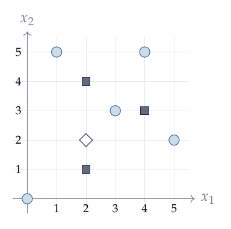

<details><summary>TikZ source</summary>

```latex
\begin{tikzpicture}[x=0.62cm,y=0.62cm,font=\small]
\draw[step=1,accent!15,very thin] (-0.5,-0.5) grid (5.5,5.5);
\draw[->,ink!60] (-0.5,0)--(5.7,0) node[right]{$x_1$}; \draw[->,ink!60] (0,-0.5)--(0,5.7) node[above]{$x_2$};
\foreach \p in {(3,3),(0,0),(5,2),(1,5),(4,5)} \node[circle,draw=accent,fill=accent!25,inner sep=2.2pt] at \p {};
\foreach \p in {(2,1),(2,4),(4,3)} \node[rectangle,draw=ink,fill=ink!70,inner sep=2.4pt] at \p {};
\node[diamond,draw=ink,fill=white,inner sep=2pt] at (2,2) {};
\foreach \x in {1,...,5} \node[below,font=\scriptsize] at (\x,0) {\x};
\foreach \y in {1,...,5} \node[left,font=\scriptsize] at (0,\y) {\y};
\end{tikzpicture}
```
</details>


### Q22.01
*MCQ · 1 mark · k-Nearest Neighbours · uses `Day22-ctx1`*

For the query in $\mathcal K$, the majority-vote labels for $k=1,3,5,7$ are

- **(A)** $-,-,-,+$
- **(B)** $-,+,-,+$
- **(C)** $+,-,-,-$
- **(D)** $-,-,+,+$

**Answer:** A  (solution header: (A))

**Solution:**

Squared distances from $(2,2)$: $(2,1)^-:1$, $(3,3)^+:2$, $(2,4)^-:4$, $(4,3)^-:5$, $(0,0)^+:8$, $(5,2)^+:9$, $(1,5)^+:10$, $(4,5)^+:13$.
$k=1$: $-$. $k=3$: $-,+,-$ gives $-$. $k=5$: three $-$, two $+$ gives $-$. $k=7$: three $-$, four $+$ gives $+$.


### Q22.02
*NAT · 1 mark · k-Nearest Neighbours · uses `Day22-ctx1`*

The minimum odd $k$ for which the query in $\mathcal K$ is labelled $+$ is ____.

**Answer:** 7

**Solution:**

From the list in Q22.01. (PYQ 2024 asked for the smallest odd $k$ that flips a label.)


### Q22.03
*NAT · 2 marks · k-Nearest Neighbours · uses `Day22-ctx1`*

One-dimensional data: $1(+),\ 2(+),\ 4(-),\ 5(+),\ 7(-),\ 8(-)$. In leave-one-out cross-validation of the 1-NN classifier, the number of misclassified points is ____.

**Answer:** 2

**Solution:**

Hold out each point and use its nearest remaining neighbour: 1 gets 2 ($+$ ✓), 2 gets 1 ($+$ ✓), 4 gets 5 ($+$, ✗), 5 gets 4 ($-$, ✗), 7 gets 8 ($-$ ✓), 8 gets 7 ($-$ ✓).
Trap: a point must not count as its own neighbour.


### Q22.04
*MCQ · 1 mark · k-Nearest Neighbours · uses `Day22-ctx1`*

From $P=(0,0)$, the candidates are $A=(3,0)$ and $B=(2,2)$. The nearer candidate under the Euclidean, Manhattan and Chebyshev ($L_\infty$) distances, respectively, is

- **(A)** $B,B,B$
- **(B)** $A,A,B$
- **(C)** $B,A,B$
- **(D)** $B,A,A$

**Answer:** C  (solution header: (C) $B,A,B$)

**Solution:**

Euclidean: $A$ 3, $B$ $2\sqrt2=2.83$. Manhattan: $A$ 3, $B$ 4. Chebyshev: $A$ 3, $B$ 2.


### Q22.05
*MSQ · 1 mark · k-Nearest Neighbours · uses `Day22-ctx1`*

Which are correct for k-NN classification?

- **(A)** Rescaling one feature can change the predictions
- **(B)** With $k=1$ the training error is 0 (distinct training points)
- **(C)** Larger $k$ gives higher variance
- **(D)** Prediction cost grows with the size of the training set

**Answer:** A, B, D  (solution header: (A), (B), (D))

**Solution:**

(C) ✗ larger $k$ averages over more points: smoother, higher bias, lower variance.


### Q22.06
*MCQ · 1 mark · k-Nearest Neighbours · uses `Day22-ctx1`*

If $k$ equals the number of training points (unweighted vote), every query is assigned

- **(A)** the label of its nearest neighbour
- **(B)** the majority class of the training set
- **(C)** a random label
- **(D)** the minority class of the training set

**Answer:** B  (solution header: (B))

**Solution:**

Every query sees the whole training set as its neighbourhood.


### Q22.07
*NAT · 1 mark · k-Nearest Neighbours · uses `Day22-ctx1`*

k-NN regression with $k=3$ on $(x,y)$: $(1,3),(2,5),(4,4),(6,10),(9,12)$ predicts at $x=3.4$ the value ____.

**Answer:** 4

**Solution:**

Distances from 3.4: $x=4$ (0.6), $x=2$ (1.4), $x=1$ (2.4); next is $x=6$ (2.6). Mean of $4,5,3$.


### Q22.08
*NAT · 1 mark · Naive Bayes · uses `Day22-ctx1`*

$P(\text{spam})=0.4$. Word $w_1$ appears with probability 0.6 in spam and 0.2 in ham; word $w_2$ with 0.3 in spam and 0.5 in ham, independently given the class. An email containing both words is spam with posterior probability ____\ (round to 3 decimals).

**Answer:** 0.54–0.546  (solution header: 0.545)

**Solution:**

Spam: $0.4\cdot0.6\cdot0.3=0.072$. Ham: $0.6\cdot0.2\cdot0.5=0.06$. Posterior $\frac{0.072}{0.132}$.


### Q22.09
*NAT · 1 mark · Naive Bayes · uses `Day22-ctx1`*

A two-class naive Bayes classifier has priors $P(y_1)=\tfrac25$, $P(y_2)=\tfrac35$ and, for a feature vector $\mathbf{x}$, $P(\mathbf{x}\mid y_1)=0.7$, $P(\mathbf{x}\mid y_2)=0.2$. The probability of misclassifying $\mathbf{x}$ is ____\ (round to 2 decimals).

**Answer:** 0.3  (solution header: 0.30)

**Solution:**

Joint scores: $y_1$: $0.4\cdot0.7=0.28$; $y_2$: $0.6\cdot0.2=0.12$. Predict $y_1$; error probability $P(y_2\mid\mathbf{x})=\frac{0.12}{0.40}$.
Note: PYQ 2025: priors $\frac13,\frac23$, likelihoods $\frac34,\frac14$: scores $\frac14$ vs $\frac16$, error $\frac{1/6}{5/12}=0.40$.


### Q22.10
*NAT · 1 mark · Naive Bayes · uses `Day22-ctx1`*

A naive Bayes classifier for 3 classes uses 10 binary features. The number of independent parameters to estimate, including the class priors, is ____.

**Answer:** 32

**Solution:**

Each class needs one Bernoulli parameter per feature: $3\cdot10$; priors need $3-1$.
Note: two classes with $K$ binary features: $2K+1$ (PYQ 2024). A full joint model would need $C(2^K-1)+C-1$.


### Q22.11
*NAT · 1 mark · Naive Bayes · uses `Day22-ctx1`*

A Gaussian naive Bayes classifier for 3 classes uses 6 continuous features (a mean and a variance per feature per class). The number of independent parameters, including class priors, is ____.

**Answer:** 38

**Solution:**

$3\cdot6\cdot2$ means and variances plus $2$ free priors.


### Q22.12
*NAT · 2 marks · Naive Bayes · uses `Day22-ctx1`*

\begin{tabular}{cccc@{ }cccc}\toprule
\# & Outlook & Wind & Play & \# & Outlook & Wind & Play\\\midrule
1 & S & W & no & 5 & S & C & yes\\
2 & S & C & yes & 6 & R & W & yes\\
3 & R & W & no & 7 & S & W & no\\
4 & R & C & yes & 8 & R & C & yes\\\bottomrule
\end{tabular}

Naive Bayes is trained on the table (maximum likelihood, no smoothing). For Outlook $=$ R and Wind $=$ W, $P(\text{yes}\mid\mathbf{x})$ is ____\ (round to 3 decimals).

**Answer:** 0.375

**Solution:**

$P(\text{yes})=\frac58$: yes rows 2, 4, 5, 6, 8 give $P(R\mid\text{yes})=\frac35$, $P(W\mid\text{yes})=\frac15$. $P(\text{no})=\frac38$: no rows 1, 3, 7 give $P(R\mid\text{no})=\frac13$, $P(W\mid\text{no})=1$.
Scores $\frac58\cdot\frac35\cdot\frac15=0.075$ and $\frac38\cdot\frac13\cdot1=0.125$; posterior $\frac{0.075}{0.2}$.


### Q22.13
*NAT · 2 marks · Naive Bayes · uses `Day22-ctx1`*

Repeat Q22.12 with Laplace (add-one) smoothing on each conditional probability (each feature has 2 values; priors unsmoothed). $P(\text{yes}\mid\mathbf{x})$ is ____\ (round to 2 decimals).

**Answer:** 0.45–0.46  (solution header: 0.46)

**Solution:**

Add-one with 2 values: yes: $\frac{3+1}{5+2}=\frac47$, $\frac{1+1}{7}=\frac27$; no: $\frac{1+1}{3+2}=\frac25$, $\frac{3+1}{5}=\frac45$.
Scores $\frac58\cdot\frac{8}{49}=0.1020$ and $\frac38\cdot\frac{8}{25}=0.12$; posterior $\frac{0.1020}{0.2220}=0.4596$.


### Q22.14
*MSQ · 1 mark · Naive Bayes · uses `Day22-ctx1`*

Which are correct?

- **(A)** Naive Bayes assumes the features are conditionally independent given the class
- **(B)** Naive Bayes is a discriminative model
- **(C)** Without smoothing, a single zero count can force a posterior to 0
- **(D)** Gaussian naive Bayes with class-specific variances can have a quadratic decision boundary

**Answer:** A, C, D  (solution header: (A), (C), (D))

**Solution:**

(B) ✗ naive Bayes models $P(\mathbf{x}\mid y)P(y)$: generative. (D) ✓ unequal variances give a quadratic log-ratio.


### Q22.15
*MCQ · 1 mark · Naive Bayes · uses `Day22-ctx1`*

Match (p) k-means, (q) a Gaussian class-conditional model with Bayes' rule, (r) SVM with (i) discriminative classifier, (ii) clustering, (iii) generative classifier.

- **(A)** p-iii, q-ii, r-i
- **(B)** p-ii, q-i, r-iii
- **(C)** p-i, q-iii, r-ii
- **(D)** p-ii, q-iii, r-i

**Answer:** D  (solution header: (D))

**Solution:**

k-means: clustering; Gaussian class-conditional with Bayes' rule: generative; SVM: discriminative. (Same pattern as PYQ 2024 and the 2026 task matching.)


### Q22.16
*MCQ · 2 marks · Linear Discriminant Analysis · uses `Day22-ctx1`*

Two classes have means $\mu_1=(1,2)$, $\mu_2=(3,1)$ and within-class scatter $S_W=\begin{pmatrix}2&0\\0&1\end{pmatrix}$. The Fisher discriminant direction is parallel to

- **(A)** $(-2,1)$
- **(B)** $(1,1)$
- **(C)** $(1,-1)$
- **(D)** $(2,1)$

**Answer:** C  (solution header: (C) $(1,-1)$)

**Solution:**

$\mathbf{w}\propto S_W^{-1}(\mu_1-\mu_2)=\mathrm{diag}\big(\tfrac12,1\big)(-2,1)=(-1,1)$, which is parallel to $(1,-1)$.
Trap: $\mu_1-\mu_2=(-2,1)$ is the answer only when $S_W\propto I$.


### Q22.17
*MCQ · 1 mark · Linear Discriminant Analysis · uses `Day22-ctx1`*

The Fisher criterion $J(\mathbf{u})=\dfrac{\mathbf{u}^{\top} S_B\mathbf{u}}{\mathbf{u}^{\top} S_W\mathbf{u}}$ is maximised at $\mathbf{u}^*$ with $\lambda=J(\mathbf{u}^*)$ ($S_W$ non-singular). Then

- **(A)** $S_BS_W\mathbf{u}^*=\lambda\mathbf{u}^*$
- **(B)** $S_W\mathbf{u}^*=\lambda S_B\mathbf{u}^*$
- **(C)** $\mathbf{u}^{*\top}\mathbf{u}^*=\lambda$
- **(D)** $S_W^{-1}S_B\mathbf{u}^*=\lambda\mathbf{u}^*$

**Answer:** D  (solution header: (D))

**Solution:**

Setting $\nabla J=0$ gives $S_B\mathbf{u}=\lambda S_W\mathbf{u}$, the generalised eigenproblem; multiply by $S_W^{-1}$. (PYQ 2024.)


### Q22.18
*MSQ · 2 marks · Linear Discriminant Analysis · uses `Day22-ctx1`*

A nearest-mean classifier computes $f(\mathbf{x})=\|\mu_r-\mathbf{x}\|^2-\|\mu_g-\mathbf{x}\|^2$ and predicts red if $f(\mathbf{x})<0$. Which are correct?

- **(A)** $f$ is an affine (linear plus constant) function of $\mathbf{x}$
- **(B)** $f$ is a quadratic polynomial in $\mathbf{x}$ with a non-zero quadratic term
- **(C)** $\mathbf{x}=\mathbf{0}$ is labelled red iff $\|\mu_r\|<\|\mu_g\|$
- **(D)** the boundary is the perpendicular bisector of the segment $\mu_r\mu_g$

**Answer:** A, C, D  (solution header: (A), (C), (D))

**Solution:**

$f(\mathbf{x})=\|\mu_r\|^2-\|\mu_g\|^2-2(\mu_r-\mu_g)^{\top}\mathbf{x}$: the $\|\mathbf{x}\|^2$ terms cancel. $f(\mathbf{0})<0\iff\|\mu_r\|<\|\mu_g\|$. $f=0$ is the set of points equidistant from both means. (PYQ 2025.)


### Q22.19
*NAT · 1 mark · Linear Discriminant Analysis · uses `Day22-ctx1`*

Multi-class LDA on 5 classes with 20 features yields at most ____\ useful discriminant directions.

**Answer:** 4

**Solution:**

$S_B$ is a sum of $C$ rank-one terms around the overall mean, so its rank is at most $C-1$.


### Q22.20
*NAT · 2 marks · Linear Discriminant Analysis · uses `Day22-ctx1`*

In one dimension, class 1 is $\mathcal N(0,1)$ with prior 0.8 and class 2 is $\mathcal N(4,1)$ with prior 0.2. The Bayes decision threshold (class 1 below it) is ____\ (round to 3 decimals).

**Answer:** 2.34–2.35  (solution header: 2.347)

**Solution:**

Choose class 1 when $\ln0.8-\frac{x^2}2>\ln0.2-\frac{(x-4)^2}2$, i.e.\ $4x-8<\ln4$: $x^*=2+\frac{\ln4}{4}$.
Note: the threshold moves away from the more probable class's mean, enlarging its region.


### Q22.21
*MCQ · 1 mark · Linear Discriminant Analysis · uses `Day22-ctx1`*

For Gaussian class-conditional densities, the Bayes decision boundary is linear when

- **(A)** each class has its own covariance matrix (QDA)
- **(B)** the classes share one covariance matrix (LDA)
- **(C)** the class priors are equal
- **(D)** the features are binary

**Answer:** B  (solution header: (B))

**Solution:**

With a shared $\Sigma$, the quadratic terms $\mathbf{x}^{\top}\Sigma^{-1}\mathbf{x}$ cancel in the log-ratio; with separate $\Sigma_k$ they do not.


### Q22.22
*MCQ · 2 marks · Support Vector Machines · uses `Day22-ctx1`*

A hard-margin linear SVM is trained on class $+1$: $(2,1),(1,2),(3,3)$ and class $-1$: $(0,0),(1,0),(-1,-1)$. The support vectors (points with $\alpha_i>0$ in the dual solution) are

- **(A)** $\{(2,1),(1,0)\}$
- **(B)** $\{(3,3),(0,0)\}$
- **(C)** $\{(2,1),(1,2),(1,0)\}$
- **(D)** $\{(1,2),(1,0),(0,0)\}$

**Answer:** A  (solution header: (A))

**Solution:**

The convex hulls are closest between $(1,0)$ and the edge $(2,1)$--$(1,2)$: the separator is $x_1+x_2=2$ with $\mathbf{w}=(1,1)$, $b=-2$, margin $\sqrt2$.
$(2,1)$, $(1,2)$ (value $+1$) and $(1,0)$ (value $-1$) lie on the margin planes. The dual conditions $\mathbf{w}=\sum\alpha_iy_i\mathbf{x}_i$, $\sum\alpha_iy_i=0$ give $\alpha_{(2,1)}(2,1)+\alpha_{(1,2)}(1,2)-\alpha_{(1,0)}(1,0)=(1,1)$ with $\alpha_{(1,0)}=\alpha_{(2,1)}+\alpha_{(1,2)}$; the first coordinate forces $\alpha_{(2,1)}=1$, so $\alpha_{(1,2)}=0$ and $\alpha_{(1,0)}=1$.
Trap: (C) lists every point on the margin, but $(1,2)$ has $\alpha=0$: being on the margin is necessary, not sufficient. (PYQ 2024 asked for a ``possible set of support vectors''.)


### Q22.23
*NAT · 1 mark · Support Vector Machines · uses `Day22-ctx1`*

A trained linear SVM has $\mathbf{w}=(3,4)$. The margin width $2/\|\mathbf{w}\|$ is ____.

**Answer:** 0.4

**Solution:**

$\frac{2}{\sqrt{9+16}}$.


### Q22.24
*MSQ · 2 marks · Support Vector Machines · uses `Day22-ctx1`*

A hard-margin linear SVM $f(\mathbf{x})=\operatorname{sign}(\mathbf{w}^{\top}\mathbf{x}+b)$ is trained on class 1: $(3,0),(0,3),(3,3)$ and class 2: $(0,0)$. Which are correct?

- **(A)** $\mathbf{w}=\big(\tfrac23,\tfrac23\big)$ and $b=-1$ (class 1 positive)
- **(B)** There are 3 support vectors
- **(C)** The margin width is $3\sqrt2$
- **(D)** $(3,3)$ is a support vector

**Answer:** A, B  (solution header: (A), (B))

**Solution:**

By symmetry $\mathbf{w}=(c,c)$. The closest class-1 points $(3,0)$, $(0,3)$ satisfy $3c+b=1$, and $(0,0)$ gives $b=-1$: $c=\tfrac23$. Support vectors: $(3,0)$, $(0,3)$, $(0,0)$.
Margin $\frac{2}{\|\mathbf{w}\|}=\frac{2}{2\sqrt2/3}=\frac{3}{\sqrt2}$, not $3\sqrt2$. $(3,3)$ gives $4-1=3>1$, so it is not a support vector.
Note: PYQ 2025 used $(2,0),(0,2),(2,2)$: $\mathbf{w}=(1,1)$, $b=-1$, margin $\sqrt2$, 3 support vectors, 100\% training accuracy.


### Q22.25
*NAT · 1 mark · Support Vector Machines · uses `Day22-ctx1`*

The distance of the point $(2,1)$ from the hyperplane $3x_1+4x_2-5=0$ is ____.

**Answer:** 1

**Solution:**

$\frac{|3\cdot2+4\cdot1-5|}{\sqrt{9+16}}=\frac55$.


### Q22.26
*MCQ · 1 mark · Support Vector Machines · uses `Day22-ctx1`*

In a soft-margin SVM, increasing the penalty $C$ tends to

- **(A)** widen the margin and allow more violations
- **(B)** narrow the margin and allow fewer violations
- **(C)** leave the solution unchanged
- **(D)** turn the SVM into logistic regression

**Answer:** B  (solution header: (B))

**Solution:**

$C$ prices slack: large $C$ approaches the hard margin (narrow, fewer violations, risk of overfitting); small $C$ allows violations for a wider margin.


### Q22.27
*NAT · 1 mark · Support Vector Machines · uses `Day22-ctx1`*

For $K(\mathbf{x},\mathbf{z})=(\mathbf{x}^{\top}\mathbf{z}+1)^2$, $K\big((1,2),(3,1)\big)=$ ____.

**Answer:** 36

**Solution:**

$\mathbf{x}^{\top}\mathbf{z}=3+2=5$; $(5+1)^2$.


### Q22.28
*MSQ · 1 mark · Support Vector Machines · uses `Day22-ctx1`*

In the dual of the hard-margin SVM with multipliers $\alpha_i\ge0$, which are correct?

- **(A)** Only support vectors have $\alpha_i>0$
- **(B)** $\mathbf{w}=\sum_i\alpha_iy_i\mathbf{x}_i$
- **(C)** $\sum_i\alpha_iy_i=0$
- **(D)** Removing a training point that is not a support vector changes the solution

**Answer:** A, B, C  (solution header: (A), (B), (C))

**Solution:**

Complementary slackness: $\alpha_i>0$ only on the margin. (D) ✗ the solution depends only on the support vectors.


### Q22.29
*NAT · 1 mark · Support Vector Machines · uses `Day22-ctx1`*

The kernel $(\mathbf{x}^{\top}\mathbf{z}+1)^2$ on $\mathbb R^{10}$ corresponds to an explicit feature map whose dimension (the number of monomials of degree $\le2$) is ____.

**Answer:** 66

**Solution:**

Monomials of degree $\le2$ in 10 variables: $\binom{10+2}{2}=1+10+55$.


### Q22.30
*NAT · 1 mark · Decision Trees · uses `Day22-ctx1`*

A node holds 9 positive and 5 negative examples. Its entropy (bits) is ____\ (round to 3 decimals).

\begin{tabular}{cccc@{ }cccc}\toprule
\# & Weather & Venue & Result & \# & Weather & Venue & Result\\\midrule
1 & S & H & W & 6 & R & H & W\\
2 & S & H & W & 7 & S & A & W\\
3 & R & H & L & 8 & R & A & L\\
4 & S & A & W & 9 & S & H & L\\
5 & R & A & L & 10 & R & A & L\\\bottomrule
\end{tabular}\\
{Table $\mathcal T$, used in the next three questions.}

**Answer:** 0.94  (solution header: 0.940)

**Solution:**

$-\frac9{14}\log_2\frac9{14}-\frac5{14}\log_2\frac5{14}=0.410+0.530$.


### Q22.31
*NAT · 2 marks · Decision Trees · uses `Day22-ctx1`*

The information gain (bits) of splitting $\mathcal T$ on Weather, with Result as target, is ____\ (round to 2 decimals).

**Answer:** 0.27–0.28  (solution header: 0.28)

**Solution:**

Root: 5 W, 5 L, entropy 1. Weather S: $\{W,W,W,W,L\}$, entropy $H(0.8)=0.722$; R: $\{L,L,W,L,L\}$, entropy $0.722$. Gain $1-0.722=0.278$.
Note: PYQ 2024 (cricket table) is the same computation.


### Q22.32
*NAT · 1 mark · Decision Trees · uses `Day22-ctx1`*

The weighted Gini impurity of the children after splitting $\mathcal T$ on Venue is ____\ (round to 2 decimals).

**Answer:** 0.48

**Solution:**

Venue A: rows 4, 5, 7, 8, 10 $=\{W,L,W,L,L\}$, Gini $1-0.4^2-0.6^2=0.48$; H: rows 1, 2, 3, 6, 9 $=\{W,W,L,W,L\}$, Gini $0.48$. Weighted $0.48$, only $0.02$ below the root's $0.5$.


### Q22.33
*MCQ · 1 mark · Decision Trees · uses `Day22-ctx1`*

For the root of a tree on $\mathcal T$, the attribute chosen by information gain and by Gini reduction is

- **(A)** Venue by both criteria
- **(B)** Weather by information gain, Venue by Gini
- **(C)** Weather by both criteria
- **(D)** neither, since the gains are equal

**Answer:** C  (solution header: (C))

**Solution:**

Weather: gain $0.278$, weighted Gini $0.32$. Venue: gain $0.029$, weighted Gini $0.48$.


### Q22.34
*MSQ · 1 mark · Decision Trees · uses `Day22-ctx1`*

Which are correct for decision trees?

- **(A)** A fully grown tree can reach zero training error on data without conflicting labels
- **(B)** Information gain favours attributes with many distinct values
- **(C)** Trees on numeric features require feature standardisation
- **(D)** With single-feature threshold tests, the decision boundaries are axis-parallel

**Answer:** A, B, D  (solution header: (A), (B), (D))

**Solution:**

(B) ✓ hence the gain ratio. (C) ✗ thresholds are invariant to monotone rescaling.


### Q22.35
*NAT · 1 mark · Decision Trees · uses `Day22-ctx1`*

A node has class proportions $\big(\tfrac12,\tfrac14,\tfrac14\big)$. Its entropy in bits is ____.

**Answer:** 1.5

**Solution:**

$\frac12\cdot1+\frac14\cdot2+\frac14\cdot2$.


### Q22.36
*NAT · 1 mark · Decision Trees · uses `Day22-ctx1`*

The minimum number of leaves of a decision tree (tests on single Boolean features) that computes the parity (XOR) of 3 Boolean features is ____.

**Answer:** 8

**Solution:**

Parity depends on every feature along every path, so every root-to-leaf path must test all 3 features: $2^3$ leaves.


## Day 23: Neural Networks, Bias--Variance, Validation, Metrics


### Q23.01
*NAT · 1 mark · Perceptrons and Multi-Layer Perceptrons*

A fully connected feed-forward network has layer sizes $20\to5\to4\to2$ (input, two hidden layers, output), and every non-input neuron has a bias. The number of learnable parameters is ____.

**Answer:** 139

**Solution:**

Each layer: (inputs $\times$ outputs) $+$ outputs. $20\cdot5+5=105$, $5\cdot4+4=24$, $4\cdot2+2=10$.


### Q23.02
*NAT · 1 mark · Perceptrons and Multi-Layer Perceptrons*

A fully connected network has layer sizes $16\to8\to4\to1$ and no biases. The number of learnable parameters is ____.

**Answer:** 164

**Solution:**

$16\cdot8+8\cdot4+4\cdot1=128+32+4$. (PYQ 2026: $30\to4\to3\to1$ gives $120+12+3=135$.)


### Q23.03
*NAT · 1 mark · Perceptrons and Multi-Layer Perceptrons*

Hidden units $h_1=\operatorname{ReLU}(2x_1+x_2+1)$, $h_2=\operatorname{ReLU}(-x_1+3x_2+4)$, $h_3=\operatorname{ReLU}(x_1-x_2)$ feed the linear output $y=h_1-2h_2+0.5h_3$. For $\mathbf{x}=(1,-2)$, $y=$ ____.

**Answer:** 2.5

**Solution:**

$h_1=\operatorname{ReLU}(2-2+1)=1$, $h_2=\operatorname{ReLU}(-1-6+4)=0$, $h_3=\operatorname{ReLU}(3)=3$; $y=1-0+1.5$.


### Q23.04
*MSQ · 1 mark · Perceptrons and Multi-Layer Perceptrons*

Which are correct?

- **(A)** XOR of two inputs is not linearly separable
- **(B)** A single perceptron can compute XOR
- **(C)** One hidden layer with two threshold (or ReLU) units suffices to compute XOR
- **(D)** The perceptron algorithm converges in finitely many updates on any linearly separable dataset

**Answer:** A, C, D  (solution header: (A), (C), (D))

**Solution:**

(C) ✓ e.g.\ $h_1=\operatorname{ReLU}(x_1+x_2)$, $h_2=\operatorname{ReLU}(x_1+x_2-1)$, $y=h_1-2h_2$ on $\{0,1\}^2$ gives $0,1,1,0$. (D) ✓ Novikoff's theorem: at most $(R/\gamma)^2$ updates.


### Q23.05
*MSQ · 1 mark · Perceptrons and Multi-Layer Perceptrons*

For $\operatorname{ReLU}(x)=\max(x,0)$, which are correct?

- **(A)** $\operatorname{ReLU}$ is continuous everywhere
- **(B)** $\operatorname{ReLU}$ is differentiable everywhere
- **(C)** $\operatorname{ReLU}(ax)=a\,\operatorname{ReLU}(x)$ for all $a\ge0$
- **(D)** $\operatorname{ReLU}(ax)=\operatorname{ReLU}(x)$ for all $a\in\mathbb R$

**Answer:** A, C  (solution header: (A), (C))

**Solution:**

(B) ✗ the left derivative at 0 is 0 and the right derivative is 1. (C) ✓ positive homogeneity. (D) ✗ e.g.\ $a=-1$, $x=1$. (PYQ 2025.)


### Q23.06
*MCQ · 1 mark · Perceptrons and Multi-Layer Perceptrons*

A 10-layer network uses the identity activation in every layer. The functions it can represent are

- **(A)** exactly the affine (linear) maps of the input
- **(B)** all continuous functions (universal approximation)
- **(C)** piecewise linear functions with up to 10 pieces
- **(D)** polynomials of degree at most 10

**Answer:** A  (solution header: (A))

**Solution:**

A composition of affine maps is affine; depth adds nothing without non-linear activations.


### Q23.07
*MCQ · 2 marks · Perceptrons and Multi-Layer Perceptrons*

[FIGURE 1: figures/Q23_07_q_f1_e1df7a80.png]

Network 1 computes $h_1=\operatorname{ReLU}(2x_1+3x_2)$, $h_2=\operatorname{ReLU}(4x_1+x_2)$, $y=\operatorname{ReLU}(3h_1+2h_2)$; Network 2 computes $y=\operatorname{ReLU}(px_1+qx_2)$. All biases are 0. For which $(p,q)$ do the two networks agree for all positive $x_1,x_2$?

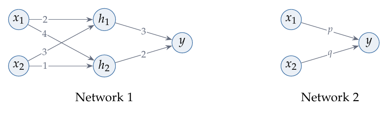

<details><summary>TikZ source</summary>

```latex
\begin{tikzpicture}[font=\small,>=Stealth,every node/.style={circle,draw=accent,fill=accent!10,inner sep=1.5pt,minimum size=15pt}]
\node (a1) at (0,1) {$x_1$}; \node (a2) at (0,-0.2) {$x_2$};
\node (h1) at (2.2,1) {$h_1$}; \node (h2) at (2.2,-0.2) {$h_2$}; \node (y) at (4.2,0.4) {$y$};
\begin{scope}[every node/.style={font=\scriptsize,fill=white,inner sep=0.5pt}]
\draw[->,ink!70] (a1)--node[pos=0.25]{2}(h1); \draw[->,ink!70] (a2)--node[pos=0.25]{3}(h1);
\draw[->,ink!70] (a1)--node[pos=0.25]{4}(h2); \draw[->,ink!70] (a2)--node[pos=0.25]{1}(h2);
\draw[->,ink!70] (h1)--node{3}(y); \draw[->,ink!70] (h2)--node{2}(y);
\end{scope}
\node[draw=none,fill=none] at (2.2,-1) {Network 1};
\node (b1) at (7,1) {$x_1$}; \node (b2) at (7,-0.2) {$x_2$}; \node (z) at (9,0.4) {$y$};
\begin{scope}[every node/.style={font=\scriptsize,fill=white,inner sep=0.5pt}]
\draw[->,ink!70] (b1)--node{$p$}(z); \draw[->,ink!70] (b2)--node{$q$}(z);
\end{scope}
\node[draw=none,fill=none] at (8,-1) {Network 2};
\end{tikzpicture}
```
</details>

- **(A)** $(6,9)$
- **(B)** $(14,11)$
- **(C)** $(24,6)$
- **(D)** $(5,4)$

**Answer:** B  (solution header: (B) $(14,11)$)

**Solution:**

For positive inputs every pre-activation is positive, so each ReLU acts as the identity: $y=3(2x_1+3x_2)+2(4x_1+x_2)=14x_1+11x_2$. (PYQ 2024 pattern.)


### Q23.08
*NAT · 1 mark · Perceptrons and Multi-Layer Perceptrons*

At a point where the sigmoid output is $\sigma(z)=0.8$, the derivative $\sigma'(z)$ is ____.

**Answer:** 0.16

**Solution:**

$\sigma'(z)=\sigma(z)(1-\sigma(z))=0.8\cdot0.2$.


### Q23.09
*NAT · 2 marks · Perceptrons and Multi-Layer Perceptrons*

The perceptron rule ($\mathbf{w}\gets\mathbf{w}+y\mathbf{x}$, $b\gets b+y$ whenever $y(\mathbf{w}^{\top}\mathbf{x}+b)\le0$) starts at $\mathbf{w}=\mathbf{0}$, $b=0$ and cycles through, in order,
$\big((2,1),+1\big)$, $\big((-1,-1),-1\big)$, $\big((0,2),+1\big)$, $\big((1,-2),-1\big)$, $\big((-2,1),-1\big)$
until a full pass makes no update. The total number of updates is ____.

**Answer:** 3

**Solution:**

Pass 1: $(2,1)$: score 0, update to $\mathbf{w}=(2,1)$, $b=1$. $(-1,-1)$: $-2$, correct. $(0,2)$: $3$, correct. $(1,-2)$: $1$ with $y=-1$, update to $(1,3)$, $b=0$. $(-2,1)$: $1$ with $y=-1$, update to $(3,2)$, $b=-1$.
Pass 2: scores $7,-6,3,-2,-5$ all have the right sign. Total 3 updates.


### Q23.10
*NAT · 1 mark · Perceptrons and Multi-Layer Perceptrons*

A softmax output layer has logits $[2,0,-1]$ and the true class is the first. The cross-entropy loss (natural log) is ____\ (round to 3 decimals).

**Answer:** 0.169–0.170  (solution header: 0.170)

**Solution:**

$-\ln\frac{e^2}{e^2+1+e^{-1}}=-\ln\frac{7.389}{8.757}$.


### Q23.11
*MCQ · 2 marks · Backpropagation*

Inputs $u=1$, $v=2$. Hidden units $h_1=\operatorname{ReLU}(au+cv)$ and $h_2=\operatorname{ReLU}(bu+dv)$; output $y=\operatorname{ReLU}(eh_1+fh_2)$, with $a=1$, $b=2$, $c=1$, $d=-0.5$, $e=2$, $f=5$. Then

- **(A)** $\frac{\partial y}{\partial a}=2,\ \frac{\partial y}{\partial f}=0$
- **(B)** $\frac{\partial y}{\partial a}=1,\ \frac{\partial y}{\partial f}=0$
- **(C)** $\frac{\partial y}{\partial a}=2,\ \frac{\partial y}{\partial f}=1$
- **(D)** $\frac{\partial y}{\partial a}=4,\ \frac{\partial y}{\partial f}=1$

**Answer:** C  (solution header: (C))

**Solution:**

Pre-activations: $au+cv=3$ and $bu+dv=1$, so $h_1=3$, $h_2=1$, $y=\operatorname{ReLU}(6+5)=11$; all ReLUs are in their linear region.
$\frac{\partial y}{\partial a}=e\cdot1\cdot u=2$; $\frac{\partial y}{\partial f}=h_2=1$.
Note: PYQ 2025 had $h_2$'s pre-activation negative: then $\partial y/\partial f=h_2=0$ and the gradient through $h_2$ is blocked.


### Q23.12
*NAT · 1 mark · Backpropagation*

A single neuron $y=\sigma(wx+b)$ with loss $L=\frac12(y-t)^2$ has $w=b=0$. For $x=1$, $t=1$, the gradient $\partial L/\partial w$ is ____.

**Answer:** −0.125  (solution header: $-0.125$)

**Solution:**

$y=\sigma(0)=0.5$. $\frac{\partial L}{\partial w}=(y-t)\,\sigma'(z)\,x=(-0.5)(0.25)(1)$.


### Q23.13
*NAT · 1 mark · Backpropagation*

Continuing Q23.12, one gradient-descent step with learning rate $0.4$ gives $w=$ ____.

**Answer:** 0.05

**Solution:**

$w\gets0-0.4(-0.125)$.


### Q23.14
*NAT · 2 marks · Backpropagation*

$h=\operatorname{ReLU}(w_1x)$, $y=w_2h$, $L=(y-t)^2$, with $x=2$, $w_1=1.5$, $w_2=-1$, $t=1$. The gradient $\partial L/\partial w_1$ is ____.

**Answer:** 16

**Solution:**

$z=3$, $h=3$, $y=-3$, $\frac{\partial L}{\partial y}=2(y-t)=-8$. $\frac{\partial L}{\partial w_1}=-8\cdot w_2\cdot1[z>0]\cdot x=-8\cdot(-1)\cdot1\cdot2$.


### Q23.15
*MSQ · 1 mark · Backpropagation*

Which are correct?

- **(A)** $\sigma'(z)\le0.25$, so gradients through many sigmoid layers tend to vanish
- **(B)** The derivative of $\operatorname{ReLU}$ is 1 for positive inputs
- **(C)** Initialising all weights to zero breaks the symmetry between hidden units
- **(D)** Backpropagation applies the chain rule in one backward pass to get all gradients

**Answer:** A, B, D  (solution header: (A), (B), (D))

**Solution:**

(C) ✗ identical initial weights give identical gradients, so hidden units stay identical; random initialisation breaks the symmetry.


### Q23.16
*MCQ · 1 mark · Backpropagation*

A ReLU hidden unit has a negative pre-activation for every training input. During gradient descent its incoming weights

- **(A)** grow without bound
- **(B)** receive zero gradient and stop changing
- **(C)** oscillate in sign
- **(D)** are reset to their initial values

**Answer:** B  (solution header: (B))

**Solution:**

$\operatorname{ReLU}'(z)=0$ for $z<0$, so no gradient flows to the incoming weights: a dead ReLU.


### Q23.17
*MCQ · 1 mark · Backpropagation*

For softmax outputs $\mathbf{p}$ with cross-entropy loss and one-hot target $\mathbf{y}$, the gradient of the loss with respect to the logits $\mathbf{z}$ is

- **(A)** $\mathbf{y}-\mathbf{p}$
- **(B)** $\mathbf{p}\odot(1-\mathbf{p})$
- **(C)** $-\log\mathbf{p}$
- **(D)** $\mathbf{p}-\mathbf{y}$

**Answer:** D  (solution header: (D))

**Solution:**

$L=-\sum_ky_k\log p_k$ with $p_k=e^{z_k}/\sum e^{z_j}$ gives $\partial L/\partial z_k=p_k-y_k$.


### Q23.18
*NAT · 1 mark · Backpropagation*

Logits are $[1,2,0]$ and the true class is the second. The derivative of the cross-entropy loss with respect to the \emph{first} logit is ____\ (round to 3 decimals).

**Answer:** 0.244–0.245  (solution header: 0.245)

**Solution:**

$p_1=\frac{e}{e+e^2+1}=\frac{2.718}{11.107}$; the first class is not the target, so the derivative is $p_1-0$.


### Q23.19
*NAT · 1 mark · Bias--Variance Trade-off*

At a test point a model has bias $0.3$ (the bias itself, not its square) and variance $0.2$, and the noise variance is $0.1$. The expected squared prediction error there is ____.

**Answer:** 0.39

**Solution:**

$0.3^2+0.2+0.1$. Bias enters squared; the variance is given directly.


### Q23.20
*MCQ · 1 mark · Bias--Variance Trade-off*

A model has training error 1\% and test error 25\%. The most likely problem and a fitting remedy are

- **(A)** high bias; add more features
- **(B)** high variance; add regularisation or more data
- **(C)** high bias; reduce regularisation
- **(D)** irreducible error; nothing helps

**Answer:** B  (solution header: (B))

**Solution:**

A large gap between training and test error is the signature of overfitting (high variance).


### Q23.21
*NAT · 2 marks · Bias--Variance Trade-off*

$X_1,X_2,X_3$ are i.i.d.\ with mean $\mu=2$ and variance 4. The estimator $\hat\mu=\frac{X_1+X_2+X_3}{4}$ has mean squared error ____.

**Answer:** 1

**Solution:**

$\mathbb{E}\hat\mu=\frac34\mu=1.5$, bias $-0.5$; $\operatorname{Var}\hat\mu=\frac{3\cdot4}{16}=0.75$. MSE $=0.25+0.75$.
Note: the unbiased $\bar X$ has MSE $\frac43$: a biased estimator can win.


### Q23.22
*MCQ · 1 mark · Bias--Variance Trade-off*

As $k$ increases in k-NN,

- **(A)** bias decreases and variance increases
- **(B)** bias increases and variance decreases
- **(C)** both decrease
- **(D)** both increase

**Answer:** B  (solution header: (B))

**Solution:**

Averaging over more neighbours smooths the prediction.


### Q23.23
*MSQ · 1 mark · Bias--Variance Trade-off*

Polynomials of increasing degree are fitted by least squares to a fixed training set. Which typically hold?

- **(A)** Training error never increases with the degree
- **(B)** Test error first falls and then rises
- **(C)** Variance of the fitted function increases with the degree
- **(D)** Bias increases with the degree

**Answer:** A, B, C  (solution header: (A), (B), (C))

**Solution:**

Nested model classes: training error cannot increase. (D) ✗ bias decreases with flexibility.


### Q23.24
*MCQ · 1 mark · Bias--Variance Trade-off*

For a fixed model class, collecting much more training data mainly

- **(A)** reduces variance, leaving bias about the same
- **(B)** reduces bias, leaving variance the same
- **(C)** reduces the irreducible error
- **(D)** increases both bias and variance

**Answer:** A  (solution header: (A))

**Solution:**

Variance shrinks roughly like $1/n$; bias is a property of the model class.


### Q23.25
*MCQ · 1 mark · Bias--Variance Trade-off*

In $\mathbb{E}[(y-\hat f(x))^2]=\text{bias}^2+\text{variance}+\sigma^2$, the term no model can reduce is

- **(A)** bias$^2$
- **(B)** variance
- **(C)** $\sigma^2$
- **(D)** none

**Answer:** C  (solution header: (C))

**Solution:**

$\sigma^2$ is the variance of $y$ around $f(x)$; it is irreducible.


### Q23.26
*NAT · 2 marks · Bias--Variance Trade-off*

Four models trained on independent training sets predict $6,7,5,8$ at $x_0$, where the true value is $f(x_0)=5$. Using these four, the estimated bias$^2$ plus variance (population variance) at $x_0$ is ____.

**Answer:** 3.5

**Solution:**

Mean prediction $6.5$: bias$^2=1.5^2=2.25$; variance $\frac{0.25+0.25+2.25+2.25}{4}=1.25$.
Shortcut: this equals the mean squared deviation from the truth: $\frac{1+4+0+9}{4}=3.5$.


### Q23.27
*MCQ · 1 mark · Cross-Validation and Evaluation Metrics*

A dataset has 1500 samples of 64 features in 10 classes; 300 samples are held out for testing, and LOOCV on the rest selects the model. The number of validation splits is

- **(A)** 10
- **(B)** 64
- **(C)** 1500
- **(D)** 1200

**Answer:** D  (solution header: (D) 1200)

**Solution:**

LOOCV makes one split per sample used for model selection: $1500-300$. The number of classes and features is irrelevant. (PYQ 2026: $1000-100=900$.)


### Q23.28
*NAT · 1 mark · Cross-Validation and Evaluation Metrics*

5-fold cross-validation chooses among 4 values of a hyperparameter. The number of model trainings needed for the selection (before retraining the final model) is ____.

**Answer:** 20

**Solution:**

$4\text{ values}\times5\text{ folds}$.


### Q23.29
*NAT · 2 marks · Cross-Validation and Evaluation Metrics*

The predictor ``mean of the training targets'' is evaluated by LOOCV on $y=1,2,3,6$. The LOOCV mean squared error is ____\ (round to 2 decimals).

**Answer:** 6.22

**Solution:**

Leaving out $y_i$, the prediction is $\frac{12-y_i}{3}$: errors $1-\frac{11}3$, $2-\frac{10}3$, $3-3$, $6-2$, i.e.\ $-\frac83,-\frac43,0,4$. MSE $=\frac{64/9+16/9+0+16}{4}=\frac{224}{36}$.


### Q23.30
*MSQ · 2 marks · Cross-Validation and Evaluation Metrics*

A test set has 40 items of class A and 20 of class B. 8 items of A are predicted as B, and 4 items of B are predicted as A. Which are correct?

- **(A)** accuracy is $\tfrac45$
- **(B)** precision of A exceeds precision of B
- **(C)** recall of A exceeds recall of B
- **(D)** the F$_1$ score of B is $\tfrac8{11}$

**Answer:** A, B, D  (solution header: (A), (B), (D))

**Solution:**

Confusion: A$\to$A 32, A$\to$B 8, B$\to$A 4, B$\to$B 16. Accuracy $\frac{48}{60}$. Precision: A $\frac{32}{36}=0.889$, B $\frac{16}{24}=0.667$. Recall: A $\frac{32}{40}=0.8$, B $\frac{16}{20}=0.8$ (equal, so (C) ✗). F$_1$(B) $=\frac{2\cdot\frac23\cdot\frac45}{\frac23+\frac45}=\frac8{11}$.
Note: PYQ 2026 is the same computation (20 and 10 stories).


### Q23.31
*NAT · 1 mark · Cross-Validation and Evaluation Metrics*

A classifier has precision $0.6$ and recall $0.75$. Its F$_1$ score is ____\ (round to 3 decimals).

**Answer:** 0.666–0.667  (solution header: 0.667)

**Solution:**

Harmonic mean: $\frac{2\cdot0.6\cdot0.75}{1.35}$.


### Q23.32
*MCQ · 1 mark · Cross-Validation and Evaluation Metrics*

In a test set, 99\% of cases are negative. A classifier that always predicts negative has

- **(A)** accuracy 0.99 and recall 0
- **(B)** accuracy 0.99 and precision 1
- **(C)** accuracy 0.5 and recall 0.5
- **(D)** accuracy 0.01 and recall 1

**Answer:** A  (solution header: (A))

**Solution:**

It is right on every negative, so accuracy is 0.99, but it finds no positive: recall 0 (precision is undefined).


### Q23.33
*NAT · 1 mark · Cross-Validation and Evaluation Metrics*

TP $=30$, FN $=10$, FP $=20$, TN $=140$. The specificity (true negative rate) is ____.

**Answer:** 0.875

**Solution:**

$\frac{TN}{TN+FP}=\frac{140}{160}$.


### Q23.34
*NAT · 2 marks · Cross-Validation and Evaluation Metrics*

Positive examples receive scores $0.9,0.7,0.4$ and negative examples $0.8,0.3,0.2$. The ROC AUC (the probability that a random positive outscores a random negative) is ____\ (round to 3 decimals).

**Answer:** 0.777–0.778  (solution header: 0.778)

**Solution:**

Pairs (positive, negative) won by the positive: $0.9$ beats 3, $0.7$ beats 2, $0.4$ beats 2; $\frac79$.


### Q23.35
*MSQ · 1 mark · Cross-Validation and Evaluation Metrics*

Which are correct?

- **(A)** LOOCV is $k$-fold cross-validation with $k=n$
- **(B)** The LOOCV error estimate has low bias but can have high variance
- **(C)** The test set may be used to choose hyperparameters if the model is retrained afterwards
- **(D)** Stratified $k$-fold keeps the class proportions roughly equal in every fold

**Answer:** A, B, D  (solution header: (A), (B), (D))

**Solution:**

(C) ✗ using the test set for any choice makes its error estimate optimistic; use a validation split or cross-validation.


### Q23.36
*MCQ · 1 mark · Cross-Validation and Evaluation Metrics*

A classifier that assigns random scores, independent of the label, has a ROC curve that is

- **(A)** the left and top edges of the unit square, with AUC 1
- **(B)** the horizontal axis, with AUC 0
- **(C)** the diagonal $\mathrm{TPR}=\mathrm{FPR}$, with AUC $0.5$
- **(D)** undefined

**Answer:** C  (solution header: (C))

**Solution:**

With label-independent scores, every threshold flags the same fraction of positives and negatives: $\mathrm{TPR}=\mathrm{FPR}$.


## Day 24: Clustering and Principal Component Analysis


### Q24.01
*NAT · 2 marks · k-Means*

k-means with $k=2$ runs on $1,2,4,7,8,10$ from initial centroids $1$ and $4$ until the assignments stop changing. The final within-cluster sum of squared distances is ____\ (round to 2 decimals).

**Answer:** 9.33

**Solution:**

Iteration 1: centroids 1, 4; clusters $\{1,2\}$, $\{4,7,8,10\}$; new centroids $1.5$, $7.25$.
Iteration 2: 4 is $2.5$ from $1.5$ and $3.25$ from $7.25$, so it moves: clusters $\{1,2,4\}$, $\{7,8,10\}$; centroids $\tfrac73$, $\tfrac{25}3$. Iteration 3: no change.
SSE: each cluster gives $\big(\tfrac43\big)^2+\big(\tfrac13\big)^2+\big(\tfrac53\big)^2=\tfrac{42}9$; total $\tfrac{28}3$.


### Q24.02
*NAT · 1 mark · k-Means*

In Q24.01, the final centroid of the cluster that contains the point 4 is ____\ (round to 2 decimals).

**Answer:** 2.33

**Solution:**

$\frac{1+2+4}{3}$.


### Q24.03
*MCQ · 1 mark · k-Means*

Points $A(1,1)$, $B(1,2)$, $C(4,3)$, $D(5,4)$, $E(2,1)$; initial centroids $A$ and $C$. After one assignment step and one update step, the centroids are

- **(A)** $(1,1.5)$ and $(3.67,2.67)$
- **(B)** $(1.33,1.33)$ and $(4.5,3.5)$
- **(C)** $(1.5,1)$ and $(4.5,3.5)$
- **(D)** $(1.33,1.33)$ and $(4,3)$

**Answer:** B  (solution header: (B))

**Solution:**

To $A$: $B$ (distance 1) and $E$ (1); to $C$: $D$ ($\sqrt2$). New centroids $\frac{(1,1)+(1,2)+(2,1)}3=(\tfrac43,\tfrac43)$ and $\frac{(4,3)+(5,4)}2=(4.5,3.5)$.


### Q24.04
*MCQ · 1 mark · k-Means*

Euclidean k-means with $k=3$ has converged on a dataset, and the points $(2,0)$ and $(0,2)$ both lie in cluster 3. If the dataset also contains the point $P$, which $P$ is \emph{necessarily} in cluster 3?

- **(A)** $(0,0)$
- **(B)** $(2,2)$
- **(C)** $(1,1)$
- **(D)** $(3,-1)$

**Answer:** C  (solution header: (C) $(1,1)$)

**Solution:**

At convergence each cluster is the set of points in the Voronoi cell of its centroid, which is convex. $(1,1)$ is the midpoint of $(2,0)$ and $(0,2)$, so it lies in the same cell. The other points are off the segment and could belong to other cells. (PYQ 2024: midpoint of $(1,1)$ and $(-1,1)$ is $(0,1)$.)


### Q24.05
*MSQ · 1 mark · k-Means*

Which are correct for Lloyd's k-means algorithm?

- **(A)** The objective (within-cluster sum of squares) never increases from one iteration to the next
- **(B)** It always reaches the global minimum of the objective
- **(C)** Cluster boundaries are linear (the Voronoi cells of the centroids)
- **(D)** The result can depend on the initial centroids

**Answer:** A, C, D  (solution header: (A), (C), (D))

**Solution:**

(B) ✗ Lloyd's algorithm converges to a local optimum; restarts or k-means++ seeding help.


### Q24.06
*NAT · 1 mark · k-Means*

A cluster contains $(0,0)$, $(2,0)$ and $(1,3)$. Its sum of squared distances to its centroid is ____.

**Answer:** 8

**Solution:**

Centroid $(1,1)$: $(1+1)+(1+1)+(0+4)$.


### Q24.07
*MCQ · 1 mark · k-Means*

For the best clustering with each $k$, the minimum within-cluster sum of squares as a function of $k$

- **(A)** is non-increasing and reaches 0 at $k=n$ (distinct points)
- **(B)** is minimised at the true number of clusters
- **(C)** first decreases and then increases
- **(D)** does not depend on $k$

**Answer:** A  (solution header: (A))

**Solution:**

More centroids can only lower the optimum, and $k=n$ puts a centroid on each point. Hence the elbow heuristic instead of minimising the SSE.


### Q24.08
*MCQ · 1 mark · k-Means*

A single extreme outlier is added to a cluster. Which representative moves the most?

- **(A)** the medoid (k-medoids)
- **(B)** the median of each coordinate
- **(C)** the mean (k-means centroid)
- **(D)** none of them moves

**Answer:** C  (solution header: (C))

**Solution:**

The mean is pulled linearly by the outlier; medians and medoids barely move.


### Q24.09
*NAT · 1 mark · k-Means*

k-means runs for 20 iterations on 1000 points with $k=5$. The number of point-to-centroid distance computations in all assignment steps together is ____.

**Answer:** 100000

**Solution:**

$n\cdot k\cdot\text{iterations}=1000\cdot5\cdot20$; each distance costs $O(d)$, giving $O(nkdT)$ overall.


### Q24.10
*NAT · 1 mark · k-Medoids*

For the one-dimensional points $1,2,3,8,15$ with absolute distance, the minimum total cost of a single medoid (sum of distances to it) is ____.

**Answer:** 20

**Solution:**

Costs: medoid 1: 24, 2: 21, 3: 20, 8: 25, 15: 46. The best medoid is the median.


### Q24.11
*NAT · 1 mark · k-Medoids*

For the points $1,2,3,8,9,15$ with absolute distance and medoids $\{2,9\}$, the total cost (each point to its nearer medoid) is ____.

**Answer:** 9

**Solution:**

Points 1, 2, 3 go to 2 (cost $1+0+1$); points 8, 9, 15 go to 9 (cost $1+0+6$).


### Q24.12
*NAT · 2 marks · k-Medoids*

In Q24.11, PAM considers swapping medoid 9 with the non-medoid 15. The change in total cost is ____.

**Answer:** 5

**Solution:**

Medoids $\{2,15\}$: $1,0,1$ for 1, 2, 3; point 8 goes to 2 (6), 9 goes to 2 (7) or 15 (6), giving 6; 15 costs 0. Total 14, so the change is $+5$: rejected.


### Q24.13
*MSQ · 1 mark · k-Medoids*

Which are correct about k-medoids compared with k-means?

- **(A)** Cluster representatives are actual data points
- **(B)** It works with any dissimilarity matrix, not only Euclidean distance
- **(C)** It is less sensitive to outliers
- **(D)** Each iteration is cheaper than a k-means iteration

**Answer:** A, B, C  (solution header: (A), (B), (C))

**Solution:**

(D) ✗ PAM evaluates $k(n-k)$ swaps, each costing $O(n)$: far more than a k-means iteration.


### Q24.14
*MCQ · 1 mark · k-Medoids*

Match tasks T1 clustering, T2 classification, T3 sampling, T4 dimensionality reduction with algorithms A1 Markov chain Monte Carlo, A2 k-medoids, A3 principal component analysis, A4 support vector machine.

- **(A)** T1:A2, T2:A4, T3:A1, T4:A3
- **(B)** T1:A4, T2:A2, T3:A1, T4:A3
- **(C)** T1:A2, T2:A3, T3:A1, T4:A4
- **(D)** T1:A1, T2:A4, T3:A2, T4:A3

**Answer:** A  (solution header: (A))

**Solution:**

Clustering: k-medoids; classification: SVM; sampling: MCMC; dimensionality reduction: PCA. (PYQ 2026 pattern, with LDA and naive Bayes.)


> **Shared context `Day24-ctx2`**

\begin{tabular}{c|ccccc}
 & $p_1$ & $p_2$ & $p_3$ & $p_4$ & $p_5$\\\hline
$p_1$ & 0 & 2 & 7 & 10 & 9\\
$p_2$ & 2 & 0 & 3.5 & 9 & 8\\
$p_3$ & 7 & 3.5 & 0 & 4 & 4.5\\
$p_4$ & 10 & 9 & 4 & 0 & 3\\
$p_5$ & 9 & 8 & 4.5 & 3 & 0
\end{tabular}\\
{Distance matrix $\mathcal M$, used in the next five questions (agglomerative clustering).}


### Q24.15
*MCQ · 2 marks · Hierarchical Clustering · uses `Day24-ctx2`*

With single linkage on $\mathcal M$, the two clusters just before the last merge are

- **(A)** $\{p_1,p_2\}$, $\{p_3,p_4,p_5\}$
- **(B)** $\{p_1,p_2,p_3\}$, $\{p_4,p_5\}$
- **(C)** $\{p_1\}$, $\{p_2,p_3,p_4,p_5\}$
- **(D)** $\{p_1,p_2,p_4\}$, $\{p_3,p_5\}$

**Answer:** B  (solution header: (B))

**Solution:**

Merges: $p_1p_2$ at 2, $p_4p_5$ at 3. Then $d(p_3,\{p_1,p_2\})=\min(7,3.5)=3.5$ beats $d(p_3,\{p_4,p_5\})=\min(4,4.5)=4$, so $p_3$ joins $\{p_1,p_2\}$ at 3.5. Last merge at $\min(4,\ldots)=4$.


### Q24.16
*MCQ · 2 marks · Hierarchical Clustering · uses `Day24-ctx2`*

With complete linkage on $\mathcal M$, the two clusters just before the last merge are

- **(A)** $\{p_1,p_2,p_3\}$, $\{p_4,p_5\}$
- **(B)** $\{p_1\}$, $\{p_2,p_3,p_4,p_5\}$
- **(C)** $\{p_1,p_2\}$, $\{p_3,p_4,p_5\}$
- **(D)** $\{p_1,p_2,p_5\}$, $\{p_3,p_4\}$

**Answer:** C  (solution header: (C))

**Solution:**

After $p_1p_2$ (2) and $p_4p_5$ (3), the cluster distances are $d(p_3,\{p_1,p_2\})=\max(7,3.5)=7$, then $d(p_3,\{p_4,p_5\})=\max(4,4.5)=4.5$, and $d(\{p_1,p_2\},\{p_4,p_5\})=10$. So $p_3$ joins $\{p_4,p_5\}$ at 4.5; the last merge is at 10.
Trap: single and complete linkage disagree here because $p_3$ has one close neighbour ($p_2$) in a cluster that is otherwise far away.


### Q24.17
*NAT · 1 mark · Hierarchical Clustering · uses `Day24-ctx2`*

In the single-linkage dendrogram of $\mathcal M$, the height of the final merge is ____.

**Answer:** 4

**Solution:**

The smallest cross distance between $\{p_1,p_2,p_3\}$ and $\{p_4,p_5\}$ is $d(p_3,p_4)=4$.


### Q24.18
*NAT · 1 mark · Hierarchical Clustering · uses `Day24-ctx2`*

The average-linkage distance between $\{p_1,p_2\}$ and $\{p_3,p_4,p_5\}$ in $\mathcal M$ is ____.

**Answer:** 7.75

**Solution:**

Mean of the six cross distances: $\frac{7+10+9+3.5+9+8}{6}=\frac{46.5}{6}$.


### Q24.19
*NAT · 1 mark · Hierarchical Clustering · uses `Day24-ctx2`*

The single-linkage dendrogram of $\mathcal M$ is cut at height 3.2. The number of clusters is ____.

**Answer:** 3

**Solution:**

Merges below 3.2 happen at heights 2 and 3: $5-2=3$ clusters, $\{p_1,p_2\}$, $\{p_4,p_5\}$, $\{p_3\}$.


### Q24.20
*MCQ · 2 marks · Hierarchical Clustering · uses `Day24-ctx2`*

Points $P_1(1,0,2)$, $P_2(2,1,3)$, $P_3(5,1,0)$, $P_4(5,1,2)$ are clustered agglomeratively with the Manhattan distance. The first two points merged are

- **(A)** $P_1,P_2$
- **(B)** $P_2,P_4$
- **(C)** $P_1,P_4$
- **(D)** $P_3,P_4$

**Answer:** D  (solution header: (D) $P_3,P_4$)

**Solution:**

Manhattan distances: $P_1P_2=3$, $P_1P_3=7$, $P_1P_4=5$, $P_2P_3=6$, $P_2P_4=4$, $P_3P_4=2$.
Trap: with the Euclidean distance $P_1P_2=\sqrt3=1.73<2$ would merge first. (PYQ 2026 used Manhattan distance on four 3-D points.)


### Q24.21
*MSQ · 1 mark · Hierarchical Clustering · uses `Day24-ctx2`*

Which are correct?

- **(A)** Single linkage uses the minimum distance over cross-cluster pairs
- **(B)** Complete linkage uses the minimum distance over cross-cluster pairs
- **(C)** Average linkage uses the distance between the cluster centroids
- **(D)** Single linkage tends to produce long chained clusters

**Answer:** A, D  (solution header: (A), (D))

**Solution:**

Single: min; complete: max (PYQ 2025: single uses DIS-2, complete uses DIS-1); average: mean of all cross-pair distances, which is not the centroid distance.


### Q24.22
*NAT · 1 mark · Hierarchical Clustering · uses `Day24-ctx2`*

Agglomerative clustering of 20 distinct points continues until one cluster remains. The number of merges is ____.

**Answer:** 19

**Solution:**

Each merge reduces the number of clusters by 1: $20\to1$.


### Q24.23
*MCQ · 1 mark · Hierarchical Clustering · uses `Day24-ctx2`*

Divisive (top-down) hierarchical clustering

- **(A)** starts with every point in its own cluster and merges the closest pair
- **(B)** starts with all points in one cluster and recursively splits clusters
- **(C)** needs $k$ to be fixed in advance and never splits
- **(D)** is identical to k-means with $k=2$

**Answer:** B  (solution header: (B))

**Solution:**

Top-down: one cluster split recursively (e.g.\ by bisecting k-means). Agglomerative is bottom-up.


### Q24.24
*MCQ · 1 mark · Hierarchical Clustering · uses `Day24-ctx2`*

Which linkage can produce an \emph{inversion}, a merge at a smaller height than an earlier merge?

- **(A)** single
- **(B)** complete
- **(C)** average
- **(D)** centroid

**Answer:** D  (solution header: (D))

**Solution:**

Single, complete and average linkage are monotone (merge heights never decrease). Centroid linkage can merge two clusters whose new centroid is closer to a third cluster than the last merge height.


### Q24.25
*NAT · 1 mark · Principal Component Analysis · uses `Day24-ctx2`*

A covariance matrix is $\begin{pmatrix}5&2\\2&2\end{pmatrix}$. The fraction of total variance explained by the first principal component is ____\ (round to 3 decimals).

**Answer:** 0.857

**Solution:**

$\det\begin{pmatrix}5-\lambda&2\\2&2-\lambda\end{pmatrix}=\lambda^2-7\lambda+6=0$: $\lambda=6,1$. Fraction $\frac67$.


### Q24.26
*MCQ · 1 mark · Principal Component Analysis · uses `Day24-ctx2`*

For the covariance matrix of Q24.25, the first principal direction is parallel to

- **(A)** $(1,2)$
- **(B)** $(1,-2)$
- **(C)** $(1,1)$
- **(D)** $(2,1)$

**Answer:** D  (solution header: (D))

**Solution:**

$(C-6I)\mathbf{v}=0$: $-v_1+2v_2=0$, so $\mathbf{v}\parallel(2,1)$. Check: $C(2,1)^{\top}=(12,6)^{\top}=6(2,1)^{\top}$.


### Q24.27
*MCQ · 1 mark · Principal Component Analysis · uses `Day24-ctx2`*

PCA reduces 50 features to 8. The angle between the second and the fifth principal directions is

- **(A)** $0^\circ$
- **(B)** $90^\circ$
- **(C)** between $0^\circ$ and $90^\circ$
- **(D)** between $90^\circ$ and $180^\circ$

**Answer:** B  (solution header: (B))

**Solution:**

Principal directions are eigenvectors of a symmetric matrix: mutually orthogonal. (PYQ 2026: first and tenth.)


### Q24.28
*NAT · 1 mark · Principal Component Analysis · uses `Day24-ctx2`*

Data with mean $(1,0)$ has first principal direction $\frac1{\sqrt5}(2,1)$. The first principal component score of the point $(3,1)$ is ____\ (round to 3 decimals).

**Answer:** 2.236

**Solution:**

Centre first: $(3,1)-(1,0)=(2,1)$; score $\frac{(2,1)\cdot(2,1)}{\sqrt5}=\sqrt5$.
Trap: projecting the uncentred point gives $\frac7{\sqrt5}=3.13$.


### Q24.29
*NAT · 1 mark · Principal Component Analysis · uses `Day24-ctx2`*

A centred dataset in $\mathbb R^{30}$ has covariance eigenvalues $\lambda_i=62-2i$, $1\le i\le30$. For the unit direction $\mathbf{u}$ of maximum variance, $\frac1n\sum_i(\mathbf{u}^{\top}\mathbf{x}^{(i)})^2=$ ____.

**Answer:** 60

**Solution:**

The variance along the top direction is the largest eigenvalue, $\lambda_1=62-2$. (PYQ 2025: $\lambda_i=100^{2-i}$ gave 100.)


### Q24.30
*NAT · 1 mark · Principal Component Analysis · uses `Day24-ctx2`*

Covariance eigenvalues are $10,5,3,2$. Keeping the first two components, the mean squared reconstruction error per point is ____.

**Answer:** 5

**Solution:**

The discarded variance: $3+2$.


### Q24.31
*NAT · 1 mark · Principal Component Analysis · uses `Day24-ctx2`*

Covariance eigenvalues are $8,4,2,1,0.5,0.5$. The minimum number of components that keeps at least 90\% of the variance is ____.

**Answer:** 4

**Solution:**

Cumulative: $50\%,75\%,87.5\%,93.75\%$ out of a total of 16.


### Q24.32
*NAT · 2 marks · Principal Component Analysis · uses `Day24-ctx2`*

A centred data matrix with $n=5$ rows has singular values $6$ and $2$. The largest eigenvalue of the sample covariance matrix (divisor $n-1$) is ____.

**Answer:** 9

**Solution:**

$S=\frac{X^{\top} X}{n-1}$ has eigenvalues $\frac{s_i^2}{n-1}=\frac{36}{4},\frac{4}{4}$.


### Q24.33
*NAT · 2 marks · Principal Component Analysis · uses `Day24-ctx2`*

The points $(2,1),(-2,-1),(1,-1),(-1,1)$ are given. Using the covariance with divisor $n$, the variance along the first principal component is ____\ (round to 2 decimals).

**Answer:** 2.65

**Solution:**

Mean $\mathbf{0}$. $\sum x_1^2=10$, $\sum x_2^2=4$, $\sum x_1x_2=2+2-1-1=2$; $C=\begin{pmatrix}2.5&0.5\\0.5&1\end{pmatrix}$.
$\lambda=\frac{3.5\pm\sqrt{1.5^2+4\cdot0.25}}{2}=\frac{3.5\pm1.803}2$: $2.651$ and $0.849$.


### Q24.34
*MSQ · 1 mark · Principal Component Analysis · uses `Day24-ctx2`*

Which are correct?

- **(A)** Data should be centred before computing principal components
- **(B)** PCA uses class labels to choose directions
- **(C)** Principal directions are eigenvectors of the covariance matrix
- **(D)** Rescaling one feature (e.g.\ metres to millimetres) can change the principal directions

**Answer:** A, C, D  (solution header: (A), (C), (D))

**Solution:**

(B) ✗ PCA ignores labels. (D) ✓ PCA is not scale-invariant: standardise when units differ.


### Q24.35
*MCQ · 1 mark · Principal Component Analysis · uses `Day24-ctx2`*

Compared with LDA, PCA

- **(A)** is unsupervised and maximises retained variance
- **(B)** is supervised and maximises class separation
- **(C)** is supervised and maximises retained variance
- **(D)** is unsupervised and maximises class separation

**Answer:** A  (solution header: (A))

**Solution:**

PCA: directions of maximum variance, no labels. LDA: directions maximising between-class over within-class scatter.


### Q24.36
*NAT · 1 mark · Principal Component Analysis · uses `Day24-ctx2`*

Ten distinct points in $\mathbb R^{50}$ (in general position) are centred. The maximum number of non-zero eigenvalues of their covariance matrix is ____.

**Answer:** 9

**Solution:**

Centring imposes one linear constraint: the centred data matrix has rank at most $n-1=9$ (and at most $d=50$).


# Part: Days 25-28: Artificial Intelligence


## Day 25: Uninformed and Informed Search


> **Shared context `Day25-ctx1`**

\textbf{Conventions for every trace on this day.} Graph search: a state is never expanded twice. Successors are generated in alphabetical (or ascending) order. BFS and DFS keep a state out of the frontier once it has been generated; UCS, greedy and A* keep the best entry per state. The goal test is applied when a state is \emph{removed} for expansion, and the ``expansion order'' lists every removed state, ending with the goal. DFS pushes successors so that the alphabetically first one is expanded first.


### Q25.01
*MCQ · 1 mark · Uninformed Search: Properties and Counts · uses `Day25-ctx1`*

Which of the following is an \emph{informed} search strategy?

- **(A)** iterative deepening search
- **(B)** uniform-cost search
- **(C)** depth-limited search
- **(D)** greedy best-first search

**Answer:** D  (solution header: (D))

**Solution:**

Greedy best-first uses a heuristic $h(n)$; the other three use only the problem definition. (PYQ 2026 asked the reverse: A* is not uninformed.)


### Q25.02
*MSQ · 1 mark · Uninformed Search: Properties and Counts · uses `Day25-ctx1`*

Branching factor $b$ is finite and step costs are at least $\epsilon>0$. Which are correct?

- **(A)** BFS is complete
- **(B)** BFS is optimal when all step costs are equal
- **(C)** DFS (tree search) is complete even when the state space has infinite paths
- **(D)** Uniform-cost search is optimal

**Answer:** A, B, D  (solution header: (A), (B), (D))

**Solution:**

(C) ✗ DFS tree search can follow an infinite path forever. (D) ✓ UCS expands in order of $g$, and with step costs $\ge\epsilon$ every path cost eventually exceeds $C^*$.


### Q25.03
*NAT · 1 mark · Uninformed Search: Properties and Counts · uses `Day25-ctx1`*

A search tree has uniform branching factor 10. The number of nodes at depth at most 3, including the root, is ____.

**Answer:** 1111

**Solution:**

$1+10+100+1000$.


### Q25.04
*NAT · 2 marks · Uninformed Search: Properties and Counts · uses `Day25-ctx1`*

Iterative deepening search runs with limits $0,1,2,3$ on a tree with branching factor 10, and the only goal is the last node generated at depth 3. Counting every node generated at depths $1,\dots,3$ in all iterations (the root is not counted), the total is ____.

**Answer:** 1230

**Solution:**

Depth-$k$ nodes are generated once in each iteration with limit $\ge k$: depth 1 three times, depth 2 twice, depth 3 once. $3\cdot10+2\cdot100+1\cdot1000$.
Note: BFS (goal test on generation) generates $1110$, so the overhead of IDS is only about 11\%.


### Q25.05
*MCQ · 1 mark · Uninformed Search: Properties and Counts · uses `Day25-ctx1`*

With branching factor $b$, solution depth $d$ and maximum depth $m$, the worst-case space requirements of BFS and DFS (tree search) are

- **(A)** $O(bd)$ and $O(b^m)$
- **(B)** $O(b^d)$ and $O(b^m)$
- **(C)** $O(bm)$ and $O(bd)$
- **(D)** $O(b^d)$ and $O(bm)$

**Answer:** D  (solution header: (D))

**Solution:**

BFS keeps a whole layer: $O(b^d)$. DFS keeps one path plus siblings: $O(bm)$.


### Q25.06
*NAT · 1 mark · Uninformed Search: Properties and Counts · uses `Day25-ctx1`*

With $b=10$ and $d=6$, one-directional BFS generates about $b^d$ nodes, while bidirectional BFS generates about $2b^{d/2}$. The ratio of the first to the second is ____.

**Answer:** 500

**Solution:**

$\frac{10^6}{2\cdot10^3}$.


### Q25.07
*MCQ · 2 marks · Uninformed Search: Properties and Counts · uses `Day25-ctx1`*

States are positive integers, the start is 1 and the goal is 7. The successors of $n$ are $n+1$ and $n+3$. With the conventions above, which statement about BFS and DFS is true?

- **(A)** BFS expands more states than DFS
- **(B)** DFS expands more states than BFS
- **(C)** both expand the same number of states
- **(D)** DFS never reaches the goal

**Answer:** A  (solution header: (A))

**Solution:**

BFS: expand 1 (add 2, 4), 2 (add 3, 5), 4 (add 7; 5 already generated), 3 (add 6), 5 (add 8), 7: goal. Order 1, 2, 4, 3, 5, 7: 6 expansions.
DFS: expand 1 (push 4, 2), 2 (push 5, 3), 3 (push 6), 6 (push 9, 7), 7: goal. Order 1, 2, 3, 6, 7: 5 expansions.
Note: PYQ 2024 used successors $n+1,n+2$ with goal 6.


### Q25.08
*MCQ · 1 mark · Uninformed Search: Properties and Counts · uses `Day25-ctx1`*

If every step cost equals 1, uniform-cost search expands states in the same order (ties aside) as

- **(A)** depth-first search
- **(B)** greedy best-first search
- **(C)** iterative deepening with limit 1
- **(D)** breadth-first search

**Answer:** D  (solution header: (D))

**Solution:**

With unit costs, $g(n)$ equals depth, so UCS expands level by level.


### Q25.09
*MCQ · 1 mark · Uninformed Search: Properties and Counts · uses `Day25-ctx1`*

Depth-limited search with limit 2 is run on a problem whose shallowest goal is at depth 3. It

- **(A)** returns a goal at depth 3
- **(B)** returns a suboptimal goal
- **(C)** reports failure (cutoff)
- **(D)** does not terminate

**Answer:** C  (solution header: (C))

**Solution:**

No goal lies within depth 2; DLS returns ``cutoff'' (a failure that signals the limit was reached).


### Q25.10
*MSQ · 2 marks · Uninformed Search: Properties and Counts · uses `Day25-ctx1`*

Which are correct?

- **(A)** Uniform-cost search can fail to terminate if there are zero-cost cycles
- **(B)** Iterative deepening combines BFS-like completeness with DFS-like memory use
- **(C)** The time complexity of iterative deepening is asymptotically worse than BFS
- **(D)** BFS returns a path with the fewest edges

**Answer:** A, B, D  (solution header: (A), (B), (D))

**Solution:**

(C) ✗ IDS is $O(b^d)$ like BFS; the repeated shallow levels are a constant factor.


> **Shared context `Day25-ctx2`**

\\
{Undirected graph $\mathcal H$ with edge costs and heuristic $h$; start S, goal G. Used in 25.2 to 25.4.}

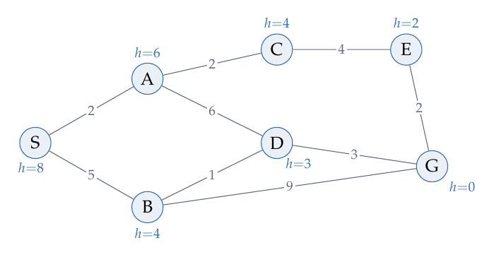

<details><summary>TikZ source</summary>

```latex
\begin{tikzpicture}[font=\small,x=1.55cm,y=1.05cm,every node/.style={circle,draw=accent,fill=accent!10,inner sep=1.4pt,minimum size=16pt}]
\node (S) at (0,0) {S}; \node (A) at (1.3,1.1) {A}; \node (B) at (1.3,-1.1) {B};
\node (C) at (2.8,1.6) {C}; \node (D) at (2.8,0) {D}; \node (E) at (4.3,1.6) {E}; \node (G) at (4.6,-0.4) {G};
\begin{scope}[every node/.style={font=\scriptsize,fill=white,inner sep=1pt}]
\draw[ink!70] (S)--node{2}(A) (S)--node{5}(B) (A)--node{2}(C) (A)--node{6}(D) (B)--node{1}(D)
  (C)--node{4}(E) (D)--node{3}(G) (E)--node{2}(G) (B)--node{9}(G);
\end{scope}
\begin{scope}[every node/.style={font=\scriptsize,text=accent}]
\node at (-0.05,-0.42) {$h{=}8$}; \node at (1.3,1.55) {$h{=}6$}; \node at (1.3,-1.55) {$h{=}4$};
\node at (2.8,2.05) {$h{=}4$}; \node at (3.05,-0.35) {$h{=}3$}; \node at (4.3,2.05) {$h{=}2$}; \node at (4.95,-0.75) {$h{=}0$};
\end{scope}
\end{tikzpicture}
```
</details>


### Q25.11
*MCQ · 1 mark · Tracing Uninformed Search · uses `Day25-ctx1`, `Day25-ctx2`*

The BFS expansion order on $\mathcal H$ is

- **(A)** S, A, B, C, D, E, G
- **(B)** S, A, B, C, D, G
- **(C)** S, A, C, E, G
- **(D)** S, B, G

**Answer:** B  (solution header: (B))

**Solution:**

Expand S (add A, B), A (add C, D), B (add G; D already generated), C (add E), D, G. E is generated but never expanded.


### Q25.12
*NAT · 1 mark · Tracing Uninformed Search · uses `Day25-ctx1`, `Day25-ctx2`*

The cost of the path returned by BFS on $\mathcal H$ is ____.

**Answer:** 14

**Solution:**

BFS reaches G from B: path S--B--G, cost $5+9$.


### Q25.13
*MCQ · 1 mark · Tracing Uninformed Search · uses `Day25-ctx1`, `Day25-ctx2`*

The DFS expansion order on $\mathcal H$ is

- **(A)** S, A, C, D, G
- **(B)** S, A, D, G
- **(C)** S, A, C, E, G
- **(D)** S, B, D, G

**Answer:** C  (solution header: (C))

**Solution:**

S, then A (first alphabetically), then C, then E, then G.


### Q25.14
*NAT · 1 mark · Tracing Uninformed Search · uses `Day25-ctx1`, `Day25-ctx2`*

The cost of the path returned by DFS on $\mathcal H$ is ____.

**Answer:** 10

**Solution:**

$2+2+4+2$.


### Q25.15
*MCQ · 2 marks · Tracing Uninformed Search · uses `Day25-ctx1`, `Day25-ctx2`*

The uniform-cost search expansion order on $\mathcal H$ is

- **(A)** S, A, C, B, D, E, G
- **(B)** S, A, B, C, D, E, G
- **(C)** S, A, C, B, D, G
- **(D)** S, A, C, E, B, D, G

**Answer:** A  (solution header: (A))

**Solution:**

$g$ values when expanded: S 0, A 2, C 4, B 5, D 6, E 8, G 9.


### Q25.16
*NAT · 1 mark · Tracing Uninformed Search · uses `Day25-ctx1`, `Day25-ctx2`*

The cost of the path returned by uniform-cost search on $\mathcal H$ is ____.

**Answer:** 9

**Solution:**

S--B--D--G $=5+1+3$. The alternatives are S--A--C--E--G $=10$ and S--A--D--G $=11$.


### Q25.17
*NAT · 1 mark · Tracing Uninformed Search · uses `Day25-ctx1`, `Day25-ctx2`*

In uniform-cost search on $\mathcal H$, D is first placed on the frontier with some path cost and later improved. Its path cost when it is expanded is ____.

**Answer:** 6

**Solution:**

Expanding A puts D on the frontier with $g=2+6=8$; expanding B (at $g=5$) lowers it to $5+1=6$.


### Q25.18
*MCQ · 1 mark · Tracing Uninformed Search · uses `Day25-ctx1`, `Day25-ctx2`*

Iterative deepening (tree search along simple paths, successors alphabetical) on $\mathcal H$ finds the goal first in the iteration with limit $\ell$ and returns the path

- **(A)** $\ell=2$; S, B, G
- **(B)** $\ell=3$; S, B, D, G
- **(C)** $\ell=4$; S, A, C, E, G
- **(D)** $\ell=3$; S, A, D, G

**Answer:** A  (solution header: (A))

**Solution:**

Limit 0 and limit 1 fail (G is not adjacent to S). With limit 2, the search tries S--A--C and S--A--D, then S--B--D and S--B--G, and finds G.


### Q25.19
*MSQ · 2 marks · Tracing Uninformed Search · uses `Day25-ctx1`, `Day25-ctx2`*

Comparing the three paths returned on $\mathcal H$ by BFS, DFS and uniform-cost search, which are correct?

- **(A)** The BFS path has the fewest edges
- **(B)** The BFS path is the cheapest
- **(C)** The uniform-cost path is the cheapest
- **(D)** The DFS path has the most edges

**Answer:** A, C, D  (solution header: (A), (C), (D))

**Solution:**

Edges: BFS 2, UCS 3, DFS 4. Costs: BFS 14, UCS 9 (optimal), DFS 10.


### Q25.20
*NAT · 1 mark · Tracing Uninformed Search · uses `Day25-ctx1`, `Day25-ctx2`*

The number of states expanded by uniform-cost search on $\mathcal H$, including the goal, is ____.

**Answer:** 7

**Solution:**

All seven states (see Q25.15).


### Q25.21
*MSQ · 1 mark · Heuristics · uses `Day25-ctx1`, `Day25-ctx2`*

$h_1$ and $h_2$ are admissible. Which are always admissible?

- **(A)** $\max(h_1,h_2)$
- **(B)** $h_1+h_2$
- **(C)** $\frac{h_1+h_2}2$
- **(D)** $|h_1-h_2|$

**Answer:** A, C, D  (solution header: (A), (C), (D))

**Solution:**

Each of $\max$, the average and $|h_1-h_2|\le\max(h_1,h_2)$ is at most $h^*$. (B) ✗ the sum can exceed $h^*$. (PYQ 2024: $|h_1-h_2|$.)


### Q25.22
*MCQ · 1 mark · Heuristics · uses `Day25-ctx1`, `Day25-ctx2`*

$h_1$ and $h_2$ are admissible and $h_2(n)\ge h_1(n)$ for every $n$. Compared with A* using $h_1$, A* using $h_2$

- **(A)** may return a more expensive path
- **(B)** always expands exactly the same nodes
- **(C)** is no longer guaranteed to terminate
- **(D)** never expands more nodes (ignoring ties)

**Answer:** D  (solution header: (D))

**Solution:**

A* expands every node with $f<C^*$, i.e.\ $h(n)<C^*-g(n)$; a larger admissible $h$ satisfies this for fewer nodes.


### Q25.23
*MCQ · 1 mark · Heuristics · uses `Day25-ctx1`, `Day25-ctx2`*

The 8-puzzle state $\begin{smallmatrix}2&8&3\\1&6&4\\7&\square&5\end{smallmatrix}$ has goal $\begin{smallmatrix}1&2&3\\8&\square&4\\7&6&5\end{smallmatrix}$. The number of misplaced tiles $h_1$ and the total Manhattan distance $h_2$ (blank not counted) are

- **(A)** 4 and 5
- **(B)** 5 and 5
- **(C)** 4 and 6
- **(D)** 5 and 6

**Answer:** A  (solution header: (A) 4 and 5)

**Solution:**

Misplaced: 2, 8, 1, 6 (3, 4, 7, 5 are in place). Manhattan: 2 is 1 away, 8 is 2 away (corner to middle-left), 1 is 1 away, 6 is 1 away: total 5.


### Q25.24
*MSQ · 1 mark · Heuristics · uses `Day25-ctx1`, `Day25-ctx2`*

For $h$ on $\mathcal H$, which are correct?

- **(A)** $h$ is admissible
- **(B)** $h$ is consistent
- **(C)** $h(\text{S})=h^*(\text{S})$
- **(D)** greedy best-first with $h$ returns an optimal path

**Answer:** A, B  (solution header: (A), (B))

**Solution:**

$h^*$: S 9, A 8, B 4, C 6, D 3, E 2; $h\le h^*$ everywhere. Consistency holds on all 9 edges in both directions (e.g.\ $h(\text{S})=8\le2+h(\text{A})$, $h(\text{A})=6\le2+h(\text{C})$). (C) ✗ $8<9$. (D) ✗ greedy returns S--B--G, cost 14.


### Q25.25
*MCQ · 1 mark · Heuristics · uses `Day25-ctx1`, `Day25-ctx2`*

Graph $\mathcal J$ is undirected with edges S--A (1), S--B (1), A--C (3), B--C (1), C--G (3), and $h(\text{S})=0$, $h(\text{A})=1$, $h(\text{B})=4$, $h(\text{C})=0$, $h(\text{G})=0$. Which state violates consistency?

- **(A)** S
- **(B)** A
- **(C)** B
- **(D)** C

**Answer:** C  (solution header: (C) B)

**Solution:**

$h(\text{B})=4>c(\text{B},\text{C})+h(\text{C})=1$. B is still admissible: $h^*(\text{B})=4$.


### Q25.26
*MCQ · 2 marks · Heuristics · uses `Day25-ctx1`, `Day25-ctx2`*

In $\mathcal H$, keep all other $h$ values fixed and change only $h(\text{B})$. The set of values of $h(\text{B})$ for which $h$ stays consistent is

- **(A)** $[2,4]$
- **(B)** $[3,4]$
- **(C)** $[0,4]$
- **(D)** $[3,9]$

**Answer:** B  (solution header: (B))

**Solution:**

Constraints on $h(\text{B})$ from its edges: $h(\text{B})\le1+h(\text{D})=4$ and $\le9+0$; and from the other end of each edge: $h(\text{S})=8\le5+h(\text{B})$ gives $h(\text{B})\ge3$, $h(\text{D})=3\le1+h(\text{B})$ gives $\ge2$.
Trap: forgetting the reverse direction of an undirected edge gives $[0,4]$.


### Q25.27
*MSQ · 1 mark · Heuristics · uses `Day25-ctx1`, `Day25-ctx2`*

Which are correct (with $h(\text{goal})=0$)?

- **(A)** Every consistent heuristic is admissible
- **(B)** Every admissible heuristic is consistent
- **(C)** With a consistent heuristic, $f=g+h$ never decreases along a path
- **(D)** $h\equiv0$ is consistent

**Answer:** A, C, D  (solution header: (A), (C), (D))

**Solution:**

(A) ✓ by induction along an optimal path. (B) ✗ see Q25.25. (C) ✓ $f(n')=g(n)+c+h(n')\ge g(n)+h(n)$.


### Q25.28
*MCQ · 1 mark · Heuristics · uses `Day25-ctx1`, `Day25-ctx2`*

The Manhattan-distance heuristic for the 8-puzzle is the exact cost of a relaxed problem in which

- **(A)** a tile can move to any square in one move
- **(B)** a tile can move to an adjacent square even if it is occupied
- **(C)** two tiles can swap places in one move
- **(D)** the blank can jump anywhere

**Answer:** B  (solution header: (B))

**Solution:**

Each tile then needs exactly its Manhattan distance in moves. (A) gives the misplaced-tiles heuristic.


### Q25.29
*NAT · 1 mark · Heuristics · uses `Day25-ctx1`, `Day25-ctx2`*

A* finds a solution at depth 2 after generating 13 nodes in total (including the root). The effective branching factor $b^*$, from $1+b^*+(b^*)^2=13$, is ____.

**Answer:** 3

**Solution:**

$b^2+b-12=0\Rightarrow b=3$.


### Q25.30
*MCQ · 1 mark · Heuristics · uses `Day25-ctx1`, `Day25-ctx2`*

Weighted A* expands by $f=g+w\,h$ with $w=2$ and an admissible $h$. The path it returns has cost at most

- **(A)** $2C^*$
- **(B)** $C^*$
- **(C)** $C^*+2$
- **(D)** $C^{*2}$

**Answer:** A  (solution header: (A))

**Solution:**

Weighted A* with weight $w$ is $w$-admissible: cost $\le wC^*$.


### Q25.31
*MCQ · 2 marks · Greedy and A* Search · uses `Day25-ctx1`, `Day25-ctx2`*

The A* expansion order on $\mathcal H$ with heuristic $h$ is

- **(A)** S, A, B, C, D, G
- **(B)** S, A, C, B, D, E, G
- **(C)** S, A, C, B, D, G
- **(D)** S, B, D, G

**Answer:** C  (solution header: (C))

**Solution:**

$f$ values when expanded: S $0+8$, A $2+6=8$, C $4+4=8$, B $5+4=9$, D $6+3=9$, G $9+0$. E ($f=8+2=10$) and G via B ($f=14$) are left on the frontier.
Note: A* expands 6 states versus 7 for UCS: the heuristic avoided E.


### Q25.32
*NAT · 1 mark · Greedy and A* Search · uses `Day25-ctx1`, `Day25-ctx2`*

The cost of the path returned by A* on $\mathcal H$ is ____.

**Answer:** 9

**Solution:**

S--B--D--G, optimal (consistent $h$).


### Q25.33
*NAT · 1 mark · Greedy and A* Search · uses `Day25-ctx1`, `Day25-ctx2`*

The number of states expanded by A* on $\mathcal H$, including the goal, is ____.

**Answer:** 6

**Solution:**

See Q25.31.


### Q25.34
*NAT · 1 mark · Greedy and A* Search · uses `Day25-ctx1`, `Day25-ctx2`*

Greedy best-first search (by $h$ alone) on $\mathcal H$ returns a path of cost ____.

**Answer:** 14

**Solution:**

From S: $h(\text{A})=6$, $h(\text{B})=4$, so B; from B: G ($h=0$). Path S--B--G.


### Q25.35
*NAT · 2 marks · Greedy and A* Search · uses `Day25-ctx1`, `Day25-ctx2`*

A* graph search that never reopens closed states is run on $\mathcal J$ of Q25.25 from S to G. The cost of the path it returns is ____.

**Answer:** 7

**Solution:**

Expand S ($f=0$): A ($1+1=2$), B ($1+4=5$). Expand A: C with $g=4$, $f=4$. Expand C (closed with $g=4$): G with $g=7$. Expand B ($f=5$): C is closed, so the cheaper path ($g=2$) is ignored. Expand G: cost 7, while the optimum S--B--C--G costs 5.
Note: with reopening, or with tree search, A* returns 5. Consistency guarantees the first expansion of a state is via an optimal path.


### Q25.36
*MCQ · 2 marks · Greedy and A* Search · uses `Day25-ctx1`, `Day25-ctx2`*

[FIGURE 1: figures/Q25_36_q_f1_dc8f952e.png]

A* with a priority queue is run on the directed graph above from S to G. The expansion order is

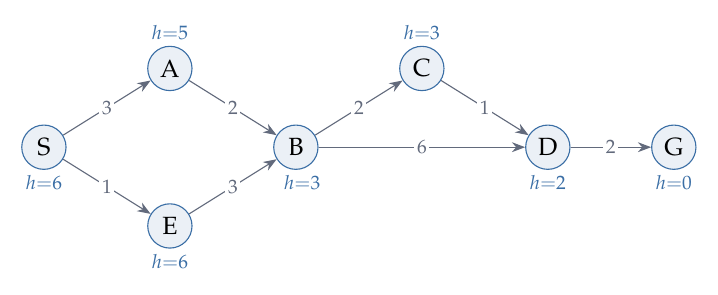

<details><summary>TikZ source</summary>

```latex
\begin{tikzpicture}[font=\small,>=Stealth,x=1.6cm,y=1cm,every node/.style={circle,draw=accent,fill=accent!10,inner sep=1.4pt,minimum size=16pt}]
\node (S) at (0,0) {S}; \node (A) at (1,1) {A}; \node (E) at (1,-1) {E}; \node (B) at (2,0) {B};
\node (C) at (3,1) {C}; \node (D) at (4,0) {D}; \node (G) at (5,0) {G};
\begin{scope}[every node/.style={font=\scriptsize,fill=white,inner sep=1pt}]
\draw[->,ink!70] (S)--node{3}(A); \draw[->,ink!70] (S)--node{1}(E); \draw[->,ink!70] (A)--node{2}(B);
\draw[->,ink!70] (E)--node{3}(B); \draw[->,ink!70] (B)--node{2}(C); \draw[->,ink!70] (B)--node{6}(D);
\draw[->,ink!70] (C)--node{1}(D); \draw[->,ink!70] (D)--node{2}(G);
\end{scope}
\begin{scope}[every node/.style={font=\scriptsize,text=accent}]
\node at (0,-0.45) {$h{=}6$}; \node at (1,1.45) {$h{=}5$}; \node at (1,-1.45) {$h{=}6$}; \node at (2.05,-0.45) {$h{=}3$};
\node at (3,1.45) {$h{=}3$}; \node at (4,-0.45) {$h{=}2$}; \node at (5,-0.45) {$h{=}0$};
\end{scope}
\end{tikzpicture}
```
</details>

- **(A)** S, A, E, B, C, D, G
- **(B)** S, E, A, B, C, D, G
- **(C)** S, E, B, A, C, D, G
- **(D)** S, E, B, C, D, G

**Answer:** C  (solution header: (C))

**Solution:**

$f$ values: S $0+6$, E $1+6=7$, B via E $4+3=7$, A $3+5=8$, C $6+3=9$, D via C $7+2=9$, G $9$. A is expanded (with $f=8$) before C, even though it does not lie on the solution.
Trap: (D) omits A; (B) is the UCS order. (PYQ 2025 pattern.)


### Q25.37
*NAT · 1 mark · Greedy and A* Search · uses `Day25-ctx1`, `Day25-ctx2`*

In Q25.36, the $f$-value of G when it is expanded is ____.

**Answer:** 9

**Solution:**

$f=g=9$ at the goal, since $h(\text{G})=0$.


### Q25.38
*MCQ · 1 mark · Greedy and A* Search · uses `Day25-ctx1`, `Day25-ctx2`*

A* with $h\equiv0$ is the same algorithm as

- **(A)** greedy best-first search
- **(B)** breadth-first search
- **(C)** depth-first search
- **(D)** uniform-cost search

**Answer:** D  (solution header: (D))

**Solution:**

$f=g$.


### Q25.39
*MCQ · 1 mark · Greedy and A* Search · uses `Day25-ctx1`, `Day25-ctx2`*

The main practical limitation of A*, which IDA* and SMA* address, is

- **(A)** it is incomplete
- **(B)** it keeps every generated node in memory
- **(C)** it is not optimal with admissible heuristics
- **(D)** it cannot handle non-unit step costs

**Answer:** B  (solution header: (B))

**Solution:**

A* stores all generated nodes ($O(b^d)$); IDA* uses iterative $f$-limits with linear memory.


### Q25.40
*MSQ · 2 marks · Greedy and A* Search · uses `Day25-ctx1`, `Day25-ctx2`*

Which are correct?

- **(A)** A* tree search is optimal with any admissible heuristic
- **(B)** A* graph search without reopening is optimal with any consistent heuristic
- **(C)** Greedy best-first search is optimal with any admissible heuristic
- **(D)** With $h=h^*$ and no ties, A* expands only states on an optimal path

**Answer:** A, B, D  (solution header: (A), (B), (D))

**Solution:**

(C) ✗ see Q25.34. (D) ✓ every state off an optimal path has $f>C^*$.


## Day 26: Adversarial Search


> **Shared context `Day26-ctx3`**

\textbf{Conventions.} Levels alternate starting with the player at the root. Children are visited left to right. Alpha--beta prunes when $\alpha\ge\beta$ (cut on equality). ``Pruned leaves'' are leaves never evaluated. Strategies at a node are numbered $1,2,\dots$ from the left.


> **Shared context `Day26-ctx4`**

\\
{Tree $\mathcal T_1$: MAX ($\triangle$) at the root, three MIN ($\triangledown$) nodes, utilities at the leaves.}

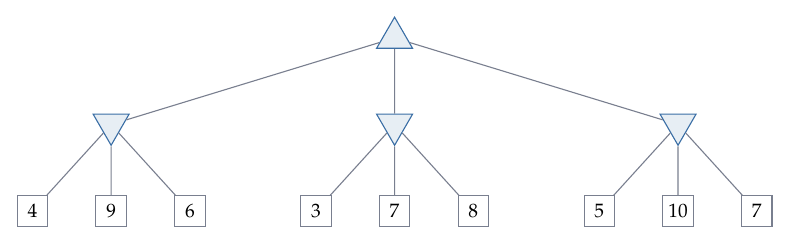

<details><summary>TikZ source</summary>

```latex
\begin{tikzpicture}[font=\small,level distance=11mm,
  level 1/.style={sibling distance=36mm},level 2/.style={sibling distance=10mm},edge from parent/.style={draw=ink!60}]
\node[mx]{}
  child{node[mn]{} child{node[lf]{4}} child{node[lf]{9}} child{node[lf]{6}}}
  child{node[mn]{} child{node[lf]{3}} child{node[lf]{7}} child{node[lf]{8}}}
  child{node[mn]{} child{node[lf]{5}} child{node[lf]{10}} child{node[lf]{7}}};
\end{tikzpicture}
```
</details>


### Q26.01
*NAT · 1 mark · Minimax · uses `Day26-ctx3`, `Day26-ctx4`*

The minimax value of the root of $\mathcal T_1$ is ____.

**Answer:** 5

**Solution:**

MIN values: $\min(4,9,6)=4$, $\min(3,7,8)=3$, $\min(5,10,7)=5$; root $\max=5$.


### Q26.02
*NAT · 1 mark · Minimax · uses `Day26-ctx3`, `Day26-ctx4`*

In $\mathcal T_1$, MAX's optimal strategy at the root (numbered from the left) is ____.

**Answer:** 3

**Solution:**

The third MIN node has the largest value. (PYQ 2026 asked for the strategy number in exactly this way.)


### Q26.03
*NAT · 1 mark · Minimax · uses `Day26-ctx3`, `Day26-ctx4`*

In a two-ply game MIN moves first and has three moves; MAX then has two replies to each, with utilities (to MAX) $(3,8)$, $(6,2)$, $(5,9)$. The minimax value of the game is ____.

**Answer:** 6

**Solution:**

MAX replies give $\max(3,8)=8$, $\max(6,2)=6$, $\max(5,9)=9$; MIN picks 6.


### Q26.04
*NAT · 1 mark · Minimax · uses `Day26-ctx3`, `Day26-ctx4`*

A complete game tree has branching factor 3 and depth 4 (the root is at depth 0). Its total number of nodes is ____.

**Answer:** 121

**Solution:**

$1+3+9+27+81=\frac{3^5-1}{2}$.


### Q26.05
*MSQ · 1 mark · Minimax · uses `Day26-ctx3`, `Day26-ctx4`*

Which are correct for minimax search (depth-first) on a finite tree with branching factor $b$ and depth $m$?

- **(A)** It plays optimally against an optimal opponent
- **(B)** Against a suboptimal MIN, MAX's minimax strategy still guarantees at least the minimax value
- **(C)** Its time complexity is $O(b^m)$
- **(D)** Its space complexity is $O(b^m)$

**Answer:** A, B, C  (solution header: (A), (B), (C))

**Solution:**

(D) ✗ depth-first minimax stores one path with siblings: $O(bm)$.


### Q26.06
*MCQ · 1 mark · Minimax · uses `Day26-ctx3`, `Day26-ctx4`*

In a two-player zero-sum game,

- **(A)** both players always receive 0 at the end
- **(B)** the game always ends in a draw under optimal play
- **(C)** MIN maximises MAX's utility
- **(D)** the utilities of the two players sum to the same constant in every terminal state

**Answer:** D  (solution header: (D))

**Solution:**

Constant-sum (zero-sum) utilities make one player's gain the other's loss, so a single utility (MAX's) describes the game.


### Q26.07
*MSQ · 2 marks · Minimax · uses `Day26-ctx3`, `Day26-ctx4`*

Every leaf utility $u$ of a deterministic game tree is replaced by $f(u)$. For which $f$ is MAX's minimax decision at the root guaranteed to be unchanged?

- **(A)** $f(u)=3u+7$
- **(B)** any strictly increasing $f$
- **(C)** $f(u)=-u$
- **(D)** $f(u)=u^2$ (utilities may be negative)

**Answer:** A, B  (solution header: (A), (B))

**Solution:**

Minimax only compares values, so any strictly increasing $f$ preserves every max and min choice. $-u$ reverses them; $u^2$ is not monotone when utilities are negative.


### Q26.08
*NAT · 2 marks · Minimax · uses `Day26-ctx3`, `Day26-ctx4`*

In $\mathcal T_1$, suppose MIN picks each of its moves uniformly at random. MAX's best expected utility is ____\ (round to 2 decimals).

[FIGURE 1: figures/Q26_08_q_f1_8c066a57.png]
\\
{Tree $\mathcal T_3$: MAX, MIN, MAX, then leaves.}

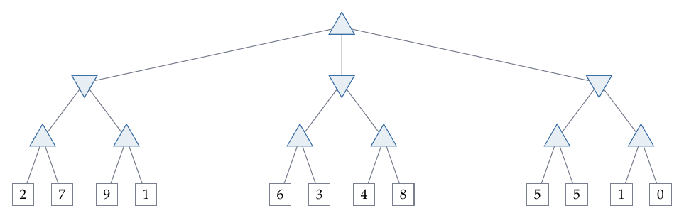

<details><summary>TikZ source</summary>

```latex
\begin{tikzpicture}[font=\small,level distance=10mm,
  level 1/.style={sibling distance=46mm},level 2/.style={sibling distance=15mm},level 3/.style={sibling distance=7mm},edge from parent/.style={draw=ink!60}]
\node[mx]{}
  child{node[mn]{} child{node[mx]{} child{node[lf]{2}} child{node[lf]{7}}} child{node[mx]{} child{node[lf]{9}} child{node[lf]{1}}}}
  child{node[mn]{} child{node[mx]{} child{node[lf]{6}} child{node[lf]{3}}} child{node[mx]{} child{node[lf]{4}} child{node[lf]{8}}}}
  child{node[mn]{} child{node[mx]{} child{node[lf]{5}} child{node[lf]{5}}} child{node[mx]{} child{node[lf]{1}} child{node[lf]{0}}}};
\end{tikzpicture}
```
</details>

**Answer:** 7.33

**Solution:**

Averages of the MIN nodes: $\frac{19}3=6.33$, $\frac{18}3=6$, $\frac{22}3=7.33$. MAX picks the third, the same move as minimax here (that need not happen in general).


### Q26.09
*NAT · 1 mark · Minimax · uses `Day26-ctx3`, `Day26-ctx4`*

The minimax value of the root of $\mathcal T_3$ is ____.

**Answer:** 7

**Solution:**

MAX level: $\max(2,7)=7$, $\max(9,1)=9$, $\max(6,3)=6$, $\max(4,8)=8$, $\max(5,5)=5$, $\max(1,0)=1$. MIN level: $\min(7,9)=7$, $\min(6,8)=6$, $\min(5,1)=1$. Root: 7.


### Q26.10
*MCQ · 1 mark · Minimax · uses `Day26-ctx3`, `Day26-ctx4`*

The principal variation of $\mathcal T_3$ (MAX's move, MIN's reply, MAX's reply, by strategy number) is

- **(A)** 1, 1, 2
- **(B)** 1, 2, 1
- **(C)** 2, 2, 2
- **(D)** 3, 1, 1

**Answer:** A  (solution header: (A))

**Solution:**

MAX moves to the first MIN node (7); MIN replies 1 (value 7, not 9); MAX then picks the second leaf (7).


### Q26.11
*MCQ · 1 mark · Alpha--Beta Pruning · uses `Day26-ctx3`, `Day26-ctx4`*

In alpha--beta pruning, $\alpha$ is the \underline{\ (m)\ } value found so far at any choice point along the path for MAX, and $\beta$ is the \underline{\ (n)\ } value found so far along the path for MIN. Then

- **(A)** (m) highest, (n) highest
- **(B)** (m) lowest, (n) highest
- **(C)** (m) lowest, (n) lowest
- **(D)** (m) highest, (n) lowest

**Answer:** D  (solution header: (D))

**Solution:**

$\alpha$ is the best (highest) value MAX can already guarantee; $\beta$ is the best (lowest) value MIN can already guarantee. (PYQ 2024.)


### Q26.12
*NAT · 1 mark · Alpha--Beta Pruning · uses `Day26-ctx3`, `Day26-ctx4`*

The number of leaves of $\mathcal T_1$ pruned by alpha--beta is ____.

**Answer:** 2

**Solution:**

First MIN node: 4, 9, 6 are all evaluated (values above $\alpha=-\infty$); value 4, so $\alpha=4$. Second MIN node: the first leaf 3 gives $v=3\le\alpha$, so 7 and 8 are pruned. Third MIN node: 5, 10, 7 are all evaluated ($5>4$, and $v$ stays above 4).


### Q26.13
*MCQ · 1 mark · Alpha--Beta Pruning · uses `Day26-ctx3`, `Day26-ctx4`*

In $\mathcal T_1$ the pruned leaves are

- **(A)** 9 and 6 under the first MIN node
- **(B)** 7 and 8 under the second MIN node
- **(C)** 10 and 7 under the third MIN node
- **(D)** 8 only

**Answer:** B  (solution header: (B))

**Solution:**

See Q26.12.


### Q26.14
*MCQ · 2 marks · Alpha--Beta Pruning · uses `Day26-ctx3`, `Day26-ctx4`*

Tree-1: a MAX root with MIN children $B_1$ (leaves $6,4$) and $B_2$ (leaves $x,9$). Tree-2: a MIN root with MAX children $C_1$ (leaves $3,7$) and $C_2$ (leaves $y,2$). For which $x$ and $y$ are the leaf 9 of Tree-1 and the leaf 2 of Tree-2 both pruned?

- **(A)** $x\in(-\infty,6]$, $y\in[3,\infty)$
- **(B)** $x\in[4,\infty)$, $y\in(-\infty,7]$
- **(C)** $x\in(-\infty,4]$, $y\in[7,\infty)$
- **(D)** $x\in(-\infty,4]$, $y\in(-\infty,3]$

**Answer:** C  (solution header: (C))

**Solution:**

Tree-1: after $B_1=4$, $\alpha=4$ at the root; in $B_2$, if $x\le4$ then $v\le\alpha$ and 9 is pruned. Tree-2: after $C_1=7$, $\beta=7$ at the root; in $C_2$, if $y\ge7$ then $v\ge\beta$ and 2 is pruned.
Note: PYQ 2025 had the same two-tree structure with different numbers.


### Q26.15
*NAT · 2 marks · Alpha--Beta Pruning · uses `Day26-ctx3`, `Day26-ctx4`*

[FIGURE 1: figures/Q26_15_q_f1_d165b8db.png]

For this tree $\mathcal T_2$, the number of leaves pruned by alpha--beta is ____.

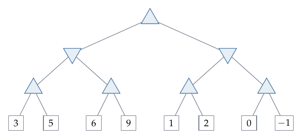

<details><summary>TikZ source</summary>

```latex
\begin{tikzpicture}[font=\small,level distance=9mm,
  level 1/.style={sibling distance=40mm},level 2/.style={sibling distance=20mm},level 3/.style={sibling distance=9mm},edge from parent/.style={draw=ink!60}]
\node[mx]{}
  child{node[mn]{} child{node[mx]{} child{node[lf]{3}} child{node[lf]{5}}} child{node[mx]{} child{node[lf]{6}} child{node[lf]{9}}}}
  child{node[mn]{} child{node[mx]{} child{node[lf]{1}} child{node[lf]{2}}} child{node[mx]{} child{node[lf]{0}} child{node[lf]{$-1$}}}};
\end{tikzpicture}
```
</details>

**Answer:** 3

**Solution:**

Left MIN: its first MAX child gives $\max(3,5)=5$, so $\beta=5$; the second MAX child sees 6 $\ge\beta$, so 9 is pruned. Left MIN $=5$ and root $\alpha=5$. Right MIN: its first MAX child gives $\max(1,2)=2\le\alpha$, so the whole second MAX child (0 and $-1$) is pruned. Total 3.


### Q26.16
*NAT · 2 marks · Alpha--Beta Pruning · uses `Day26-ctx3`, `Day26-ctx4`*

The order of the children of every node of $\mathcal T_2$ is reversed (so the leaves read $-1,0,2,1,9,6,5,3$). The number of leaves pruned is ____.

**Answer:** 1

**Solution:**

Left MIN: its first MAX child $(-1,0)$ gives 0, so $\beta=0$; its second MAX child sees 2 $\ge\beta$, so the leaf 1 is pruned. Left MIN $=0$ and root $\alpha=0$.
Right MIN: MAX$(9,6)=9$ sets $\beta=9$; MAX$(5,3)$ evaluates both leaves (5 and 3 are below $\beta$), value 5. Right MIN $=5$; root 5. One leaf pruned.
Note: a poor ordering prunes less (1 leaf versus 3); the root value is unchanged.


### Q26.17
*NAT · 2 marks · Alpha--Beta Pruning · uses `Day26-ctx3`, `Day26-ctx4`*

The number of leaves of $\mathcal T_3$ pruned by alpha--beta is ____.

**Answer:** 5

**Solution:**

MIN$_1$: MAX$(2,7)=7$, $\beta=7$; MAX child two sees 9 $\ge7$, so 1 is pruned. MIN$_1=7$ and $\alpha=7$.
MIN$_2$: MAX$(6,3)=6\le\alpha$, so the whole MAX$(4,8)$ is pruned (2 leaves).
MIN$_3$: MAX$(5,5)=5\le\alpha$, so MAX$(1,0)$ is pruned (2 leaves). Total $1+2+2$.


### Q26.18
*NAT · 2 marks · Alpha--Beta Pruning · uses `Day26-ctx3`, `Day26-ctx4`*

During alpha--beta on $\mathcal T_3$, the value returned to the root by the third MIN node is ____.

**Answer:** 5

**Solution:**

MIN$_3$ returns its first child's value 5 as soon as it falls to $\alpha=7$ or below. Its true minimax value is $\min(5,1)=1$: after a cutoff only the bound ``$\le5$'' is meaningful.


### Q26.19
*MCQ · 1 mark · Alpha--Beta Pruning · uses `Day26-ctx3`, `Day26-ctx4`*

Compared with plain minimax, alpha--beta always

- **(A)** returns the same value at the root
- **(B)** returns the same value at every node
- **(C)** evaluates at most half the leaves
- **(D)** needs an evaluation function

**Answer:** A  (solution header: (A))

**Solution:**

Pruned branches cannot influence the root decision. Interior values can differ (Q26.18); the number of leaves evaluated varies with ordering.


### Q26.20
*NAT · 1 mark · Alpha--Beta Pruning · uses `Day26-ctx3`, `Day26-ctx4`*

With perfect move ordering, alpha--beta on a uniform tree of branching factor $b=2$ and depth $d=6$ evaluates $b^{\lceil d/2\rceil}+b^{\lfloor d/2\rfloor}-1$ leaves, which is ____.

**Answer:** 15

**Solution:**

$2^3+2^3-1$ out of $2^6=64$ leaves.


### Q26.21
*NAT · 1 mark · Alpha--Beta Pruning · uses `Day26-ctx3`, `Day26-ctx4`*

Using the same formula, with $b=30$ and $d=4$, perfectly ordered alpha--beta evaluates ____\ leaves (minimax evaluates 810\,000).

**Answer:** 1799

**Solution:**

$30^2+30^2-1$, versus $30^4=810000$.


### Q26.22
*NAT · 2 marks · Alpha--Beta Pruning · uses `Day26-ctx3`, `Day26-ctx4`*

The MIN children of the root of $\mathcal T_1$ are reordered so that the one with the highest value comes first (leaves $5,10,7\mid4,9,6\mid3,7,8$). The number of leaves pruned is ____.

**Answer:** 4

**Solution:**

First MIN node: 5, 10, 7, value 5, so $\alpha=5$. Second: 4 $\le5$, pruning 9 and 6. Third: 3 $\le5$, pruning 7 and 8. Total 4 (versus 2 with the original order).


### Q26.23
*MSQ · 1 mark · Alpha--Beta Pruning · uses `Day26-ctx3`, `Day26-ctx4`*

Which are correct?

- **(A)** The amount of pruning depends on the order in which children are examined
- **(B)** Values returned by interior nodes after a cutoff may be only bounds, not exact minimax values
- **(C)** With perfect ordering, alpha--beta can search about twice as deep as minimax in the same time
- **(D)** Alpha--beta can prune below chance nodes without any bounds on the utilities

**Answer:** A, B, C  (solution header: (A), (B), (C))

**Solution:**

(D) ✗ an expectation can be changed by any unseen child unless utilities are bounded.


### Q26.24
*MCQ · 1 mark · Alpha--Beta Pruning · uses `Day26-ctx3`, `Day26-ctx4`*

At a MIN node, the remaining children are pruned as soon as the node's current value $v$ satisfies

- **(A)** $v\ge\beta$
- **(B)** $v\le\alpha$
- **(C)** $v\le\beta$
- **(D)** $v\ge\alpha$

**Answer:** B  (solution header: (B))

**Solution:**

MAX above already has an alternative worth $\alpha$; a MIN node worth at most $v\le\alpha$ will never be chosen. Dually, a MAX node cuts when $v\ge\beta$.


### Q26.25
*MCQ · 1 mark · Alpha--Beta Pruning · uses `Day26-ctx3`, `Day26-ctx4`*

With perfect ordering, the effective branching factor of alpha--beta is about

- **(A)** $b$
- **(B)** $b/2$
- **(C)** $\sqrt b$
- **(D)** $\log b$

**Answer:** C  (solution header: (C))

**Solution:**

$b^{m/2}$ leaves $=(\sqrt b)^m$.


### Q26.26
*NAT · 1 mark · Expectimax and Chance Nodes · uses `Day26-ctx3`, `Day26-ctx4`*

MAX chooses among three actions, each leading to a chance node: $a_1$: 10 w.p. 0.5, 0 w.p. 0.5; $a_2$: 20 w.p. 0.25, 2 w.p. 0.75; $a_3$: 6 w.p. 0.8, 4 w.p. 0.2. The expectimax value at the root is ____.

**Answer:** 6.5

**Solution:**

$a_1$: $5$; $a_2$: $0.25\cdot20+0.75\cdot2=6.5$; $a_3$: $0.8\cdot6+0.2\cdot4=5.6$.


### Q26.27
*MCQ · 1 mark · Expectimax and Chance Nodes · uses `Day26-ctx3`, `Day26-ctx4`*

In Q26.26, expectimax chooses

- **(A)** $a_1$
- **(B)** $a_2$
- **(C)** $a_3$
- **(D)** a tie between $a_2$ and $a_3$

**Answer:** B  (solution header: (B))

**Solution:**

Highest expected value.


### Q26.28
*MCQ · 1 mark · Expectimax and Chance Nodes · uses `Day26-ctx3`, `Day26-ctx4`*

In Q26.26, if each chance node is replaced by a MIN node over the same outcomes, minimax chooses

- **(A)** $a_1$
- **(B)** $a_2$
- **(C)** $a_3$
- **(D)** a tie between $a_1$ and $a_2$

**Answer:** C  (solution header: (C))

**Solution:**

Worst cases: $a_1$ 0, $a_2$ 2, $a_3$ 4. Minimax is pessimistic and picks $a_3$.


### Q26.29
*MCQ · 2 marks · Expectimax and Chance Nodes · uses `Day26-ctx3`, `Day26-ctx4`*

In Q26.26, every utility $u$ is replaced by $\sqrt u$ (a strictly increasing transformation). Expectimax now chooses

- **(A)** $a_1$
- **(B)** $a_2$
- **(C)** $a_3$
- **(D)** the same action as before, necessarily

**Answer:** C  (solution header: (C))

**Solution:**

$a_1$: $0.5\sqrt{10}=1.581$; $a_2$: $0.25\sqrt{20}+0.75\sqrt2=1.118+1.061=2.179$; $a_3$: $0.8\sqrt6+0.2\cdot2=1.960+0.4=2.360$.
Note: expectimax is sensitive to the magnitudes of utilities (risk attitude), not only their order.


### Q26.30
*NAT · 1 mark · Expectimax and Chance Nodes · uses `Day26-ctx3`, `Day26-ctx4`*

MAX chooses between a sure utility of 4 and a gamble paying 10 with probability $p$ and 0 otherwise. Expectimax prefers the gamble exactly when $p$ exceeds ____.

**Answer:** 0.4

**Solution:**

$10p>4$.


### Q26.31
*NAT · 2 marks · Expectimax and Chance Nodes · uses `Day26-ctx3`, `Day26-ctx4`*

MAX has actions $a_1,a_2$. Each leads to a fair coin flip, after which MIN chooses between two leaves: $a_1$: heads $\{3,9\}$, tails $\{8,4\}$; $a_2$: heads $\{6,2\}$, tails $\{7,9\}$. The expectiminimax value at the root is ____.

**Answer:** 4.5

**Solution:**

$a_1$: $0.5\min(3,9)+0.5\min(8,4)=0.5\cdot3+0.5\cdot4=3.5$. $a_2$: $0.5\cdot2+0.5\cdot7=4.5$.


### Q26.32
*MCQ · 1 mark · Expectimax and Chance Nodes · uses `Day26-ctx3`, `Day26-ctx4`*

In Q26.31, MAX chooses

- **(A)** $a_1$
- **(B)** $a_2$
- **(C)** either (tie)
- **(D)** cannot be decided

**Answer:** B  (solution header: (B))

**Solution:**

$4.5>3.5$.


### Q26.33
*MSQ · 1 mark · Expectimax and Chance Nodes · uses `Day26-ctx3`, `Day26-ctx4`*

Which are correct?

- **(A)** Without bounds on utilities, the children of a chance node cannot be pruned
- **(B)** If all utilities lie in a known interval, some pruning below chance nodes is possible
- **(C)** Expectimax decisions are unchanged by a positive affine transformation of utilities
- **(D)** Expectimax decisions are unchanged by every strictly increasing transformation of utilities

**Answer:** A, B, C  (solution header: (A), (B), (C))

**Solution:**

(D) ✗ see Q26.29.


### Q26.34
*NAT · 1 mark · Expectimax and Chance Nodes · uses `Day26-ctx3`, `Day26-ctx4`*

A chance node rolls a fair six-sided die and the utility equals the square of the face. Its expected value is ____\ (round to 2 decimals).

**Answer:** 15.17

**Solution:**

$\frac{1+4+9+16+25+36}{6}=\frac{91}6$.


### Q26.35
*NAT · 1 mark · Depth-Limited Games and Evaluation · uses `Day26-ctx3`, `Day26-ctx4`*

A depth-limited search scores a cutoff state by $\mathrm{Eval}=3m+0.5\,b-2t$ (material $m$, mobility $b$, threats $t$). For $m=2$, $b=6$, $t=1$, Eval is ____.

**Answer:** 7

**Solution:**

$3\cdot2+0.5\cdot6-2\cdot1$.


### Q26.36
*MCQ · 1 mark · Depth-Limited Games and Evaluation · uses `Day26-ctx3`, `Day26-ctx4`*

The \emph{horizon effect} in depth-limited game search is

- **(A)** delaying an unavoidable bad event beyond the search depth so that it looks avoided
- **(B)** the inability to evaluate terminal states
- **(C)** running out of memory at the deepest level
- **(D)** pruning a move that would have been best

**Answer:** A  (solution header: (A))

**Solution:**

E.g.\ sacrificing pieces to push an inevitable loss beyond the depth limit.


### Q26.37
*MCQ · 1 mark · Depth-Limited Games and Evaluation · uses `Day26-ctx3`, `Day26-ctx4`*

Quiescence search

- **(A)** stops the search as soon as a capture is possible
- **(B)** removes the evaluation function entirely
- **(C)** replaces alpha--beta with minimax at the leaves
- **(D)** extends the search at non-quiet positions (e.g.\ pending captures) before applying the evaluation function

**Answer:** D  (solution header: (D))

**Solution:**

Evaluate only quiet positions, where the evaluation function is reliable.


### Q26.38
*NAT · 2 marks · Depth-Limited Games and Evaluation · uses `Day26-ctx3`, `Day26-ctx4`*

A program can evaluate about $10^6$ leaves per move with branching factor 10. Using about $b^{d/2}$ leaves for perfectly ordered alpha--beta, the depth it can search is ____\ (minimax reaches depth 6).

**Answer:** 12

**Solution:**

$10^{d/2}=10^6\Rightarrow d=12$, twice the minimax depth.


### Q26.39
*MCQ · 1 mark · Depth-Limited Games and Evaluation · uses `Day26-ctx3`, `Day26-ctx4`*

Game programs use iterative deepening mainly because it

- **(A)** guarantees optimal play in chess
- **(B)** removes the need for an evaluation function
- **(C)** gives a move whenever time runs out and improves move ordering for alpha--beta
- **(D)** uses less memory than depth-first search

**Answer:** C  (solution header: (C))

**Solution:**

The previous iteration's best move is searched first, which improves pruning; a move is always available when time runs out.


### Q26.40
*MSQ · 1 mark · Depth-Limited Games and Evaluation · uses `Day26-ctx3`, `Day26-ctx4`*

Which are correct?

- **(A)** Chess is deterministic with perfect information
- **(B)** Backgammon needs chance nodes
- **(C)** Poker is a perfect-information game
- **(D)** Tic-tac-toe is a draw under optimal play

**Answer:** A, B, D  (solution header: (A), (B), (D))

**Solution:**

(C) ✗ cards are hidden: imperfect information.


## Day 27: Propositional and First-Order Logic


### Q27.01
*MCQ · 1 mark · Equivalence, Validity, Satisfiability*

Which pair is logically equivalent?

- **(A)** $p\Rightarrow q$ and $\neg q\Rightarrow\neg p$
- **(B)** $p\Rightarrow q$ and $q\Rightarrow p$
- **(C)** $\neg(p\wedge q)$ and $\neg p\wedge\neg q$
- **(D)** $p\Rightarrow(q\Rightarrow r)$ and $(p\Rightarrow q)\Rightarrow r$

**Answer:** A  (solution header: (A))

**Solution:**

Contrapositive equivalence. (B) is the converse, (C) is a wrong De Morgan ($\neg(p\wedge q)\equiv\neg p\vee\neg q$), and (D) fails at $p=q=r=$ false: left true, right false.
Note: PYQ 2025: $p\to q\equiv\neg p\vee q$.


### Q27.02
*MSQ · 1 mark · Equivalence, Validity, Satisfiability*

Which are tautologies?

- **(A)** $(\neg x\wedge y)\Rightarrow(x\Rightarrow y)$
- **(B)** $(x\wedge\neg y)\Rightarrow(x\Rightarrow y)$
- **(C)** $(x\Rightarrow y)\vee(y\Rightarrow x)$
- **(D)** $(x\Rightarrow y)\Rightarrow(\neg x\Rightarrow\neg y)$

**Answer:** A, C  (solution header: (A), (C))

**Solution:**

(A) the antecedent forces $x$ false, so $x\Rightarrow y$ is true. (B) $x=1,y=0$: antecedent true, consequent false. (C) one of the two implications is always true. (D) $x=0,y=1$ falsifies it (inverse error).
Note: PYQ 2024 asked for tautologies among four formulas of exactly this shape.


### Q27.03
*NAT · 1 mark · Equivalence, Validity, Satisfiability*

The number of the 8 assignments to $p,q,r$ that make $(p\vee q)\Rightarrow r$ true is ____.

**Answer:** 5

**Solution:**

False only when $p\vee q$ is true and $r$ is false: 3 rows. $8-3$.


### Q27.04
*NAT · 1 mark · Equivalence, Validity, Satisfiability*

The number of models of $(p\Leftrightarrow q)\wedge(q\vee r)$ over $p,q,r$ is ____.

**Answer:** 3

**Solution:**

$p=q$; then $q\vee r$: $(1,1,0),(1,1,1),(0,0,1)$.


### Q27.05
*MCQ · 1 mark · Equivalence, Validity, Satisfiability*

$\neg(p\Rightarrow q)$ is equivalent to

- **(A)** $\neg p\Rightarrow\neg q$
- **(B)** $\neg p\wedge q$
- **(C)** $p\wedge\neg q$
- **(D)** $\neg p\vee q$

**Answer:** C  (solution header: (C))

**Solution:**

$\neg(\neg p\vee q)=p\wedge\neg q$.


### Q27.06
*NAT · 1 mark · Equivalence, Validity, Satisfiability*

The number of satisfying assignments of $x_1\oplus x_2\oplus x_3\oplus x_4$ is ____.

**Answer:** 8

**Solution:**

Odd parity: half of the 16 assignments.


### Q27.07
*MCQ · 1 mark · Equivalence, Validity, Satisfiability*

The contrapositive of ``if it rains, the match is cancelled'' is

- **(A)** if the match is cancelled, it rained
- **(B)** if it does not rain, the match is not cancelled
- **(C)** it rains and the match is not cancelled
- **(D)** if the match is not cancelled, it did not rain

**Answer:** D  (solution header: (D))

**Solution:**

$p\Rightarrow q$ becomes $\neg q\Rightarrow\neg p$. (A) is the converse, (B) the inverse, (C) the negation.


### Q27.08
*MCQ · 1 mark · Equivalence, Validity, Satisfiability*

$(p\wedge q)\vee(p\wedge\neg q)\vee(\neg p\wedge\neg q)$ simplifies to

- **(A)** $p$
- **(B)** $q\Rightarrow p$
- **(C)** $p\vee q$
- **(D)** $\neg q$

**Answer:** B  (solution header: (B))

**Solution:**

The first two terms give $p$; then $p\vee(\neg p\wedge\neg q)=p\vee\neg q=q\Rightarrow p$.


### Q27.09
*MSQ · 1 mark · Equivalence, Validity, Satisfiability*

Which connective sets are functionally complete?

- **(A)** $\{\uparrow\}$ (NAND)
- **(B)** $\{\neg,\wedge\}$
- **(C)** $\{\wedge,\vee\}$
- **(D)** $\{\Rightarrow,\neg\}$

**Answer:** A, B, D  (solution header: (A), (B), (D))

**Solution:**

$\{\wedge,\vee\}$ cannot express $\neg$ (every formula is monotone, true when all inputs are true). $\{\Rightarrow,\neg\}$: $p\vee q\equiv\neg p\Rightarrow q$.


### Q27.10
*MSQ · 1 mark · Equivalence, Validity, Satisfiability*

Which are correct?

- **(A)** A sentence is valid iff its negation is unsatisfiable
- **(B)** Every satisfiable sentence is valid
- **(C)** A contradiction is unsatisfiable
- **(D)** Every valid sentence is satisfiable

**Answer:** A, C, D  (solution header: (A), (C), (D))

**Solution:**

(B) ✗ e.g.\ $p$ is satisfiable but not valid.


### Q27.11
*MSQ · 1 mark · Entailment and Inference*

Sentence $X$ entails sentence $Y$ ($X\models Y$). Which are correct?

- **(A)** $X\Rightarrow Y$ is valid
- **(B)** $X\wedge\neg Y$ is unsatisfiable
- **(C)** every model of $X$ is a model of $Y$
- **(D)** $Y\models X$

**Answer:** A, B, C  (solution header: (A), (B), (C))

**Solution:**

All three are definitions of entailment. (D) ✗ entailment is not symmetric. (PYQ 2026.)


### Q27.12
*MCQ · 2 marks · Entailment and Inference*

$KB=\{p\Rightarrow q,\ q\Rightarrow r,\ p\vee s,\ \neg s\}$. Which sentence is entailed by $KB$?

- **(A)** $\neg p$
- **(B)** $s$
- **(C)** $r$
- **(D)** $\neg r$

**Answer:** C  (solution header: (C) $r$)

**Solution:**

$\neg s$ and $p\vee s$ give $p$; then $q$, then $r$. The only model is $p,q,r$ true, $s$ false.


### Q27.13
*NAT · 1 mark · Entailment and Inference*

The number of models of $(p\vee q)\wedge(\neg p\vee r)$ over $p,q,r$ is ____.

**Answer:** 4

**Solution:**

$p=1$: need $r=1$, $q$ free (2). $p=0$: need $q=1$, $r$ free (2).


### Q27.14
*MCQ · 1 mark · Entailment and Inference*

Resolving the clauses $p\vee q$ and $\neg p\vee r$ gives

- **(A)** $q\wedge r$
- **(B)** $p\vee r$
- **(C)** $q\vee r$
- **(D)** the empty clause

**Answer:** C  (solution header: (C))

**Solution:**

Cancel the complementary pair $p,\neg p$ and join the rest.


### Q27.15
*MSQ · 1 mark · Entailment and Inference*

Which inference patterns are sound?

- **(A)** from $\alpha\Rightarrow\beta$ and $\alpha$, infer $\beta$
- **(B)** from $\alpha\Rightarrow\beta$ and $\neg\beta$, infer $\neg\alpha$
- **(C)** from $\alpha\Rightarrow\beta$ and $\beta$, infer $\alpha$
- **(D)** from $\alpha\vee\beta$ and $\neg\beta\vee\gamma$, infer $\alpha\vee\gamma$

**Answer:** A, B, D  (solution header: (A), (B), (D))

**Solution:**

Modus ponens, modus tollens, resolution. (C) is affirming the consequent.


### Q27.16
*NAT · 1 mark · Entailment and Inference*

The number of models of $(a\Rightarrow b)\wedge(b\Rightarrow c)\wedge(c\Rightarrow d)$ over $a,b,c,d$ is ____.

**Answer:** 5

**Solution:**

The implications force $a\le b\le c\le d$: $0000,0001,0011,0111,1111$.


### Q27.17
*MCQ · 1 mark · Entailment and Inference*

Propositional entailment is monotonic. This means

- **(A)** if $KB\models\alpha$ then $KB\wedge\beta\models\alpha$ for every $\beta$
- **(B)** if $KB\models\alpha$ then $\alpha\models KB$
- **(C)** adding sentences can make an entailed sentence false
- **(D)** every KB entails every sentence

**Answer:** A  (solution header: (A))

**Solution:**

More premises can only shrink the set of models, so everything entailed stays entailed.


### Q27.18
*MCQ · 1 mark · Entailment and Inference*

The deduction theorem states that $KB\models(\alpha\Rightarrow\beta)$ if and only if

- **(A)** $KB\wedge\beta\models\alpha$
- **(B)** $KB\models\alpha$ and $KB\models\beta$
- **(C)** $KB\models\neg\alpha$
- **(D)** $KB\wedge\alpha\models\beta$

**Answer:** D  (solution header: (D))

**Solution:**

Proof by assuming $\alpha$.


### Q27.19
*MCQ · 1 mark · Entailment and Inference*

Which clause set is unsatisfiable?

- **(A)** $\{p\vee q,\ \neg p\vee q,\ p\vee\neg q\}$
- **(B)** $\{p\vee q,\ \neg p\vee q,\ p\vee\neg q,\ \neg p\vee\neg q\}$
- **(C)** $\{p,\ \neg p\vee q\}$
- **(D)** $\{\neg p\vee\neg q,\ p\vee q\}$

**Answer:** B  (solution header: (B))

**Solution:**

All four clauses over $p,q$ together exclude every assignment. (A) has the model $p=q=1$.


### Q27.20
*NAT · 1 mark · Entailment and Inference*

The number of satisfying assignments of $(a\vee b)\wedge(\neg a\vee c)\wedge(\neg b\vee\neg c)$ is ____.

**Answer:** 2

**Solution:**

$a=1$: $c=1$, so $b=0$: $(1,0,1)$. $a=0$: $b=1$, so $c=0$: $(0,1,0)$.


### Q27.21
*MCQ · 1 mark · CNF, Resolution, Horn Clauses*

A CNF form of $p\Leftrightarrow q$ is

- **(A)** $(p\vee q)\wedge(\neg p\vee\neg q)$
- **(B)** $(p\wedge q)\vee(\neg p\wedge\neg q)$
- **(C)** $(\neg p\vee q)\wedge(p\vee\neg q)$
- **(D)** $(\neg p\vee\neg q)\wedge(p\vee q)\wedge p$

**Answer:** C  (solution header: (C))

**Solution:**

$(p\Rightarrow q)\wedge(q\Rightarrow p)$. (B) is the DNF; (A) is $p\oplus q$.


### Q27.22
*NAT · 1 mark · CNF, Resolution, Horn Clauses*

Converting $(a\wedge b)\vee(c\wedge d)$ to CNF by distributing $\vee$ over $\wedge$ gives ____\ clauses.

**Answer:** 4

**Solution:**

$(a\vee c)(a\vee d)(b\vee c)(b\vee d)$.


### Q27.23
*NAT · 1 mark · CNF, Resolution, Horn Clauses*

Converting $(a_1\wedge b_1)\vee(a_2\wedge b_2)\vee(a_3\wedge b_3)$ to CNF by distribution (no simplification) gives ____\ clauses.

**Answer:** 8

**Solution:**

One literal from each conjunction: $2^3$ clauses. Distribution can blow up exponentially; Tseitin encoding avoids this.


### Q27.24
*NAT · 2 marks · CNF, Resolution, Horn Clauses*

To prove $r$ from $\{\neg p\vee q,\ \neg q\vee r,\ p\}$, add $\neg r$ and resolve, each step using the newest clause with one clause of the set. The number of resolution steps until the empty clause is ____.

**Answer:** 3

**Solution:**

$\neg r$ with $\neg q\vee r$ gives $\neg q$; with $\neg p\vee q$ gives $\neg p$; with $p$ gives $\square$.


### Q27.25
*MSQ · 1 mark · CNF, Resolution, Horn Clauses*

Which are Horn clauses (at most one positive literal)?

- **(A)** $\neg a\vee\neg b\vee c$
- **(B)** $a$
- **(C)** $\neg a\vee b\vee c$
- **(D)** $\neg a\vee\neg b$

**Answer:** A, B, D  (solution header: (A), (B), (D))

**Solution:**

(C) has two positive literals. (D) is a goal (negative) clause.


### Q27.26
*NAT · 2 marks · CNF, Resolution, Horn Clauses*

Rules $a\wedge b\Rightarrow c$, $c\Rightarrow d$, $b\wedge d\Rightarrow e$, $e\wedge a\Rightarrow f$, $g\Rightarrow h$ and facts $a$, $b$ are given. Forward chaining derives ____\ new facts.

**Answer:** 4

**Solution:**

$c$ (from $a,b$), $d$, $e$ (from $b,d$), $f$ (from $e,a$). $h$ is not derived since $g$ is unknown.


### Q27.27
*MSQ · 1 mark · CNF, Resolution, Horn Clauses*

Which are correct?

- **(A)** Resolution is refutation-complete for propositional logic
- **(B)** Forward chaining is sound and complete for Horn knowledge bases
- **(C)** Every propositional sentence has an equivalent CNF
- **(D)** Conversion to CNF by distribution always gives a formula of polynomial size

**Answer:** A, B, C  (solution header: (A), (B), (C))

**Solution:**

(D) ✗ see Q27.23.


### Q27.28
*MCQ · 1 mark · CNF, Resolution, Horn Clauses*

During resolution, a clause that contains both $p$ and $\neg p$

- **(A)** is always true and can be discarded
- **(B)** makes the clause set unsatisfiable
- **(C)** must be resolved first
- **(D)** is the empty clause

**Answer:** A  (solution header: (A))

**Solution:**

$p\vee\neg p\vee\cdots$ is valid and adds no constraint.


### Q27.29
*MSQ · 2 marks · First-Order Logic*

Consider $s_1$: $\forall x\,\neg Absent(x)\Rightarrow Pass(x)$; $s_2$: $\forall x\,\neg Pass(x)\Rightarrow Absent(x)$; $s_3$: $\forall x\,Absent(x)\Rightarrow\neg Pass(x)$; $s_4$: $\forall x\,Pass(x)\Rightarrow\neg Absent(x)$. Which represent ``every student passes except those who are absent'' (domain: students)?

- **(A)** $s_1\wedge s_3$
- **(B)** $s_1\wedge s_2$
- **(C)** $s_2\wedge s_3$
- **(D)** $s_3\wedge s_4$

**Answer:** A, C  (solution header: (A), (C))

**Solution:**

``Except'' means: not absent $\Rightarrow$ pass, and absent $\Rightarrow$ not pass. $s_2$ is the contrapositive of $s_1$ and $s_4$ of $s_3$, so (A) and (C) both say both directions; (B) and (D) state only one. (PYQ 2024 rugby-ball pattern.)


### Q27.30
*MCQ · 1 mark · First-Order Logic*

$\neg\forall x\,\exists y\,P(x,y)$ is equivalent to

- **(A)** $\exists x\,\forall y\,\neg P(x,y)$
- **(B)** $\forall x\,\exists y\,\neg P(x,y)$
- **(C)** $\exists x\,\exists y\,\neg P(x,y)$
- **(D)** $\forall x\,\forall y\,\neg P(x,y)$

**Answer:** A  (solution header: (A))

**Solution:**

Push $\neg$ inwards, flipping each quantifier.


### Q27.31
*MSQ · 2 marks · First-Order Logic*

Over non-empty domains, which sentences are \emph{not} valid?

- **(A)** $\forall x\,P(x)\Rightarrow\exists x\,P(x)$
- **(B)** $\exists x\,\forall y\,R(x,y)\Rightarrow\forall y\,\exists x\,R(x,y)$
- **(C)** $\forall y\,\exists x\,R(x,y)\Rightarrow\exists x\,\forall y\,R(x,y)$
- **(D)** $\exists x\,P(x)\wedge\exists x\,Q(x)\Rightarrow\exists x\,(P(x)\wedge Q(x))$

**Answer:** C, D  (solution header: (C), (D))

**Solution:**

(C) ``everyone is loved by someone'' does not give ``someone loves everyone''. (D) $P$ and $Q$ may hold of different elements. (A) and (B) are valid. (PYQ 2026 asked which are not valid.)


### Q27.32
*MCQ · 1 mark · First-Order Logic*

``Every student who studies passes'' is

- **(A)** $\forall x\,(Student(x)\wedge Studies(x)\wedge Passes(x))$
- **(B)** $\forall x\,(Student(x)\wedge Studies(x)\Rightarrow Passes(x))$
- **(C)** $\exists x\,(Student(x)\wedge Studies(x)\Rightarrow Passes(x))$
- **(D)** $\forall x\,Student(x)\Rightarrow\forall x\,(Studies(x)\wedge Passes(x))$

**Answer:** B  (solution header: (B))

**Solution:**

Universal with implication. (A) claims everything is a student.


### Q27.33
*MCQ · 1 mark · First-Order Logic*

``Some student failed'' is

- **(A)** $\exists x\,(Student(x)\Rightarrow Failed(x))$
- **(B)** $\forall x\,(Student(x)\wedge Failed(x))$
- **(C)** $\exists x\,Student(x)\vee Failed(x)$
- **(D)** $\exists x\,(Student(x)\wedge Failed(x))$

**Answer:** D  (solution header: (D))

**Solution:**

Existential with conjunction. (A) is true as soon as any non-student exists.
Shortcut: $\forall$ pairs with $\Rightarrow$, $\exists$ pairs with $\wedge$.


### Q27.34
*MSQ · 2 marks · First-Order Logic*

On the domain $\{1,2,3,4\}$, $R(x,y)$ means ``$x$ divides $y$''. Which sentences are true?

- **(A)** $\forall x\,\exists y\,R(x,y)$
- **(B)** $\exists x\,\forall y\,R(x,y)$
- **(C)** $\forall y\,\exists x\,(x\ne y\wedge R(x,y))$
- **(D)** $\exists y\,\forall x\,R(x,y)$

**Answer:** A, B  (solution header: (A), (B))

**Solution:**

(A) $y=x$. (B) $x=1$ divides all. (C) fails for $y=1$ (only 1 divides 1). (D) no $y\le4$ is divisible by 1, 2, 3 and 4.


### Q27.35
*MCQ · 1 mark · First-Order Logic*

The most general unifier of $Knows(John,x)$ and $Knows(y,Mother(y))$ is

- **(A)** $\{x/Mother(y)\}$
- **(B)** $\{y/John,\ x/John\}$
- **(C)** the terms do not unify
- **(D)** $\{y/John,\ x/Mother(John)\}$

**Answer:** D  (solution header: (D))

**Solution:**

$y\mapsto John$, then $x\mapsto Mother(John)$.


### Q27.36
*MSQ · 2 marks · First-Order Logic*

Which pairs fail to unify (with the occurs check; $A,B$ are distinct constants)?

- **(A)** $P(x,x)$ and $P(A,B)$
- **(B)** $P(x,f(x))$ and $P(y,y)$
- **(C)** $Q(x,A)$ and $Q(B,y)$
- **(D)** $R(f(x),x)$ and $R(f(A),A)$

**Answer:** A, B  (solution header: (A), (B))

**Solution:**

(A) $x$ cannot be both $A$ and $B$. (B) $y=x$ and $x=f(x)$ fails the occurs check. (C) $\{x/B,y/A\}$. (D) $\{x/A\}$.


### Q27.37
*MCQ · 1 mark · First-Order Logic*

Skolemising $\forall x\,\exists y\,Loves(x,y)$ gives

- **(A)** $\forall x\,Loves(x,C)$ for a new constant $C$
- **(B)** $Loves(C,D)$
- **(C)** $\forall x\,Loves(x,F(x))$ for a new function $F$
- **(D)** $\exists y\,Loves(F(y),y)$

**Answer:** C  (solution header: (C))

**Solution:**

$y$ depends on $x$, so it becomes $F(x)$. A constant is used only when no universal quantifier precedes the $\exists$.


### Q27.38
*NAT · 1 mark · First-Order Logic*

The number of \emph{free} variable occurrences in $\Big(\forall x\,\big(P(x,y)\Rightarrow\exists y\,Q(y,z)\big)\Big)\vee R(x)$ is ____.

**Answer:** 3

**Solution:**

$y$ in $P(x,y)$ (the inner $\exists y$ does not cover it), $z$ in $Q$, and $x$ in $R(x)$ (outside the scope of $\forall x$).


### Q27.39
*MCQ · 1 mark · First-Order Logic*

For $\alpha=\forall x\,\exists y\,Loves(x,y)$ and $\beta=\exists y\,\forall x\,Loves(x,y)$,

- **(A)** $\alpha\models\beta$ but not conversely
- **(B)** $\beta\models\alpha$ but not conversely
- **(C)** they are equivalent
- **(D)** neither entails the other

**Answer:** B  (solution header: (B))

**Solution:**

One $y$ loved by everyone gives each $x$ someone to love; not conversely.


### Q27.40
*MSQ · 1 mark · First-Order Logic*

Which are correct?

- **(A)** ``Each king is a person'' is $\forall x\,(King(x)\Rightarrow Person(x))$
- **(B)** ``Each king is a person'' is $\forall x\,(King(x)\wedge Person(x))$
- **(C)** $\forall x\,Likes(x,IceCream)$ is equivalent to $\neg\exists x\,\neg Likes(x,IceCream)$
- **(D)** $\forall x\,\forall y\,(Sibling(x,y)\Rightarrow Sibling(y,x))$ states that $Sibling$ is symmetric

**Answer:** A, C, D  (solution header: (A), (C), (D))

**Solution:**

(B) says everything is a king and a person. (PYQ 2026 asked for the statement that is NOT true.)


## Day 28: Reasoning under Uncertainty


> **Shared context `Day28-ctx5`**

\\
{Network $\mathcal N$ (cloudy, sprinkler, rain, wet)}

\begin{tabular}{@{}ll@{}}
$P(+c)=0.5$ & \\
$P(+s\mid+c)=0.1$ & $P(+s\mid\neg c)=0.5$\\
$P(+r\mid+c)=0.8$ & $P(+r\mid\neg c)=0.2$\\
$P(+w\mid+s,+r)=0.99$ & $P(+w\mid+s,\neg r)=0.9$\\
$P(+w\mid\neg s,+r)=0.9$ & $P(+w\mid\neg s,\neg r)=0$
\end{tabular}

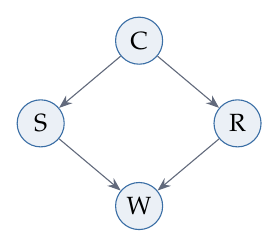

<details><summary>TikZ source</summary>

```latex
\begin{tikzpicture}[font=\small,>=Stealth,x=1.25cm,y=1.05cm,every node/.style={circle,draw=accent,fill=accent!10,inner sep=1pt,minimum size=17pt}]
\node (C) at (1,2) {C}; \node (S) at (0,1) {S}; \node (R) at (2,1) {R}; \node (W) at (1,0) {W};
\draw[->,ink!70] (C)--(S); \draw[->,ink!70] (C)--(R); \draw[->,ink!70] (S)--(W); \draw[->,ink!70] (R)--(W);
\end{tikzpicture}
```
</details>


### Q28.01
*NAT · 1 mark · Bayesian Network Representation · uses `Day28-ctx5`*

In $\mathcal N$, $P(+c,\neg s,+r,+w)$ is ____\ (round to 3 decimals).

**Answer:** 0.324

**Solution:**

$P(+c)P(\neg s\mid+c)P(+r\mid+c)P(+w\mid\neg s,+r)=0.5\cdot0.9\cdot0.8\cdot0.9$.


### Q28.02
*NAT · 1 mark · Bayesian Network Representation · uses `Day28-ctx5`*

The number of independent parameters in the CPTs of $\mathcal N$ is ____\ (a full joint over 4 Boolean variables needs 15).

**Answer:** 9

**Solution:**

C: 1; S: 2; R: 2; W: 4 (one per parent configuration).


### Q28.03
*NAT · 1 mark · Bayesian Network Representation · uses `Day28-ctx5`*

The number of independent numbers needed to specify an arbitrary joint distribution of 10 Boolean variables is ____.

**Answer:** 1023

**Solution:**

$2^{10}-1$ (probabilities must sum to 1).


### Q28.04
*NAT · 1 mark · Bayesian Network Representation · uses `Day28-ctx5`*

A Bayesian network over 10 Boolean variables has at most 2 parents per node. The maximum number of independent CPT parameters is ____.

**Answer:** 35

**Solution:**

In a topological order the first node has no parent and the second at most one; the other 8 can have 2. Maximum $1+2+8\cdot4$.
Trap: $10\cdot4=40$ ignores acyclicity.


### Q28.05
*MCQ · 2 marks · Bayesian Network Representation · uses `Day28-ctx5`*

A joint distribution factorises as $P(A)\,P(B)\,P(C\mid A)\,P(D\mid B,C)\,P(E\mid D)$. Which statement is \emph{false}?

- **(A)** $A\perp\!\!\!\perp B$
- **(B)** $A\perp\!\!\!\perp E\mid D$
- **(C)** $A\perp\!\!\!\perp B\mid D$
- **(D)** $C\perp\!\!\!\perp E\mid D$

**Answer:** C  (solution header: (C))

**Solution:**

The graph is $A\to C\to D\leftarrow B$, $D\to E$. Given $D$, the collider at $D$ opens the path $A\to C\to D\leftarrow B$. (A) unobserved collider blocks; (B), (D) are chains blocked at $D$. (PYQ 2024 asked the same question with $U,V\to W\to X,Y$.)


### Q28.06
*MSQ · 1 mark · Bayesian Network Representation · uses `Day28-ctx5`*

In $\mathcal N$, which independences hold?

- **(A)** $S\perp\!\!\!\perp R\mid C$
- **(B)** $S\perp\!\!\!\perp R\mid C,W$
- **(C)** $C\perp\!\!\!\perp W\mid S,R$
- **(D)** $S\perp\!\!\!\perp R$

**Answer:** A, C  (solution header: (A), (C))

**Solution:**

(A) the fork at C is blocked. (B) observing the collider W opens $S\to W\leftarrow R$. (C) every path from C to W passes through S or R in a chain. (D) the fork at C is open.


### Q28.07
*MCQ · 1 mark · Bayesian Network Representation · uses `Day28-ctx5`*

A Bayesian network represents the joint distribution as

- **(A)** $\prod_iP(X_i)$
- **(B)** $\prod_iP(X_i\mid X_1,\dots,X_{i-1})$ with no simplification
- **(C)** $\sum_iP(X_i\mid\mathrm{Pa}(X_i))$
- **(D)** $\prod_iP(X_i\mid\mathrm{Pa}(X_i))$

**Answer:** D  (solution header: (D))

**Solution:**

Chain rule plus the local Markov property (each node is independent of its non-descendants given its parents).


### Q28.08
*NAT · 1 mark · Bayesian Network Representation · uses `Day28-ctx5`*

In $\mathcal N$, $P(+c\mid+r)$ is ____.

**Answer:** 0.8

**Solution:**

$P(+r)=0.5\cdot0.8+0.5\cdot0.2=0.5$; $\frac{0.4}{0.5}$.


### Q28.09
*NAT · 2 marks · Bayesian Network Representation · uses `Day28-ctx5`*

Boolean variables $U,V,W,Z$ form a network with $P(U{=}1)=0.6$; $P(V{=}1\mid U{=}0)=0.3$, $P(V{=}1\mid U{=}1)=0.7$; $P(W{=}1\mid U{=}0)=0.2$, $P(W{=}1\mid U{=}1)=0.9$; and $P(Z{=}1\mid V,W)=0.1,0.5,0.4,0.8$ for $(V,W)=(0,0),(0,1),(1,0),(1,1)$. The value of $P(U{=}1,V{=}1,W{=}1,Z{=}1)$ is ____\ (round to 4 decimals).

**Answer:** 0.3024

**Solution:**

$0.6\cdot0.7\cdot0.9\cdot0.8$. (PYQ 2024: the same product with that network's CPTs.)


### Q28.10
*MCQ · 1 mark · Bayesian Network Representation · uses `Day28-ctx5`*

Building a network by adding variables in a \emph{non-causal} order (effects before causes) usually

- **(A)** gives a network with more edges and larger CPTs
- **(B)** gives the same network as the causal order
- **(C)** makes the network cyclic
- **(D)** makes some conditional probabilities undefined

**Answer:** A  (solution header: (A))

**Solution:**

E.g.\ adding Mary and John before Alarm forces extra arcs: diagnostic orderings need more edges and larger CPTs.


> **Shared context `Day28-ctx6`**

\\
{DAG $\mathcal G$, used in 28.2.}

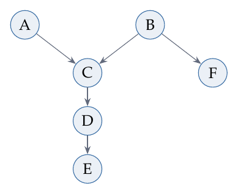

<details><summary>TikZ source</summary>

```latex
\begin{tikzpicture}[font=\small,>=Stealth,x=1.3cm,y=1cm,every node/.style={circle,draw=accent,fill=accent!10,inner sep=1pt,minimum size=17pt}]
\node (A) at (0,1) {A}; \node (B) at (2,1) {B}; \node (C) at (1,0) {C}; \node (D) at (1,-1) {D}; \node (E) at (1,-2) {E}; \node (F) at (3,0) {F};
\draw[->,ink!70] (A)--(C); \draw[->,ink!70] (B)--(C); \draw[->,ink!70] (C)--(D); \draw[->,ink!70] (D)--(E); \draw[->,ink!70] (B)--(F);
\end{tikzpicture}
```
</details>


### Q28.11
*MSQ · 2 marks · Conditional Independence and d-Separation · uses `Day28-ctx5`, `Day28-ctx6`*

In $\mathcal G$, which hold?

- **(A)** $A\perp\!\!\!\perp B$
- **(B)** $A\perp\!\!\!\perp B\mid C$
- **(C)** $A\perp\!\!\!\perp B\mid E$
- **(D)** $A\perp\!\!\!\perp F$

**Answer:** A, D  (solution header: (A), (D))

**Solution:**

(A) the only path $A\to C\leftarrow B$ has an unobserved collider. (B) observing C opens it. (C) E is a descendant of C, so observing it also opens it. (D) the path $A\to C\leftarrow B\to F$ is blocked at C.


### Q28.12
*MSQ · 2 marks · Conditional Independence and d-Separation · uses `Day28-ctx5`, `Day28-ctx6`*

In $\mathcal G$, which hold?

- **(A)** $A\perp\!\!\!\perp F\mid D$
- **(B)** $E\perp\!\!\!\perp F\mid C$
- **(C)** $A\perp\!\!\!\perp E\mid D$
- **(D)** $D\perp\!\!\!\perp F$

**Answer:** B, C  (solution header: (B), (C))

**Solution:**

(A) D is a descendant of the collider C, so $A\to C\leftarrow B\to F$ opens. (B) $E\leftarrow D\leftarrow C\leftarrow B\to F$ is blocked at the observed chain node C. (C) $A\to C\to D\to E$ is blocked at D. (D) $D\leftarrow C\leftarrow B\to F$ is open.


### Q28.13
*NAT · 2 marks · Conditional Independence and d-Separation · uses `Day28-ctx5`, `Day28-ctx6`*

The number of unordered pairs of distinct nodes of $\mathcal G$ that are marginally independent (d-separated given the empty set) is ____.

**Answer:** 2

**Solution:**

Only $\{A,B\}$ and $\{A,F\}$: every path out of A goes through the collider C to reach B or F; every other pair is connected by a collider-free path.


### Q28.14
*NAT · 1 mark · Conditional Independence and d-Separation · uses `Day28-ctx5`, `Day28-ctx6`*

The size of the Markov blanket of B in $\mathcal G$ is ____.

**Answer:** 3

**Solution:**

Parents (none), children C and F, co-parents of children (A for C): $\{A,C,F\}$.


### Q28.15
*NAT · 1 mark · Conditional Independence and d-Separation · uses `Day28-ctx5`, `Day28-ctx6`*

If all variables of $\mathcal G$ are Boolean, the number of independent CPT parameters is ____.

**Answer:** 12

**Solution:**

A 1, B 1, C 4, D 2, E 2, F 2.


### Q28.16
*MSQ · 1 mark · Conditional Independence and d-Separation · uses `Day28-ctx5`, `Day28-ctx6`*

For three variables, which are correct?

- **(A)** Chain $X\to Y\to Z$: $X\perp\!\!\!\perp Z\mid Y$
- **(B)** Fork $X\leftarrow Y\to Z$: $X\perp\!\!\!\perp Z\mid Y$
- **(C)** Collider $X\to Y\leftarrow Z$: $X\perp\!\!\!\perp Z\mid Y$
- **(D)** Collider $X\to Y\leftarrow Z$: $X\perp\!\!\!\perp Z$

**Answer:** A, B, D  (solution header: (A), (B), (D))

**Solution:**

(C) ✗ observing a collider makes its parents dependent (explaining away).


### Q28.17
*NAT · 2 marks · Conditional Independence and d-Separation · uses `Day28-ctx5`, `Day28-ctx6`*

In $\mathcal N$, $P(+s\mid+w)\approx0.430$. The value of $P(+s\mid+w,+r)$ is ____\ (round to 3 decimals).

**Answer:** 0.194–0.195  (solution header: 0.194)

**Solution:**

$P(+s,+r,+w)=\sum_cP(c)P(+s\mid c)P(+r\mid c)\cdot0.99=(0.5\cdot0.1\cdot0.8+0.5\cdot0.5\cdot0.2)\cdot0.99=0.0891$; $P(+r,+w)=0.4581$. Ratio $0.1945$.
Note: learning that it rained ``explains away'' the wet grass, so the sprinkler becomes less likely ($0.430\to0.194$).


### Q28.18
*MCQ · 1 mark · Conditional Independence and d-Separation · uses `Day28-ctx5`, `Day28-ctx6`*

Which structure encodes \emph{different} conditional independences from the other three?

- **(A)** $X\to Y\to Z$
- **(B)** $X\leftarrow Y\leftarrow Z$
- **(C)** $X\leftarrow Y\to Z$
- **(D)** $X\to Y\leftarrow Z$

**Answer:** D  (solution header: (D))

**Solution:**

Chains and forks give $X\perp\!\!\!\perp Z\mid Y$; the v-structure gives $X\perp\!\!\!\perp Z$ marginally instead.


### Q28.19
*MCQ · 1 mark · Conditional Independence and d-Separation · uses `Day28-ctx5`, `Day28-ctx6`*

Moralising $\mathcal G$ (for d-separation or variable elimination) adds the undirected edge

- **(A)** A--B
- **(B)** C--F
- **(C)** A--D
- **(D)** D--F

**Answer:** A  (solution header: (A))

**Solution:**

A and B are co-parents of C (``marry the parents'').


### Q28.20
*MCQ · 1 mark · Conditional Independence and d-Separation · uses `Day28-ctx5`, `Day28-ctx6`*

Given its Markov blanket, a node is conditionally independent of

- **(A)** its parents only
- **(B)** all other nodes in the network
- **(C)** its non-descendants only, and only when there is no evidence
- **(D)** its children only

**Answer:** B  (solution header: (B))

**Solution:**

Parents, children and children's other parents shield a node from everything else.


### Q28.21
*NAT · 1 mark · Exact Inference · uses `Day28-ctx5`, `Day28-ctx6`*

In $\mathcal N$, $P(+w)$ is ____\ (round to 4 decimals).

**Answer:** 0.6471

**Solution:**

$P(s,r)$: $(+,+)$: $0.5(0.1\cdot0.8)+0.5(0.5\cdot0.2)=0.09$; $(+,-)$: $0.5(0.1\cdot0.2)+0.5(0.5\cdot0.8)=0.21$; $(-,+)$: $0.5(0.9\cdot0.8)+0.5(0.5\cdot0.2)=0.41$; $(-,-)$: $0.29$.
$P(+w)=0.09\cdot0.99+0.21\cdot0.9+0.41\cdot0.9+0=0.0891+0.189+0.369$.


### Q28.22
*NAT · 2 marks · Exact Inference · uses `Day28-ctx5`, `Day28-ctx6`*

In $\mathcal N$, $P(+r\mid+w)$ is ____\ (round to 3 decimals).

**Answer:** 0.707–0.708  (solution header: 0.708)

**Solution:**

$P(+r,+w)=0.0891+0.369=0.4581$; $\frac{0.4581}{0.6471}$.


### Q28.23
*NAT · 2 marks · Exact Inference · uses `Day28-ctx5`, `Day28-ctx6`*

In $\mathcal N$, $P(+s\mid+w)$ is ____\ (round to 3 decimals).

**Answer:** 0.429–0.430  (solution header: 0.430)

**Solution:**

$P(+s,+w)=0.0891+0.189=0.2781$; $\frac{0.2781}{0.6471}$.


### Q28.24
*NAT · 2 marks · Exact Inference · uses `Day28-ctx5`, `Day28-ctx6`*

In $\mathcal N$, $P(+c\mid+w)$ is ____\ (round to 3 decimals).

**Answer:** 0.575–0.576  (solution header: 0.576)

**Solution:**

$P(+c,+w)=0.5\big(0.08\cdot0.99+0.02\cdot0.9+0.72\cdot0.9\big)=0.5\cdot0.7452=0.3726$; $\frac{0.3726}{0.6471}$.


### Q28.25
*NAT · 1 mark · Exact Inference · uses `Day28-ctx5`, `Day28-ctx6`*

To compute $P(W)$ in $\mathcal N$, variable elimination first sums out C from $P(C)P(S\mid C)P(R\mid C)$. The new factor's number of entries (all variables Boolean) is ____.

**Answer:** 4

**Solution:**

$f(S,R)=\sum_cP(c)P(S\mid c)P(R\mid c)$ has $2\times2$ entries (these are the four $P(s,r)$ values above).


### Q28.26
*MCQ · 2 marks · Exact Inference · uses `Day28-ctx5`, `Day28-ctx6`*

For a star network where $H$ is the parent of $X_1,\dots,X_n$ and the query is $P(X_1)$, eliminating $H$ \emph{first} creates a factor over

- **(A)** one variable
- **(B)** two variables
- **(C)** no variables
- **(D)** all of $X_1,\dots,X_n$, exponential in $n$

**Answer:** D  (solution header: (D))

**Solution:**

Summing out $H$ multiplies all $n$ child factors, giving a factor over $X_1,\dots,X_n$ with $2^n$ entries. Eliminating the leaves $X_2,\dots,X_n$ first (each sums to 1) keeps every factor small.


### Q28.27
*MSQ · 1 mark · Exact Inference · uses `Day28-ctx5`, `Day28-ctx6`*

Which are correct for inference in Bayesian networks?

- **(A)** Variable elimination is an exact inference algorithm
- **(B)** Gibbs sampling is an approximate inference algorithm
- **(C)** Rejection sampling is an exact inference algorithm
- **(D)** Exact inference is NP-hard in general networks

**Answer:** A, B, D  (solution header: (A), (B), (D))

**Solution:**

(C) ✗ rejection sampling is approximate (consistent as samples grow). (PYQ 2025.)


### Q28.28
*MCQ · 1 mark · Exact Inference · uses `Day28-ctx5`, `Day28-ctx6`*

To compute $P(R\mid+c)$ in $\mathcal N$, which variables can be removed before inference without changing the answer?

- **(A)** S only
- **(B)** W only
- **(C)** S and W
- **(D)** none

**Answer:** C  (solution header: (C))

**Solution:**

W is a barren node (not a query, evidence or ancestor of either): remove it. Then S becomes barren: remove it too. $P(R\mid+c)=0.8$ directly.


### Q28.29
*MCQ · 1 mark · Exact Inference · uses `Day28-ctx5`, `Day28-ctx6`*

Variable elimination runs in time linear in the size of the network (CPT sizes) when the network is

- **(A)** any DAG
- **(B)** a polytree (singly connected)
- **(C)** fully connected
- **(D)** a DAG with a cycle

**Answer:** B  (solution header: (B))

**Solution:**

In polytrees there is an elimination order with no large intermediate factors.


### Q28.30
*NAT · 1 mark · Exact Inference · uses `Day28-ctx5`, `Day28-ctx6`*

In $\mathcal N$, $P(+r)$ is ____.

**Answer:** 0.5

**Solution:**

$0.5\cdot0.8+0.5\cdot0.2$.


### Q28.31
*NAT · 1 mark · Approximate Inference by Sampling · uses `Day28-ctx5`, `Day28-ctx6`*

Rejection sampling estimates $P(R\mid+w)$ in $\mathcal N$ from prior samples. The expected fraction of samples rejected is ____\ (round to 4 decimals).

**Answer:** 0.3529

**Solution:**

Samples with $\neg w$ are rejected: $1-0.6471$.


### Q28.32
*NAT · 1 mark · Approximate Inference by Sampling · uses `Day28-ctx5`, `Day28-ctx6`*

With 10\,000 prior samples, the expected number kept in Q28.31 is ____.

**Answer:** 6471

**Solution:**

$10000\cdot P(+w)$.


### Q28.33
*NAT · 1 mark · Approximate Inference by Sampling · uses `Day28-ctx5`, `Day28-ctx6`*

Likelihood weighting for evidence $+s,+w$ in $\mathcal N$ samples $C=+c$ and then $R=+r$. The weight of this sample is ____\ (round to 3 decimals).

**Answer:** 0.099

**Solution:**

Weight $=\prod_{\text{evidence}}P(e\mid\text{parents})=P(+s\mid+c)\cdot P(+w\mid+s,+r)=0.1\cdot0.99$.


### Q28.34
*NAT · 2 marks · Approximate Inference by Sampling · uses `Day28-ctx5`, `Day28-ctx6`*

With evidence $+s,+w$, likelihood weighting draws four samples with $(C,R)=(+c,+r)$, $(\neg c,\neg r)$, $(\neg c,+r)$, $(+c,\neg r)$. The resulting estimate of $P(+r\mid+s,+w)$ is ____\ (round to 3 decimals).

**Answer:** 0.523–0.524  (solution header: 0.524)

**Solution:**

Weights: $(+c,+r)$: $0.1\cdot0.99=0.099$; $(\neg c,\neg r)$: $0.5\cdot0.9=0.45$; $(\neg c,+r)$: $0.5\cdot0.99=0.495$; $(+c,\neg r)$: $0.1\cdot0.9=0.09$.
Estimate $\frac{0.099+0.495}{1.134}=0.524$. (The exact value is $0.320$; four samples are far too few.)


### Q28.35
*NAT · 2 marks · Approximate Inference by Sampling · uses `Day28-ctx5`, `Day28-ctx6`*

A Gibbs sampler for $\mathcal N$ with evidence $\neg s,+w$ currently has $R=+r$ and resamples C. The probability of setting $C=+c$ is ____\ (round to 3 decimals).

**Answer:** 0.878

**Solution:**

$P(c\mid\neg s,+r)\propto P(c)P(\neg s\mid c)P(+r\mid c)$: $+c$: $0.5\cdot0.9\cdot0.8=0.36$; $\neg c$: $0.5\cdot0.5\cdot0.2=0.05$. $\frac{0.36}{0.41}$. W is not in C's Markov blanket.


### Q28.36
*MSQ · 1 mark · Approximate Inference by Sampling · uses `Day28-ctx5`, `Day28-ctx6`*

Which are correct?

- **(A)** Prior sampling estimates converge to the true probabilities as the number of samples grows
- **(B)** Rejection sampling wastes most samples when the evidence is unlikely
- **(C)** Likelihood weighting samples the evidence variables from their CPTs
- **(D)** Gibbs sampling is a Markov chain Monte Carlo method

**Answer:** A, B, D  (solution header: (A), (B), (D))

**Solution:**

(C) ✗ evidence variables are fixed to their observed values; only the weight uses their CPTs.


### Q28.37
*MCQ · 1 mark · Approximate Inference by Sampling · uses `Day28-ctx5`, `Day28-ctx6`*

In Gibbs sampling on a Bayesian network, each non-evidence variable is resampled from its distribution conditioned on

- **(A)** its parents only
- **(B)** all other variables, which reduces to its Markov blanket
- **(C)** the evidence only
- **(D)** its children only

**Answer:** B  (solution header: (B))

**Solution:**

$P(X\mid\text{all others})\propto P(X\mid\mathrm{Pa}(X))\prod_{Y\in\text{children}}P(Y\mid\mathrm{Pa}(Y))$.


### Q28.38
*NAT · 1 mark · Approximate Inference by Sampling · uses `Day28-ctx5`, `Day28-ctx6`*

A probability near $0.2$ is estimated as a sample proportion from 400 independent samples. Its standard error $\sqrt{p(1-p)/N}$ is ____.

**Answer:** 0.02

**Solution:**

$\sqrt{0.16/400}$. Halving the error needs 4 times as many samples.


### Q28.39
*NAT · 1 mark · Approximate Inference by Sampling · uses `Day28-ctx5`, `Day28-ctx6`*

A variable takes values $1,2,3$ with probabilities $0.2,0.5,0.3$. Inverse-CDF sampling with the uniform number $u=0.65$ returns the value ____.

**Answer:** 2

**Solution:**

Cumulative $0.2,0.7,1.0$; $0.2<0.65\le0.7$.


### Q28.40
*MCQ · 1 mark · Approximate Inference by Sampling · uses `Day28-ctx5`, `Day28-ctx6`*

Which method needs no samples to be discarded and weights each sample by the likelihood of the evidence?

- **(A)** prior sampling
- **(B)** rejection sampling
- **(C)** likelihood weighting
- **(D)** variable elimination

**Answer:** C  (solution header: (C))

**Solution:**

Likelihood weighting fixes evidence and weights samples; rejection sampling discards inconsistent samples.


# Part: Days 29-32: General Aptitude and Full Mock Sets


## Day 29: General Aptitude


### Q29.01
*MCQ · 1 mark · Verbal Ability*

If `$\to$' denotes increasing intensity, then [warm $\to$ hot $\to$ scorching] is analogous to [cool $\to$ \underline{ } $\to$ frigid].

- **(A)** tepid
- **(B)** mild
- **(C)** balmy
- **(D)** cold

**Answer:** D  (solution header: (D) cold)

**Solution:**

The scale rises in intensity: cool, cold, frigid. Tepid and balmy are warm words.


### Q29.02
*MCQ · 1 mark · Verbal Ability*

Frugal : Spendthrift :: Candid : \underline{ }

- **(A)** Honest
- **(B)** Open
- **(C)** Blunt
- **(D)** Evasive

**Answer:** D  (solution header: (D) Evasive)

**Solution:**

Antonym pairs: frugal (thrifty) versus spendthrift; candid (frank) versus evasive. (PYQ 2026: verbosity versus brevity, insolence versus respect.)


### Q29.03
*MCQ · 1 mark · Verbal Ability*

By the time we reached the station, the train \underline{ }.

- **(A)** has left
- **(B)** would leave
- **(C)** leaves
- **(D)** had left

**Answer:** D  (solution header: (D) had left)

**Solution:**

An action completed before another past action takes the past perfect.


### Q29.04
*MCQ · 1 mark · Verbal Ability*

She is good \underline{\ \ } mathematics but careless \underline{\ \ } money, so she relies \underline{\ \ } her brother.

- **(A)** at; with; on
- **(B)** in; for; at
- **(C)** at; of; at
- **(D)** with; at; on

**Answer:** A  (solution header: (A) at; with; on)

**Solution:**

Good \emph{at}, careless \emph{with} (money), rely \emph{on}.


### Q29.05
*MCQ · 1 mark · Verbal Ability*

``Had the bridge been inspected last year, the accident would have been prevented.'' Based only on this sentence, which statement is true?

- **(A)** The bridge was inspected last year.
- **(B)** The accident was prevented.
- **(C)** The bridge was not inspected last year.
- **(D)** Inspection never prevents accidents.

**Answer:** C  (solution header: (C))

**Solution:**

``Had \dots\ been \dots, would have \dots'' is a counterfactual (third conditional): the condition did not happen. (PYQ 2026.)


### Q29.06
*MCQ · 2 marks · Verbal Ability*

``Cities that added protected cycle lanes saw cycling rise sharply, while cities that only painted lanes on roads saw little change.'' Which can be inferred from this passage alone?

- **(A)** Painted lanes reduce cycling.
- **(B)** Protection from traffic appears to matter for whether people cycle.
- **(C)** Every city should ban cars.
- **(D)** Cycling rises in every city that builds any lane.

**Answer:** B  (solution header: (B))

**Solution:**

The contrast is between protected and painted lanes, so protection is what appears to matter. (A) and (D) contradict the passage; (C) goes beyond it.


### Q29.07
*MCQ · 2 marks · Verbal Ability*

\begin{tabular}{@{}l@{ }l@{}}\toprule
\textbf{Statement} & \textbf{Response}\\\midrule
P.\ We cannot hold the fair in this storm. & 1.\ I will look into it.\\
Q.\ There is an error in my electricity bill. & 2.\ You will have to make up for it.\\
R.\ They were too strong; we had no choice. & 3.\ Then let us call it off.\\
S.\ I missed two weeks of classes. & 4.\ So you gave in?\\\bottomrule
\end{tabular}

The correct matching is

- **(A)** P-3, Q-1, R-4, S-2
- **(B)** P-1, Q-3, R-2, S-4
- **(C)** P-3, Q-4, R-1, S-2
- **(D)** P-2, Q-1, R-4, S-3

**Answer:** A  (solution header: (A))

**Solution:**

Storm: call it off (P-3). Bill error: look into it (Q-1). No choice: gave in (R-4). Missed classes: make up for it (S-2). (PYQ 2025 used the same phrasal-verb matching.)


### Q29.08
*MCQ · 1 mark · Verbal Ability*

A person who endures pain or hardship without showing feelings or complaining is

- **(A)** a cynic
- **(B)** a hedonist
- **(C)** a sceptic
- **(D)** a stoic

**Answer:** D  (solution header: (D) a stoic)

**Solution:**

A cynic distrusts motives, a hedonist seeks pleasure, a sceptic doubts.


### Q29.09
*MCQ · 1 mark · Verbal Ability*

Which sentence is grammatically \emph{correct}?

- **(A)** Neither of the boys were present.
- **(B)** Each of the students have a laptop.
- **(C)** The committee has submitted its report.
- **(D)** One of my friend live in Pune.

**Answer:** C  (solution header: (C))

**Solution:**

``Neither of'' and ``each of'' take a singular verb; ``one of my friends lives''. A collective noun acting as one unit takes \emph{has} and \emph{its}.


### Q29.10
*MCQ · 2 marks · Verbal Ability*

``Data collected for one purpose is often reused for another. Even anonymised records can sometimes be re-identified when combined with other datasets. Hence consent obtained at collection may not cover every later use.'' The main point is that

- **(A)** anonymisation always protects privacy
- **(B)** data should never be collected
- **(C)** consent at collection may not be enough for later uses of data
- **(D)** combining datasets is illegal

**Answer:** C  (solution header: (C))

**Solution:**

The passage ends with its conclusion: consent at collection may not cover later uses.


### Q29.11
*MCQ · 1 mark · Quantitative Ability*

How many 4-digit positive integers divisible by 3 can be formed from the digits $\{0,1,2,4,5\}$ with no digit repeated?

- **(A)** 24
- **(B)** 36
- **(C)** 48
- **(D)** 18

**Answer:** A  (solution header: (A) 24)

**Solution:**

Digit sums of 4 chosen digits (total of all five is 12): leaving out 0 gives 12 ✓, 1 gives 11, 2 gives 10, 4 gives 8, 5 gives 7. So only $\{1,2,4,5\}$ works: $4!=24$. (Sets containing 0 are never divisible by 3 here.)
Note: PYQ 2024 used $\{1,3,4,6,7\}$: answer 72.


### Q29.12
*MCQ · 1 mark · Quantitative Ability*

The sum $1+\frac12+\frac13+\frac14+\frac19+\frac18+\frac1{27}+\frac1{16}+\frac1{81}+\cdots$ (powers of $\frac12$ and of $\frac13$ interleaved) is

- **(A)** $\frac73$
- **(B)** $3$
- **(C)** $\frac{11}4$
- **(D)** $\frac52$

**Answer:** D  (solution header: (D) $\frac52$)

**Solution:**

$\sum_{k\ge0}2^{-k}=2$ and $\sum_{k\ge1}3^{-k}=\frac12$. (PYQ 2024 pattern.)


### Q29.13
*MCQ · 1 mark · Quantitative Ability*

In an election 2,40,000 votes were cast and 10,000 were invalid. Valid votes were shared A 35\%, B 30\%, C 20\%, D 15\%. The votes received by A and D together are

- **(A)** 1,15,000
- **(B)** 1,20,000
- **(C)** 1,10,000
- **(D)** 1,25,000

**Answer:** A  (solution header: (A))

**Solution:**

Valid votes $230000$; A and D have $50\%$: $115000$.


### Q29.14
*NAT · 2 marks · Quantitative Ability*

Five integers from 0 to 15 (repetition allowed) have mean 10, median 12 and a single mode 15. Ignoring order, the number of possible collections is ____.

**Answer:** 4

**Solution:**

Sorted $a\le b\le12\le d\le e$, sum 50, single mode 15: $d=e=15$ (two 15s; three would break the median). Then $a+b=8$ with $a<b<12$ distinct (a repeat would tie the mode): $(0,8),(1,7),(2,6),(3,5)$.
Note: PYQ 2026 asked the same with 0--20, mean 12, median 18, mode 20.


### Q29.15
*NAT · 1 mark · Quantitative Ability*

The product of the digits of a three-digit number is 105. The sum of its digits is ____.

**Answer:** 15

**Solution:**

$105=3\cdot5\cdot7$ is the only way with digits $1$--$9$ ($15$ and $21$ are not digits).


### Q29.16
*MCQ · 2 marks · Quantitative Ability*

For distinct positive reals $m>n>1$, let $x=(mn)^{\log(m/n)}$ and $y=\dfrac{m^{\log m}}{n^{\log n}}$ (same base for all logs). Then

- **(A)** $x>y$
- **(B)** $x<y$
- **(C)** $x=y$
- **(D)** it depends on $m,n$

**Answer:** C  (solution header: (C))

**Solution:**

$\log x=(\log m+\log n)(\log m-\log n)=\log^2m-\log^2n=\log y$.
Note: PYQ 2026: $n^{\log m}=m^{\log n}$ since both logs equal $\log m\log n$.


### Q29.17
*NAT · 1 mark · Quantitative Ability*

A can finish a job in 12 days and B in 18 days. They work together for 4 days, then A leaves and B finishes alone. The total number of days taken is ____.

**Answer:** 12

**Solution:**

Together: $4\big(\frac1{12}+\frac1{18}\big)=\frac59$. B finishes $\frac49$ in $8$ days. Total $4+8$.


### Q29.18
*NAT · 1 mark · Quantitative Ability*

A 240 m train passes a pole in 12 s. At the same speed it crosses a 360 m platform in ____\ seconds.

**Answer:** 30

**Solution:**

Speed $20$ m/s; distance $240+360=600$ m.


### Q29.19
*MCQ · 1 mark · Quantitative Ability*

A family has four children; each is a boy or a girl with probability $\frac12$, independently. The probability of having at least one boy and at least one girl is

- **(A)** $\frac38$
- **(B)** $\frac12$
- **(C)** $\frac78$
- **(D)** $\frac{15}{16}$

**Answer:** C  (solution header: (C))

**Solution:**

$1-P(\text{all boys})-P(\text{all girls})=1-\frac2{16}$.


### Q29.20
*MCQ · 2 marks · Quantitative Ability*

Person 1 invests Rs.~30,000, 10,000, 10,000 in funds A, B, C; Person 2 invests Rs.~10,000, 20,000, 20,000. Funds B and C return 8\% a year. After a year Person 1 has Rs.~1,000 more than Person 2. The annual return of fund A is

- **(A)** 10\%
- **(B)** 12\%
- **(C)** 13\%
- **(D)** 15\%

**Answer:** C  (solution header: (C) 13\%)

**Solution:**

Both invest 50,000. Returns: Person 1 $30000r+20000(0.08)$; Person 2 $10000r+40000(0.08)$. Difference $20000r-1600=1000$ gives $r=0.13$. (PYQ 2024 pattern.)


### Q29.21
*MCQ · 1 mark · Quantitative Ability*

If $3^{x^2}=27\times9^{x}$, then the possible values of $x$ are

- **(A)** $1,-3$
- **(B)** $3$ only
- **(C)** $\pm\sqrt3$
- **(D)** $3,-1$

**Answer:** D  (solution header: (D))

**Solution:**

$3^{x^2}=3^{3+2x}$, so $x^2-2x-3=0$: $x=3$ or $-1$. (PYQ 2025 pattern.)


### Q29.22
*MSQ · 2 marks · Quantitative Ability*

A rectangle has length $L>W$. Its length is increased by 20\% and its width decreased by 20\%. Which are true for all such $L,W$?

- **(A)** The area decreases by 4\%
- **(B)** The perimeter increases
- **(C)** The diagonal is unchanged
- **(D)** The new rectangle can be a square

**Answer:** A, B  (solution header: (A), (B))

**Solution:**

Area $1.2\cdot0.8=0.96$. Perimeter change $2(0.2L-0.2W)>0$. Diagonal$^2$ change $0.44L^2-0.36W^2>0$. A square would need $1.2L=0.8W$, impossible when $L>W$.


### Q29.23
*MCQ · 2 marks · Analytical Reasoning*

P, Q, R, S, T sit in a row of five seats. T is in the middle seat. R is at one end. Q is immediately to the right of P. Neither S nor P is at an end. Who sits at the right end?

- **(A)** P
- **(B)** Q
- **(C)** R
- **(D)** S

**Answer:** B  (solution header: (B) Q)

**Solution:**

T is in seat 3 and P is not at an end, so P is in seat 2 or 4. If P is 2, Q is 3 (taken by T): impossible. So P is 4, Q is 5. R is at the other end (seat 1) and S takes seat 2: R S T P Q.


### Q29.24
*MSQ · 1 mark · Analytical Reasoning*

Statements: All cats are mammals. Some mammals are pets. Which conclusions follow?

- **(A)** Some cats are pets.
- **(B)** All pets are mammals.
- **(C)** Some mammals are cats.
- **(D)** No mammal is a pet.

**Answer:** C  (solution header: (C))

**Solution:**

``All cats are mammals'' gives ``some mammals are cats'' (cats exist). Cats and pets may or may not overlap, so (A) does not follow; (B) reverses the second statement; (D) contradicts ``some mammals are pets''.


### Q29.25
*MCQ · 1 mark · Analytical Reasoning*

Pointing to a photograph of a woman, Ravi says, ``Her mother's only son is my father.'' The woman is Ravi's

- **(A)** mother
- **(B)** sister
- **(C)** aunt
- **(D)** grandmother

**Answer:** C  (solution header: (C) aunt)

**Solution:**

Her mother's only son is her brother, who is Ravi's father: she is Ravi's father's sister.


### Q29.26
*MCQ · 1 mark · Analytical Reasoning*

If COLD is written as DQOH (letters shifted by $+1,+2,+3,+4$), then WARM is written as

- **(A)** XCUQ
- **(B)** XBTP
- **(C)** YCUQ
- **(D)** XCVQ

**Answer:** A  (solution header: (A))

**Solution:**

W$+1$=X, A$+2$=C, R$+3$=U, M$+4$=Q.


### Q29.27
*MCQ · 2 marks · Analytical Reasoning*

The temperature on a day rises steadily until 2 pm and falls steadily afterwards. At times $t_1<t_2$ the temperatures are equal. Then

- **(A)** $t_1<t_2<$ 2 pm
- **(B)** $t_1<$ 2 pm $<t_2$
- **(C)** 2 pm $<t_1<t_2$
- **(D)** $t_1=$ 2 pm or $t_2=$ 2 pm

**Answer:** B  (solution header: (B))

**Solution:**

On each side of 2 pm the temperature is strictly monotone, so equal values must lie on opposite sides. (PYQ 2025 used ages and weight.)


### Q29.28
*MCQ · 1 mark · Analytical Reasoning*

A map has a central region surrounded by a ring of 5 regions; each ring region borders the centre and its two neighbours in the ring. The minimum number of colours so that bordering regions differ is

- **(A)** 2
- **(B)** 3
- **(C)** 4
- **(D)** 5

**Answer:** C  (solution header: (C) 4)

**Solution:**

The ring is a 5-cycle (odd), needing 3 colours, and the centre touches all of them: the wheel $W_5$ needs 4.


### Q29.29
*NAT · 1 mark · Analytical Reasoning*

The number of rectangles (of any size) in a grid of 3 rows and 4 columns of unit squares is ____.

**Answer:** 60

**Solution:**

Choose 2 of the 4 horizontal lines and 2 of the 5 vertical lines: $\binom42\binom52=6\cdot10$.


### Q29.30
*NAT · 1 mark · Analytical Reasoning*

Anu is 12th from the top and 23rd from the bottom in her class (no ties). The number of students is ____.

**Answer:** 34

**Solution:**

$12+23-1$.


### Q29.31
*NAT · 1 mark · Analytical Reasoning*

The angle (in degrees, at most 180) between the hour and minute hands of a clock at 3:40 is ____.

**Answer:** 130

**Solution:**

$|30H-5.5M|=|90-220|$.


### Q29.32
*MCQ · 2 marks · Analytical Reasoning*

A, B, C, D each like a different one of tea, coffee, juice, milk. A likes neither tea nor coffee. B likes juice. C does not like milk. D does not like tea. Who likes coffee?

- **(A)** A
- **(B)** B
- **(C)** C
- **(D)** D

**Answer:** D  (solution header: (D) D)

**Solution:**

A: neither tea nor coffee, juice is B's, so milk. C: not milk, so tea or coffee; D: not tea, so coffee; C has tea.


### Q29.33
*NAT · 1 mark · Spatial Reasoning and Geometry*

A $5\times5\times5$ cube is painted on all faces and cut into unit cubes. The number of unit cubes with exactly two painted faces is ____.

**Answer:** 36

**Solution:**

Edge cubes minus corners: $12(n-2)=12\cdot3$.


### Q29.34
*NAT · 1 mark · Spatial Reasoning and Geometry*

In Q29.33, the number of unit cubes with no painted face is ____.

**Answer:** 27

**Solution:**

$(n-2)^3$.


### Q29.35
*MCQ · 1 mark · Spatial Reasoning and Geometry*

A solid is a cone with a hemisphere of the same radius attached to its base (an ice-cream shape). A plane containing its axis cuts it. The cross-section is bounded by

- **(A)** a circle
- **(B)** a triangle joined to a semicircle
- **(C)** a rhombus
- **(D)** an ellipse

**Answer:** B  (solution header: (B))

**Solution:**

The cone's axial section is a triangle and the hemisphere's is a semicircle on the same diameter. (PYQ 2024: two cones base to base give a rhombus.)


### Q29.36
*NAT · 1 mark · Spatial Reasoning and Geometry*

A square is inscribed in a circle of radius 10 cm. The area (cm$^2$) inside the circle but outside the square is ____\ (round to 2 decimals).

**Answer:** 114.15–114.16  (solution header: 114.16)

**Solution:**

The square's diagonal is $20$, so its side is $10\sqrt2$ and its area 200; circle $100\pi=314.16$.


### Q29.37
*NAT · 1 mark · Spatial Reasoning and Geometry*

A square sheet is folded in half three times (each fold halving the folded stack), and one hole is punched through all layers away from the edges. On unfolding, the number of holes is ____.

**Answer:** 8

**Solution:**

Three folds make $2^3$ layers.


### Q29.38
*MCQ · 1 mark · Spatial Reasoning and Geometry*

A clock shows 4:20. Its image in a vertical mirror (left--right reflection) appears to show

- **(A)** 7:40
- **(B)** 8:40
- **(C)** 7:20
- **(D)** 4:40

**Answer:** A  (solution header: (A) 7:40)

**Solution:**

Mirror time $=$ 11:60 $-$ 4:20.


### Q29.39
*NAT · 1 mark · Spatial Reasoning and Geometry*

On a street grid, the number of shortest routes that go 4 blocks east and 3 blocks north is ____.

**Answer:** 35

**Solution:**

$\binom{7}{3}$.


### Q29.40
*NAT · 1 mark · Spatial Reasoning and Geometry*

Each interior angle of a regular dodecagon (12 sides), in degrees, is ____.

**Answer:** 150

**Solution:**

$\frac{(12-2)180}{12}$.


## Day 30: Mock Set A (Full Syllabus)


> **Shared context `Day30-ctx1`**

Forty questions in roughly the weight of the DA paper: probability and statistics 8, linear algebra 6, calculus 3, programming and DSA 7, DBMS 5, machine learning 7, AI 4. Aim for 90 minutes. Take $z_{0.025}=1.96$ and $t_{0.025,15}=2.131$.


### Q30.01
*NAT · 2 marks · A.1\quad Probability and Statistics · uses `Day30-ctx1`*

A disease has prevalence 2\%. A test has sensitivity 95\% and specificity 90\%. The probability of disease given a positive test is ____\ (round to 3 decimals).

**Answer:** 0.162

**Solution:**

$\frac{0.02\cdot0.95}{0.02\cdot0.95+0.98\cdot0.10}=\frac{0.019}{0.117}$.
Trap: the low prevalence keeps the posterior small despite a good test.


### Q30.02
*NAT · 1 mark · A.1\quad Probability and Statistics · uses `Day30-ctx1`*

Arrivals follow a Poisson process with rate 3 per hour. The probability of at least 2 arrivals in an hour is ____\ (round to 3 decimals).

**Answer:** 0.801

**Solution:**

$1-e^{-3}(1+3)=1-4e^{-3}$.


### Q30.03
*NAT · 1 mark · A.1\quad Probability and Statistics · uses `Day30-ctx1`*

$X\sim\mathrm{Exp}(\lambda=0.5)$. $P(X>5\mid X>2)$ is ____\ (round to 3 decimals).

**Answer:** 0.223

**Solution:**

Memoryless: $P(X>3)=e^{-0.5\cdot3}=e^{-1.5}$.


### Q30.04
*NAT · 1 mark · A.1\quad Probability and Statistics · uses `Day30-ctx1`*

$X$ and $Y$ are independent with $\operatorname{Var} X=2$ and $\operatorname{Var} Y=3$. $\operatorname{Var}(2X-3Y+4)$ is ____.

**Answer:** 35

**Solution:**

$4\cdot2+9\cdot3$; constants do not affect variance and the minus sign is squared away.


### Q30.05
*NAT · 1 mark · A.1\quad Probability and Statistics · uses `Day30-ctx1`*

A sample of 36 from a population with known $\sigma=12$ has mean 50. The upper limit of the 95\% confidence interval for $\mu$ is ____\ (round to 2 decimals).

**Answer:** 53.92

**Solution:**

$50+1.96\cdot\frac{12}{6}$.


### Q30.06
*MCQ · 2 marks · A.1\quad Probability and Statistics · uses `Day30-ctx1`*

A sample of 16 has mean 52 and standard deviation 8. For $H_0:\mu=50$ against $H_1:\mu\ne50$ at the 5\% level,

- **(A)** $t=1.0$; reject $H_0$
- **(B)** $t=1.0$; do not reject $H_0$
- **(C)** $t=0.25$; do not reject $H_0$
- **(D)** $t=4.0$; reject $H_0$

**Answer:** B  (solution header: (B))

**Solution:**

$t=\frac{52-50}{8/4}=1.0<2.131$.


### Q30.07
*NAT · 1 mark · A.1\quad Probability and Statistics · uses `Day30-ctx1`*

A die is rolled 60 times with face counts $8,12,9,11,6,14$. The $\chi^2$ goodness-of-fit statistic for fairness is ____.

**Answer:** 4.2

**Solution:**

Expected 10 each: $\frac{4+4+1+1+16+16}{10}$ (5 degrees of freedom; not significant).


### Q30.08
*MSQ · 1 mark · A.1\quad Probability and Statistics · uses `Day30-ctx1`*

Which are correct for i.i.d.\ samples with finite variance?

- **(A)** The sample variance with divisor $n-1$ is unbiased for $\sigma^2$
- **(B)** The maximum likelihood estimate of a normal variance (divisor $n$) is unbiased
- **(C)** The sample mean is unbiased for $\mu$
- **(D)** For large $n$ the sample mean is approximately normal whatever the population distribution

**Answer:** A, C, D  (solution header: (A), (C), (D))

**Solution:**

(B) ✗ $\mathbb{E}\big[\frac1n\sum(X_i-\bar X)^2\big]=\frac{n-1}n\sigma^2$.


### Q30.09
*NAT · 1 mark · A.2\quad Linear Algebra · uses `Day30-ctx1`*

For $A=\begin{pmatrix}2&1\\1&2\end{pmatrix}$, $\operatorname{tr}(A^5)$ is ____.

**Answer:** 244

**Solution:**

Eigenvalues 3 and 1; $\operatorname{tr}A^5=3^5+1^5$.


### Q30.10
*MCQ · 1 mark · A.2\quad Linear Algebra · uses `Day30-ctx1`*

The matrix $\begin{pmatrix}1&2&3\\2&4&k\\1&1&1\end{pmatrix}$ is singular exactly when $k$ equals

- **(A)** 3
- **(B)** 4
- **(C)** 6
- **(D)** 9

**Answer:** C  (solution header: (C) 6)

**Solution:**

$\det=1(4-k)-2(2-k)+3(2-4)=k-6$.


### Q30.11
*NAT · 1 mark · A.2\quad Linear Algebra · uses `Day30-ctx1`*

$P$ is the orthogonal projection matrix onto the line spanned by $(1,2,2)$. The entry $P_{23}$ is ____\ (round to 3 decimals).

**Answer:** 0.444

**Solution:**

$P=\frac{\mathbf{a}\mathbf{a}^{\top}}{\mathbf{a}^{\top}\mathbf{a}}=\frac19\mathbf{a}\mathbf{a}^{\top}$; $P_{23}=\frac{2\cdot2}{9}$.


### Q30.12
*NAT · 2 marks · A.2\quad Linear Algebra · uses `Day30-ctx1`*

The largest singular value of $\begin{pmatrix}3&0\\4&5\end{pmatrix}$ is ____\ (round to 3 decimals).

**Answer:** 6.708

**Solution:**

$A^{\top} A=\begin{pmatrix}25&20\\20&25\end{pmatrix}$ has eigenvalues 45 and 5; $\sigma_1=\sqrt{45}$. (Check: $\sigma_1\sigma_2=15=|\det A|$.)


### Q30.13
*MSQ · 1 mark · A.2\quad Linear Algebra · uses `Day30-ctx1`*

$A$ is $3\times4$ with rank 3. For every $\mathbf{b}\in\mathbb R^3$, which are correct about $A\mathbf{x}=\mathbf{b}$?

- **(A)** it is consistent
- **(B)** it has infinitely many solutions
- **(C)** the null space of $A$ has dimension 1
- **(D)** it has a unique solution

**Answer:** A, B, C  (solution header: (A), (B), (C))

**Solution:**

Rank 3 equals the number of rows, so the column space is $\mathbb R^3$: always consistent. Nullity $4-3=1$, so infinitely many solutions.


### Q30.14
*MCQ · 1 mark · A.2\quad Linear Algebra · uses `Day30-ctx1`*

The quadratic form $2x^2+4xy+5y^2$ is

- **(A)** positive definite
- **(B)** positive semidefinite but not definite
- **(C)** indefinite
- **(D)** negative definite

**Answer:** A  (solution header: (A))

**Solution:**

Matrix $\begin{pmatrix}2&2\\2&5\end{pmatrix}$: leading minors $2>0$ and $\det=6>0$ (eigenvalues 6, 1).


### Q30.15
*NAT · 1 mark · A.3\quad Calculus and Optimisation · uses `Day30-ctx1`*

$\displaystyle\lim_{x\to0}\frac{e^x-1-x}{x^2}$ is ____.

**Answer:** 0.5

**Solution:**

$e^x=1+x+\frac{x^2}2+\cdots$.


### Q30.16
*NAT · 1 mark · A.3\quad Calculus and Optimisation · uses `Day30-ctx1`*

The maximum value of $f(x)=xe^{-x/2}$ for $x\ge0$ is ____\ (round to 3 decimals).

**Answer:** 0.736

**Solution:**

$f'=e^{-x/2}(1-\frac x2)=0$ at $x=2$; $f(2)=\frac2e$.


### Q30.17
*NAT · 2 marks · A.3\quad Calculus and Optimisation · uses `Day30-ctx1`*

The coefficient of $x^3$ in the Maclaurin series of $e^x\ln(1+x)$ is ____\ (round to 3 decimals).

**Answer:** 0.333

**Solution:**

$\big(x-\frac{x^2}2+\frac{x^3}3\big)\big(1+x+\frac{x^2}2\big)$: the $x^3$ terms are $\frac13-\frac12+\frac12$.


### Q30.18
*NAT · 2 marks · A.4\quad Programming, Data Structures and Algorithms · uses `Day30-ctx1`*

```python
def f(n, memo={}):
    if n < 2:
        return n
    if n not in memo:
        memo[n] = f(n - 1) + f(n - 2)
    return memo[n]

calls = 0
def g(xs):
    global calls
    calls += 1
    return [x * 2 for x in xs if x % 3]

print(f(10) + len(g(range(10))) + calls)
```

The value printed is ____.

**Answer:** 62

**Solution:**

$f(10)=55$ (the mutable default memo is fine here). $g$ keeps $x$ with $x\bmod3\ne0$: $1,2,4,5,7,8$, 6 items. \texttt{calls} is incremented before \texttt{print} adds it, so it is 1. $55+6+1$.


### Q30.19
*MCQ · 1 mark · A.4\quad Programming, Data Structures and Algorithms · uses `Day30-ctx1`*

```python
a = [[0] * 3] * 2
b = [row[:] for row in a]
a[0][1] = 5
b[1][2] = 7
print(a[1][1] + sum(b[1]), a is b)
```

The output is

- **(A)** \texttt{7 False}
- **(B)** \texttt{12 False}
- **(C)** \texttt{12 True}
- **(D)** \texttt{5 False}

**Answer:** B  (solution header: (B))

**Solution:**

\texttt{a} has two references to one row, so \texttt{a[1][1]} is 5. \texttt{b} was copied row by row \emph{before} the change: \texttt{b[1]} $=[0,0,7]$. $5+7=12$; \texttt{a is b} is \texttt{False}.


### Q30.20
*MCQ · 2 marks · A.4\quad Programming, Data Structures and Algorithms · uses `Day30-ctx1`*

The keys $9,4,7,1,8,2$ are inserted in this order into an empty binary min-heap (array, root at index 0), and then one extract-min is performed. The array is

- **(A)** $[2,8,4,9,7]$
- **(B)** $[2,4,8,9,7]$
- **(C)** $[4,8,7,9,2]$
- **(D)** $[2,4,7,9,8]$

**Answer:** D  (solution header: (D))

**Solution:**

Inserts: $[9]\to[4,9]\to[4,9,7]\to$ 1 bubbles to the root $[1,4,7,9]\to[1,4,7,9,8]\to$ 2 swaps with 7 $[1,4,2,9,8,7]$.
Extract: move 7 to the root, $[7,4,2,9,8]$; sift down with the smaller child 2: $[2,4,7,9,8]$.


### Q30.21
*MCQ · 2 marks · A.4\quad Programming, Data Structures and Algorithms · uses `Day30-ctx1`*

The keys $50,30,70,20,40,60,80,35,45,65$ are inserted into an empty BST, then 30 is deleted (replaced by its inorder successor). The preorder traversal is

- **(A)** $50,40,20,35,45,70,60,65,80$
- **(B)** $50,35,20,40,45,70,60,65,80$
- **(C)** $50,20,35,40,45,70,60,65,80$
- **(D)** $50,35,20,45,40,70,60,65,80$

**Answer:** B  (solution header: (B))

**Solution:**

30 has two children; its inorder successor is 35 (leftmost in the subtree at 40), which replaces it. Preorder $50,35,20,40,45,70,60,65,80$.


### Q30.22
*NAT · 1 mark · A.4\quad Programming, Data Structures and Algorithms · uses `Day30-ctx1`*

Insertion sort on $[5,2,4,6,1,3]$ performs ____\ swaps (adjacent exchanges).

**Answer:** 9

**Solution:**

Swaps equal inversions: $5$: 4, $2$: 1, $4$: 2, $6$: 2, $1$: 0.


### Q30.23
*NAT · 1 mark · A.4\quad Programming, Data Structures and Algorithms · uses `Day30-ctx1`*

The DAG on $\{a,b,c,d,e\}$ has edges $a\to c$, $b\to c$, $c\to d$, $b\to e$. The number of topological orders is ____.

**Answer:** 7

**Solution:**

$b$ must precede $c$ and $e$; $a$ precedes $c$; $c$ precedes $d$. Count by brute force or by cases on the position of $e$: 7.


### Q30.24
*MCQ · 1 mark · A.4\quad Programming, Data Structures and Algorithms · uses `Day30-ctx1`*

$T(n)=3T(n/4)+n\log n$ solves to

- **(A)** $\Theta(n)$
- **(B)** $\Theta(n^{\log_43})$
- **(C)** $\Theta(n\log^2n)$
- **(D)** $\Theta(n\log n)$

**Answer:** D  (solution header: (D))

**Solution:**

$n^{\log_43}\approx n^{0.79}$ is dominated by $n\log n$ (Master case 3, regularity holds).


### Q30.25
*NAT · 2 marks · A.5\quad Database Management and Warehousing · uses `Day30-ctx1`*

Table \texttt{Sales(region, rep, amount)} holds the amounts North: 120, 90, 300; South: 150, 200, 80; East: 500, 50; West: 110, 130, 190 (one row per amount, distinct reps).

```sql
SELECT region, COUNT(*)
FROM Sales
WHERE amount > 100
GROUP BY region
HAVING SUM(amount) > 400;
```

The \texttt{COUNT(*)} values of the returned rows add up to ____.

**Answer:** 6

**Solution:**

After \texttt{WHERE}: North $\{120,300\}$ sum 420 ✓ (2); South $\{150,200\}$ 350 ✗; East $\{500\}$ ✓ (1); West $\{110,130,190\}$ 430 ✓ (3). $2+1+3$.


### Q30.26
*NAT · 2 marks · A.5\quad Database Management and Warehousing · uses `Day30-ctx1`*

$R(A,B,C,D,E)$ has $F=\{A\to B,\ BC\to E,\ ED\to A\}$. The number of candidate keys is ____.

**Answer:** 3

**Solution:**

$C$ and $D$ never appear on a right side, so they are in every key. $(CD)^+=CD$; adding $A$: $ACD\to B\to E$ ✓; $B$: $BCD\to E\to A$ ✓; $E$: $CDE\to A\to B$ ✓. Keys $ACD$, $BCD$, $CDE$.


### Q30.27
*MCQ · 1 mark · A.5\quad Database Management and Warehousing · uses `Day30-ctx1`*

For $R$ and $F$ of Q30.26, the highest normal form of $R$ is

- **(A)** 1NF
- **(B)** 2NF
- **(C)** 3NF
- **(D)** BCNF

**Answer:** C  (solution header: (C) 3NF)

**Solution:**

All attributes are prime, so 3NF holds; $A\to B$ has a non-superkey left side, so not BCNF.


### Q30.28
*MCQ · 1 mark · A.5\quad Database Management and Warehousing · uses `Day30-ctx1`*

$\mathit{Enrol}(sid,cid)\div\Pi_{cid}\big(\sigma_{dept='CS'}(\mathit{Course})\big)$ returns the students enrolled in

- **(A)** every CS course
- **(B)** at least one CS course
- **(C)** only CS courses
- **(D)** no CS course

**Answer:** A  (solution header: (A))

**Solution:**

Division returns the students paired with every course in the divisor.


### Q30.29
*NAT · 1 mark · A.5\quad Database Management and Warehousing · uses `Day30-ctx1`*

A B$^+$ tree node is 4096 bytes, a key is 16 bytes and a child pointer is 8 bytes. The maximum number of children of an internal node is ____.

**Answer:** 171

**Solution:**

$8p+16(p-1)\le4096\Rightarrow24p\le4112$.


### Q30.30
*NAT · 2 marks · A.6\quad Machine Learning · uses `Day30-ctx1`*

Ridge regression without intercept minimises $\|\mathbf{y}-X\mathbf{w}\|^2+\|\mathbf{w}\|^2$ for $X=\begin{pmatrix}1&0\\0&1\\1&1\end{pmatrix}$, $\mathbf{y}=(1,2,3)^{\top}$. The value of $w_1$ is ____\ (round to 3 decimals).

**Answer:** 0.875

**Solution:**

$X^{\top} X+I=\begin{pmatrix}3&1\\1&3\end{pmatrix}$, $X^{\top}\mathbf{y}=(4,5)$; $\mathbf{w}=\frac18\begin{pmatrix}3&-1\\-1&3\end{pmatrix}\begin{pmatrix}4\\5\end{pmatrix}=(0.875,1.375)$.


### Q30.31
*NAT · 2 marks · A.6\quad Machine Learning · uses `Day30-ctx1`*

One-dimensional data: $1(A),2(A),4(B),5(B),6(B),9(A)$. Distance-weighted 4-NN (weight $1/d$) classifies $x=3.4$. The total weight for class A is ____\ (round to 3 decimals).

**Answer:** 1.131

**Solution:**

Distances from 3.4: 4 (0.6, B), 2 (1.4, A), 5 (1.6, B), 1 (2.4, A). A's weight $\frac1{1.4}+\frac1{2.4}=0.714+0.417$. B's weight is $2.292$, so B wins.


### Q30.32
*NAT · 1 mark · A.6\quad Machine Learning · uses `Day30-ctx1`*

A hard-margin SVM has exactly two support vectors, $(1,1)$ in class $+1$ and $(-1,-1)$ in class $-1$. The margin width $2/\|\mathbf{w}\|$ is ____\ (round to 3 decimals).

**Answer:** 2.828

**Solution:**

By symmetry $b=0$ and $\mathbf{w}=(c,c)$ with $2c=1$. $\|\mathbf{w}\|=\frac1{\sqrt2}$, margin $2\sqrt2$ (the distance between the two support vectors).


### Q30.33
*NAT · 1 mark · A.6\quad Machine Learning · uses `Day30-ctx1`*

Class 1 is $\mathcal N(0,1)$ and class 2 is $\mathcal N(2,1)$ with equal priors. $P(\text{class }1\mid x=0.5)$ is ____\ (round to 3 decimals).

**Answer:** 0.731

**Solution:**

Likelihood ratio $\frac{e^{-0.125}}{e^{-1.125}}=e$; posterior $\frac{e}{e+1}=\sigma(1)$.


### Q30.34
*NAT · 2 marks · A.6\quad Machine Learning · uses `Day30-ctx1`*

k-means with $k=2$ on $(1,1),(2,1),(4,3),(5,4),(1,2)$ starts from centroids $(1,1)$ and $(5,4)$ and runs to convergence. The final within-cluster sum of squares is ____\ (round to 2 decimals).

**Answer:** 2.33

**Solution:**

Clusters $\{(1,1),(2,1),(1,2)\}$ with centroid $(\frac43,\frac43)$ and $\{(4,3),(5,4)\}$ with centroid $(4.5,3.5)$ (stable). SSE $\frac{2}{9}+\frac59+\frac59+0.5+0.5=\frac{12}9+1$.


### Q30.35
*NAT · 1 mark · A.6\quad Machine Learning · uses `Day30-ctx1`*

For the points $(2,0),(0,1),(-2,0),(0,-1)$, the fraction of variance explained by the first principal component is ____.

**Answer:** 0.8

**Solution:**

Covariance (divisor $n$) $\mathrm{diag}(2,0.5)$: $\frac{2}{2.5}$.


### Q30.36
*NAT · 1 mark · A.6\quad Machine Learning · uses `Day30-ctx1`*

A fully connected network $10\to8\to8\to3$ with biases has ____\ learnable parameters.

**Answer:** 187

**Solution:**

$(80+8)+(64+8)+(24+3)$.


### Q30.37
*MCQ · 2 marks · A.7\quad Artificial Intelligence · uses `Day30-ctx1`*

A directed graph has edges S$\to$A (1), S$\to$B (4), A$\to$B (2), A$\to$C (5), B$\to$C (1), C$\to$G (3), B$\to$G (6) and heuristic $h$: S 5, A 4, B 3, C 2, G 0. A* (graph search, goal test on expansion) returns the path

- **(A)** S, B, G
- **(B)** S, A, C, G
- **(C)** S, A, B, C, G
- **(D)** S, B, C, G

**Answer:** C  (solution header: (C))

**Solution:**

Expanded with $f$: S 5; A $1+4=5$; B via A $3+3=6$; C via B $4+2=6$; G $7$. Path S--A--B--C--G, cost 7.


### Q30.38
*NAT · 2 marks · A.7\quad Artificial Intelligence · uses `Day30-ctx1`*

A MAX root has three MIN children with leaves $(3,5,10)$, $(2,9,7)$, $(6,1,8)$, visited left to right. The number of leaves pruned by alpha--beta is ____.

**Answer:** 3

**Solution:**

First MIN: 3, 5, 10, value 3, $\alpha=3$. Second MIN: 2 $\le3$, so 9 and 7 are pruned. Third: 6, then 1 $\le3$, so 8 is pruned. Root 3.


### Q30.39
*MSQ · 1 mark · A.7\quad Artificial Intelligence · uses `Day30-ctx1`*

Which are valid?

- **(A)** $\big((p\Rightarrow q)\wedge(q\Rightarrow r)\big)\Rightarrow(p\Rightarrow r)$
- **(B)** $\big((p\vee q)\wedge\neg p\big)\Rightarrow q$
- **(C)** $(p\Rightarrow q)\Rightarrow(q\Rightarrow p)$
- **(D)** $\neg(p\wedge q)\Leftrightarrow(\neg p\vee\neg q)$

**Answer:** A, B, D  (solution header: (A), (B), (D))

**Solution:**

Hypothetical syllogism, disjunctive syllogism, De Morgan. (C) is the converse error.


### Q30.40
*NAT · 2 marks · A.7\quad Artificial Intelligence · uses `Day30-ctx1`*

In the chain $A\to B\to C$, $P(+a)=0.3$, $P(+b\mid+a)=0.9$, $P(+b\mid\neg a)=0.2$, $P(+c\mid+b)=0.7$, $P(+c\mid\neg b)=0.1$. $P(+a\mid+c)$ is ____\ (round to 3 decimals).

**Answer:** 0.555

**Solution:**

$P(+c\mid+a)=0.9\cdot0.7+0.1\cdot0.1=0.64$; $P(+c\mid\neg a)=0.2\cdot0.7+0.8\cdot0.1=0.22$. $P(+a\mid+c)=\frac{0.3\cdot0.64}{0.3\cdot0.64+0.7\cdot0.22}=\frac{0.192}{0.346}$.


## Day 31: Mock Set B (Full Syllabus)


> **Shared context `Day31-ctx2`**

Same weighting as Mock Set A. Take $\Phi(2)=0.9772$, $\Phi(1.73)=0.9582$, $z_{0.05}=1.645$.


### Q31.01
*NAT · 1 mark · B.1\quad Probability and Statistics · uses `Day31-ctx2`*

Two fair dice are rolled. Given that at least one shows 6, the probability that the sum is 8 is ____\ (round to 3 decimals).

**Answer:** 0.182

**Solution:**

``At least one 6'' has 11 outcomes; sum 8 among them: $(2,6),(6,2)$. $\frac2{11}$.


### Q31.02
*NAT · 1 mark · B.1\quad Probability and Statistics · uses `Day31-ctx2`*

$X\sim\mathrm{Bin}(10,0.3)$. $P(X\le1)$ is ____\ (round to 3 decimals).

**Answer:** 0.149

**Solution:**

$0.7^{10}+10(0.3)(0.7)^9=0.0282+0.1211$.


### Q31.03
*NAT · 1 mark · B.1\quad Probability and Statistics · uses `Day31-ctx2`*

IQ scores are $\mathcal N(100,15^2)$. The probability that a score exceeds 130 is ____\ (round to 4 decimals).

**Answer:** 0.0228

**Solution:**

$z=\frac{130-100}{15}=2$; $1-0.9772$.


### Q31.04
*MSQ · 2 marks · B.1\quad Probability and Statistics · uses `Day31-ctx2`*

$X$ is uniform on $\{-1,0,1\}$ and $Y=X^2$. Which are correct?

- **(A)** $\operatorname{Cov}(X,Y)=0$
- **(B)** $X$ and $Y$ are independent
- **(C)** the correlation of $X$ and $Y$ is 0
- **(D)** $\mathbb{E}[Y]=\frac23$

**Answer:** A, C, D  (solution header: (A), (C), (D))

**Solution:**

$\operatorname{Cov}=\mathbb{E}[X^3]-\mathbb{E}[X]\mathbb{E}[X^2]=0-0$. But $Y$ is a function of $X$, so they are dependent: zero correlation does not imply independence. $\mathbb{E}[Y]=\frac23$.


### Q31.05
*NAT · 2 marks · B.1\quad Probability and Statistics · uses `Day31-ctx2`*

$X$ has density $f(x)=cx^2$ on $[0,3]$. The median of $X$ is ____\ (round to 3 decimals).

**Answer:** 2.381

**Solution:**

$c=\frac19$; $F(x)=\frac{x^3}{27}=\frac12\Rightarrow x=3\cdot2^{-1/3}$.


### Q31.06
*NAT · 2 marks · B.1\quad Probability and Statistics · uses `Day31-ctx2`*

$S$ is the sum of 100 independent $\mathrm{Uniform}(0,1)$ variables. Using the normal approximation, $P(S>55)$ is about ____\ (round to 3 decimals).

**Answer:** 0.041–0.042  (solution header: 0.042)

**Solution:**

$\mathbb{E} S=50$, $\operatorname{Var} S=\frac{100}{12}$, $\sigma=2.887$; $z=\frac5{2.887}=1.73$; $1-0.9582$.


### Q31.07
*MCQ · 1 mark · B.1\quad Probability and Statistics · uses `Day31-ctx2`*

A sample of 25 from a population with $\sigma=10$ has mean 104. For $H_0:\mu=100$ against $H_1:\mu>100$ at the 5\% level,

- **(A)** $z=0.4$; do not reject
- **(B)** $z=2.0$; do not reject
- **(C)** $z=0.4$; reject
- **(D)** $z=2.0$; reject

**Answer:** D  (solution header: (D))

**Solution:**

$z=\frac{104-100}{10/5}=2>1.645$.


### Q31.08
*NAT · 1 mark · B.1\quad Probability and Statistics · uses `Day31-ctx2`*

$X\sim\mathrm{Exp}(1)$. $\mathbb{E}[X\mid X>1]$ is ____.

**Answer:** 2

**Solution:**

Memoryless: $X-1\mid X>1$ is again $\mathrm{Exp}(1)$, so $\mathbb{E}[X\mid X>1]=1+1$.


### Q31.09
*NAT · 1 mark · B.2\quad Linear Algebra · uses `Day31-ctx2`*

$A=\begin{pmatrix}2&1&0\\1&2&1\\0&1&2\end{pmatrix}$. $\det(A^2A^{\top})$ is ____.

**Answer:** 64

**Solution:**

$\det A=2(4-1)-1(2-0)=4$; $\det(A^2A^{\top})=4^2\cdot4$.


### Q31.10
*MSQ · 2 marks · B.2\quad Linear Algebra · uses `Day31-ctx2`*

$P$ is an $n\times n$ idempotent matrix ($P^2=P$). Which are always correct?

- **(A)** every eigenvalue of $P$ is 0 or 1
- **(B)** $I-P$ is idempotent
- **(C)** $\operatorname{tr}(P)=\operatorname{rank}(P)$
- **(D)** $P$ is symmetric

**Answer:** A, B, C  (solution header: (A), (B), (C))

**Solution:**

$(I-P)^2=I-2P+P^2=I-P$. Idempotent matrices are diagonalisable with eigenvalues 0 and 1, so trace $=$ rank. (D) ✗ oblique projections are idempotent but not symmetric, e.g.\ $\begin{pmatrix}1&1\\0&0\end{pmatrix}$.


### Q31.11
*NAT · 1 mark · B.2\quad Linear Algebra · uses `Day31-ctx2`*

$A$ is $5\times7$ with rank 3. The dimension of the null space of $A^{\top}$ is ____.

**Answer:** 2

**Solution:**

$A^{\top}$ is $7\times5$ with rank 3: nullity $5-3$.


### Q31.12
*NAT · 1 mark · B.2\quad Linear Algebra · uses `Day31-ctx2`*

In the Doolittle factorisation $A=LU$ (unit lower-triangular $L$) of $A=\begin{pmatrix}2&1\\6&5\end{pmatrix}$, the entry $u_{22}$ is ____.

**Answer:** 2

**Solution:**

$l_{21}=6/2=3$; $u_{22}=5-3\cdot1$.


### Q31.13
*MSQ · 2 marks · B.2\quad Linear Algebra · uses `Day31-ctx2`*

$Q$ is a $3\times3$ real orthogonal matrix with $\det Q=-1$. Which are correct?

- **(A)** $\|Q\mathbf{x}\|=\|\mathbf{x}\|$ for every $\mathbf{x}$
- **(B)** $-1$ is an eigenvalue of $Q$
- **(C)** every eigenvalue of $Q$ is real
- **(D)** $Q^{-1}=Q^{\top}$

**Answer:** A, B, D  (solution header: (A), (B), (D))

**Solution:**

Eigenvalues lie on the unit circle and come in conjugate pairs; with odd dimension and determinant $-1$, a real eigenvalue $-1$ must occur. (C) ✗ e.g.\ a rotation followed by a reflection has complex eigenvalues.


### Q31.14
*NAT · 1 mark · B.2\quad Linear Algebra · uses `Day31-ctx2`*

The least-squares solution of the inconsistent system $x=1$, $x=2$, $2x=6$ is ____.

**Answer:** 2.5

**Solution:**

Normal equation: $(1+1+4)x=1+2+12$.


### Q31.15
*MCQ · 1 mark · B.3\quad Calculus and Optimisation · uses `Day31-ctx2`*

$f(x)=x\sin(1/x)$ for $x\ne0$ and $f(0)=0$. At $x=0$, $f$ is

- **(A)** discontinuous
- **(B)** continuous but not differentiable
- **(C)** differentiable with $f'(0)=0$
- **(D)** differentiable with $f'(0)=1$

**Answer:** B  (solution header: (B))

**Solution:**

$|x\sin(1/x)|\le|x|\to0$: continuous. $\frac{f(h)-f(0)}h=\sin(1/h)$ has no limit: not differentiable.
Note: $x^2\sin(1/x)$ is differentiable at 0 with derivative 0.


### Q31.16
*NAT · 1 mark · B.3\quad Calculus and Optimisation · uses `Day31-ctx2`*

One Newton step for $x^2-5=0$ from $x_0=2$ gives $x_1=$ ____.

**Answer:** 2.25

**Solution:**

$x_1=2-\frac{4-5}{4}$.


### Q31.17
*NAT · 1 mark · B.3\quad Calculus and Optimisation · uses `Day31-ctx2`*

Gradient descent on $f(x)=(x-3)^2$ with learning rate $0.1$ starts at $x_0=0$. $x_2$ is ____.

**Answer:** 1.08

**Solution:**

$x_{k+1}=x_k-0.1\cdot2(x_k-3)=0.8x_k+0.6$: $x_1=0.6$, $x_2=1.08$.


### Q31.18
*NAT · 2 marks · B.4\quad Programming, Data Structures and Algorithms · uses `Day31-ctx2`*

```python
def gen(n):
    for i in range(n):
        if i % 2 == 0:
            yield i * i

g = gen(7)
first = next(g)
rest = list(g)
s = "datascience"
print(first + sum(rest) + len(s[1:8:3]))
```

The value printed is ____.

**Answer:** 59

**Solution:**

The generator yields $0,4,16,36$. \texttt{first} is 0 and \texttt{rest} sums to 56. \texttt{s[1:8:3]} takes indices 1, 4, 7: \texttt{"asi"}, length 3.


### Q31.19
*MCQ · 1 mark · B.4\quad Programming, Data Structures and Algorithms · uses `Day31-ctx2`*

```python
def h(n):
    if n <= 1:
        return 1
    return h(n - 1) + 2 * h(n - 2)

print([h(k) for k in range(6)])
```

The output is

- **(A)** \texttt{[1, 1, 3, 5, 11, 21]}
- **(B)** \texttt{[1, 1, 3, 7, 15, 31]}
- **(C)** \texttt{[1, 1, 2, 3, 5, 8]}
- **(D)** \texttt{[1, 3, 5, 11, 21, 43]}

**Answer:** A  (solution header: (A))

**Solution:**

$h(0)=h(1)=1$, then $h(n)=h(n-1)+2h(n-2)$: $3,5,11,21$ (Jacobsthal-like).


### Q31.20
*NAT · 1 mark · B.4\quad Programming, Data Structures and Algorithms · uses `Day31-ctx2`*

The keys $22,33,4,15,26,37,8$ are inserted in order into a table of size 11 with $h(k)=k\bmod11$ and linear probing. The slot of 37 is ____.

**Answer:** 7

**Solution:**

22 at 0; 33 (home 0) at 1; 4 at 4; 15 (home 4) at 5; 26 (home 4) at 6; 37 (home 4) at 7; 8 at 8. Primary clustering around slot 4.


### Q31.21
*NAT · 2 marks · B.4\quad Programming, Data Structures and Algorithms · uses `Day31-ctx2`*

Quicksort with Lomuto partition (last element as pivot) sorts $[4,7,1,6,3,5,2]$. The total number of key comparisons with the pivot is ____.

**Answer:** 14

**Solution:**

Partitions (a part of $k$ elements costs $k-1$ comparisons): $[4,7,1,6,3,5,2]$ with pivot 2: 6, giving $[1,2,4,6,3,5,7]$. Right part $[4,6,3,5,7]$, pivot 7: 4 (7 stays last). $[4,6,3,5]$, pivot 5: 3, giving $[4,3,5,6]$. $[4,3]$, pivot 3: 1. Total $6+4+3+1$.
Note: pivots 7 and 5 are near-maximal: an unlucky, nearly linear chain of partitions.


### Q31.22
*NAT · 1 mark · B.4\quad Programming, Data Structures and Algorithms · uses `Day31-ctx2`*

A directed graph has edges S$\to$A (4), S$\to$B (1), B$\to$A (2), B$\to$C (6), A$\to$C (1), A$\to$D (5), C$\to$D (2), C$\to$T (7), D$\to$T (1). The shortest distance from S to T is ____.

**Answer:** 7

**Solution:**

S 0, B 1, A 3 (via B), C 4, D 6, T 7 (via D). Path S--B--A--C--D--T.


### Q31.23
*NAT · 1 mark · B.4\quad Programming, Data Structures and Algorithms · uses `Day31-ctx2`*

Binary search with three-way comparisons on a sorted array of 100 distinct keys needs at most ____\ comparisons when the key is absent.

**Answer:** 7

**Solution:**

$\lfloor\log_2100\rfloor+1$.


### Q31.24
*MCQ · 1 mark · B.4\quad Programming, Data Structures and Algorithms · uses `Day31-ctx2`*

The infix expression $a*(b+c)-d/e$ in postfix is

- **(A)** \texttt{a b c + * d e / -}
- **(B)** \texttt{a b + c * d e / -}
- **(C)** \texttt{a b c * + d e - /}
- **(D)** \texttt{a b c + d * e / -}

**Answer:** A  (solution header: (A))

**Solution:**

$a*(b+c)\to$ \texttt{a b c + *}; $d/e\to$ \texttt{d e /}; then \texttt{-}.


### Q31.25
*NAT · 2 marks · B.5\quad Database Management and Warehousing · uses `Day31-ctx2`*

\texttt{Emp(eid, dept, sal)} has rows (1,A,50), (2,A,70), (3,A,70), (4,B,40), (5,B,60), (6,C,55).

```sql
SELECT eid
FROM Emp E
WHERE NOT EXISTS (SELECT *
                  FROM Emp F
                  WHERE F.dept = E.dept
                    AND F.sal > E.sal);
```

The number of rows returned is ____.

**Answer:** 4

**Solution:**

Top earners per department, ties included: 2 and 3 (A), 5 (B), 6 (C).


### Q31.26
*NAT · 1 mark · B.5\quad Database Management and Warehousing · uses `Day31-ctx2`*

$R(A,B)=\{(1,x),(2,y),(3,x)\}$ and $S(B,C)=\{(x,p),(x,q),(z,r)\}$. $|R\bowtie S|$ is ____.

**Answer:** 4

**Solution:**

$B=x$ matches 2 $R$ tuples $\times$ 2 $S$ tuples; $y$ and $z$ match nothing.


### Q31.27
*MCQ · 2 marks · B.5\quad Database Management and Warehousing · uses `Day31-ctx2`*

$R(A,B,C,D)$ has $F=\{A\to B,\ C\to D\}$. Which decomposition is both lossless and dependency preserving?

- **(A)** $\{AB,CD\}$
- **(B)** $\{AC,BD\}$
- **(C)** $\{ABC,D\}$
- **(D)** $\{AB,ACD\}$

**Answer:** D  (solution header: (D))

**Solution:**

$AB\cap ACD=A$ and $A\to B$: lossless; $A\to B$ lies in $AB$ and $C\to D$ in $ACD$: preserving. (A) has no common attribute: lossy.


### Q31.28
*NAT · 2 marks · B.5\quad Database Management and Warehousing · uses `Day31-ctx2`*

A sorted file has 50\,000 records of 200 bytes in 4096-byte blocks (unspanned). A sparse primary index (one entry per data block) uses 12-byte keys and 8-byte pointers. The number of first-level index blocks is ____.

**Answer:** 13

**Solution:**

Blocking factor $\lfloor4096/200\rfloor=20$, so 2500 data blocks; fan-out $\lfloor4096/20\rfloor=204$; $\lceil2500/204\rceil$.


### Q31.29
*NAT · 1 mark · B.5\quad Database Management and Warehousing · uses `Day31-ctx2`*

A cube has dimensions product (item $<$ category), store (city $<$ region $<$ country) and time (day $<$ month $<$ year). Counting ``all'' once per dimension, the number of cuboids is ____.

**Answer:** 48

**Solution:**

$(2+1)(3+1)(3+1)$.


### Q31.30
*NAT · 2 marks · B.6\quad Machine Learning · uses `Day31-ctx2`*

For 10 points, $\sum x=50$, $\sum y=80$, $\sum xy=460$, $\sum x^2=290$. The least-squares line predicts at $x=6$ the value ____.

**Answer:** 9.5

**Solution:**

$S_{xy}=460-\frac{50\cdot80}{10}=60$, $S_{xx}=290-250=40$, slope 1.5, intercept $8-1.5\cdot5=0.5$.


### Q31.31
*NAT · 1 mark · B.6\quad Machine Learning · uses `Day31-ctx2`*

A logistic model has $\mathbf{w}=(1,-2)$ and $b=-0.5$. $P(y=1\mid\mathbf{x}=(2,1))$ is ____\ (round to 3 decimals).

**Answer:** 0.378

**Solution:**

$z=2-2-0.5=-0.5$; $\sigma(-0.5)$.


### Q31.32
*NAT · 1 mark · B.6\quad Machine Learning · uses `Day31-ctx2`*

A node has 8 positive and 8 negative examples. A split sends $(6^+,2^-)$ left and $(2^+,6^-)$ right. The information gain (bits) is ____\ (round to 3 decimals).

**Answer:** 0.189

**Solution:**

$1-H(0.75)=1-0.811$.


### Q31.33
*MCQ · 1 mark · B.6\quad Machine Learning · uses `Day31-ctx2`*

10-fold cross-validation is run on 1000 samples. Each model is trained on

- **(A)** 100 samples
- **(B)** 900 samples
- **(C)** 999 samples
- **(D)** 1000 samples

**Answer:** B  (solution header: (B))

**Solution:**

Each fold holds out 100.


### Q31.34
*MCQ · 1 mark · B.6\quad Machine Learning · uses `Day31-ctx2`*

Two Gaussian classes share covariance $I$, have means $(0,0)$ and $(2,2)$, and equal priors. The Bayes decision boundary is

- **(A)** $x_1=x_2$
- **(B)** $x_1+x_2=4$
- **(C)** $x_1+x_2=2$
- **(D)** $x_1^2+x_2^2=4$

**Answer:** C  (solution header: (C))

**Solution:**

The perpendicular bisector of the means (shared covariance $I$, equal priors): passes through $(1,1)$ with normal $(1,1)$.


### Q31.35
*MCQ · 2 marks · B.6\quad Machine Learning · uses `Day31-ctx2`*

The one-dimensional points $1,2,4,8,13$ are clustered agglomeratively with complete linkage. Just before the last merge the clusters are

- **(A)** $\{1,2,4,8\},\{13\}$
- **(B)** $\{1,2\},\{4,8,13\}$
- **(C)** $\{1,2,4\},\{8,13\}$
- **(D)** $\{1\},\{2,4,8,13\}$

**Answer:** C  (solution header: (C))

**Solution:**

Complete linkage: $\{1,2\}$ at 1; $\{1,2\}+4$ at 3 (max distance); then $\{8,13\}$ at 5 beats $\{1,2,4\}$--8 at 7.
Trap: single linkage chains 8 onto $\{1,2,4\}$ (at 4) and leaves $\{13\}$ alone.


### Q31.36
*MSQ · 1 mark · B.6\quad Machine Learning · uses `Day31-ctx2`*

Which changes usually reduce variance?

- **(A)** increasing $k$ in k-NN
- **(B)** increasing the ridge penalty $\lambda$
- **(C)** increasing polynomial degree
- **(D)** growing a decision tree to full depth

**Answer:** A, B  (solution header: (A), (B))

**Solution:**

More averaging or more penalty lowers variance; higher degree and deeper trees raise it.


### Q31.37
*MCQ · 1 mark · B.7\quad Artificial Intelligence · uses `Day31-ctx2`*

Undirected graph: S--A (3), S--B (1), B--C (5), A--C (1), C--G (2), A--G (6), B--D (1), D--G (7). Uniform-cost search (graph search, alphabetical ties, goal test on expansion) expands the states in the order

- **(A)** S, B, A, D, C, G
- **(B)** S, B, D, A, C, G
- **(C)** S, A, B, C, D, G
- **(D)** S, B, D, C, A, G

**Answer:** B  (solution header: (B))

**Solution:**

$g$: S 0, B 1, D 2, A 3, C 4 (via A), G 6 (S--A--C--G). D (via B) beats A.


### Q31.38
*NAT · 1 mark · B.7\quad Artificial Intelligence · uses `Day31-ctx2`*

A MAX root has three MIN children; each MIN node has two MAX children with two leaves each. The leaves, left to right, are $3,7\mid2,9\ \|\ 5,1\mid8,4\ \|\ 6,6\mid0,10$. The minimax value of the root is ____.

**Answer:** 7

**Solution:**

MAX level: $7,9\mid5,8\mid6,10$; MIN: $7,5,6$; root 7.


### Q31.39
*MCQ · 1 mark · B.7\quad Artificial Intelligence · uses `Day31-ctx2`*

``No student likes every course'' is

- **(A)** $\forall x\,\forall y\,\big(Student(x)\wedge Course(y)\Rightarrow\neg Likes(x,y)\big)$
- **(B)** $\neg\exists x\,\big(Student(x)\wedge\forall y\,(Course(y)\Rightarrow Likes(x,y))\big)$
- **(C)** $\exists x\,\big(Student(x)\wedge\neg\forall y\,Likes(x,y)\big)$
- **(D)** $\neg\forall x\,\big(Student(x)\Rightarrow\exists y\,Likes(x,y)\big)$

**Answer:** B  (solution header: (B))

**Solution:**

``It is not the case that some student likes every course.'' (A) says no student likes any course.


### Q31.40
*MSQ · 2 marks · B.7\quad Artificial Intelligence · uses `Day31-ctx2`*

In the network $X\to Y\leftarrow Z$, $Y\to W$, which hold?

- **(A)** $X\perp\!\!\!\perp Z$
- **(B)** $X\perp\!\!\!\perp Z\mid W$
- **(C)** $X\perp\!\!\!\perp W$
- **(D)** $X\perp\!\!\!\perp Z\mid Y$

**Answer:** A  (solution header: (A))

**Solution:**

The collider $Y$ blocks $X$--$Z$ unless $Y$ or its descendant $W$ is observed, so (B) and (D) fail. (C) $X\to Y\to W$ is an open chain.


## Day 32: Mock Set C (Full Syllabus)


> **Shared context `Day32-ctx3`**

The hardest of the three sets: more two-mark, multi-step and cross-topic questions. Aim for 100 minutes.


### Q32.01
*NAT · 1 mark · C.1\quad Probability and Statistics · uses `Day32-ctx3`*

Box I has 3 white and 2 black balls; box II has 1 white and 4 black. A box is chosen with probability $\frac12$ each and a ball drawn is white. The probability that it came from box I is ____.

**Answer:** 0.75

**Solution:**

$\frac{0.5\cdot\frac35}{0.5\cdot\frac35+0.5\cdot\frac15}$.


### Q32.02
*NAT · 2 marks · C.1\quad Probability and Statistics · uses `Day32-ctx3`*

A fair die is rolled until two consecutive sixes appear. The expected number of rolls is ____.

**Answer:** 42

**Solution:**

Let $a$ be the expected rolls from scratch and $b$ the expected rolls after one six. $a=1+\frac16b+\frac56a$ and $b=1+\frac16\cdot0+\frac56a$. Solving: $a=42$.
Shortcut: for $k$ consecutive sixes, $\sum_{i=1}^k6^i$: $6+36$.


### Q32.03
*NAT · 2 marks · C.1\quad Probability and Statistics · uses `Day32-ctx3`*

$(X,Y)$ has density $f(x,y)=2$ on $0<y<x<1$. $\mathbb{E}[Y]$ is ____\ (round to 3 decimals).

**Answer:** 0.333

**Solution:**

$f_X(x)=2x$ and $\mathbb{E}[Y\mid X=x]=\frac x2$, so $\mathbb{E}[Y]=\frac12\mathbb{E}[X]=\frac12\cdot\frac23$. (Directly: $\int_0^1\int_0^x2y\,dy\,dx=\frac13$.)


### Q32.04
*MSQ · 1 mark · C.1\quad Probability and Statistics · uses `Day32-ctx3`*

Which are correct?

- **(A)** A $\chi^2_k$ variable has mean $k$ and variance $2k$
- **(B)** The $t_\nu$ distribution tends to $\mathcal N(0,1)$ as $\nu\to\infty$
- **(C)** The sum of squares of $k$ i.i.d.\ $\mathcal N(0,1)$ variables is $\chi^2_k$
- **(D)** The $t$ distribution has lighter tails than the standard normal

**Answer:** A, B, C  (solution header: (A), (B), (C))

**Solution:**

(D) ✗ $t$ has heavier tails, which is why $t$ critical values exceed $z$ values.


### Q32.05
*NAT · 1 mark · C.1\quad Probability and Statistics · uses `Day32-ctx3`*

Chebyshev's inequality bounds $P(|X-\mu|\ge2\sigma)$ above by ____.

**Answer:** 0.25

**Solution:**

$\frac1{k^2}$ with $k=2$.


### Q32.06
*NAT · 1 mark · C.1\quad Probability and Statistics · uses `Day32-ctx3`*

$X_1,X_2,X_3$ are i.i.d.\ $\mathrm{Uniform}(0,1)$. $\mathbb{E}[\max(X_1,X_2,X_3)]$ is ____.

**Answer:** 0.75

**Solution:**

$\mathbb{E}[\max]=\frac{n}{n+1}$ for $n$ uniforms (density $nx^{n-1}$).


### Q32.07
*NAT · 1 mark · C.1\quad Probability and Statistics · uses `Day32-ctx3`*

$\operatorname{Var} X=4$, $\operatorname{Var} Y=9$ and $\operatorname{Var}(X+Y)=19$. The correlation of $X$ and $Y$ is ____.

**Answer:** 0.5

**Solution:**

$19=4+9+2\operatorname{Cov}$, so $\operatorname{Cov}=3$; $\rho=\frac3{2\cdot3}$.


### Q32.08
*MCQ · 1 mark · C.1\quad Probability and Statistics · uses `Day32-ctx3`*

A $\chi^2$ test of independence on a $3\times4$ contingency table has degrees of freedom

- **(A)** 12
- **(B)** 7
- **(C)** 11
- **(D)** 6

**Answer:** D  (solution header: (D) 6)

**Solution:**

$(r-1)(c-1)=2\cdot3$.


### Q32.09
*NAT · 2 marks · C.2\quad Linear Algebra · uses `Day32-ctx3`*

The best rank-1 approximation (in Frobenius norm) of $\mathrm{diag}(5,3,1)$ leaves an error $\|A-A_1\|_F$ of ____\ (round to 3 decimals).

**Answer:** 3.162

**Solution:**

Eckart--Young: keep $\sigma_1=5$; error $\sqrt{3^2+1^2}$.


### Q32.10
*NAT · 1 mark · C.2\quad Linear Algebra · uses `Day32-ctx3`*

$P$ is the orthogonal projection of $\mathbb R^4$ onto a 2-dimensional subspace. $\det(I+P)$ is ____.

**Answer:** 4

**Solution:**

Eigenvalues of $P$: $1,1,0,0$; of $I+P$: $2,2,1,1$.


### Q32.11
*NAT · 1 mark · C.2\quad Linear Algebra · uses `Day32-ctx3`*

For $A=\begin{pmatrix}1&2\\0&3\end{pmatrix}$, Cayley--Hamilton gives $A^2-4A+3I=0$. The $(1,2)$ entry of $A^{-1}$ is ____\ (round to 3 decimals).

**Answer:** −0.667  (solution header: $-0.667$)

**Solution:**

$A^{-1}=\frac{4I-A}{3}=\frac13\begin{pmatrix}3&-2\\0&1\end{pmatrix}$.


### Q32.12
*MSQ · 1 mark · C.2\quad Linear Algebra · uses `Day32-ctx3`*

$S=\{(1,2,3),(2,4,6),(0,1,1)\}$. Which are correct?

- **(A)** $S$ is linearly dependent
- **(B)** $\dim\operatorname{span}(S)=2$
- **(C)** $(1,3,4)\in\operatorname{span}(S)$
- **(D)** $S$ spans $\mathbb R^3$

**Answer:** A, B, C  (solution header: (A), (B), (C))

**Solution:**

$(2,4,6)=2(1,2,3)$; $(1,2,3)$ and $(0,1,1)$ are independent: dimension 2; $(1,3,4)=(1,2,3)+(0,1,1)$.


### Q32.13
*NAT · 1 mark · C.2\quad Linear Algebra · uses `Day32-ctx3`*

Gram--Schmidt on $\mathbf{v}_1=(1,1,0)$, $\mathbf{v}_2=(1,0,1)$ gives $\mathbf{u}_2=\mathbf{v}_2-\mathrm{proj}_{\mathbf{v}_1}\mathbf{v}_2$. $\|\mathbf{u}_2\|^2$ is ____.

**Answer:** 1.5

**Solution:**

$\mathrm{proj}=\frac{1}{2}(1,1,0)$; $\mathbf{u}_2=(0.5,-0.5,1)$; $0.25+0.25+1$.


### Q32.14
*NAT · 2 marks · C.2\quad Linear Algebra · uses `Day32-ctx3`*

A Markov chain has transition matrix $\begin{pmatrix}0.9&0.1\\0.5&0.5\end{pmatrix}$ (rows sum to 1). The stationary probability of state 1 is ____\ (round to 3 decimals).

**Answer:** 0.833

**Solution:**

$\pi_1\cdot0.1=\pi_2\cdot0.5$ (balance), so $\pi_1=5\pi_2$ and $\pi=(\frac56,\frac16)$.


### Q32.15
*NAT · 1 mark · C.3\quad Calculus and Optimisation · uses `Day32-ctx3`*

The maximum of $f(x)=x^3-6x^2+9x+1$ on $[0,4]$ is ____.

**Answer:** 5

**Solution:**

Critical points $x=1,3$: $f(1)=5$, $f(3)=1$; ends $f(0)=1$, $f(4)=5$.


### Q32.16
*NAT · 1 mark · C.3\quad Calculus and Optimisation · uses `Day32-ctx3`*

$\int_0^1xe^x\,dx$ is ____.

**Answer:** 1

**Solution:**

By parts: $[xe^x-e^x]_0^1=0-(-1)$.


### Q32.17
*MCQ · 1 mark · C.3\quad Calculus and Optimisation · uses `Day32-ctx3`*

The point $c$ given by the mean value theorem for $f(x)=x^2$ on $[1,3]$ is

- **(A)** 1.5
- **(B)** $\sqrt5$
- **(C)** 2
- **(D)** 2.5

**Answer:** C  (solution header: (C) 2)

**Solution:**

$f'(c)=2c=\frac{9-1}{2}$.


### Q32.18
*NAT · 2 marks · C.4\quad Programming, Data Structures and Algorithms · uses `Day32-ctx3`*

```python
class Counter:
    total = 0
    def __init__(self):
        self.count = 0
    def hit(self):
        self.count += 1
        Counter.total += 1
        return self

a, b = Counter(), Counter()
a.hit().hit()
b.hit()
b.total = 100
print(a.count + b.count + Counter.total + b.total)
```

The value printed is ____.

**Answer:** 106

**Solution:**

\texttt{a.count}$=2$, \texttt{b.count}$=1$, \texttt{Counter.total}$=3$. \texttt{b.total = 100} creates an \emph{instance} attribute on \texttt{b}, shadowing the class attribute: $2+1+3+100$.


### Q32.19
*MCQ · 1 mark · C.4\quad Programming, Data Structures and Algorithms · uses `Day32-ctx3`*

```python
words = ["data", "ai", "gate", "da", "ml", "data", "ai"]
freq = {}
for w in words:
    freq[w] = freq.get(w, 0) + 1
best = sorted(freq, key=lambda w: (-freq[w], w))
print(best[:3], len(set("".join(words))))
```

The output is

- **(A)** \texttt{['ai', 'data', 'da'] 8}
- **(B)** \texttt{['data', 'ai', 'da'] 8}
- **(C)** \texttt{['ai', 'data', 'da'] 9}
- **(D)** \texttt{['data', 'ai', 'gate'] 8}

**Answer:** A  (solution header: (A))

**Solution:**

Counts: data 2, ai 2, gate 1, da 1, ml 1. The key $(-\text{count},\text{word})$ orders ties alphabetically: \texttt{ai}, \texttt{data}, then \texttt{da} $<$ \texttt{gate} $<$ \texttt{ml}. Letters used: d, a, t, i, g, e, m, l: 8.


### Q32.20
*MCQ · 2 marks · C.4\quad Programming, Data Structures and Algorithms · uses `Day32-ctx3`*

```python
class Node:
    def __init__(self, v, nxt=None):
        self.v, self.nxt = v, nxt

def build(xs):
    head = None
    for x in reversed(xs):
        head = Node(x, head)
    return head

def f(head):
    prev, cur = None, head
    while cur and cur.nxt:
        nxt2 = cur.nxt.nxt
        cur.nxt.nxt = cur
        if prev:
            prev.nxt = cur.nxt
        else:
            head = cur.nxt
        cur.nxt = nxt2
        prev, cur = cur, nxt2
    return head

h = f(build([1, 2, 3, 4, 5]))
out = []
while h:
    out.append(h.v)
    h = h.nxt
print(out)
```

The output is

- **(A)** \texttt{[5, 4, 3, 2, 1]}
- **(B)** \texttt{[1, 3, 5, 2, 4]}
- **(C)** \texttt{[2, 1, 4, 3, 5]}
- **(D)** \texttt{[2, 1, 3, 4, 5]}

**Answer:** C  (solution header: (C))

**Solution:**

The loop swaps adjacent pairs of nodes by relinking: $(1,2)\to(2,1)$, $(3,4)\to(4,3)$; 5 has no partner.


### Q32.21
*MCQ · 1 mark · C.4\quad Programming, Data Structures and Algorithms · uses `Day32-ctx3`*

A binary tree has inorder D B E A F C G and postorder D E B F G C A. Its preorder is

- **(A)** A B C D E F G
- **(B)** A D B E C F G
- **(C)** A B E D C G F
- **(D)** A B D E C F G

**Answer:** D  (solution header: (D))

**Solution:**

Root A (last in postorder). Inorder splits $\{D,B,E\}$ left and $\{F,C,G\}$ right; recursively B over D, E and C over F, G.


### Q32.22
*NAT · 2 marks · C.4\quad Programming, Data Structures and Algorithms · uses `Day32-ctx3`*

Top-down merge sort (split at $\lfloor n/2\rfloor$) on $[3,8,1,6,2,7,4,5]$ makes ____\ key comparisons in total.

**Answer:** 17

**Solution:**

Pairs: $(3,8)$ 1, $(1,6)$ 1, $(2,7)$ 1, $(4,5)$ 1. Merges of 2 and 2: $[3,8]+[1,6]$ takes 3, $[2,7]+[4,5]$ takes 3. Final $[1,3,6,8]+[2,4,5,7]$ takes 7. Total $4+6+7$.


### Q32.23
*NAT · 1 mark · C.4\quad Programming, Data Structures and Algorithms · uses `Day32-ctx3`*

An undirected graph has edges AB 4, AC 3, BC 2, BD 5, CD 7, CE 6, DE 1, DF 8, EF 9. The weight of a minimum spanning tree is ____.

**Answer:** 19

**Solution:**

Kruskal: DE 1, BC 2, AC 3, (AB 4 makes a cycle), BD 5, (CE 6 cycle, CD 7 cycle), DF 8. $1+2+3+5+8$.


### Q32.24
*NAT · 1 mark · C.4\quad Programming, Data Structures and Algorithms · uses `Day32-ctx3`*

BFS starts at a corner of the $4\times4$ grid graph (16 vertices, edges between horizontal and vertical neighbours). The number of vertices at distance exactly 3 is ____.

**Answer:** 4

**Solution:**

Distance from $(0,0)$ is $i+j$; $i+j=3$ with $0\le i,j\le3$: 4 vertices.


### Q32.25
*MCQ · 2 marks · C.5\quad Database Management and Warehousing · uses `Day32-ctx3`*

$C(cid,name)$ has cids 1, 2, 3, 4. $O(oid,cid,amt)$ has rows $(10,1,50)$, $(11,1,\texttt{NULL})$, $(12,2,30)$, $(13,5,20)$.

```sql
SELECT C.cid, COUNT(O.oid), COUNT(O.amt), SUM(O.amt)
FROM C LEFT JOIN O ON C.cid = O.cid
GROUP BY C.cid;
```

The output rows for cid 1 and cid 3 are

- **(A)** $(1,2,2,50)$ and $(3,1,0,0)$
- **(B)** $(1,2,1,50)$ and $(3,0,0,\texttt{NULL})$
- **(C)** $(1,1,1,50)$ and no row for 3
- **(D)** $(1,2,1,50)$ and $(3,1,1,\texttt{NULL})$

**Answer:** B  (solution header: (B))

**Solution:**

cid 1 matches orders 10 and 11: \texttt{COUNT(oid)} 2, \texttt{COUNT(amt)} 1 (NULL skipped), \texttt{SUM} 50. cid 3 is padded with NULLs: counts 0, \texttt{SUM} NULL. (Order 13 with cid 5 is dropped by the left join.)


### Q32.26
*NAT · 2 marks · C.5\quad Database Management and Warehousing · uses `Day32-ctx3`*

With $O$ of Q32.25:

```sql
SELECT COUNT(*)
FROM O
WHERE amt > ALL (SELECT amt FROM O WHERE cid = 1);
```

The value returned is ____.

**Answer:** 0

**Solution:**

The subquery returns $\{50,\texttt{NULL}\}$; ``$>$ ALL'' with a NULL is never TRUE.


### Q32.27
*NAT · 1 mark · C.5\quad Database Management and Warehousing · uses `Day32-ctx3`*

$R(A,B,C,D,E)$ with $F=\{A\to B,\ B\to C,\ C\to D,\ D\to E\}$ is decomposed by 3NF synthesis. The number of relations is ____.

**Answer:** 4

**Solution:**

Minimal cover is $F$ itself: $AB$, $BC$, $CD$, $DE$. The key $A$ is inside $AB$: no extra relation.


### Q32.28
*MSQ · 1 mark · C.5\quad Database Management and Warehousing · uses `Day32-ctx3`*

Which classifications of warehouse measures are correct?

- **(A)** \texttt{max} is distributive
- **(B)** variance is algebraic
- **(C)** median is holistic
- **(D)** average is distributive

**Answer:** A, B, C  (solution header: (A), (B), (C))

**Solution:**

(D) ✗ average is algebraic (sum and count), not distributive.


### Q32.29
*NAT · 1 mark · C.5\quad Database Management and Warehousing · uses `Day32-ctx3`*

An attribute ranges from 10 to 60. Under min--max normalisation to $[0,1]$, the value 22 maps to ____.

**Answer:** 0.24

**Solution:**

$\frac{22-10}{60-10}$.


### Q32.30
*NAT · 2 marks · C.6\quad Machine Learning · uses `Day32-ctx3`*

The perceptron rule ($\mathbf{w}\gets\mathbf{w}+y\mathbf{x}$, $b\gets b+y$ when $y(\mathbf{w}^{\top}\mathbf{x}+b)\le0$) starts at $\mathbf{w}=\mathbf{0}$, $b=0$ and cycles through $\big((1,2),+1\big)$, $\big((2,-1),-1\big)$, $\big((-1,1),+1\big)$, $\big((0,-2),-1\big)$ until a full pass has no update. The number of updates is ____.

**Answer:** 2

**Solution:**

$(1,2),+1$: score 0, update to $\mathbf{w}=(1,2)$, $b=1$. $(2,-1),-1$: $2-2+1=1$, wrong, update to $\mathbf{w}=(-1,3)$, $b=0$. $(-1,1)$: $4$ ✓. $(0,-2)$: $-6$ ✓. Second pass: $5,-5,4,-6$, all correct.


### Q32.31
*NAT · 1 mark · C.6\quad Machine Learning · uses `Day32-ctx3`*

For the points $1,2,6,7,8,15$ with absolute distance, the total cost of the medoids $\{2,7\}$ is ____.

**Answer:** 11

**Solution:**

1, 2 go to 2 (cost 1); 6, 7, 8 go to 7 (cost $1+0+1$); 15 goes to 7 (cost 8). $1+2+8$.


### Q32.32
*NAT · 2 marks · C.6\quad Machine Learning · uses `Day32-ctx3`*

Logistic regression has $\mathbf{w}=(1,-1)$ and $b=0.5$. One SGD step on the cross-entropy loss with learning rate $0.1$ uses $\mathbf{x}=(1,2)$, $y=0$. The new $w_2$ is ____\ (round to 3 decimals).

**Answer:** −1.076 to −1.075  (solution header: $-1.076$)

**Solution:**

$z=1-2+0.5=-0.5$, $p=0.378$; gradient $(p-y)\mathbf{x}=0.378(1,2)$; $w_2=-1-0.1\cdot0.755$.


### Q32.33
*NAT · 1 mark · C.6\quad Machine Learning · uses `Day32-ctx3`*

A ridge model $y=\mathbf{w}^{\top}\mathbf{x}$ with $\mathbf{w}=(1,-2)$ is evaluated on $\mathbf{x}=(2,1)$ with $y_{true}=3$, squared error as data loss and regulariser $0.5\|\mathbf{w}\|^2$. The regularised loss is ____.

**Answer:** 11.5

**Solution:**

Prediction $2-2=0$; squared error $9$; regulariser $0.5(1+4)=2.5$.
Note: with absolute error (PYQ 2026 style) the loss would be $3+2.5=5.5$.


### Q32.34
*MSQ · 2 marks · C.6\quad Machine Learning · uses `Day32-ctx3`*

A classifier has TP $=40$, FP $=10$, FN $=20$, TN $=30$. Which are correct?

- **(A)** precision is 0.8
- **(B)** recall is 0.8
- **(C)** accuracy is 0.7
- **(D)** specificity is 0.75

**Answer:** A, C, D  (solution header: (A), (C), (D))

**Solution:**

Precision $\frac{40}{50}$, recall $\frac{40}{60}=0.667$, accuracy $\frac{70}{100}$, specificity $\frac{30}{40}$.


### Q32.35
*NAT · 1 mark · C.6\quad Machine Learning · uses `Day32-ctx3`*

A covariance matrix is $\mathrm{diag}(4,9,1)$. The fraction of variance explained by the first principal component is ____\ (round to 3 decimals).

**Answer:** 0.643

**Solution:**

$\frac{9}{4+9+1}$.


### Q32.36
*MCQ · 1 mark · C.6\quad Machine Learning · uses `Day32-ctx3`*

$y=\operatorname{ReLU}\big(w_2\,\operatorname{ReLU}(w_1x)\big)$ with $x=-1$, $w_1=2$, $w_2=3$. The gradients $\big(\partial y/\partial w_1,\ \partial y/\partial w_2\big)$ are

- **(A)** $(-3,0)$
- **(B)** $(0,0)$
- **(C)** $(-3,-2)$
- **(D)** $(0,-2)$

**Answer:** B  (solution header: (B))

**Solution:**

The inner pre-activation is $-2<0$, so the inner ReLU outputs 0 and has zero gradient; the outer output is $\operatorname{ReLU}(0)=0$. Both gradients are 0 (taking $\operatorname{ReLU}'(0)=0$).


### Q32.37
*MCQ · 2 marks · C.7\quad Artificial Intelligence · uses `Day32-ctx3`*

Tree 1: a MAX root with MIN children having leaves $(5,8)$ and $(x,2)$. Tree 2: a MIN root with MAX children having leaves $(1,4)$ and $(y,6)$. Alpha--beta (left to right, cut on equality) prunes the leaf 2 of Tree 1 and the leaf 6 of Tree 2 exactly when

- **(A)** $x\le5$ and $y\ge4$
- **(B)** $x\ge5$ and $y\le4$
- **(C)** $x\le8$ and $y\ge1$
- **(D)** $x\le5$ and $y\le4$

**Answer:** A  (solution header: (A))

**Solution:**

Tree 1: after $(5,8)$ the root has $\alpha=5$; in the second MIN node, $x\le5$ triggers the cut. Tree 2: after $(1,4)$ the MIN root has $\beta=4$; the second MAX node cuts when $y\ge4$.


### Q32.38
*NAT · 1 mark · C.7\quad Artificial Intelligence · uses `Day32-ctx3`*

The number of models of $\{A\vee B,\ \neg A\vee C,\ \neg B\vee C\}$ over $A,B,C$ is ____.

**Answer:** 3

**Solution:**

$A\vee B$ forces one of them true, and each forces $C$: $C=1$ with $(A,B)\in\{10,01,11\}$.


### Q32.39
*NAT · 1 mark · C.7\quad Artificial Intelligence · uses `Day32-ctx3`*

In the chain $A\to B\to C$, $P(+a)=0.4$, $P(+b\mid+a)=0.7$, $P(+b\mid\neg a)=0.2$, $P(+c\mid+b)=0.9$, $P(+c\mid\neg b)=0.3$. Variable elimination gives $P(+c)=$ ____.

**Answer:** 0.54

**Solution:**

Sum out $A$: $P(+b)=0.4\cdot0.7+0.6\cdot0.2=0.4$. Sum out $B$: $0.4\cdot0.9+0.6\cdot0.3$.


### Q32.40
*NAT · 1 mark · C.7\quad Artificial Intelligence · uses `Day32-ctx3`*

For the chain of Q32.39, Gibbs sampling with evidence $+c$ and current state $A=+a$ resamples $B$. The probability of choosing $B=+b$ is ____\ (round to 3 decimals).

**Answer:** 0.875

**Solution:**

$P(b\mid+a,+c)\propto P(b\mid+a)P(+c\mid b)$: $0.7\cdot0.9=0.63$ versus $0.3\cdot0.3=0.09$. $\frac{0.63}{0.72}$.
