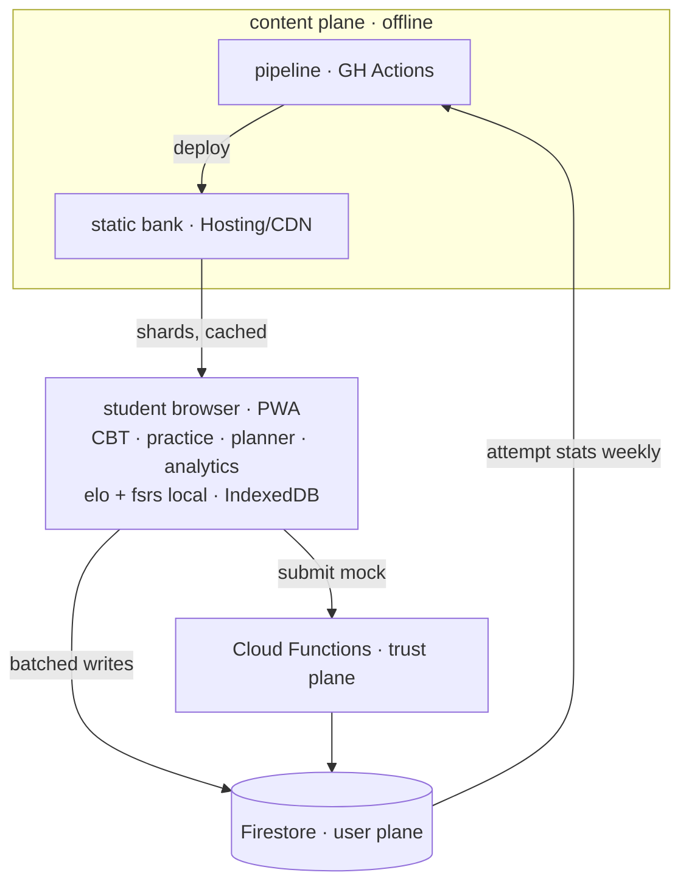

# 02 · Architecture

## three planes
- **content** (read-mostly, same for all): bank shards, blueprints, taxonomy, item stats, images → built offline, static on Hosting/CDN, cached in IndexedDB by version.
- **user** (per user): profile, mastery, sessions, plans, mocks, pace → Firestore, rules = owner only.
- **trust** (server only): mock keys + grading, moderation, leaderboards, kill-switch, daily digest → Cloud Functions.

## firebase budget (VERIFY quotas at build time)
- Spark: 50k reads / 20k writes / 20k deletes per day, 1 GiB. Cloud Storage + Functions need **Blaze** (free quotas still apply). → go Blaze + ₹500 budget alert + kill-switch fn.
- images: bundle with Hosting (content-addressed webp) or Cloudflare R2. not Cloud Storage.
- per active user/day target: ~5–10 reads, ~5–8 writes → ~2,500 DAU inside free writes.
| action | reads | writes |
|---|---|---|
| app open (profile, mastery, plan) | 3 | 0 |
| practice session (1 batched doc) | 0 | 1–2 |
| end-of-session mastery + plan | 0 | 2 |
| mock | 1–2 | 2–3 |
| questions | 0 (CDN) | 0 |

## resilience
- CBT state (paper + responses + timer) in IndexedDB; refresh / network drop / crash resumes same second. submit retries until server ack.
- firestore offline persistence on; event queue flushes on reconnect.

## security
- rules: `users/{uid}/**` owner only; `papers` read signed-in, write admin; `uploads` create validated, update admin; `leaderboards` function-only.
- App Check (reCAPTCHA v3). callable functions verify auth + App Check.
- leaderboard scores only from server re-grading of raw responses.

## pipeline (python)
acquire (sha256 + source meta) → extract (vision LLM, same schema as user prompt; Marker/MinerU fallback) → validate (zod-equivalent schema, KaTeX render test, answer∈options) → key join (final official keys; mismatch → quarantine) → dedupe (normalise, MinHash/SimHash + embeddings cos>0.93, merge `appearances`) → tag (LLM enum + kNN + rules, 2/3 agree else review) → seed difficulty → publish shards + manifest → deploy.

## repo + env
see CLAUDE.md layout. envs: `dev` (emulators), `staging`, `prod` firebase projects. secrets via GH Actions secrets, never committed.
