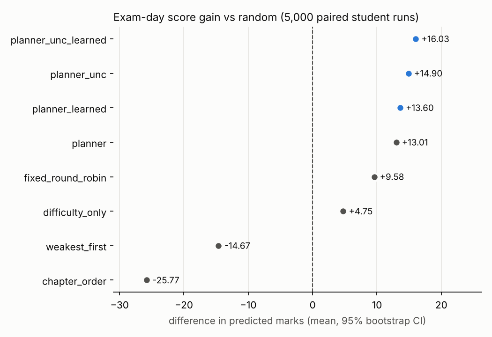
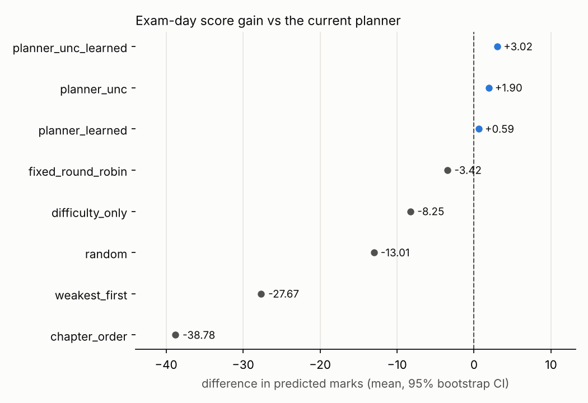
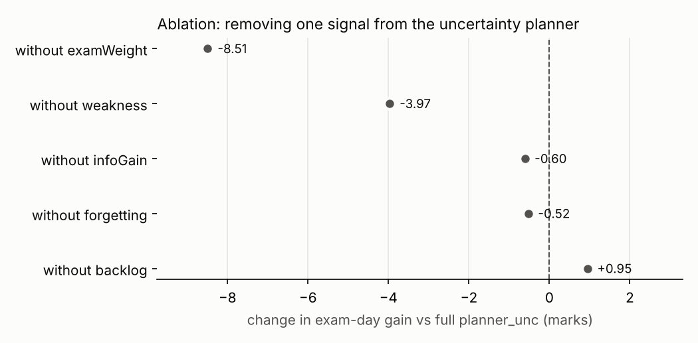
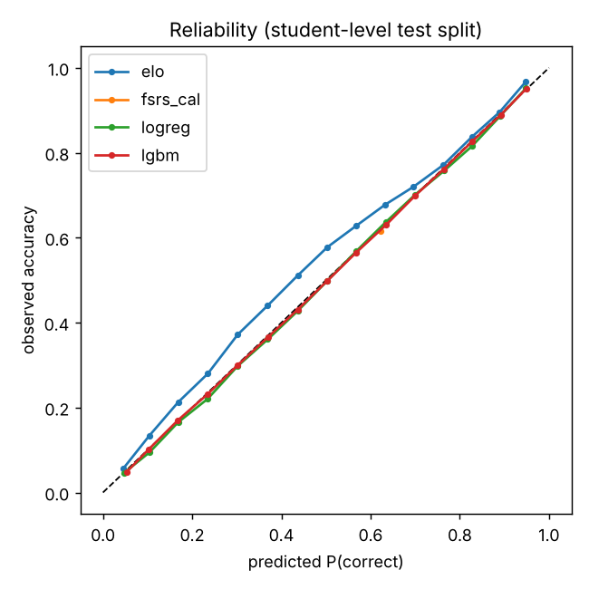

# Results: ML upgrade study (docs/17)

All numbers below come from the JSON files in this folder, produced by the commands in **Reproduce**. Synthetic students only (`core/src/sim`): no real user data was collected or used.

Files: `sim_baselines.json` (Phase A), `sim_planner.json` (Phase E comparison), `sim_ablation.json` (Phase E ablation), `recall_model/` (Phase C: `metrics.json`, `ablation.json`, `reliability.json`, `reliability.png`), plots `policy_gain.png`, `policy_gain_vs_planner.png`, `ablation.png`.

## Headline

- **Learned recall model vs Elo** (held-out students, 660k attempts): logistic regression log-loss **0.6098 vs 0.6330** (Δ −0.0232, 95% CI [−0.0243, −0.0222], bootstrap over students), ECE **0.0047** vs 0.0498, AUC 0.686 vs 0.648. It closes ~44% of the gap between Elo and the oracle (the sim's true P, log-loss 0.5808). Temporal split (train days < 69, test later days of unseen students): 0.5892 vs 0.6163, ECE 0.011. **Gate met** (beats Elo on student-split log-loss with ECE < 0.05).
- **Planner**: the uncertainty-aware planner using the learned model (`planner_unc_learned`) gains **+3.02 marks** at exam day over the current planner (95% CI [2.95, 3.08], positive in 5/5 seeds) and beats every baseline with a CI excluding 0; it also cuts wasted practice minutes by 76 (−19%). Each piece helps on its own: uncertainty priority with Elo +1.90 [1.83, 1.96]; learned model with the heuristic priority +0.59 [0.53, 0.66].
- **Defaults unchanged**: Elo and the heuristic priority stay the product default; both new paths are behind app flags (off).

## Setup

- Simulator: 96 topics (3 subjects × 8 chapters × 4 topics), 24-item banks, blueprint-weighted 90-question paper (+4/−1). Students have per-topic true ability, item-level learning (largest near P≈0.5, saturating), FSRS-like forgetting with spacing benefit, and day-to-day completion noise. 100-day runway, 180 min weekdays / 240 Saturday / Sunday off, mocks per the schedule.
- Design: **paired** — within a seed every policy sees the same students (abilities, learning rates, forgetting, completion) and the same world. Seeds 1–5 each change both world and students. 1,000 students per seed → 5,000 paired runs per policy.
- Statistics: mean over all runs; 95% percentile bootstrap (2,000 replicates) resampling students *within* each seed; paired differences bootstrap the per-student differences. "k/5" = seeds whose own mean difference is > 0.
- Metrics: **gain** = predicted exam-day score (true ability) − start; **retention** = exam-weighted mean memory retention at exam day over practised topics; **wasted min** = practice minutes on items with true P > 0.9 or < 0.2 (mocks excluded); **mean score gain over runway** = area under the score curve per day; **practice min** = minutes actually practised.

### Policies
| name | what it does |
|---|---|
| `random` | random topics in chunks of 8, items at estimated P≈0.65 |
| `fixed_round_robin` | every topic in syllabus order, 6 items each, cycling |
| `difficulty_only` | random topics, items at estimated P≈0.5 |
| `weakest_first` | lowest estimated mastery first, 8 items per topic |
| `chapter_order` | syllabus order, equal share per topic, then move on |
| `planner` | product planner (docs/05 5.5), Elo, heuristic priority |
| `planner_learned` | planner with mastery and item targeting from the learned model |
| `planner_unc` | planner with `priorityMode: 'uncertainty'` (Elo) |
| `planner_unc_learned` | both |

## Phase A + E: policy comparison (`sim_planner.json`; baselines identical to `sim_baselines.json`)

| policy | exam-day gain (marks) | 95% CI | vs random (paired) | 95% CI | retention at exam | wasted min | practice min | mean score gain over runway |
|---|---|---|---|---|---|---|---|---|
| `planner_unc_learned` | 131.62 | [131.17, 132.04] | +16.03 | [15.91, 16.14] | 0.9610 | 318 | 10529 | 78.01 |
| `planner_unc` | 130.49 | [130.06, 130.91] | +14.90 | [14.79, 15.02] | 0.9602 | 383 | 10528 | 77.87 |
| `planner_learned` | 129.19 | [128.74, 129.67] | +13.60 | [13.49, 13.72] | 0.9626 | 327 | 10530 | 74.70 |
| `planner` | 128.60 | [128.16, 129.02] | +13.01 | [12.90, 13.11] | 0.9619 | 394 | 10528 | 74.75 |
| `fixed_round_robin` | 125.17 | [124.67, 125.66] | +9.58 | [9.48, 9.68] | 0.9777 | 336 | 11151 | 68.03 |
| `difficulty_only` | 120.34 | [119.87, 120.83] | +4.75 | [4.65, 4.86] | 0.9566 | 557 | 11148 | 65.05 |
| `random` | 115.59 | [115.11, 116.06] | — | — | 0.9566 | 351 | 11148 | 62.70 |
| `weakest_first` | 100.92 | [100.53, 101.32] | -14.67 | [-14.89, -14.46] | 0.9186 | 363 | 11147 | 57.99 |
| `chapter_order` | 89.82 | [89.44, 90.19] | -25.77 | [-25.92, -25.63] | 0.8993 | 1050 | 11117 | 43.86 |



Paired gain differences (mean, 95% CI, seeds positive):

| policy | vs `random` | vs `fixed_round_robin` | vs `difficulty_only` | vs `weakest_first` | vs `chapter_order` | vs `planner` |
|---|---|---|---|---|---|---|
| `planner` | +13.01 [12.90, 13.11] (5/5) | +3.42 [3.31, 3.53] (5/5) | +8.25 [8.13, 8.38] (5/5) | +27.67 [27.49, 27.86] (5/5) | +38.78 [38.62, 38.93] (5/5) | — |
| `planner_learned` | +13.60 [13.49, 13.72] (5/5) | +4.02 [3.91, 4.13] (5/5) | +8.85 [8.72, 8.98] (5/5) | +28.27 [28.08, 28.45] (5/5) | +39.37 [39.21, 39.54] (5/5) | +0.59 [0.53, 0.66] (5/5) |
| `planner_unc` | +14.90 [14.79, 15.02] (5/5) | +5.32 [5.21, 5.44] (5/5) | +10.15 [10.01, 10.28] (5/5) | +29.57 [29.38, 29.76] (5/5) | +40.68 [40.53, 40.83] (5/5) | +1.90 [1.83, 1.96] (5/5) |
| `planner_unc_learned` | +16.03 [15.91, 16.14] (5/5) | +6.44 [6.33, 6.56] (5/5) | +11.27 [11.14, 11.40] (5/5) | +30.69 [30.51, 30.88] (5/5) | +41.80 [41.65, 41.96] (5/5) | +3.02 [2.95, 3.08] (5/5) |

Other metrics vs `planner`:

| policy | Δ wasted min | 95% CI | Δ retention | 95% CI |
|---|---|---|---|---|
| `planner_learned` | -66.7 | [-69.9, -63.4] | +0.0007 | [0.0005, 0.0009] |
| `planner_unc` | -10.8 | [-12.8, -8.8] | -0.0017 | [-0.0019, -0.0015] |
| `planner_unc_learned` | -75.7 | [-78.9, -72.5] | -0.0009 | [-0.0011, -0.0007] |



## Phase E: ablation (`sim_ablation.json`)

Each row switches one signal of the uncertainty priority off (`signals`), or disables carry-over of unfinished work (`carryCap: 0`).

| variant (one signal off) | gain | Δ vs `planner_unc` | 95% CI | seeds with Δ>0 |
|---|---|---|---|---|
| `planner_unc` (all signals) | 130.49 | — | — | — |
| `planner_unc_no_examWeight` | 121.99 | -8.51 | [-8.60, -8.42] | 0/5 |
| `planner_unc_no_weakness` | 126.52 | -3.97 | [-4.05, -3.89] | 0/5 |
| `planner_unc_no_infoGain` | 129.89 | -0.60 | [-0.66, -0.54] | 0/5 |
| `planner_unc_no_forgetting` | 129.97 | -0.52 | [-0.58, -0.46] | 0/5 |
| `planner_unc_no_backlog` | 131.44 | +0.95 | [0.89, 1.02] | 5/5 |



## Phase C: learned recall model (`recall_model/`)

Data: `sim:export`, 300 students × 3 policies (`random`, `weakest_first`, `planner`) × 100 days, seed 2026 → 3,750,795 attempts (csv sha256 `8042e4b4…2dceb`). Split **by student** (sha256 of seed:sid): 70% train / 10% val / 20% test; temporal split: train students' days < 69, test students' days ≥ 69 (models refit). Features (13, closed-form of the on-device mastery doc + item b): see docs/05 5.12. Logistic regression C=0.1 chosen on val; LightGBM 15 leaves, early stopping (765 trees). Note the study above uses seeds 1–5, so the shipped model is evaluated on worlds and students it never saw, and on policies (`planner_learned`, `planner_unc_learned`) absent from its training data.

Student-level test split:

| model | rows | AUC | log-loss | Brier | ECE | Δ log-loss vs Elo [95% CI] |
|---|---|---|---|---|---|---|
| `elo` | 660446 | 0.6477 | 0.6330 | 0.2214 | 0.0498 | — |
| `fsrs_raw` | 660446 | 0.5441 | 1.2076 | 0.2921 | 0.2204 | +0.5745 [0.5621, 0.5870] |
| `fsrs_cal` | 660446 | 0.4559 | 0.6664 | 0.2368 | 0.0065 | +0.0334 [0.0307, 0.0366] |
| `logreg` | 660446 | 0.6865 | 0.6098 | 0.2108 | 0.0047 | -0.0232 [-0.0243, -0.0222] |
| `lgbm` | 660446 | 0.6899 | 0.6079 | 0.2100 | 0.0030 | -0.0252 [-0.0264, -0.0240] |
| `oracle_p_true` | 660446 | 0.7294 | 0.5808 | 0.1982 | 0.0019 | — |

Temporal split:

| model | rows | AUC | log-loss | Brier | ECE | Δ log-loss vs Elo [95% CI] |
|---|---|---|---|---|---|---|
| `elo` | 200166 | 0.6619 | 0.6163 | 0.2135 | 0.0972 | — |
| `fsrs_raw` | 200166 | 0.5592 | 0.8497 | 0.2570 | 0.1749 | +0.2335 [0.2253, 0.2414] |
| `fsrs_cal` | 200166 | 0.4408 | 0.6468 | 0.2271 | 0.0612 | +0.0306 [0.0285, 0.0330] |
| `logreg` | 200166 | 0.6742 | 0.5892 | 0.2012 | 0.0112 | -0.0271 [-0.0290, -0.0254] |
| `lgbm` | 200166 | 0.6801 | 0.5866 | 0.2002 | 0.0126 | -0.0296 [-0.0313, -0.0281] |
| `oracle_p_true` | 200166 | 0.7062 | 0.5718 | 0.1940 | 0.0034 | — |



**Shipped: logistic regression**, not LightGBM. LightGBM is 0.002 better in log-loss (CI of the difference vs Elo overlaps logreg's) but is 765 trees / 1.4 MB of JSON against 13 coefficients; the client scorer is a dot product. `core/src/measure/learned.weights.json` records version, seed, data hash, export command and these metrics; a golden test checks the TS scorer against Python on 8 fixed vectors to 1e-9.

Feature ablation (logreg refit without each feature, student test split):

| feature dropped | Δ test log-loss |
|---|---|
| `log_k` | +0.00101 |
| `x_elo` | +0.00084 |
| `unseen` | +0.00066 |
| `rd` | +0.00064 |
| `err` | +0.00008 |
| `log_days` | +0.00007 |
| `b` | +0.00003 |
| `log_s` | +0.00003 |
| `log_n` | +0.00002 |
| `x_elo_r` | +0.00001 |
| `r` | +0.00001 |
| `one_minus_r` | +0.00001 |
| `x_elo_rd` | -0.00000 |

## Reproduce

Versions: Node 22, pnpm 12, Python 3.11.18 (numpy 2.4.6, pandas 3.1.1, scikit-learn 1.9.1, lightgbm 4.7.0, matplotlib 3.11.2; `pipeline/ml/requirements.txt`). From the repo root:

```bash
pnpm install
```

```bash
/usr/bin/python3.11 -m venv pipeline/ml/.venv && pipeline/ml/.venv/bin/pip install -r pipeline/ml/requirements.txt
```

Phase A baselines (~8 min on 3 cores):

```bash
pnpm sim:study -- --students 1000 --seeds 1,2,3,4,5 --days 100 --jobs 3 --out ../docs/results/sim_baselines.json
```

Phase C data + training (export ~1 min; training tens of minutes on 4 shared cores, most of it the feature ablation — add `--no-ablation` to skip) + weights export:

```bash
pnpm sim:export -- --students 300 --seed 2026 --days 100 --chunk 50 --policies random,weakest_first,planner --out ../pipeline/ml/data/sim_attempts.csv
```

```bash
pipeline/ml/.venv/bin/python -m pipeline.ml.train --data pipeline/ml/data/sim_attempts.csv --seed 2026 --out pipeline/ml/out
```

```bash
pipeline/ml/.venv/bin/python -m pipeline.ml.export_weights --model pipeline/ml/out/logreg.pkl --out core/src/measure/learned.weights.json --sim-command "pnpm --filter @kairos/core sim:export -- --students 300 --seed 2026 --days 100 --chunk 50 --policies random,weakest_first,planner --out ../pipeline/ml/data/sim_attempts.csv"
```

Phase E comparison (~22 min on 4 cores) and ablation (~14 min):

```bash
pnpm sim:study -- --students 1000 --seeds 1,2,3,4,5 --days 100 --jobs 4 --policies random,fixed_round_robin,difficulty_only,weakest_first,chapter_order,planner,planner_unc,planner_learned,planner_unc_learned --baselines random,fixed_round_robin,difficulty_only,weakest_first,chapter_order,planner --out ../docs/results/sim_planner.json
```

```bash
pnpm sim:study -- --students 1000 --seeds 1,2,3,4,5 --days 100 --jobs 4 --policies planner_unc,planner_unc_no_examWeight,planner_unc_no_weakness,planner_unc_no_infoGain,planner_unc_no_forgetting,planner_unc_no_backlog --baselines planner_unc --out ../docs/results/sim_ablation.json
```

Plots:

```bash
pipeline/ml/.venv/bin/python -m pipeline.ml.plot_results
```

Everything is deterministic given the seeds: the baseline rows in `sim_planner.json` reproduce `sim_baselines.json` exactly, and a second training run reproduced `metrics.json` exactly. Only `generated` and `runtimeSec` vary.

### Turning the flags on
Off by default. Build-time `VITE_FLAG_LEARNED_RECALL=1` and/or `VITE_FLAG_UNCERTAINTY_PLANNER=1`, or per device `localStorage.setItem('kairos.flag.learnedRecall', '1')` / `'kairos.flag.uncertaintyPlanner'`. `learnedRecall` switches practice item picking (`buildTodayQueue`) and planner mastery to the learned model; `uncertaintyPlanner` sets `priorityMode: 'uncertainty'`. With both off the code paths are the original Elo ones. In core: `PlannerConfig.recallModel` / `priorityMode`, `predictRecall(t, b, now, { model })`.

## Limitations and negative results

- **Simulation only.** Every result is on synthetic students whose answer model (1PL with learning and FSRS-like forgetting) is close to the model family we fit, which flatters both Elo and the learned model. The margin on real students is unknown and may be smaller; real-data results would need opt-in exports and should be called preliminary.
- **The sim and the planner share assumptions** (e.g. desirable difficulty near P≈0.5, topic weights known exactly). Gains against baselines partly reflect that the planner was designed for this world. Robustness to other sim parameters (learning rate, forgetting, guess rate) was not swept — a follow-up.
- **Planners practise ~6% fewer minutes** than the baselines (10,528 vs ~11,148) because of the ±15% load rule, buffers and taper; the planner wins despite less practice, but per-minute efficiency is not separately reported.
- **Retention**: `fixed_round_robin` has the best exam-day retention (0.978) yet lower gain; the uncertainty priority slightly *lowers* retention vs `planner` (−0.0017, CI excludes 0) while raising gain. Retention is not what the exam scores.
- **Negative result: carry-over of unfinished work.** Disabling backlog carry-over (`carryCap: 0`) *improves* gain by +0.95 [0.89, 1.02] and cuts wasted minutes. In the sim, re-doing yesterday's unfinished task is worse than re-planning from current estimates. The product keeps carry-over for now (it is a UX promise: skipped work is not silently dropped) — flagged for a follow-up study with a "re-plan instead of carry" variant.
- **Info gain and forgetting are small signals** (−0.60 and −0.52 marks when removed); exam weight (−8.5) and weakness (−4.0) carry most of the effect.
- **FSRS retrievability alone does not predict item correctness** in this sim: raw R is badly calibrated (log-loss 1.21) and the calibrated version has AUC < 0.5, i.e. a negative fitted slope. A plausible (unverified) reason is confounding: policies revisit weak topics more, so high R marks weak topics. R still adds a little inside the logistic model.
- **Elo calibration**: Elo is systematically underconfident (observed accuracy above predicted in the 0.2–0.7 range; ECE 0.050 student split, 0.097 temporal). Part of the learned model's gain is simply recalibration.
- **Within-session count is the most useful learned feature** (`log_k`): the sim learns item by item within a session while the mastery doc only updates at session end. In the app, `kInSession` is passed by `buildTodayQueue` per pick; the planner calls the model with `kInSession = 0`.
- **Not done**: Bayesian IRT (pymc/numpyro) and DKT/SAKT models (Phase C optional), "buffer days used" metric (Phase A), the Settings "Download my attempts (CSV)" button (Phase B; app session events have no typed attempt shape yet, so `toAttemptRows` has no clean source), and stretch phases D, F, G.

## Blockers

- **Push to GitHub refused (HTTP 403)** for this session ("Claude doesn't have GitHub access to 1mystic/Kairos"). All commits are on the local branch `feat/ml-upgrade`; push once access is restored.
- **Pre-existing failures on `main`, unchanged by this branch**: 7 app tests fail (`src/practice/{mine,screens,summary}.test.tsx` — "useStore must be used inside StoreProvider"; `src/saved/saved.test.tsx`; `src/styles/consistency.test.ts`), and `pnpm lint` reports 212 errors, all in the committed build output `app/public/dryrun/`. Verified identical on `main` (83a0f94). Not fixed here (out of scope).
- `core/scripts/*.ts` are not covered by `tsc -p core` (core has no Node types); they are linted and exercised by every study run.

## Ethics and privacy

Training data is synthetic. The attempt table (docs/03) has no uid and no free text; real-user export would be opt-in, on-device, never uploaded automatically, and minors' data stays on the device without consent (DPDP). The learned model uses no demographic features; it sees only the student's own mastery state and item difficulty. The model ships as static JSON and runs on the client (Spark plan, no server inference).
